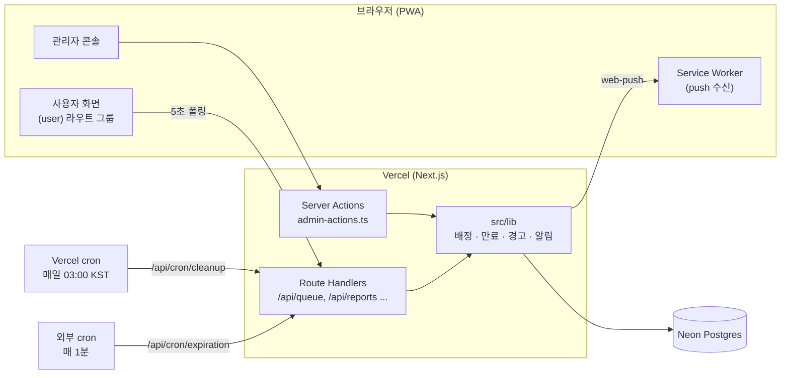
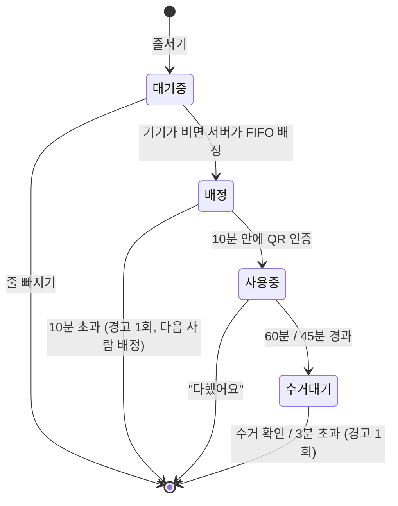

> **TL;DR**
> - 기숙사 공용 세탁기·건조기를 **원격으로 줄 서고, 서버가 순서대로 자동 배정하고, QR로 사용을 시작하는** 웹 서비스 *Washed*를 4인 팀이 약 2주(2026-09-11 ~ 09-22) 동안 만들었습니다.
> - 스택: Next.js 16(App Router) · React 19 · TypeScript · Tailwind CSS v4 · Neon Postgres · Auth.js v5 · Web Push · Vercel
> - 숫자: GitHub Issue 42개, PR 59개(54개 merge), DB migration 14개, 자동 테스트 **359개 전부 통과**
> - 가장 많이 고민한 점은 **"트랜잭션을 쓸 수 없는 환경에서 동시 요청을 어떻게 공정하게 처리할까"** 였습니다. 답은 *SQL 한 문장 = 한 트랜잭션* 원칙과 DB 제약이었습니다.

---

## 1. 왜 만들었나 — 문제 정의

기숙사 세탁실을 써 본 사람이라면 아래 상황이 익숙할 겁니다.

1. **비어 있는지 보려면 내려가 봐야 한다.** 원격으로 확인할 방법이 없습니다.
2. **남은 시간을 모른다.** 그래서 같은 날 몇 번씩 세탁실을 오갑니다.
3. **공정한 순서가 없다.** 먼저 세탁물을 넣는 사람이 임자입니다.
4. 그래서 생긴 우회책이 **"빨래 바구니로 자리 맡기"** 입니다.

런드리고, 세탁특공대처럼 세탁물을 맡기는 서비스는 있지만 **공용 세탁기의 대기 순서**를 다루는 서비스는 찾지 못했습니다. 그래서 문제를 이렇게 좁혔습니다.

> "세탁실에 가지 않고도 줄을 서고, 내 차례가 오면 알림을 받고, 정해진 시간 안에 와서 쓰고, 다 쓰면 바로 다음 사람에게 넘어가게 하자."

**대상 사용자**

| 구분 | 누구 | 하는 일 |
|---|---|---|
| A1 | 기숙사 학생 (한국어를 읽지 못하는 유학생 포함) | 줄서기, QR 인증, 사용, 신고 |
| A2 | 기숙사 행정실 | 기기 상태 관리, 경고·제한, 공지, 신고 처리 |
| A3 | 수리 기사 | 고장 기기 확인 |

---

## 2. 목표와 요구사항

### 2-1. 기획 문서 체계

코드부터 짜지 않고 `docs/` 아래에 기획 문서를 순서대로 쌓았습니다.

```
01-problem   문제 정의 · 유사 서비스 비교
02-workflow  As-Is / To-Be 업무 흐름 (S1~S13)
03-requirements  요구사항 R1~R38 (우선순위 상/중/하)
04-features  기능 F1~F41 (MVP / v2 구분)
05-policy    정책 P1~P26, 서비스 정책 SP1~SP9
06-data      저장 항목 · 파생값
07-screens   화면 9개 · 이동 표 · 공통 인수 조건
08-deployNOTE  프로토타입 → 서버/DB 전환 설계
PRD          위 문서를 묶은 최종 문서
```

모든 항목에 **R/F/P ID**를 붙여 서로 참조하게 했습니다. 예를 들어 코드 주석에도 `05 P6`처럼 정책 번호를 남겨서, 나중에 코드를 읽는 사람이 "이 조건이 왜 있지?"를 문서로 거슬러 올라갈 수 있게 했습니다. 문서에서 정해지지 않은 부분은 `[?]`, AI나 팀원이 낸 아이디어는 `[제안]`으로 표시해서 **확정된 정책과 아이디어를 섞지 않았습니다.**

### 2-2. 기능 요구사항 (MVP)

- 원격 줄서기: 세탁기 1줄 + 건조기 1줄, 1인 최대 2줄
- **FIFO 자동 배정**: 같은 종류에서 가장 먼저 비는 기기를 서버가 배정합니다. 호기는 고를 수 없습니다.
- **QR 체크인**: 배정된 기기 앞에서 QR을 찍어야 타이머가 시작됩니다.
- "다했어요" 버튼으로 사용 종료, 수거 확인
- 웹 푸시 알림과 알림함
- 신고(세탁물 방치 등, 사진 첨부), 문의
- 관리자 콘솔: 기기 상태, 세탁실 점검 모드, 경고·제한, 공지, 신고 처리
- 회원: `ac.kr` 학교 이메일 가입(이메일 인증 코드), Google 로그인, 탈퇴
- 4개 언어(한국어, 영어, 중국어, 일본어)

### 2-3. 핵심 정책 수치

이 서비스는 **시간 규칙**이 곧 비즈니스 로직입니다.

| 규칙 | 값 |
|---|---|
| 배정 후 QR 인증 제한시간 | **10분** (놓치면 경고 1회, 다음 사람에게 넘어감) |
| 사용 시간 | 세탁기 **60분**, 건조기 **45분** |
| 종료 후 수거 유예 | **3분** (놓치면 경고 1회) |
| 같은 사건에서 여러 위반 | **사건당 경고 1회**로 통합 |
| 경고 누적 | **3회 → 3일간 줄서기 제한**, 이후 0회로 초기화 |
| 월간 초기화 | 매월 1일(KST) 경고·제한 초기화 |
| 인증 코드 | 6자리, 5분 유효, 5회 오입력 제한, 재전송 60초 |
| 탈퇴 | 즉시 이용 중지, 14일 내 복구 가능, 이후 삭제 |
| 점검 모드 | 새 줄서기·배정 차단, 진행 중인 사용은 유지 |

### 2-4. 비기능 요구사항

- **판정은 서버 시간으로**: 만료, 경고, 배정은 모두 DB의 `now()` 기준입니다. 클라이언트 시계는 화면 표시 보정에만 씁니다.
- **보안**: 학교 이메일 확인은 서버에서 합니다. Google의 `hd` 파라미터는 UI 힌트로만 씁니다. 제재 정보는 서버에만 둡니다.
- **개인정보 최소화**: 전화번호는 받지 않습니다. 데이터별 보존 기간을 정했습니다(알림 30일, 이용기록·신고 3개월, 경고 기록 1개월 등).
- **반응형**: 사용자 화면은 390×844 기준, 최대 너비 430px. 관리자 콘솔은 데스크톱 전용입니다.
- **다국어**: 사전 키가 언어마다 395개이고, `satisfies Dictionary`로 빠진 키를 컴파일 단계에서 잡습니다.

---

## 3. 구조 설계

### 3-1. 기술 스택과 선택 이유

| 영역 | 선택 | 이유 |
|---|---|---|
| 프레임워크 | Next.js 16 (App Router), React 19 | 화면과 API(Route Handler), Server Action을 한 저장소에서 관리 |
| 언어 / 스타일 | TypeScript, Tailwind CSS v4 | 타입으로 상태값 오타 방지, 디자인 토큰 적용이 빠름 |
| DB | Neon Postgres (`@neondatabase/serverless`) | 서버리스 환경에 맞는 HTTP 드라이버, PR별 DB branch |
| 인증 | Auth.js v5 (JWT, Credentials + Google) | 세션 테이블 없이 쿠키로 처리 |
| 알림 | `web-push` (VAPID), Service Worker, PWA | 앱 설치 없이 휴대폰 푸시 |
| 메일 | Resend | 가입·비밀번호 재설정 인증 코드 |
| 배포 | Vercel | PR마다 preview 배포 |
| 테스트 | Node 내장 `node:test` + PGlite | 실제 Postgres 스키마로 테스트 (7장) |
| 디자인 | Claude Design 프로토타입(`.dc.html`) → React | Figma 없이 화면 13종 설계 |

### 3-2. 전체 구조



```
src/
├─ app/
│  ├─ (user)/        학생 화면 (home, history, notifications, settings ...)
│  ├─ admin/         관리자 콘솔
│  └─ api/           queue, machines, reports, push, cron ...
├─ lib/              DB 접근 · 정책 · 서버 비즈니스 로직
│  ├─ assignment.ts      배정 SQL (drainQueue)
│  ├─ usage.ts           QR 인증 · 사용 종료
│  ├─ expiration.ts      만료 스윕 · 자동 경고
│  ├─ scheduler.ts       스윕 실행 순서
│  └─ i18n/              4개 언어 사전
└─ components/       공용 UI
db/
├─ schema.sql        전체 스키마
└─ migrations/       0001 ~ 0015
```

### 3-3. 상태 머신

줄서기 한 건(queue 행 하나)이 곧 하나의 **사건**입니다.



"종료"는 상태값으로 저장하지 않습니다. **행을 지우고**, 기록은 `usage_history`와 `warnings`에 남깁니다. 기기 쪽 상태는 `사용가능 ↔ 사용중`이 기본이고, `고장`과 `점검중`은 관리자만 바꿉니다.

### 3-4. 핵심 설계 원칙: "SQL 한 문장 = 한 트랜잭션"

Neon의 serverless HTTP 드라이버는 요청 하나에 SQL 문장 하나를 보냅니다. 여러 문장을 `BEGIN … COMMIT`으로 묶을 수 없습니다. 그런데 배정은 이런 일을 **원자적으로** 해야 합니다.

- 빈 기기와 대기자를 고른다
- 대기자를 `배정` 상태로 바꾼다
- 기기를 `사용중`으로 바꾼다

그래서 모든 상태 전이를 **CTE(WITH 절) 하나짜리 SQL 문장**으로 작성했습니다. 그리고 세 겹으로 방어했습니다.

1. `FOR UPDATE` 잠금: 동시에 들어온 요청이 낡은 스냅샷으로 짝을 짓지 못하게 합니다.
2. 조건부 `UPDATE` / `DELETE`: `WHERE status = '대기 중'`처럼 기대한 상태일 때만 바꿉니다.
3. **부분 UNIQUE 인덱스**: 위 둘이 뚫려도 DB가 마지막으로 거부합니다(에러 23505).

---

## 4. 구현 과정

### 4-1. 타임라인

| 기간 | 단계 | 주요 내용 |
|---|---|---|
| 09-11 ~ 09-15 | **0. 기획 · 디자인** | 기획 문서 01~05와 PRD, Claude Design 프로토타입, 로그인·이메일 인증·알림 초기 백엔드 |
| 09-16 | **1. 핵심 기능** | Issue·PR 템플릿 도입. 하루에 PR 7개 merge: 로그인, DB 기반 홈 화면, 줄서기 API, **서버 배정**, 이용기록, 신고, 데이터 보존·탈퇴 |
| 09-17 ~ 09-18 | **2. 기능 완성 · 첫 수정** | QR 인증, "다했어요", 만료 스케줄러 v1, 푸시 알림, 세션 리팩터링. 관리자 기능. 통합 브랜치를 `integration-total`에서 `dev`로 전환 |
| 09-19 ~ 09-21 | **3. 안정화 · 테스트** | migration 상태 자동 점검, 조회와 쓰기 분리, 자동 경고 스케줄러 완성, 1분 주기 실행, 상태 전이 E2E 테스트, UI·로직 수정 |
| 09-21 ~ 09-22 | **4. 릴리스** | 스플래시, 4개 언어, 반응형 레이아웃, `dev → main` 릴리스 |
| 09-27 | **이후** | 보안 보강: 가입 코드 API의 이메일 존재 여부 노출 차단, 신고 사진 파일의 magic byte 검사 |

처음에는 localStorage로 동작하는 프로토타입이었고, 이를 서버와 DB로 옮기는 것이 전체 작업의 뼈대였습니다. 회고 표로 정리하면 이렇습니다.

| 프로토타입 | 최종 |
|---|---|
| localStorage에 상태 저장 | 서버 DB(Neon Postgres) |
| 클라이언트가 배정 | 서버·DB가 배정 |
| 브라우저 타이머로 만료 판정 | cron 스케줄러가 서버 시간으로 판정 |
| 조회(GET) 요청이 상태도 변경 | 조회와 쓰기 분리 (`POST /api/queue/sweep`) |
| 브라우저 알림 권한 = 푸시 구독으로 간주 | 권한과 실제 구독을 따로 관리 |

### 4-2. 대표 구현 ① 공정한 배정: `drainQueue()`

줄서기 요청은 두 단계로 처리합니다. **먼저 무조건 `대기 중`으로 넣고, 그다음 `drainQueue()`가 대기열 전체를 순서대로 배정합니다.** 실제 SQL의 핵심만 줄이면 이렇습니다.

```sql
WITH
locked_free AS MATERIALIZED (          -- 1) 지금 배정 가능한 기기를 잠근다
  SELECT m.machine_id, m.kind, m.name
    FROM machines m
   WHERE m.status = '사용가능'
     AND NOT EXISTS (SELECT 1 FROM queue q WHERE q.machine_id = m.machine_id)
   ORDER BY m.kind, m.name
     FOR UPDATE
),
locked_waiting AS MATERIALIZED (       -- 2) 줄 선 순서대로 대기자를 잠근다
  SELECT q.queue_id, q.user_id, q.machine_kind, q.queued_at
    FROM queue q
   WHERE q.status = '대기 중'
   ORDER BY q.machine_kind, q.queued_at, q.queue_id
     FOR UPDATE
),
free AS (SELECT *, row_number() OVER (PARTITION BY kind ORDER BY name) AS rn FROM locked_free),
waiting AS (SELECT *, row_number() OVER (PARTITION BY machine_kind ORDER BY queued_at, queue_id) AS rn FROM locked_waiting),
pairs AS (                             -- 3) 종류별 k번째 대기자 ↔ k번째 기기
  SELECT w.queue_id, f.machine_id
    FROM waiting w JOIN free f ON f.kind = w.machine_kind AND f.rn = w.rn
),
assigned AS (                          -- 4) 줄서기를 먼저 '배정'으로 (서버 시각만 사용)
  UPDATE queue q
     SET machine_id = p.machine_id, status = '배정',
         assigned_at = now(),
         assign_deadline_at = now() + interval '10 minutes'
    FROM pairs p
   WHERE q.queue_id = p.queue_id AND q.status = '대기 중'
  RETURNING q.queue_id, q.machine_id
)
UPDATE machines m SET status = '사용중'  -- 5) 실제로 배정된 줄의 기기만 잡는다
  FROM assigned a WHERE m.machine_id = a.machine_id;
```

포인트는 이렇습니다.

- 윈도 함수(`row_number`)와 `FOR UPDATE`는 같은 SELECT에 쓸 수 없어서 `MATERIALIZED` CTE로 층을 나눴습니다.
- READ COMMITTED에서 `FOR UPDATE`는 잠금을 기다렸다가 깨어날 때 **최신 행으로 WHERE를 다시 평가합니다.** 그래서 두 요청이 같은 기기를 동시에 잡는 일이 없습니다.
- 줄서기를 먼저 쓰고 기기를 나중에 씁니다. 둘이 어긋나도 **주인 없는 `사용중` 기기**가 생기지 않게 하려는 순서입니다.
- 같은 규칙을 순수 함수 `pairWaitersWithMachines()`로도 만들어 DB 없이 단위 테스트합니다.

### 4-3. 대표 구현 ② 위조 방지 QR

기기마다 고정 QR을 붙이되 서버만 아는 비밀키로 서명합니다.

```ts
// 형식: washed.v1.<machineId>.<HMAC-SHA256(base64url)>
function sign(machineId: string): string {
  return createHmac('sha256', secret())
    .update(`${PREFIX}.${VERSION}.${machineId}`)
    .digest('base64url');
}

// 검증: 길이 비교 후 timingSafeEqual 로 시간차 공격을 막는다
if (expected.length !== given.length || !timingSafeEqual(expected, given)) return null;
```

QR 인증 SQL 한 문장이 "내 배정인가, 맞는 기기인가, 상태가 `배정`인가, `assign_deadline_at > now()`인가"를 함께 확인하고, 타이머(`ends_at = now() + 60분/45분`)를 서버에서 설정합니다. 같은 QR을 다시 찍으면 `already_running` 경로로 빠져서 **타이머가 연장되지 않습니다(멱등).**

### 4-4. 대표 구현 ③ "사건당 경고 1회"를 DB가 보장

만료 스케줄러는 1분마다 돌고, 실패하면 재시도도 합니다. 관리자가 같은 사건에 직접 경고를 줄 수도 있습니다. 코드 분기만으로 "한 번만"을 지키기는 어렵다고 판단해서 **DB 제약으로 강제했습니다.**

```sql
-- 0012_warning_incident_key.sql
ALTER TABLE warnings
  ADD COLUMN IF NOT EXISTS incident_queue_id uuid NULL;

-- 같은 줄서기 사건을 가리키는 경고는 자동이든 관리자든 DB가 두 번째를 거부한다(23505).
CREATE UNIQUE INDEX IF NOT EXISTS warnings_incident_queue_id_idx
  ON warnings (incident_queue_id)
  WHERE incident_queue_id IS NOT NULL;
```

- 경고 삽입과 누적 횟수 증가를 CTE 하나로 묶었습니다. 23505가 나면 "이미 경고가 있는 사건"으로 보고 조용히 넘어가며, 횟수도 올리지 않습니다.
- FK를 걸지 않은 이유도 migration에 적어 두었습니다. 경고를 쓰는 시점에는 queue 행이 이미 삭제된 뒤여서, `ON DELETE SET NULL`을 걸면 UNIQUE가 무의미해지기 때문입니다.

---

## 5. 트러블슈팅

### ① 늦게 온 사람이 먼저 배정받는다

- **증상**: 빈 기기가 있을 때 새로 들어온 요청이 이미 기다리던 사람보다 먼저 기기를 잡았습니다.
- **원인**: "빈 기기가 있으면 바로 배정"이라는 지름길이 대기열 순서를 무시했습니다.
- **해결**: 모든 요청을 먼저 `대기 중`으로 넣고 `drainQueue()`가 순서대로 배정하는 2단계로 바꿨습니다. 10분 마감 시각도 클라이언트 시계에서 서버 `now()`로 옮겼습니다.

### ② 같은 사건에 경고가 두 번

- **원인**: 자동 경고와 관리자 경고가 서로를 모르고, 스케줄러가 재실행되면서 중복 창이 생겼습니다.
- **해결**: 위의 `incident_queue_id` 부분 UNIQUE 인덱스. 처음에는 기존 데이터를 backfill하는 방식도 검토했지만, 적용하는 사이에 경고가 두 번 써질 수 있는 창이 남아서 폐기했습니다.

### ③ 같은 경고인데 시각이 다르다 (#65)

- **증상**: 관리자 화면과 알림함에 같은 경고의 시각이 다르게 보였습니다.
- **원인**: 경고 행과 알림 행이 각각 `now()`를 호출했습니다.
- **해결**: 경고의 `issued_at`을 `::text`로 받아(드라이버의 Date 변환과 절삭을 피함) 알림 생성에 그대로 넘겼습니다. 날짜 경계는 `seoulDayKey`로 KST 기준으로 통일했습니다.

### ④ 스케줄러를 만들었는데 돌지 않는다 (#66)

- **증상**: 만료된 배정이 홈 화면에 계속 남아 있었습니다.
- **원인**: 만료 처리 라우트는 만들었지만 **실행 일정을 걸지 않았습니다.**
- **해결**: Vercel Hobby 플랜의 cron은 하루 1회만 가능해서, 외부 cron 서비스가 1분마다 `/api/cron/expiration`을 `Bearer CRON_SECRET`으로 호출하게 했습니다. 주기를 5분으로 하면 3분 수거 유예가 사실상 3~8분이 되므로 1분으로 정했습니다. 비밀키가 설정되지 않으면 모든 요청을 거부합니다(fail closed).
- **덤으로 찾은 문제**: 월간 경고 초기화를 1분 스윕에 넣으면 1일 하루 종일 새 경고를 계속 지워 버립니다. 그래서 하루 1회 cleanup에만 둡니다.

### ⑤ 예상 배정 시각이 0:00에서 멈춘다 (#85)

- **원인**: 대기 시간 계산이 3분 수거 유예를 빼먹었습니다.
- **해결**: `PICKUP_GRACE_MINUTES` 공통 상수를 만들어 계산과 정책이 같은 값을 쓰게 하고, 회귀 테스트 11개를 추가했습니다.

### ⑥ 조회가 상태를 바꾼다 (#35)

GET `/api/queue`가 조회하면서 만료 처리까지 하고 있었습니다. 캐시나 프리페치에 의해 의도치 않게 상태가 바뀔 수 있어서, 상태 변경은 `POST /api/queue/sweep`으로 분리했습니다.

---

## 6. 테스트와 검증

### 6-1. 전략: DB를 mock하지 않는다

이 서비스의 핵심 로직은 거의 다 **SQL 한 문장** 안에 있습니다. DB를 mock하면 테스트 대상 코드가 통째로 사라집니다. 그래서 다음처럼 구성했습니다.

- **PGlite**(WASM으로 컴파일한 Postgres)에 실제 `db/schema.sql`을 시나리오마다 새로 적용합니다.
- `@/lib/db`를 같은 tagged-template 인터페이스의 브리지로 바꿔서, **운영 코드의 실제 함수와 Route Handler를 그대로 호출**합니다.
- 브리지에 실행기가 설치되지 않으면 예외를 던집니다. DB를 거치지 않고 조용히 통과하는 테스트를 막기 위해서입니다.
- 테스트 러너는 별도 라이브러리 없이 Node 내장 `node:test`를 썼습니다.

### 6-2. 결과

| 항목 | 결과 |
|---|---|
| 테스트 파일 | 25개 |
| 테스트 | **359개 통과 / 0 실패 / 0 건너뜀** (81 suites, 약 27.6초) |
| 성장 | 09-16 기준 65개 → 최종 359개 |

**상태 전이 E2E (56 케이스)** 가 다루는 시나리오는 다음과 같습니다.

| 시나리오 | 확인하는 것 |
|---|---|
| 정상 사용 | 줄서기 → 배정 → QR → 사용 → 수거 |
| QR 미인증 | 10분 후 만료, 경고 정확히 1회, 다음 대기자에게 FIFO로 넘어감 |
| 대기자 없이 만료 | 기기가 깨끗이 `사용가능`으로 돌아옴 |
| 세탁 60분 / 건조 45분 | 수거대기 전환, 3분 유예 후 강제 종료 |
| 스케줄러 반복 실행 | 경고·이용기록·대기열 중복 없음, 마감 시각이 밀리지 않음, FIFO 유지 (**멱등성**) |
| 점검 모드 | 켜면 신규 배정 중단, 진행 중 사용은 유지, 끄면 순서대로 재개 |

E2E 테스트는 정책 수치(10분, 60분 등)를 상수 import가 아니라 **일부러 하드코딩**했습니다. 누군가 정책 상수를 바꾸면 테스트가 깨져서, 정책 변경이 조용히 통과하지 않게 하려는 의도입니다.

그 밖에 데이터 보존(36개), 다국어 콘텐츠(23개), 신고 규칙(20개), 문의(19개), 경고 시각 동기화(18개) 테스트가 있습니다.

### 6-3. PR 전 검증 루틴

모든 Issue 작업은 아래 순서를 거쳤습니다.

```
npx tsc --noEmit  →  npm run build  →  npm run lint  →  npm test  →  git diff / git status
```

- lint는 기존 오류(baseline)와 이번 변경으로 생긴 신규 오류를 구분하고, **신규 0건**을 확인합니다.
- DB migration은 `npm run db:migrate:status`(읽기 전용)로 dev / preview / production DB의 적용 상태를 확인하는 스크립트를 따로 만들었습니다. 접속 문자열 대신 SHA-256 지문만 출력합니다.
- DB에 쓰는 테스트는 **Neon test branch**에서 먼저 했습니다. 실행 전에 `current_setting('neon.branch_id', true)`로 실제 연결된 branch를 확인합니다.

### 6-4. 한계

- PGlite는 연결이 하나뿐이라 **진짜 동시 경합은 재현하지 못합니다.** 반복 실행 시 결과가 같은지(멱등성)까지만 검증했습니다.
- neon-http 드라이버 자체는 테스트하지 않았습니다.
- GitHub Actions 같은 **CI가 없어서** 위 검증 루틴은 사람(과 AI)이 수동으로 돌렸습니다.

---

## 7. AI(Claude Code)와 협업한 방식

이번 프로젝트는 Claude Code를 적극적으로 썼습니다. non-merge 커밋 74개 중 38개가 AI와 함께 작성한 커밋입니다. 중요한 것은 **"AI를 쓰는 규칙"을 저장소에 문서로 남긴 것**이었습니다.

**`CLAUDE.md`: 팀 공용 작업 규칙**

- Issue와 `docs/`를 기준으로 작업하고, 문서에 없는 정책은 만들지 말고 질문할 것
- 최신 `dev`에서 Issue별 브랜치를 만들고, PR base는 `dev`, `git add .` 금지, force push 금지
- working tree가 dirty하면 switch / pull / reset 하지 말고 먼저 보고할 것
- 시간·권한·배정 판정은 서버에서, 클라이언트 `Date.now()`로 정책 판정 금지
- DB write 전에 Neon branch 확인, production은 명시적 승인 없이는 건드리지 않음
- 커밋, push, PR, merge는 단계마다 사용자 승인

이 규칙은 한 번에 만든 것이 아니라 **사고가 날 뻔할 때마다 추가되어 v1 → v4로 발전했습니다.** 통합 브랜치 전환, dirty tree 규칙, Neon branch 확인이 모두 그렇게 들어간 규칙입니다.

**Skill과 Agent**

| 이름 | 역할 |
|---|---|
| `issue-implementation` Skill | 안전 확인 → 요구사항 수집 → 분석 9항목 → 범위 내 구현 → 검증 → 범위 리뷰 → 최종 보고 |
| `pre-pr-check` Skill | PR 직전 범위 밖 변경, 비밀정보, tsc / build / lint / test, Issue 체크리스트 대조 |
| `planning-partner` Agent | 팀에게 기획 질문을 하나씩 던지고 답을 문서 양식에 받아 적음 |
| `product-planner` Agent | 기획 문서의 빈 곳과 모호한 문장을 질문으로 돌려줌 (읽기 전용) |
| `product-builder` Agent | PRD와 디자인 파일로 화면 구현 |

가장 중요한 교훈은 이것이었습니다.

> **"Claude가 완료라고 보고해도 Issue 원문과 다시 비교한다."**

예를 들어 "자동 경고 중복 방지"는 완료됐는데 "관리자 수동 경고와의 교차 중복"은 빠져 있는 식의 누락이 실제로 있었습니다. 그래서 완료 조건을 잘게 나누고, 최종 보고서에 **"다른 Issue로 남긴 부분"** 항목을 넣었습니다.

---

## 8. 팀 협업 프로세스

- **Issue 템플릿**(목표, 할 일, 참고)과 **PR 템플릿**(관련 Issue, 작업 내용, 스크린샷, Vercel preview 테스트 방법)
- **브랜치 전략**: `feat|fix|refactor|chore/<번호>-<이름>` → `dev`(통합) → `main`(릴리스). 9월 18일에 통합 브랜치를 `integration-total`에서 `dev`로 정리했습니다.
- **Vercel PR preview**: 리뷰어가 링크 하나로 바로 동작을 확인했습니다.
- **Conflict 원칙**: ours / theirs 한쪽을 통째로 고르지 않고 양쪽 변경 목적을 확인한 뒤 모두 살립니다. 실제로 테스트 resolve hook 파일에서 이렇게 수동 병합했습니다.
- `dev`가 GitHub 기본 브랜치가 아니라서 PR 본문의 `Close #NN`이 자동으로 닫히지 않습니다. merge 후 Issue 상태를 직접 확인하는 절차를 넣었습니다.

---

## 9. 회고

### 👍 잘된 점

1. **문서 우선 기획.** R/F/P ID로 요구사항, 기능, 정책, 코드 주석이 이어져서 "왜 이렇게 했지?"에 답할 수 있었습니다. AI가 정책을 지어내는 것도 막아 줬습니다.
2. **정합성을 DB에 맡겼다.** `FOR UPDATE`, 조건부 UPDATE, 부분 UNIQUE 인덱스로 동시성과 중복을 코드가 아니라 DB가 보장하게 했습니다.
3. **실제 Postgres로 테스트했다.** PGlite 덕분에 SQL 로직 자체를 테스트할 수 있었고, 테스트는 359개까지 늘었습니다.
4. **서버 시간 일원화.** 모든 마감과 만료를 `now()`로 판정하고, 클라이언트는 `serverNow`로 표시만 보정했습니다. 이용기록의 종료 시각도 스윕이 실행된 시각이 아니라 마감 시각으로 남깁니다.
5. **AI 작업 규칙을 문서화했다.** 사고가 날 뻔할 때마다 `CLAUDE.md`와 Skill에 규칙을 추가해서, 같은 실수가 반복되지 않았습니다.

### 🤔 아쉬운 점

1. **CI가 없다.** 검증 루틴이 사람의 성실함에 기대고 있습니다.
2. **진짜 동시성 테스트를 못 했다.** 연결 하나짜리 PGlite로는 멱등성까지만 확인할 수 있었습니다.
3. **"코드 완성 ≠ 동작".** 스케줄러를 만들고도 실행 일정을 빠뜨린 일(#66)처럼, cron 등록이나 환경변수 같은 **배포 환경 설정**은 코드 리뷰로는 잡히지 않았습니다.
4. **정적 QR의 한계.** 서명으로 위조는 막지만 촬영한 QR을 재사용하는 것은 막지 못합니다. 이번 범위에서는 의도적으로 제외했습니다.
5. **다국어 마무리 부족.** 알림함 문구와 푸시 본문은 아직 번역되지 않았고(#99), 관리자 콘솔은 한국어 전용입니다.
6. **정책 수치의 근거가 약하다.** 10분, 3분, 경고 3회, 3일 제한은 실제 사용 데이터 없이 정한 값입니다.
7. **문서 최신화가 늦었다.** README와 일부 Skill이 이전 브랜치 전략과 구현 상태를 그대로 담고 있습니다.

### 🚀 다음에 개선할 점

| 아쉬운 점 | 개선 방향 |
|---|---|
| 수동 검증 | GitHub Actions로 tsc / lint / test / build를 PR마다 자동 실행 |
| 동시성 검증 | 실제 Postgres(또는 Neon test branch)에 여러 연결로 동시 요청을 보내는 부하 테스트 |
| 배포 설정 누락 | 배포 체크리스트와 헬스체크(마지막 스윕 시각 노출, 실패 시 알림) |
| QR 재사용 | 시간에 따라 바뀌는 QR이나 위치·기기 기반 체크인 검토 |
| 알림 다국어 | 이미 설계해 둔 알림 다국어 DB 구조(키 + 파라미터 저장) 적용 |
| 정책 수치 | 실제 이용 데이터(평균 수거 시간, 미인증 비율)로 수치 조정 |
| 문서 | README·Skill을 릴리스 체크리스트에 포함해 함께 갱신 |

---

## 10. 마치며

"세탁기 줄서기"는 단순해 보였지만, 막상 만들어 보니 **동시성, 시간, 공정성**이라는 백엔드의 고전적인 문제가 모두 들어 있었습니다. 트랜잭션을 쓸 수 없다는 제약이 오히려 "한 문장 안에서 끝내고, 나머지는 DB 제약에 맡긴다"는 단순한 원칙을 만들어 줬습니다.

AI와 함께 개발하면서 배운 것은, AI가 코드를 빨리 써 주는 것보다 **AI가 지켜야 할 규칙과 검증 절차를 팀이 먼저 정해 두는 것**이 훨씬 중요하다는 점이었습니다.

긴 글 읽어 주셔서 감사합니다. 🧺
