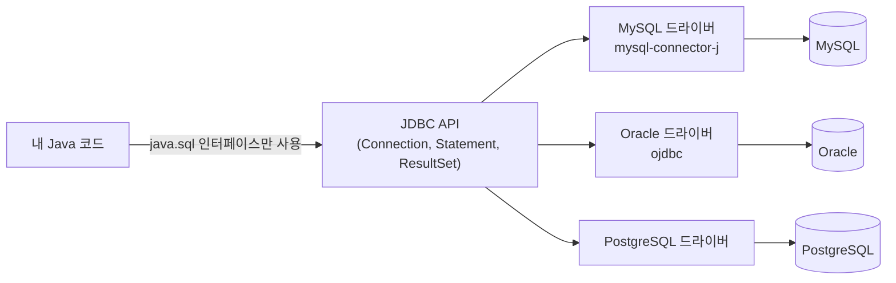
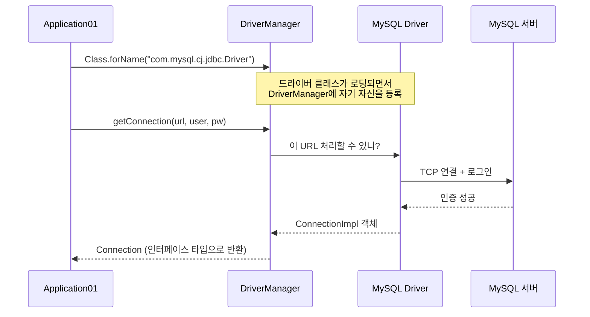
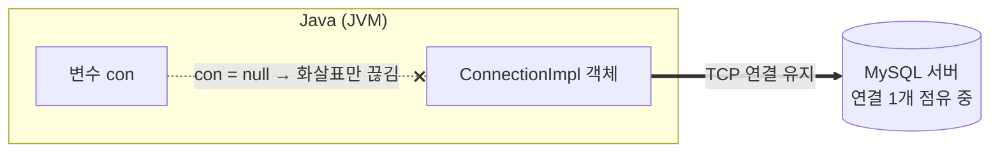
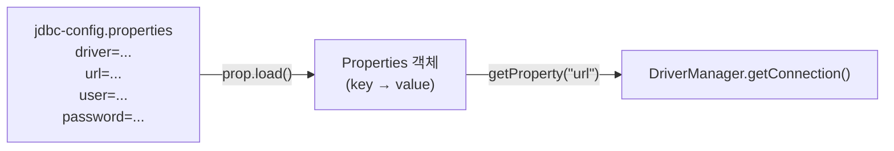
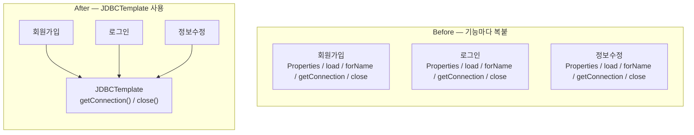

> **이번 글에서 다루는 것**
> 1. JDBC가 무엇이고, 왜 "인터페이스"로 되어 있는지
> 2. `DriverManager`로 `Connection` 객체 만들기
> 3. 접속 정보를 `.properties` 파일로 분리하기
> 4. 반복되는 코드를 `JDBCTemplate`으로 묶기

---

## 0. JDBC란?

**JDBC(Java DataBase Connectivity)** 는 Java 프로그램이 데이터베이스와 대화하기 위한 **표준 API**다.
핵심은 `java.sql` 패키지에 들어 있는 **인터페이스들**(`Connection`, `Statement`, `ResultSet` …)이다.

여기서 중요한 질문 하나.

> "왜 클래스가 아니라 인터페이스일까?"

DB는 MySQL, Oracle, PostgreSQL… 종류가 많고, 각 DB와 통신하는 방법(프로토콜)은 전부 다르다.
그래서 Java는 **"이런 기능이 있어야 한다"는 규격(인터페이스)만** 정하고,
**실제 구현은 각 DB 회사가 만든 드라이버**가 담당한다.



덕분에 내 코드는 `Connection`, `Statement` 같은 **인터페이스 타입만** 알고 있으면 되고,
DB를 바꿔도 드라이버와 접속 정보만 바꾸면 코드 대부분을 그대로 쓸 수 있다.
(OOP에서 배운 **다형성**이 실제로 쓰이는 대표적인 예다.)

### 드라이버 의존성 추가 (Gradle)

드라이버는 JDK에 포함되어 있지 않으므로 외부 라이브러리로 추가해야 한다.

```groovy
dependencies {
    // mysql 연동을 위한 외부 api 의존성
    implementation 'com.mysql:mysql-connector-j:8.4.0'
}
```

---

## 1. Connection 객체 만들기 (Application01)

```java
Connection con = null;

try {
    // 1) MySQL 드라이버 클래스 로딩
    Class.forName("com.mysql.cj.jdbc.Driver");

    // 2) Connection 객체 얻기
    con = DriverManager.getConnection(
            "jdbc:mysql://localhost/menudb",  // URL
            "wanted",                         // user
            "wanted"                          // password
    );

    System.out.println("con = " + con);   // 값이 출력되면 menudb 접근 성공

} catch (ClassNotFoundException e) {
    throw new RuntimeException(e);
} catch (SQLException e) {
    throw new RuntimeException(e);
} finally {
    con = null;
}
```

### 1-1. 실제로 무슨 일이 일어나는가?



출력해보면 이런 값이 나온다.

```
con = com.mysql.cj.jdbc.ConnectionImpl@1a2b3c4d
```

`Connection` 인터페이스 타입 변수에 **MySQL 드라이버가 만든 구현체(`ConnectionImpl`)** 가 담겨 있다는 걸 확인할 수 있다.

> 📌 **정확히 짚고 넘어가기**
> 수업 코드 주석에는 "인터페이스를 구현한 DriverManager를 통해서 만든다"고 되어 있는데,
> 엄밀히 말하면 **`DriverManager`는 `Connection`을 구현한 클래스가 아니다.**
> `DriverManager`는 등록된 드라이버 중 URL에 맞는 것을 찾아서 **연결을 대신 요청해주는 관리자(중개인)** 이고,
> `Connection`을 실제로 구현한 건 **드라이버 안의 `ConnectionImpl`** 이다.
>
> | 이름 | 정체 | 역할 |
> |---|---|---|
> | `Connection` | 인터페이스 (`java.sql`) | DB 연결이 가져야 할 기능의 규격 |
> | `DriverManager` | 클래스 (`java.sql`) | 드라이버를 관리하고 연결을 중개 |
> | `ConnectionImpl` | 클래스 (MySQL 드라이버) | `Connection`의 실제 구현체 |

### 1-2. JDBC URL 읽는 법

```
jdbc:mysql://localhost:3306/menudb?serverTimezone=Asia/Seoul
└─┬┘ └─┬─┘   └───┬───┘ └┬─┘ └──┬─┘ └──────────┬──────────┘
프로토콜 DB종류   호스트   포트  DB이름       추가 옵션(선택)
```

- 포트를 생략하면 MySQL 기본 포트인 **3306**이 사용된다. (그래서 `localhost/menudb`도 동작한다.)
- 옵션은 `?key=value&key=value` 형태로 붙인다.

### 1-3. `Class.forName()`은 꼭 필요할까?

`Class.forName("...Driver")`는 드라이버 클래스를 메모리에 올리는 코드다. 클래스가 로딩될 때 드라이버 내부의 `static` 블록이 실행되며 `DriverManager`에 자신을 등록한다.

다만 **JDBC 4.0(Java 6) 이후로는 드라이버 jar만 클래스패스에 있으면 자동으로 등록**된다.
그래서 요즘은 생략해도 동작한다. 수업처럼 명시적으로 써두면 "어떤 드라이버를 쓰는지" 코드로 드러난다는 장점은 있다.

### 1-4. ⚠️ `con = null`은 연결을 끊지 않는다

`finally`에서 `con = null;`을 하고 있는데, 이건 **변수가 더 이상 객체를 가리키지 않게 할 뿐**이다.
DB 서버 쪽 연결은 그대로 남아 있다.



연결을 실제로 반납하려면 **`con.close()`** 를 호출해야 한다.
DB 서버는 동시에 받을 수 있는 연결 수(MySQL 기본 `max_connections` = 151)가 정해져 있어서,
close 없이 연결을 계속 만들면 결국 `Too many connections` 에러가 난다.
이 문제는 바로 아래 `JDBCTemplate.close()`에서 해결된다.

---

## 2. 접속 정보 분리하기 (Application02)

### 문제점

Application01은 URL, 아이디, 비밀번호가 **Java 코드에 그대로 박혀 있다(하드코딩).**

- 코드가 GitHub에 올라가면 비밀번호도 같이 공개된다.
- DB 정보가 바뀌면 코드를 수정하고 다시 컴파일해야 한다.

### 해결: `.properties` 파일 + `Properties` 객체

```properties
# jdbc-config.properties
driver=com.mysql.cj.jdbc.Driver
url=jdbc:mysql://localhost/menudb
user=wanted
password=wanted
```

```java
Properties prop = new Properties();

prop.load(new FileReader("src/main/java/com/wanted/a_connection/jdbc-config.properties"));

String driver   = prop.getProperty("driver");
String url      = prop.getProperty("url");
String user     = prop.getProperty("user");
String password = prop.getProperty("password");

Class.forName(driver);
con = DriverManager.getConnection(url, user, password);
```

`Properties`는 `key=value` 형태의 텍스트를 읽어서 **Map처럼** 꺼내 쓸 수 있게 해주는 클래스다.



### 더 알아두면 좋은 점

**① 파일로 뺐다고 "숨겨진" 건 아니다.**
properties 파일도 결국 평문이다. 진짜로 숨기려면 이 파일을 `.gitignore`에 추가해서 저장소에 올리지 않아야 한다.
보통은 `jdbc-config.properties.example` 같은 샘플 파일만 올려두고, 실제 값은 각자 로컬에서 채운다.

```gitignore
# .gitignore
**/jdbc-config.properties
```

**② 상대 경로의 기준은 "실행 위치(작업 디렉터리)"다.**
`new FileReader("src/main/...")`는 **프로그램을 실행한 폴더**를 기준으로 파일을 찾는다.
IntelliJ에서는 보통 프로젝트 루트가 기준이라 잘 동작하지만, 다른 곳에서 실행하면 `FileNotFoundException`이 난다.
이 문제는 Chapter 3에서 `ClassLoader`로 **클래스패스 기준**으로 읽는 방식으로 개선된다.

**③ catch가 길다면 멀티 catch**
처리 방식이 같은 예외는 `|`로 묶을 수 있다.

```java
} catch (IOException | ClassNotFoundException | SQLException e) {
    throw new RuntimeException(e);
}
```

> `FileNotFoundException`은 `IOException`의 자식이라 같이 묶으면 컴파일 에러가 난다.
> 부모인 `IOException` 하나만 써도 둘 다 잡힌다.

---

## 3. 반복 코드 묶기 — JDBCTemplate

### 문제점

회원가입, 로그인, 회원정보 수정, 회원 삭제… 기능마다 DB 접근이 필요하다.
그때마다 **Properties 생성 → 파일 읽기 → 드라이버 로딩 → 연결 → 해제** 코드를 복사하면 중복이 엄청나다.

### 해결: 연결 생성/해제를 static 메서드로 분리

```java
public class JDBCTemplate {

    // Connection 객체를 생성하는 코드를 메서드화
    public static Connection getConnection() {
        Connection con = null;
        Properties prop = new Properties();
        try {
            prop.load(new FileReader("src/main/java/com/wanted/a_connection/jdbc-config.properties"));

            String driver   = prop.getProperty("driver");
            String url      = prop.getProperty("url");
            String user     = prop.getProperty("user");
            String password = prop.getProperty("password");

            Class.forName(driver);
            con = DriverManager.getConnection(url, user, password);

        } catch (IOException | ClassNotFoundException | SQLException e) {
            throw new RuntimeException(e);
        }
        return con;
    }

    // Connection 객체의 자원을 해제하는 코드를 메서드화
    public static void close(Connection con) {
        try {
            // 커넥션이 존재하고, 닫혀있지 않다면
            if (con != null && !con.isClosed()) {
                con.close();
            }
        } catch (SQLException e) {
            throw new RuntimeException(e);
        }
    }
}
```

사용하는 쪽은 아주 짧아진다.

```java
import static com.wanted.b_template.JDBCTemplate.close;
import static com.wanted.b_template.JDBCTemplate.getConnection;

public class Application {
    public static void main(String[] args) {
        Connection con = getConnection();
        System.out.println("con = " + con);
        // con 을 활용해서 회원가입 진행 완료!!
        close(con);
    }
}
```



### 짚고 넘어가기

**`import static`이란?**
static 메서드는 원래 `JDBCTemplate.getConnection()`처럼 `클래스명.메서드명()`으로 호출한다.
`import static`을 쓰면 클래스명을 생략하고 `getConnection()`만으로 호출할 수 있다.

**`con != null && !con.isClosed()` 순서가 중요한 이유**
`&&`는 앞 조건이 `false`면 뒤를 검사하지 않는다(단락 평가).
`con`이 `null`인데 `con.isClosed()`부터 호출하면 `NullPointerException`이 나기 때문에, null 체크를 반드시 앞에 둔다.

**왜 static 메서드인가?**
`JDBCTemplate`은 저장할 상태(필드)가 없고 "연결 만들어줘 / 닫아줘"라는 **기능만 제공하는 유틸리티**다.
매번 `new JDBCTemplate()`으로 객체를 만들 이유가 없으니 static으로 두는 게 자연스럽다.

> 💡 **아직 남은 아쉬움** — `getConnection()`을 호출할 때마다 properties 파일을 **매번 다시 읽는다.**
> Chapter 3에서는 `static` 블록으로 **클래스 로딩 시 딱 한 번만** 읽도록 개선된다.

---

## ✅ 마무리 요약

| 단계 | 핵심 | 남은 문제 |
|---|---|---|
| Application01 | `DriverManager.getConnection()`으로 연결 | 접속 정보 하드코딩, `close()` 없음 |
| Application02 | `.properties` + `Properties`로 정보 분리 | 연결 코드가 기능마다 반복 |
| JDBCTemplate | 연결 생성/해제를 static 메서드로 분리 | 파일을 매번 읽음, 실행 위치 기준 경로 |

- **JDBC = 인터페이스(규격)**, **드라이버 = 구현체**. 내 코드는 인터페이스만 의존한다.
- `DriverManager`는 구현체가 아니라 **연결을 중개하는 관리자**다.
- 변수에 `null`을 넣는 것과 **`close()`로 자원을 반납하는 것은 전혀 다르다.**
- 민감 정보는 파일로 분리하고, 그 파일은 **`.gitignore`** 로 저장소에서 제외한다.

**다음 글 →** `Statement`와 `ResultSet`으로 실제 SQL을 실행하고, `PreparedStatement`가 왜 필요한지 알아본다.
