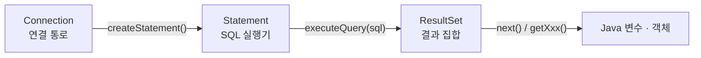
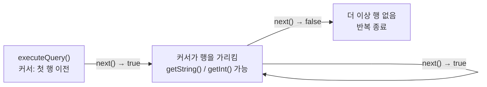
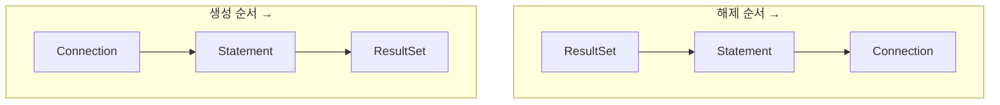
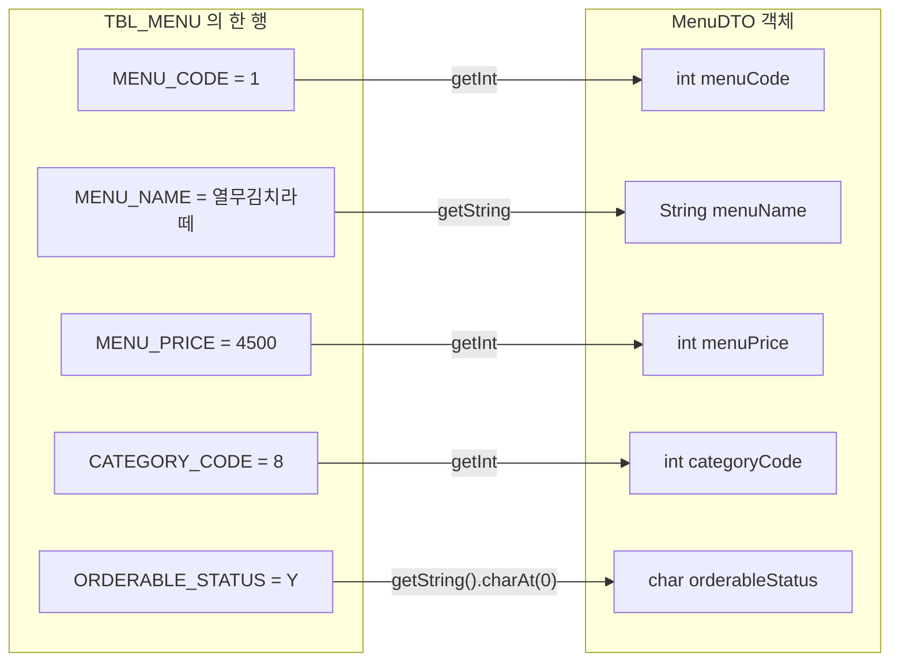
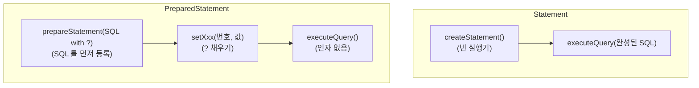
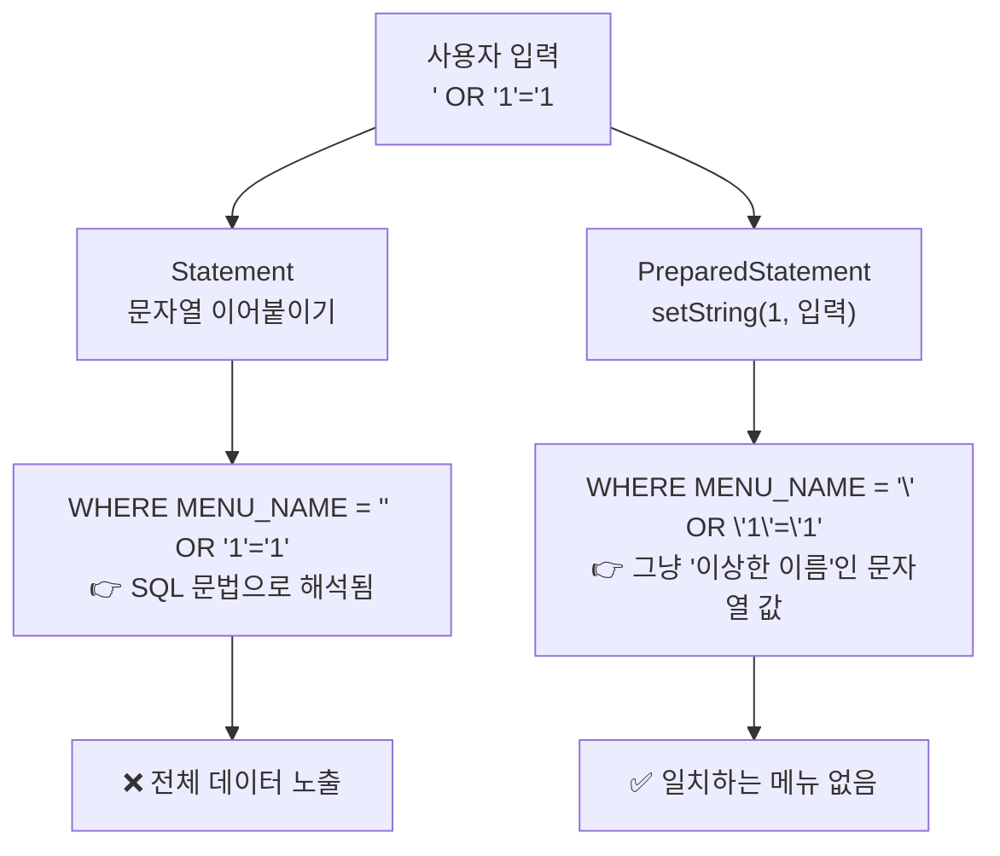
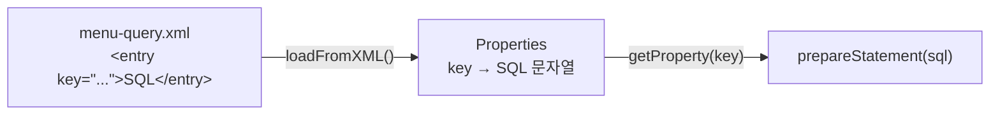
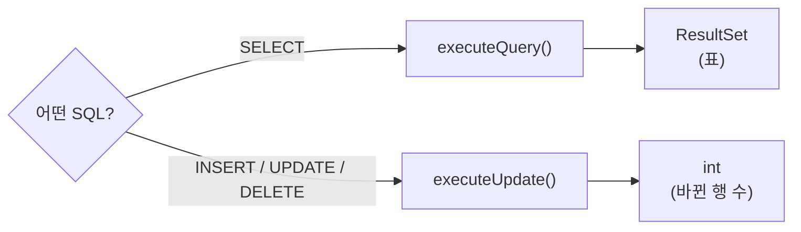

> **이번 글에서 다루는 것**
> 1. `Statement`로 SQL 실행, `ResultSet`으로 결과 받기
> 2. 조회 결과를 Java 객체(DTO)에 옮겨 담기
> 3. `PreparedStatement`와 placeholder(`?`) — 그리고 **SQL Injection**
> 4. SQL을 XML 파일로 분리하기
> 5. `executeQuery()` vs `executeUpdate()`

---

## 0. JDBC 객체 3총사

Chapter 1에서 만든 `Connection`은 "DB로 가는 길"일 뿐이다. 실제로 SQL을 보내고 결과를 받으려면 두 개가 더 필요하다.

| 인터페이스 | 하는 일 | 만드는 방법 |
|---|---|---|
| `Connection` | DB와의 연결 통로 | `DriverManager.getConnection()` |
| `Statement` | SQL을 담아서 **실행** | `con.createStatement()` |
| `ResultSet` | SELECT 결과를 **표 형태로** 받음 | `stmt.executeQuery(sql)` |



세 개 모두 **인터페이스**라서 `new`로 만들 수 없고, 앞 단계 객체가 제공하는 메서드로 얻는다.
(실제 구현체는 역시 MySQL 드라이버 안에 있다.)

---

## 1. Statement로 전체 조회 (a_statements/Application01)

```java
Connection con = getConnection();
Statement stmt = null;
ResultSet rset = null;

try {
    stmt = con.createStatement();
    rset = stmt.executeQuery("SELECT * FROM TBL_MENU");

    while (rset.next()) {
        System.out.println(
                rset.getString("MENU_NAME") + " 은/는 "
                + rset.getString("MENU_PRICE") + "원 입니다. "
        );
    }
} catch (SQLException e) {
    throw new RuntimeException(e);
} finally {
    close(rset);
    close(stmt);
    close(con);
}
```

### 1-1. `ResultSet`과 커서(cursor) — `next()`가 헷갈린다면

`ResultSet`은 결과 표 위를 움직이는 **커서(손가락)** 를 가지고 있다고 생각하면 쉽다.
처음 커서는 **첫 번째 행의 "위"** 에 있다. 그래서 데이터를 읽기 전에 반드시 `next()`를 한 번 호출해야 한다.

```
            MENU_CODE | MENU_NAME       | MENU_PRICE
👉 (시작)   ─────────────────────────────────────────   ← 아무 행도 가리키지 않음
   next()→  1         | 열무김치라떼      | 4500        ← true
   next()→  2         | 우럭스무디        | 5000        ← true
   next()→  3         | 생갈치쉐이크      | 6000        ← true
   next()→  (더 없음)                                   ← false → while 종료
```



- **여러 행** 예상 → `while (rset.next())`
- **0 또는 1행** 예상 → `if (rset.next())`

`next()`를 호출하지 않고 바로 `getString()`을 부르면 `SQLException`(Before start of result set)이 발생한다.

### 1-2. `getXxx()` 사용법

| 메서드 | 예시 | 메모 |
|---|---|---|
| `getString("컬럼명")` | `rset.getString("MENU_NAME")` | 숫자 컬럼도 문자열로 꺼낼 수 있음 |
| `getInt("컬럼명")` | `rset.getInt("MENU_PRICE")` | 값이 NULL이면 **0** 반환 |
| `getString(1)` | 첫 번째 컬럼 | **인덱스는 1부터** 시작 |

> 💡 컬럼명은 대소문자를 구분하지 않는다. 별칭(`AS`)을 붙였다면 별칭으로 꺼내야 한다.

### 1-3. 자원 해제 순서

자원은 **만든 순서의 역순**으로 닫는 것이 원칙이다.



`ResultSet`은 `Statement`에 의존하고, `Statement`는 `Connection`에 의존하기 때문이다.
(참고로 수업 코드는 `close(con)`을 먼저 호출하는데, JDBC 스펙상 Connection을 닫으면 하위 객체도 함께 정리되긴 한다.
하지만 습관적으로 **역순**으로 닫아두면 어떤 상황에서도 안전하다.)

이를 위해 `JDBCTemplate`에 `close()`가 **오버로딩**으로 3개 추가되었다.

```java
public static void close(Connection con) { ... }
public static void close(Statement stmt) { ... }   // PreparedStatement도 여기로 들어온다
public static void close(ResultSet rset) { ... }
```

> `PreparedStatement`는 `Statement`를 상속한 인터페이스라서 `close(Statement)` 하나로 같이 처리된다. (다형성!)

---

## 2. 조건 조회 — 사용자 입력 받기 (Application02)

```java
System.out.print("메뉴 이름 입력 : ");
String menuName = sc.nextLine();

stmt = con.createStatement();
rset = stmt.executeQuery(
    "SELECT MENU_CODE, MENU_PRICE, ORDERABLE_STATUS FROM TBL_MENU WHERE MENU_NAME = '" + menuName + "'"
);

if (rset.next()) {
    System.out.println(menuName + " 의 정보 : "
            + rset.getString("MENU_CODE") + " , "
            + rset.getString("MENU_PRICE") + " 원 , "
            + rset.getString("ORDERABLE_STATUS"));
}
```

문자열 비교라 `'` 작은따옴표를 직접 붙여줘야 해서 코드가 지저분하다.
그런데 **불편한 것보다 훨씬 큰 문제**가 숨어 있다. → 아래 **4-2. SQL Injection**에서 다룬다.

---

## 3. 결과를 Java 객체로 옮기기 — DTO (Application03)

지금까지는 결과를 출력만 하고 끝냈다. 하지만 실제 프로그램에서는 조회한 데이터를 **다른 곳으로 넘기고, 가공하고, 화면에 보여줘야** 한다.
그러려면 DB의 한 행(row)을 Java 객체 하나로 옮겨 담아야 한다. 이때 쓰는 그릇이 **DTO(Data Transfer Object)** 다.



```java
MenuDTO menu = null;

if (rset.next()) {
    menu = new MenuDTO();
    menu.setMenuCode(rset.getInt("MENU_CODE"));
    menu.setMenuName(rset.getString("MENU_NAME"));
    menu.setMenuPrice(rset.getInt("MENU_PRICE"));
    menu.setCategoryCode(rset.getInt("CATEGORY_CODE"));
    menu.setOrderableStatus(rset.getString("ORDERABLE_STATUS").charAt(0));
}
System.out.println("menu = " + menu);
```

### DTO의 기본 구성 요소

1. `private` 필드 (테이블 컬럼과 1:1)
2. 기본 생성자
3. 모든 필드를 초기화하는 생성자
4. Getter / Setter
5. `toString()`

### 더 알아두면 좋은 점

- **이름 매핑 규칙** — DB는 `MENU_NAME`(스네이크 케이스, 대문자), Java는 `menuName`(카멜 케이스)을 쓴다. 이 변환을 지금은 손으로 하지만, 나중에 배우는 MyBatis·JPA는 이걸 자동으로 해준다.
- **타입 매핑** — `INT → int`, `VARCHAR → String`, `CHAR(1) → char 또는 String`. `ResultSet`에는 `getChar()`가 없어서 `getString().charAt(0)`을 쓴다. (그래서 Chapter 3에서는 그냥 `String`으로 바뀐다.)
- **`menu`가 null일 수 있다** — 일치하는 메뉴가 없으면 `if`에 들어가지 않아 `menu = null`이 출력된다.
- **여러 행을 담으려면?** `List<MenuDTO>`를 만들고 `while` 안에서 DTO를 하나씩 `add()` 하면 된다. (Application04의 과제이자 Chapter 3의 `findAll()`)

---

## 4. PreparedStatement

### 4-1. 기본 사용법 — placeholder `?`

```java
pstmt = con.prepareStatement(
    "SELECT MENU_CODE, MENU_PRICE, ORDERABLE_STATUS FROM TBL_MENU WHERE MENU_NAME = ?"
);
pstmt.setString(1, menuName);   // 첫 번째 ? 에 menuName 바인딩

rset = pstmt.executeQuery();     // ← 괄호 안에 SQL을 넣지 않는다!
```

**Statement와 사용 순서가 다르다.**



- `?`의 번호는 **왼쪽부터 1, 2, 3…** (0부터 아님!)
- 모든 `?`는 실행 전에 **반드시** `setXxx()`로 채워야 한다. 하나라도 빠지면 `SQLException`.
- `setString`을 쓰면 드라이버가 알아서 `'`를 붙여주므로 직접 따옴표를 쓸 필요가 없다.
- ⚠️ `?`는 **값** 자리에만 쓸 수 있다. 테이블명·컬럼명·`ORDER BY` 대상 같은 **SQL 구조**에는 쓸 수 없다.

> ⚠️ `pstmt.executeQuery(query)`처럼 SQL을 또 넣으면 안 된다.
> 이건 부모인 `Statement`의 메서드를 호출하는 것이라 런타임 에러가 난다.

### 4-2. ⚠️ SQL Injection — PreparedStatement가 진짜 필요한 이유

수업에서는 PreparedStatement의 장점으로 "편리함"과 "성능"을 배웠는데, **실무에서 가장 중요한 이유는 보안**이다.

Statement 방식(Application02)에 사용자가 메뉴 이름 대신 이렇게 입력했다고 해보자.

```
메뉴 이름 입력 : ' OR '1'='1
```

문자열을 그대로 이어 붙이면 완성되는 SQL은…

```sql
SELECT ... FROM TBL_MENU WHERE MENU_NAME = '' OR '1'='1'
--                                        └──────┬──────┘
--                          '1'='1' 은 항상 참 → 모든 행이 조회됨!
```

입력값이 **데이터가 아니라 SQL 문법의 일부**가 되어버린 것이다. 이것이 **SQL Injection** 공격이다.
로그인 쿼리였다면 비밀번호 없이 로그인이 되고, `'; DELETE FROM ...` 같은 입력이면 데이터가 지워질 수도 있다.



`PreparedStatement`는 **SQL 구조(틀)를 먼저 확정**하고, `?`에 들어오는 값은 무조건 "값"으로만 취급한다.
그래서 입력에 따옴표가 섞여 있어도 SQL 문법이 바뀌지 않는다.

> ✅ **결론: 사용자 입력이 SQL에 들어가는 경우엔 무조건 `PreparedStatement`.**

### 4-3. 성능 이야기 — 조금 더 정확하게

수업 내용: *"Statement는 매번 파싱·컴파일, PreparedStatement는 최초 1회 컴파일 후 재사용 → 성능 향상"*

이건 개념적으로 맞는 설명이고, Oracle 같은 DB에서는 그대로 적용된다.
다만 **MySQL Connector/J는 기본 설정에서 PreparedStatement를 클라이언트(Java) 쪽에서 흉내 낸다.**
`?`에 값을 안전하게 채운 완성 SQL을 서버로 보내는 방식이라, 기본값으로는 서버 측 재사용 이점이 크지 않다.

서버 측 Prepared Statement와 캐시를 쓰고 싶다면 URL 옵션을 켠다.

```
jdbc:mysql://localhost:3306/menudb?useServerPrepStmts=true&cachePrepStmts=true
```

어느 쪽이든 **SQL Injection 방지 효과는 동일**하므로, PreparedStatement를 쓰는 이유는 충분하다.

---

## 5. SQL을 XML로 분리하기 (Application03)

`JOIN`이나 긴 `WHERE` 절이 들어가면 Java 문자열로 SQL을 쓰기가 괴롭다. `+`와 줄바꿈 공백 때문에 실수도 잦다.
그래서 SQL을 **XML 파일로 분리**한다.

```xml
<?xml version="1.0" encoding="UTF-8" ?>
<!DOCTYPE properties SYSTEM "http://java.sun.com/dtd/properties.dtd">
<properties>

    <entry key="findMenuByMenuName">
        SELECT
            *
        FROM
            TBL_MENU
        WHERE
            MENU_NAME = ?
    </entry>

    <entry key="modifyMenuPriceByMenuName">
        UPDATE TBL_MENU
        SET MENU_PRICE = ?
        WHERE MENU_NAME = ?
    </entry>

</properties>
```

```java
Properties prop = new Properties();
prop.loadFromXML(new FileInputStream("src/main/java/com/wanted/b_preparedstatements/menu-query.xml"));

String query = prop.getProperty("findMenuByMenuName");   // key 로 SQL 꺼내기
pstmt = con.prepareStatement(query);
```



### 짚고 넘어가기

- **`DOCTYPE properties`가 핵심** — 이 선언이 있어야 `Properties.loadFromXML()`이 읽을 수 있는 형식이 된다. `<entry key="">` 하나가 `.properties`의 `key=value` 한 줄과 같다.
- **`load()` vs `loadFromXML()`** — `.properties`는 `load(Reader)`, XML은 `loadFromXML(InputStream)`. XML은 `InputStream`(바이트 기반)을 받는다는 점이 다르다.
- **⚠️ SQL에 `<` 를 쓸 땐 CDATA** — XML에서 `<`는 태그 시작 문자라서 `WHERE PRICE < 5000`을 그대로 쓰면 파싱 에러가 난다.

```xml
<entry key="findCheapMenus">
    <![CDATA[
        SELECT * FROM TBL_MENU WHERE MENU_PRICE < 5000
    ]]>
</entry>
```

> 이 "SQL은 XML에, 호출은 key로" 구조가 바로 나중에 배울 **MyBatis Mapper XML**의 원형이다.

---

## 6. 조회 vs 변경 — executeQuery / executeUpdate (Application04)

CRUD 중 **R(SELECT)** 은 결과 "표"가 돌아오고, **C·U·D(INSERT·UPDATE·DELETE, DML)** 는 "몇 행이 바뀌었는지"만 돌아온다.

```java
String query = prop.getProperty("modifyMenuPriceByMenuName");
// UPDATE TBL_MENU SET MENU_PRICE = ? WHERE MENU_NAME = ?

pstmt = con.prepareStatement(query);
pstmt.setInt(1, price);         // 첫 번째 ? → MENU_PRICE
pstmt.setString(2, menuName);   // 두 번째 ? → MENU_NAME

int result = pstmt.executeUpdate();   // 영향 받은 행의 수

if (result > 0) {
    System.out.println(menuName + " 메뉴 가격 수정 성공!! (영향 받은 행 : " + result + ")");
} else {
    System.out.println(menuName + " 메뉴 가격 변경 실패!! 메뉴 이름을 다시 확인해주세요");
}
```

| 메서드 | 사용하는 SQL | 반환 타입 | 의미 |
|---|---|---|---|
| `executeQuery()` | SELECT | `ResultSet` | 조회 결과 표 |
| `executeUpdate()` | INSERT / UPDATE / DELETE | `int` | 영향 받은 행 수 |
| `execute()` | 아무거나 | `boolean` | 결과가 ResultSet이면 `true` (잘 안 씀) |



### 짚고 넘어가기

- **`result == 0`은 에러가 아니다.** SQL은 정상 실행됐지만 `WHERE` 조건에 맞는 행이 없었다는 뜻이다. 진짜 에러(문법 오류, 제약조건 위반)는 `SQLException`으로 터진다.
- **DML에는 ResultSet이 필요 없다.** 그래서 이 예제는 `close(pstmt)`, `close(con)`만 한다.
- **자동 커밋(auto-commit)** — JDBC의 `Connection`은 기본적으로 `autoCommit = true`라서 `executeUpdate()`가 끝나는 즉시 DB에 **영구 반영**된다. 여러 SQL을 하나로 묶어 "전부 성공 or 전부 취소"하고 싶다면 트랜잭션을 직접 관리해야 한다. → Chapter 3에서 Service 계층이 이 책임을 갖는 이유와 연결된다.

---

## ✅ 마무리 요약

| | Statement | PreparedStatement |
|---|---|---|
| 생성 | `con.createStatement()` | `con.prepareStatement(sql)` |
| SQL 전달 시점 | 실행할 때 `executeQuery(sql)` | 생성할 때 |
| 변수 삽입 | 문자열 이어붙이기 (`'` 직접 처리) | `?` + `setXxx(번호, 값)` |
| SQL Injection | ❌ 취약 | ✅ 방어 |
| 가독성 | 낮음 | 높음 |

- `Connection → Statement → ResultSet` 순으로 만들고, **역순으로 닫는다.**
- `ResultSet`의 커서는 **첫 행 이전**에서 시작 → `next()`부터 호출.
- DB의 한 행 = **DTO 객체 하나**, 여러 행 = **`List<DTO>`**.
- SQL은 XML로 분리하고 key로 꺼내 쓴다. (`<` 는 CDATA로!)
- SELECT는 `executeQuery()`, DML은 `executeUpdate()`.

**다음 글 →** 지금까지 `main` 하나에 몰려 있던 코드를 **View · Controller · Service · DAO** 계층으로 나눠본다.
