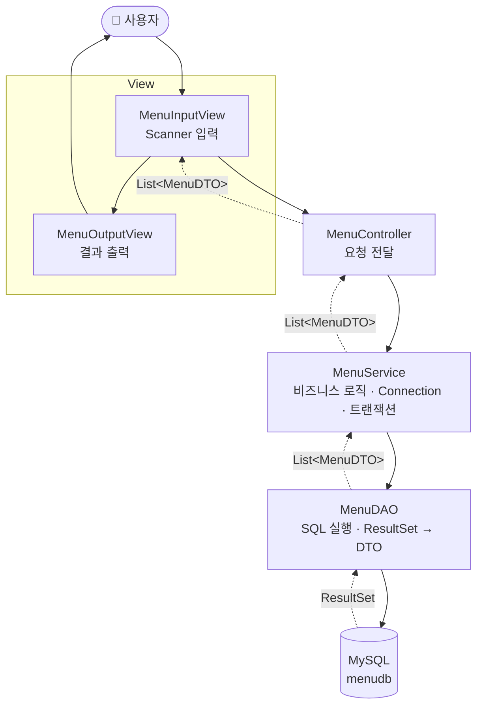
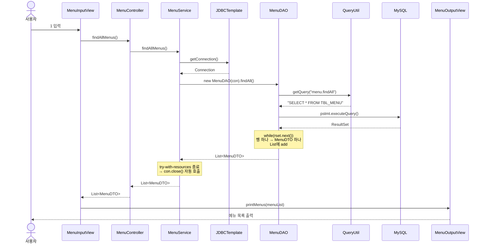
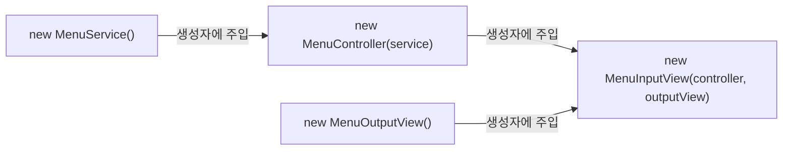
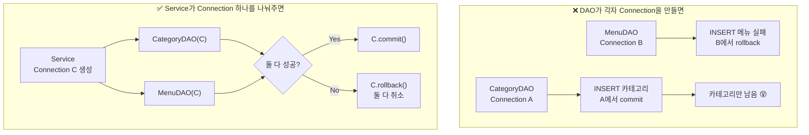
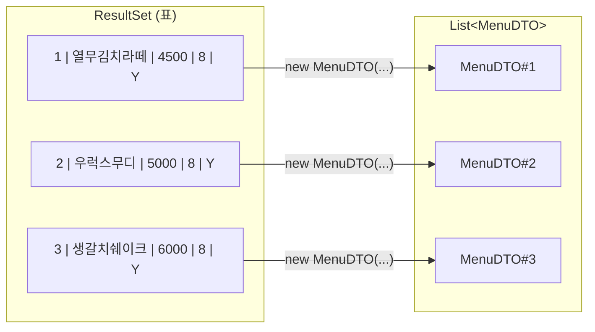
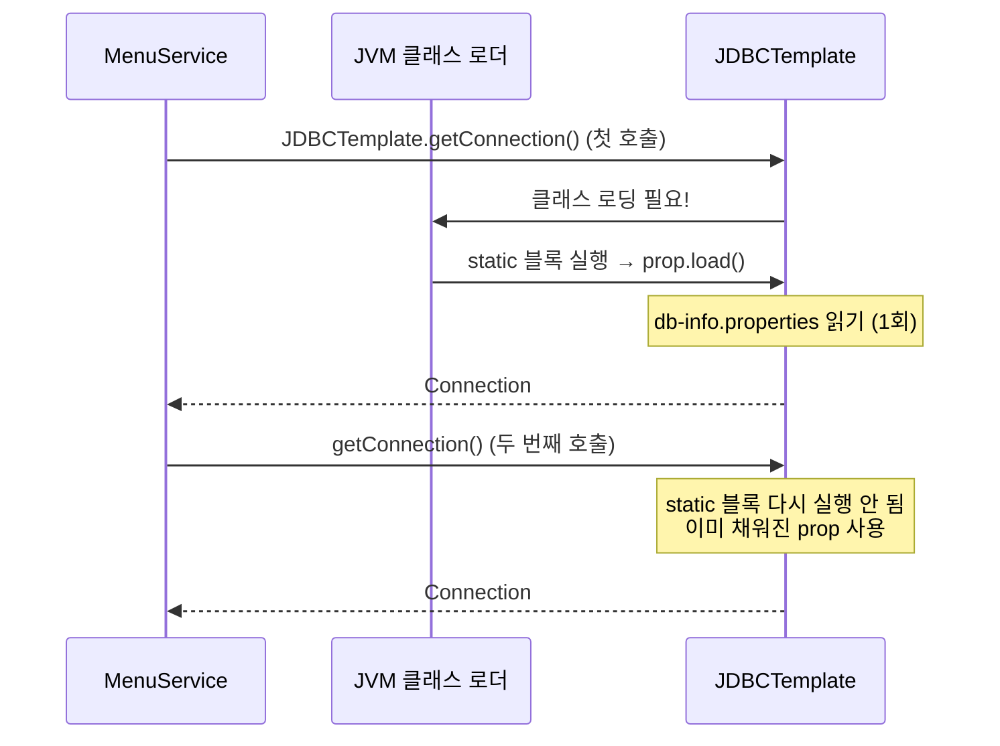
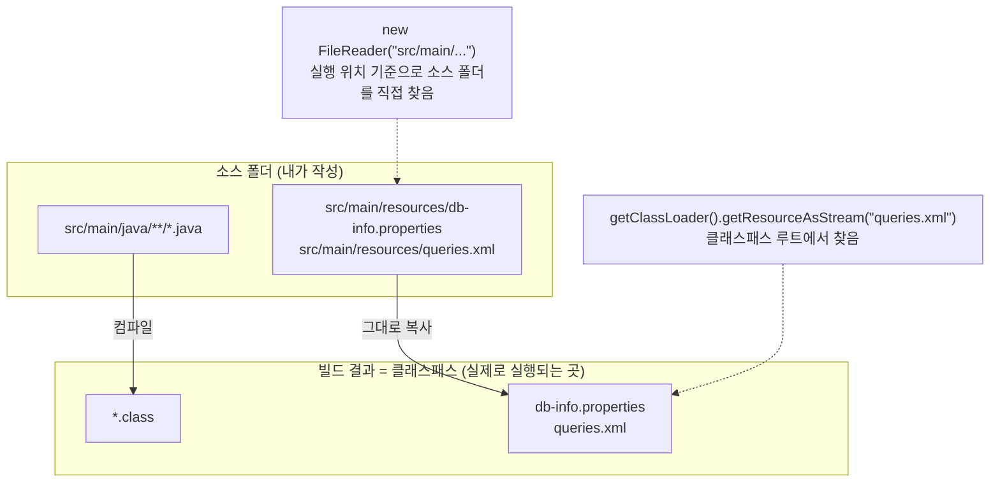
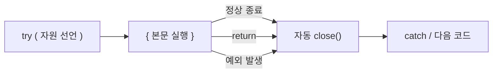
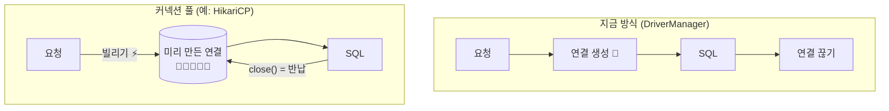
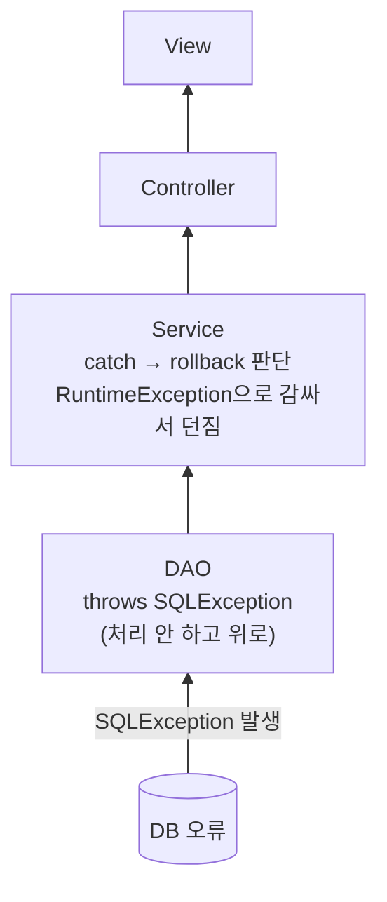

> **이번 글에서 다루는 것**
> 1. 왜 코드를 계층으로 나누는가
> 2. View · Controller · Service · DAO 각각의 책임
> 3. 메뉴 전체 조회 요청이 계층을 타고 흐르는 과정
> 4. 개선된 `JDBCTemplate` / `QueryUtil` — `static` 블록, 클래스패스 리소스
> 5. `try-with-resources`, 그리고 Connection을 **Service에서** 만드는 이유

---

## 0. 왜 계층을 나누는가?

Chapter 2까지는 `main` 메서드 하나에 **입력 받기 + SQL 실행 + 결과 변환 + 출력**이 전부 들어 있었다.
기능이 2~3개일 땐 괜찮지만, 메뉴 등록·수정·삭제·카테고리 관리… 기능이 늘어나면 이렇게 된다.

- 어디를 고쳐야 할지 찾기 어렵다.
- 출력 형식 하나 바꾸려다 SQL 코드를 건드리게 된다.
- 같은 SQL 실행 코드가 여기저기 복사된다.

그래서 **"한 클래스는 한 가지 책임만"** 원칙에 따라 역할별로 나눈다.
식당에 비유하면 이해가 쉽다.

| 계층 | 식당 비유 | 하는 일 |
|---|---|---|
| **View** | 손님 응대 (홀 직원) | 주문 받기(입력), 음식 내주기(출력) |
| **Controller** | 주문 전달 (카운터) | 주문서를 알맞은 주방 담당에게 넘김 |
| **Service** | 셰프 | 요리 순서·규칙 결정, 여러 재료 조합 |
| **DAO** | 창고 담당 | 창고(DB)에서 재료 꺼내오기 / 넣기 |
| **DTO** | 쟁반 | 계층 사이에서 데이터를 담아 나르는 그릇 |

---

## 1. 전체 구조 한눈에 보기

### 1-1. 패키지 구조

```
com.wanted.restaurant
├── Application.java                  ← 객체 조립 & 실행
├── global
│   ├── common/QueryUtil.java         ← queries.xml 에서 SQL 꺼내기
│   └── config/JDBCTemplate.java      ← Connection 생성
└── menu
    ├── view
    │   ├── input/MenuInputView.java  ← 사용자 입력
    │   └── output/MenuOutputView.java← 결과 출력
    ├── controller/MenuController.java
    └── model
        ├── service/MenuService.java
        ├── dao/MenuDAO.java
        └── dto/MenuDTO.java

src/main/resources
├── db-info.properties                ← DB 접속 정보
└── queries.xml                       ← SQL 모음
```

`global`(여러 도메인이 공통으로 쓰는 것)과 `menu`(메뉴 도메인)를 나눠두었다.
나중에 `category`, `order` 같은 도메인이 생기면 `menu`와 같은 구조로 옆에 추가하면 된다.

### 1-2. 계층 다이어그램



**규칙: 화살표는 한 방향으로만, 한 칸씩만.**
View가 DAO를 직접 부르거나, DAO가 View를 아는 일은 없다. 각 계층은 **바로 아래 계층만** 알고 있다.

---

## 2. 메뉴 전체 조회 — 요청의 여행

"1번(메뉴 전체 조회)"을 입력했을 때 실제로 일어나는 일을 순서대로 따라가 보자.



---

## 3. 계층별 코드와 책임

### 3-1. Application — 객체 조립

```java
public static void main(String[] args) {
    MenuService service       = new MenuService();
    MenuController controller = new MenuController(service);
    MenuOutputView outputView = new MenuOutputView();
    MenuInputView inputView   = new MenuInputView(controller, outputView);

    inputView.displayMainView();
}
```

필요한 객체를 **아래 계층부터** 만들어서, 위 계층의 **생성자에 넣어준다.**



> 💡 **의존성 주입(DI, Dependency Injection)**
> `MenuController`가 내부에서 `new MenuService()`를 직접 하지 않고, **밖에서 만들어진 객체를 받아서** 쓰는 방식이다.
> 이렇게 하면 Controller는 "Service가 어떻게 만들어지는지" 몰라도 되고, 테스트할 때 가짜 Service로 바꿔 끼우기도 쉽다.
> 지금은 `main`에서 손으로 조립하지만, **Spring은 이 조립을 프로그램 시작 시 자동으로** 해준다. 오늘 코드가 그 맛보기다.

필드에 `final`이 붙어 있는 것도 눈여겨볼 점이다.

```java
private final MenuService menuService;
```

`final`이므로 생성자에서 한 번 넣으면 바꿀 수 없다. "이 Controller는 평생 이 Service와 일한다"는 걸 보장한다.

### 3-2. View — 사용자와 대화

```java
public class MenuInputView {
    private final MenuController menuController;
    private final MenuOutputView menuOutputView;
    private final Scanner sc = new Scanner(System.in);

    public void displayMainView() {
        System.out.println("1. 메뉴 전체 조회");
        System.out.print("메뉴를 입력해주세요 : ");
        int menu = sc.nextInt();

        switch (menu) {
            case 1:
                List<MenuDTO> menuList = menuController.findAllMenus();
                menuOutputView.printMenus(menuList);
                break;
        }
    }
}
```

| ✅ 해야 할 일 | ❌ 하면 안 되는 일 |
|---|---|
| `Scanner`로 입력 환경 제공 | SQL 작성 |
| 입력값을 Controller에 전달 | 비즈니스 로직 처리 |
| OutputView에 출력 요청 | commit / rollback |

InputView와 OutputView를 나눈 이유: **입력 방식**(콘솔 → 웹 폼)과 **출력 방식**(콘솔 → HTML)은 따로 바뀔 수 있기 때문이다.

### 3-3. Controller — 커맨드 센터

```java
public List<MenuDTO> findAllMenus() {
    List<MenuDTO> menuList = menuService.findAllMenus();
    return menuList;
}
```

지금은 전달만 해서 "이게 왜 필요하지?" 싶을 수 있다. 기능이 늘어나면 Controller가 이런 일을 맡는다.

- View에서 받은 값들을 **DTO로 조립** (예: 이름·가격·카테고리를 받아 `MenuDTO` 하나로)
- **간단한 입력 검증** (가격이 음수인지, 이름이 비었는지)
- 어떤 Service 메서드를 부를지 결정

| ✅ 해야 할 일 | ❌ 하면 안 되는 일 |
|---|---|
| 요청 처리 메서드 제공 | `Scanner` 입력 처리 (View의 일) |
| 적절한 Service 호출 | 비즈니스 로직 |
| DTO 조립, 간단한 유효성 검사 | SQL 관련 작업 |

> 웹으로 넘어가면 Controller는 "HTTP 요청을 받는 입구"가 된다. View가 바뀌어도 Service 이하 코드는 그대로 재사용할 수 있다는 게 계층 분리의 진짜 이득이다.

### 3-4. Service — 비즈니스 로직 & 트랜잭션

```java
public List<MenuDTO> findAllMenus() {
    try (Connection con = JDBCTemplate.getConnection()) {

        return new MenuDAO(con).findAll();

    } catch (SQLException e) {
        throw new RuntimeException(e);
    }
}
```

**비즈니스 로직**이란 "우리 서비스의 규칙상 **어떤 작업을 어떤 순서로** 처리하는가"이다.
예: "메뉴를 등록할 때 카테고리가 없으면 카테고리부터 만든다", "판매 중지 메뉴는 가격을 수정할 수 없다".

Service가 할 일:
1. DAO 호출
2. 데이터 검증 및 가공
3. 필요하면 여러 DAO 조합
4. **Connection 생성 & 트랜잭션(commit / rollback)**
5. 예외 처리

#### 🤔 왜 Connection을 DAO가 아니라 Service에서 만들까?

이 부분이 이번 챕터에서 가장 헷갈리는 지점이다. 답은 **트랜잭션** 때문이다.

예를 들어 "새 카테고리를 만들고, 그 카테고리에 메뉴를 등록한다"는 기능이 있다고 하자.
두 개의 INSERT는 **둘 다 성공하거나, 둘 다 취소되어야** 한다. (카테고리만 생기고 메뉴는 실패하면 데이터가 꼬인다.)

**commit / rollback은 Connection 단위로 동작한다.** 그래서 두 DAO가 **같은 Connection**을 써야 한 묶음으로 처리할 수 있다.



그래서 `MenuDAO`는 Connection을 **생성자로 받기만** 한다.

```java
public MenuDAO(Connection connection) {
    this.connection = connection;
}
```

나중에 등록/수정/삭제를 만들 때 Service의 흐름은 대략 이런 모양이 된다. (개념 스케치)

```java
try (Connection con = JDBCTemplate.getConnection()) {
    con.setAutoCommit(false);      // 자동 커밋 끄기
    try {
        // DAO 작업 1, 2, 3 ... (모두 같은 con 사용)
        con.commit();              // 전부 성공 → 확정
    } catch (SQLException e) {
        con.rollback();            // 하나라도 실패 → 전부 취소
        throw e;
    }
}
```

### 3-5. DAO — DB로 가는 관문

```java
public List<MenuDTO> findAll() throws SQLException {
    String query = QueryUtil.getQuery("menu.findAll");
    List<MenuDTO> menus = new ArrayList<>();

    try (PreparedStatement pstmt = connection.prepareStatement(query)) {
        ResultSet rset = pstmt.executeQuery();

        while (rset.next()) {
            MenuDTO menu = new MenuDTO(
                    rset.getInt("MENU_CODE"),
                    rset.getString("MENU_NAME"),
                    rset.getInt("MENU_PRICE"),
                    rset.getInt("CATEGORY_CODE"),
                    rset.getString("ORDERABLE_STATUS")
            );
            menus.add(menu);
        }
    }
    return menus;
}
```

DAO(Data Access Object)가 할 일:
1. SQL 구문 가져와서 실행
2. `PreparedStatement` 생성
3. 파라미터를 `?`에 바인딩
4. `ResultSet`으로 결과 받기
5. 결과를 **Java 객체(DTO)로 변환**



#### 짚고 넘어가기

- **`throws SQLException`** — DAO는 예외를 직접 처리하지 않고 Service로 던진다. 예외가 났을 때 rollback할지 결정하는 건 트랜잭션을 가진 Service의 몫이기 때문이다.
- **`ResultSet`은 try() 안에 없는데 괜찮을까?** — JDBC 스펙상 `Statement`가 닫히면 그 Statement가 만든 `ResultSet`도 함께 닫힌다. 그래서 동작에는 문제가 없다. 다만 명시적으로 관리하고 싶다면 이렇게 둘 다 넣을 수 있다.

  ```java
  try (PreparedStatement pstmt = connection.prepareStatement(query);
       ResultSet rset = pstmt.executeQuery()) {
      ...
  }
  ```

- **생성자 매핑 순서 주의** — `new MenuDTO(...)` 생성자 방식은 코드가 짧지만, 인자 **순서**를 틀리면(예: 가격과 카테고리 코드 위치를 바꾸면) 둘 다 `int`라 컴파일 에러 없이 엉뚱한 값이 들어간다.
- **`ORDERABLE_STATUS`가 `String`으로** — Chapter 2에서는 `char` + `charAt(0)`을 썼는데, 여기서는 `getString()` 그대로 받도록 DTO 타입이 `String`으로 바뀌었다. 변환 코드가 사라져 더 단순하다.

### 3-6. DTO — 계층을 오가는 쟁반

`MenuDTO`는 Chapter 2와 같고, `orderableStatus` 타입만 `String`으로 바뀌었다.
DTO는 **로직이 없는 순수 데이터 그릇**이라 어느 계층에서든 자유롭게 주고받는다. (그래서 다이어그램에서 모든 계층을 관통한다.)

---

## 4. 개선된 공통 클래스

### 4-1. JDBCTemplate — static 블록으로 한 번만 읽기

```java
public class JDBCTemplate {

    private static final Properties prop = new Properties();

    // 클래스가 로드 될 때 한 번만 실행된다.
    static {
        try {
            prop.load(JDBCTemplate.class.getClassLoader()
                    .getResourceAsStream("db-info.properties"));
        } catch (IOException e) {
            throw new RuntimeException(e);
        }
    }

    public static Connection getConnection() throws SQLException {
        return DriverManager.getConnection(
                prop.getProperty("db.url"),
                prop.getProperty("db.username"),
                prop.getProperty("db.password")
        );
    }
}
```

Chapter 1 버전과 비교해 보자.

| | Chapter 1 JDBCTemplate | Chapter 3 JDBCTemplate |
|---|---|---|
| 설정 파일 읽는 시점 | `getConnection()` 호출할 **때마다** | 클래스 로딩 시 **딱 1번** (`static` 블록) |
| 파일 위치 | `src/main/java/...` (FileReader) | `src/main/resources` (ClassLoader) |
| 경로 기준 | 실행 위치(작업 디렉터리) | **클래스패스** |
| `Class.forName()` | 있음 | 없음 (JDBC 4.0 자동 등록) |
| 예외 처리 | 내부에서 RuntimeException으로 감쌈 | `SQLException`을 호출자에게 던짐 |
| `close()` 메서드 | 있음 | 없음 → `try-with-resources`가 대신함 |

#### static 블록은 언제 실행될까?



#### 🤔 `FileReader("src/...")` vs `getResourceAsStream("...")`

이것도 처음엔 헷갈리는 부분이다.



- `FileReader("src/main/...")`는 **프로젝트 폴더에서 실행할 때만** 동작한다. jar로 배포하면 `src` 폴더 자체가 없어서 실패한다.
- `resources` 폴더의 파일은 빌드할 때 `.class` 파일들과 **같은 곳(클래스패스)** 으로 복사된다. (프로젝트의 `out/production/resources/`에 `queries.xml`이 들어 있는 게 바로 그 결과다.)
- `getClassLoader().getResourceAsStream("파일명")`은 그 **클래스패스 루트**를 기준으로 찾기 때문에 어디서 실행하든 동작한다.

> ⚠️ 파일을 못 찾으면 `getResourceAsStream()`은 예외 대신 **`null`을 반환**하고, 이어서 `load(null)`에서 `NullPointerException`이 난다. NPE가 나면 파일 이름이나 위치(resources 폴더인지)부터 확인하자.

### 4-2. QueryUtil — SQL 저장소

```java
public class QueryUtil {

    private static final Properties queries = new Properties();

    static {
        try (InputStream inputStream = QueryUtil.class.getClassLoader()
                .getResourceAsStream("queries.xml")) {
            queries.loadFromXML(inputStream);
        } catch (Exception e) {
            throw new RuntimeException("쿼리 로딩 중 오류 발생", e);
        }
    }

    public static String getQuery(String key) {
        return queries.getProperty(key).trim();
    }
}
```

```xml
<entry key="menu.findAll">
    SELECT
        *
    FROM
        TBL_MENU
</entry>
```

- **key에 `menu.` 접두사** — 도메인이 늘어나면 `category.findAll`, `order.findAll`처럼 key가 겹치지 않게 구분할 수 있다.
- **`.trim()`** — XML에서 SQL을 보기 좋게 들여쓰면 앞뒤에 줄바꿈·공백이 붙는다. 실행에는 큰 문제가 없지만 로그로 출력할 때 깔끔하도록 잘라낸다.
- 없는 key를 넣으면 `getProperty()`가 `null`을 반환하고 `.trim()`에서 NPE가 난다. key 오타를 의심하자.

---

## 5. try-with-resources

Chapter 2까지는 이렇게 `finally`에서 일일이 닫았다.

```java
Connection con = null;
try {
    con = getConnection();
    ...
} catch (SQLException e) {
    ...
} finally {
    close(con);    // 직접 해제
}
```

Chapter 3에서는 `try()` 괄호 안에서 자원을 선언한다.

```java
try (Connection con = JDBCTemplate.getConnection()) {
    return new MenuDAO(con).findAll();
} catch (SQLException e) {
    throw new RuntimeException(e);
}
// try 블록을 벗어나는 순간 con.close() 가 자동 호출됨
```



### 짚고 넘어가기

- **조건: `AutoCloseable`을 구현한 객체만** 넣을 수 있다. `Connection`, `Statement`, `ResultSet`, `InputStream`, `Scanner` 모두 해당된다.
- **`return`해도 닫힌다** — Service 코드처럼 try 안에서 바로 `return`해도, 값을 반환하기 직전에 `close()`가 먼저 실행된다.
- **여러 개를 선언하면 역순으로 닫힌다** — `try (A a = ...; B b = ...)`이면 `b → a` 순서. Chapter 2에서 손으로 지키던 "역순 해제"를 자동으로 해준다.
- **null이면 close를 건너뛴다** — Chapter 1의 `if (con != null && !con.isClosed())` 같은 체크가 필요 없다.

---

## 6. 앞으로 알아두면 좋은 것 — 커넥션 풀

`JDBCTemplate` 주석에 이런 문장이 있다.

> 커넥션 풀 없이 DriverManager 로 직접 커넥션을 생성한다. `getConnection()`을 호출할 때마다 새로운 물리 연결이 만들어지고, `close()`를 호출하면 실제로 DB 와의 연결이 끊어진다.

DB 연결을 맺는 건 **네트워크 연결 + 로그인 인증**을 거치는 비싼 작업이다. 요청 하나마다 연결을 새로 만들고 끊으면, 사용자가 많아질수록 느려진다.

**커넥션 풀(Connection Pool)** 은 연결을 미리 여러 개 만들어 두고 **빌려줬다가 돌려받는** 방식이다.



풀을 쓰면 `close()`의 의미가 "연결 끊기"에서 **"풀에 반납하기"** 로 바뀐다. 그래서 풀을 쓰든 안 쓰든 **`close()`는 반드시 호출**해야 한다.
Spring Boot는 기본으로 **HikariCP**라는 커넥션 풀을 사용한다.

---

## 7. 예외 흐름 정리



`SQLException`은 **체크 예외**(반드시 처리하거나 `throws` 해야 하는 예외)다.
DAO는 판단할 위치가 아니므로 위로 던지고, 트랜잭션을 가진 Service에서 잡아 `RuntimeException`(언체크 예외)으로 감싼다.
이렇게 하면 Controller·View는 `throws SQLException`을 붙이지 않아도 되어, **DB 기술이 위 계층으로 새어 나가지 않는다.**

---

## ✅ 마무리 요약

| 계층 | 클래스 | 한 줄 책임 |
|---|---|---|
| 조립 | `Application` | 객체를 만들고 생성자로 연결(DI) |
| View | `MenuInputView` / `MenuOutputView` | 입력 받기 / 출력하기 |
| Controller | `MenuController` | View ↔ Service 연결, DTO 조립·간단 검증 |
| Service | `MenuService` | 비즈니스 로직, **Connection·트랜잭션 관리** |
| DAO | `MenuDAO` | SQL 실행, ResultSet → DTO 변환 |
| DTO | `MenuDTO` | 계층 간 데이터 운반 |
| 공통 | `JDBCTemplate` / `QueryUtil` | Connection 생성 / SQL 조회 |

- 각 계층은 **바로 아래 계층만** 안다.
- Connection은 **Service**가 만들어 DAO에 넘긴다 → 여러 DAO 작업을 **하나의 트랜잭션**으로 묶기 위해.
- 설정·SQL 파일은 `resources`에 두고 **ClassLoader로 클래스패스 기준** 읽기.
- `static` 블록 = 클래스 로딩 시 **1회** 실행.
- `try-with-resources` = 자동 `close()`, 여러 개면 **역순**.

현재 구현된 기능은 **전체 조회(Read)** 하나다. 같은 구조에 `findByCode`, `insert`, `update`, `delete`를 계층별로 하나씩 추가하면 CRUD가 완성된다.
