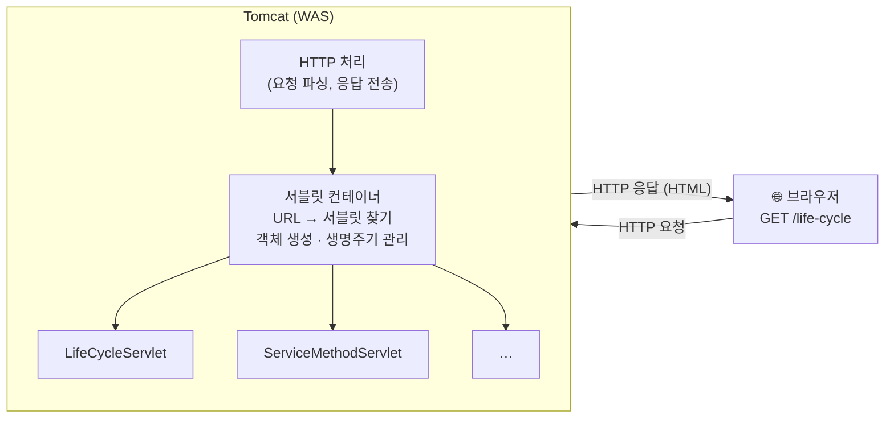
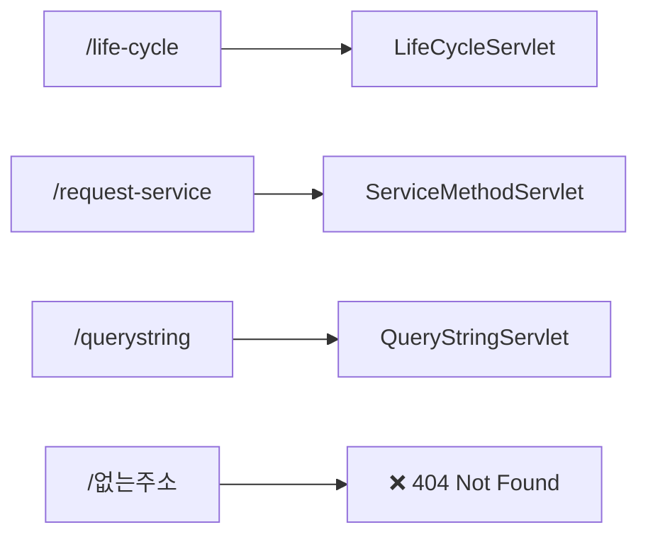
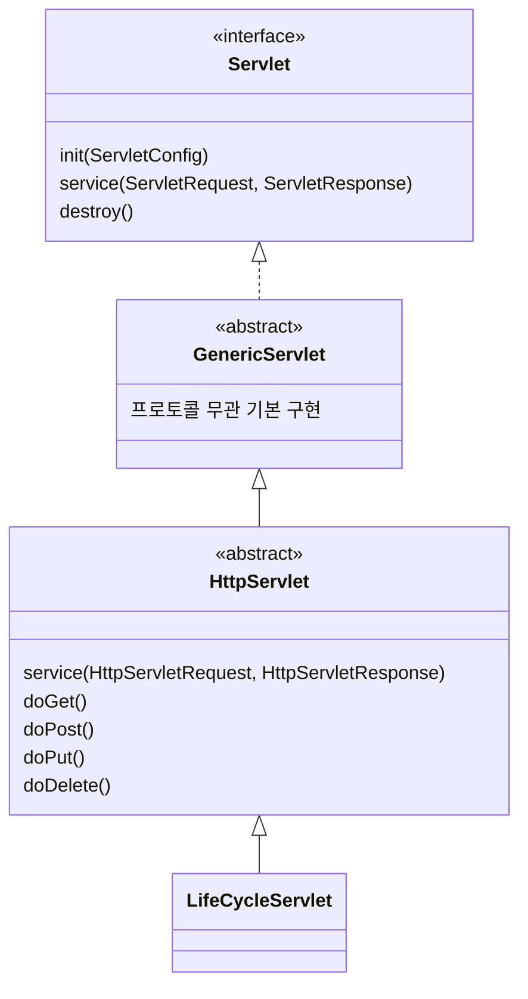
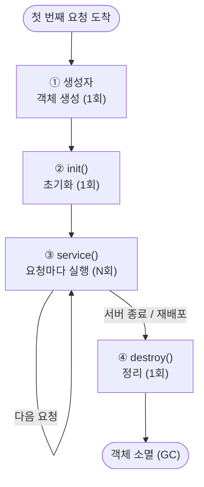
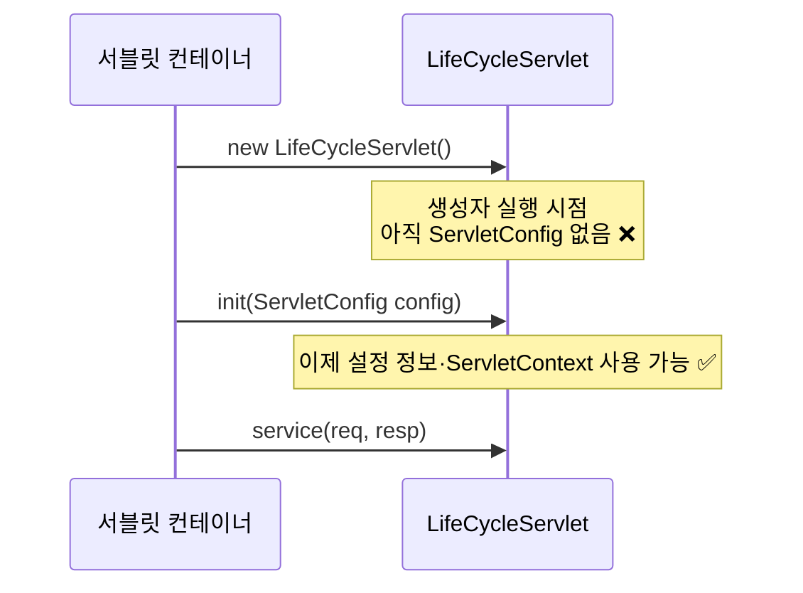
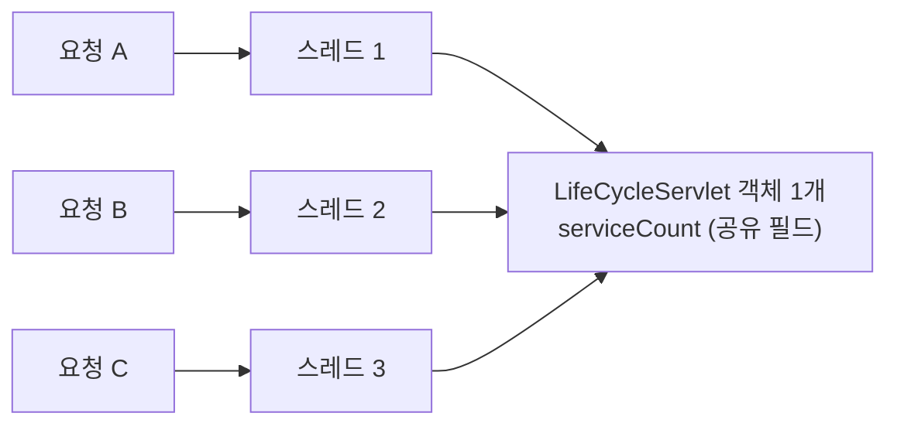
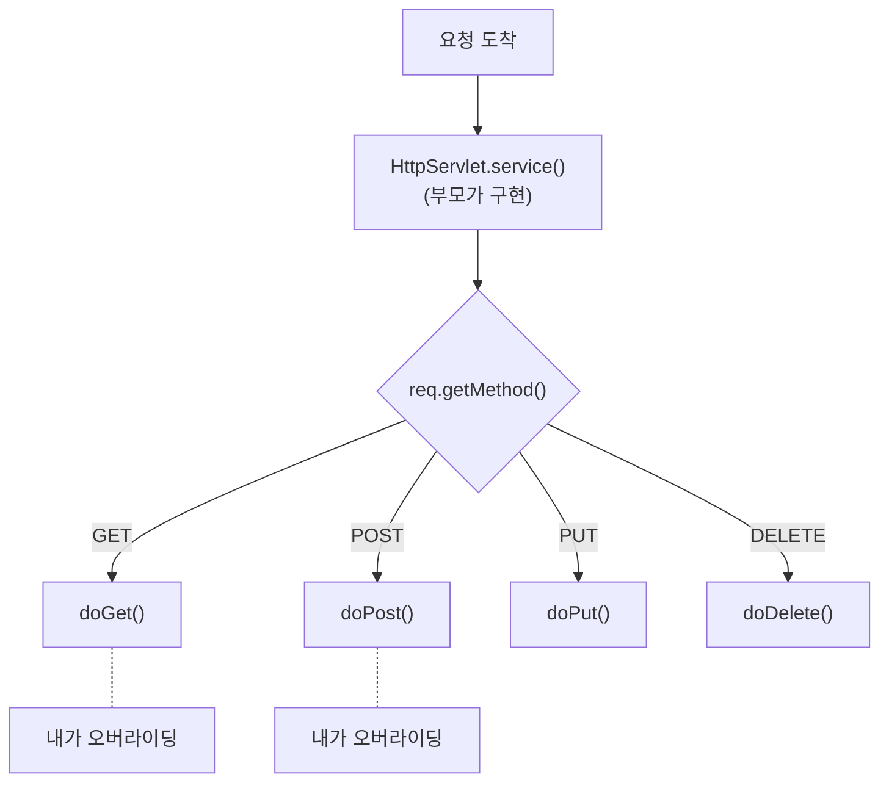

> **이번 글에서 다루는 것**
> 1. 서블릿이 무엇이고, 웹 요청이 서블릿까지 오는 경로
> 2. 프로젝트 설정 (`war` 플러그인, `jakarta.servlet-api`)
> 3. `@WebServlet`으로 URL 매핑하기
> 4. 서블릿 생명주기: 생성자 → `init()` → `service()` → `destroy()`
> 5. `service()`가 `doGet()` / `doPost()`로 요청을 나누는 원리

---

## 0. 서블릿(Servlet)이란?

지금까지 만든 Java 프로그램은 `main()`을 실행하고 **콘솔**로 입출력했다.
웹에서는 사용자가 **브라우저**로 URL을 요청하고, 서버는 **HTML**로 응답한다.

**서블릿은 "HTTP 요청을 받아서 처리하고, 응답을 돌려주는 Java 클래스"** 다.
그런데 서블릿에는 `main()`이 없다. 그럼 누가 실행시킬까? → **서블릿 컨테이너(Tomcat)** 다.



| 용어 | 의미 | 예시 |
|---|---|---|
| **웹 서버** | 정적 파일(HTML, CSS, 이미지)을 그대로 응답 | Nginx, Apache |
| **WAS** (Web Application Server) | Java 코드를 실행해 **동적인** 응답을 만듦 | Tomcat |
| **서블릿 컨테이너** | WAS 안에서 서블릿 객체를 만들고, 호출하고, 없애는 관리자 | Tomcat의 Catalina |
| **서블릿** | 요청 1종류를 처리하는 Java 클래스 | `LifeCycleServlet` |

> 💡 서블릿은 우리가 `new`하지도, 직접 호출하지도 않는다. **컨테이너가 알아서 만들고 알아서 호출한다.**
> 이렇게 "제어권이 프레임워크에게 넘어간 구조"를 **제어의 역전(IoC)** 이라고 하는데, 나중에 Spring을 배울 때 핵심 개념으로 다시 등장한다.

---

## 1. 프로젝트 설정

```groovy
plugins {
    id 'java'
    id 'war'          // 웹 애플리케이션 배포 파일(.war)로 빌드
}

dependencies {
    compileOnly('jakarta.servlet:jakarta.servlet-api:6.1.0')
}
```

### 짚고 넘어가기

- **`war` 플러그인** — 웹 애플리케이션은 `.jar`가 아니라 **`.war`(Web ARchive)** 로 묶어서 Tomcat에 올린다.
- **`compileOnly`인 이유** — 서블릿 API는 **Tomcat이 이미 가지고 있다.** 컴파일할 때만 필요하고, 배포 파일에 또 넣으면 Tomcat의 것과 충돌할 수 있다.
- **`javax` → `jakarta`** — 예전 자료에는 `javax.servlet.*`으로 나오는데, Java EE가 Eclipse 재단으로 넘어가면서 **Jakarta EE**로 이름이 바뀌었다. Tomcat 10 이상은 `jakarta.servlet.*`을 써야 한다. 구글링한 코드가 안 된다면 import부터 확인하자.

### 폴더 구조

```
src/main
├── java/com/wanted/servlet/...     ← 서블릿, 필터 (Java 코드)
└── webapp                          ← 웹 루트 ("/")
    ├── index.html                  ← http://localhost:8080/index.html
    ├── b_service/service.html      ← http://localhost:8080/b_service/service.html
    ├── *.jsp
    └── WEB-INF/web.xml             ← 설정 파일 (외부에서 직접 접근 불가)
```

`webapp` 폴더가 곧 URL의 `/`다. 단, **`WEB-INF` 안의 파일은 브라우저가 직접 요청할 수 없다.** (설정 파일이나 숨겨야 할 JSP를 넣는 곳)

---

## 2. `@WebServlet` — URL과 서블릿 연결하기

```java
@WebServlet(value = "/life-cycle")
public class LifeCycleServlet extends HttpServlet { ... }
```

"사용자가 `/life-cycle`을 요청하면 이 클래스가 처리한다"는 뜻이다. `value`만 쓸 때는 `@WebServlet("/life-cycle")`처럼 생략할 수 있다.



### 짚고 넘어가기

- **URL은 반드시 `/`로 시작**해야 한다. `@WebServlet("life-cycle")`이면 서버 시작 시 에러가 난다.
- **같은 URL을 두 서블릿에 매핑하면** 서버가 시작되지 않는다. (`IllegalArgumentException: ... are both mapped to the url-pattern`)
- 어노테이션 대신 `web.xml`의 `<servlet>`, `<servlet-mapping>`으로도 등록할 수 있다. 수업 후반의 **필터**에서 두 방식을 모두 보게 된다.
- **`extends HttpServlet`** — 서블릿은 원래 `Servlet` 인터페이스를 구현해야 하지만, HTTP 처리에 필요한 기본 동작을 미리 구현해 둔 **`HttpServlet`을 상속**하면 필요한 메서드만 오버라이딩하면 된다.



---

## 3. 서블릿 생명주기 (a_lifecycle)

```java
@WebServlet(value = "/life-cycle")
public class LifeCycleServlet extends HttpServlet {

    private int initCount = 1;
    private int serviceCount = 1;
    private int destroyCount = 1;

    public LifeCycleServlet() {
        System.out.println("기본생성자 호출됨...");
    }

    @Override
    public void init(ServletConfig config) throws ServletException {
        System.out.println("init() 호출됨... : " + initCount++);
    }

    @Override
    protected void service(HttpServletRequest req, HttpServletResponse resp)
            throws ServletException, IOException {
        System.out.println("service() 호출됨... : " + serviceCount++);
    }

    @Override
    public void destroy() {
        System.out.println("destroy() 호출됨... : " + destroyCount++);
    }
}
```

`/life-cycle`을 3번 요청하고 서버를 끄면 콘솔에 이렇게 찍힌다.

```
기본생성자 호출됨...
init() 호출됨... : 1
service() 호출됨... : 1
service() 호출됨... : 2
service() 호출됨... : 3
destroy() 호출됨... : 1      ← 서버 종료 시
```

### 3-1. 생명주기 그림



| 단계 | 언제 | 몇 번 | 주로 하는 일 |
|---|---|---|---|
| 생성자 | 첫 요청 시 (기본값) | 1번 | 객체 생성 |
| `init()` | 생성 직후 | 1번 | 설정값 읽기, 자원 준비 |
| `service()` | **요청이 올 때마다** | N번 | 요청 처리 |
| `destroy()` | 서버 종료·재배포 시 | 1번 | 자원 정리 |

### 3-2. 🤔 생성자와 `init()`은 뭐가 다를까?

수업 중 주석에 "기본생성자 역할?"이라는 메모가 있었는데, 둘 다 1번만 실행되니 헷갈릴 만하다.
차이는 **"컨테이너가 준비해준 정보를 쓸 수 있느냐"** 다.



- **생성자**: 순수하게 Java 객체가 만들어지는 시점. 컨테이너 관련 정보는 아직 없다.
- **`init()`**: 컨테이너가 **`ServletConfig`(초기 파라미터, 컨텍스트 정보)** 를 넘겨주는 시점. 서블릿 초기화 코드는 여기에 쓰는 게 정석이다.

> ⚠️ **작은 함정** — `init(ServletConfig config)`를 오버라이딩하면서 `super.init(config)`를 호출하지 않으면, 나중에 `getServletConfig()`가 `null`을 반환한다.
> 그래서 직접 초기화 코드를 넣을 때는 **매개변수 없는 `init()`** 을 오버라이딩하는 것을 권장한다. 부모 `init(ServletConfig)`가 config를 저장한 뒤 `init()`을 불러준다.
>
> ```java
> @Override
> public void init() throws ServletException {
>     // getServletConfig() 사용 가능
> }
> ```

### 3-3. 🤔 왜 생성자가 딱 1번만 호출될까? — 서블릿은 싱글톤

요청이 100번 와도 `LifeCycleServlet` 객체는 **딱 1개**다. 컨테이너가 객체 하나를 만들어두고, 요청이 올 때마다 **스레드를 하나씩 붙여서** 같은 객체의 `service()`를 호출한다.



이 구조 때문에 꼭 알아둘 점이 있다.

> ⚠️ **서블릿에 인스턴스 필드로 "요청마다 달라지는 값"을 두면 안 된다.**
> 여러 스레드가 같은 필드를 동시에 읽고 쓰기 때문에 값이 꼬인다.
> 예제의 `serviceCount++`도 동시에 요청이 몰리면 숫자가 건너뛰거나 중복될 수 있다. (학습용 카운터라 괜찮지만, 로그인한 사용자 ID 같은 걸 필드에 저장하면 **다른 사람 정보가 보이는** 사고가 난다.)
> 요청마다 달라지는 값은 **메서드 안의 지역 변수**로 다루자.

### 3-4. 생성 시점 바꾸기 — `loadOnStartup`

기본적으로 서블릿은 **첫 요청이 들어올 때** 만들어진다(지연 로딩). 그래서 첫 요청만 살짝 느리다.
서버가 켜질 때 미리 만들고 싶다면:

```java
@WebServlet(value = "/life-cycle", loadOnStartup = 1)
```

0 이상의 숫자를 주면 서버 시작 시 생성되고, 숫자가 작을수록 먼저 만들어진다.

---

## 4. `service()`와 `doGet()` / `doPost()` (b_service)

### 4-1. 요청을 보내는 3가지 방법

```html
<!-- ① a 태그: 링크 클릭 = GET -->
<a href="/request-service">서비스 메소드 요청하기</a>

<!-- ② form method="get" -->
<form action="/request-service" method="get">
    <input type="submit" value="GET 방식 요청!!">
</form>

<!-- ③ form method="post" -->
<form action="/request-service" method="post">
    <input type="submit" value="POST 방식 요청!!">
</form>
```

| 요청 방법 | HTTP 메서드 |
|---|---|
| 주소창에 URL 입력 / 새로고침 | GET |
| `<a href>` 클릭 | GET |
| `<form method="get">` | GET |
| `<form method="post">` | POST |
| `<form>`에 method 생략 | **GET** (기본값) |

> HTML `<form>`으로 보낼 수 있는 건 **GET과 POST뿐**이다. PUT, DELETE는 JavaScript(`fetch`)로 보내야 한다.

### 4-2. service()를 직접 오버라이딩하면?

```java
@Override
protected void service(HttpServletRequest req, HttpServletResponse resp) {
    String httpMethod = req.getMethod();   // "GET" 또는 "POST"
    System.out.println("httpMethod = " + httpMethod);
}
```

GET이든 POST든 **모두 이 메서드로** 들어온다. 그러면 안에서 `if ("GET".equals(...))`로 직접 나눠야 한다.

### 4-3. 그래서 doGet() / doPost()를 오버라이딩한다

```java
@WebServlet(value = "/request-service")
public class ServiceMethodServlet extends HttpServlet {

    @Override
    protected void doGet(HttpServletRequest req, HttpServletResponse resp) {
        System.out.println("GET 요청을 처리할 메소드 호출됨...");
    }

    @Override
    protected void doPost(HttpServletRequest req, HttpServletResponse resp) {
        System.out.println("POST 요청을 처리할 메소드 호출됨...");
    }
}
```

**`HttpServlet`의 `service()`가 이미 그 `if` 분기를 구현해 두었기 때문**이다.



### 짚고 넘어가기

- **`service()`를 오버라이딩하면 분기 기능이 사라진다.** 부모의 `service()`를 덮어쓴 것이므로 `doGet()`/`doPost()`는 더 이상 호출되지 않는다. 그래서 보통은 `service()`는 건드리지 않고 `doXxx()`만 오버라이딩한다.
- **오버라이딩하지 않은 메서드로 요청이 오면 `405 Method Not Allowed`** — 예를 들어 `doPost()`만 만들어두고 브라우저 주소창에 URL을 치면(GET) 405 에러 페이지가 나온다. "404가 아니라 405가 떴다" = **URL은 맞는데 HTTP 메서드가 안 맞는다**는 뜻이다.
- **`ServletException`, `IOException`을 던질 수 있다** — 메서드 시그니처의 `throws`는 컨테이너가 처리한다. 처리되지 않은 예외가 나가면 사용자는 **500 에러**를 보게 된다. (→ 03편 에러 페이지)

---

## ✅ 마무리 요약

- **서블릿** = HTTP 요청을 처리하는 Java 클래스. `main()` 없이 **컨테이너(Tomcat)가 생성·호출·소멸**을 관리한다.
- `@WebServlet("/url")`로 URL과 서블릿을 연결한다.
- 생명주기: **생성자(1) → init(1) → service(N) → destroy(1)**
- 서블릿 객체는 **1개(싱글톤)**, 요청은 **스레드**별로 처리 → 인스턴스 필드에 요청 데이터를 저장하지 말 것.
- `HttpServlet.service()`가 HTTP 메서드에 따라 `doGet()` / `doPost()`로 나눠준다. 우리는 `doXxx()`만 오버라이딩한다.
- 404 = URL이 없음, **405 = URL은 있는데 메서드가 맞지 않음**.

**다음 글 →** 요청에 담긴 데이터(파라미터)를 꺼내고, 브라우저에 HTML로 응답해본다.
