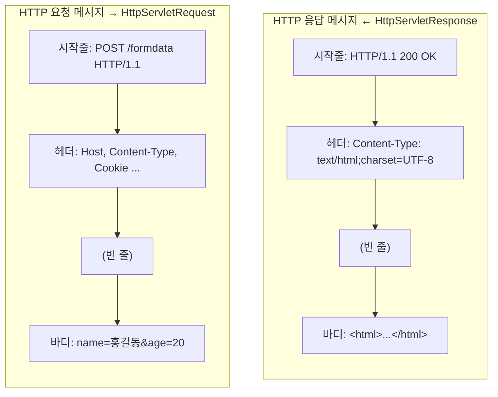
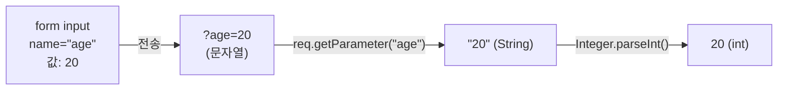
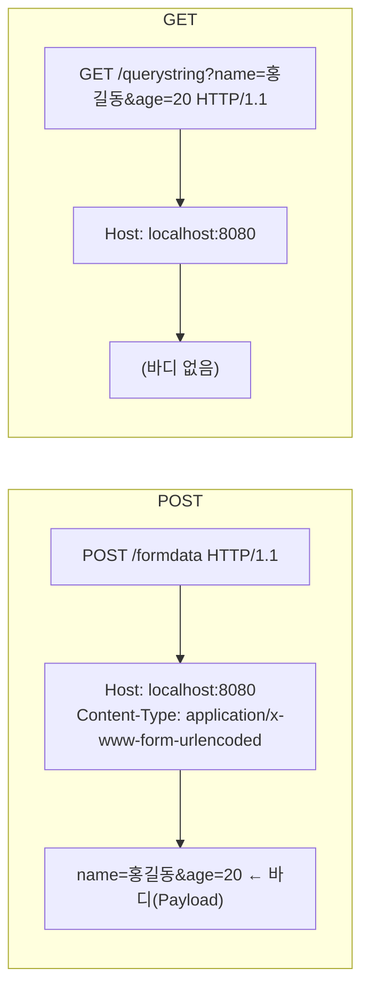
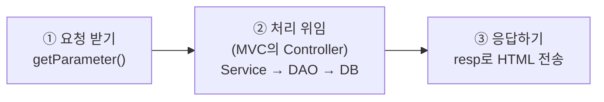
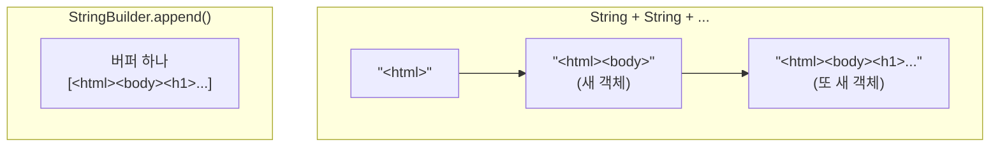
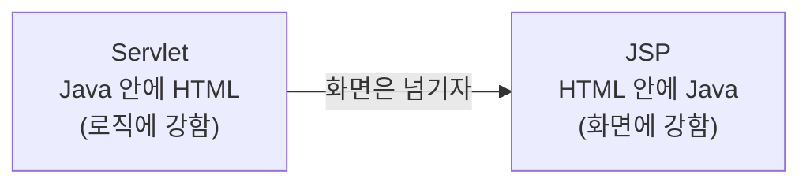

> **이번 글에서 다루는 것**
> 1. HTTP 요청·응답 메시지의 생김새
> 2. GET(쿼리스트링)과 POST(Body)로 데이터 보내기
> 3. `getParameter()` / `getParameterValues()`로 값 꺼내기
> 4. `HttpServletResponse` + `PrintWriter`로 HTML 응답하기
> 5. 한글이 깨지는 이유와 `setContentType()`

---

## 0. HTTP 메시지 먼저 보기

서블릿의 `req`, `resp`는 결국 **HTTP 메시지를 Java 객체로 바꿔놓은 것**이다. 메시지 모양을 알면 메서드들이 훨씬 잘 이해된다.



| 메시지 부분 | 요청에서 꺼내는 메서드 | 응답에 넣는 메서드 |
|---|---|---|
| 시작줄 | `req.getMethod()`, `req.getRequestURI()` | `resp.setStatus()`, `resp.sendError()` |
| 헤더 | `req.getHeader("...")`, `req.getCookies()` | `resp.setContentType()`, `resp.addCookie()` |
| 바디 / 파라미터 | `req.getParameter("...")` | `resp.getWriter().print(...)` |

> 💡 브라우저에서 **F12 → Network 탭**을 열고 요청을 클릭하면 실제 메시지(Headers, Payload, Response)를 볼 수 있다. 이 글의 내용을 직접 확인해보면 훨씬 빨리 이해된다.

---

## 1. GET 요청과 쿼리스트링 (QueryStringServlet)

### 1-1. 보내는 쪽 (HTML)

```html
<form action="/querystring" method="get">
    <input type="text"   name="name">
    <input type="number" name="age">
    <input type="date"   name="birthday">
    <input type="radio"  name="gender" value="M"> <input type="radio" name="gender" value="F">
    <select name="national"> <option value="ko">한국</option> ... </select>
    <input type="checkbox" name="hobbies" value="movie">
    <input type="checkbox" name="hobbies" value="music">
    <input type="checkbox" name="hobbies" value="sleep">
    <input type="submit" value="GET 요청">
</form>
```

제출하면 브라우저 주소창이 이렇게 바뀐다.

```
/querystring?name=홍길동&age=20&birthday=2021-01-08&gender=M&national=ko&hobbies=movie&hobbies=music
└────┬─────┘└──────────────────────────────── 쿼리스트링 ─────────────────────────────────────────┘
   경로      ?로 시작, key=value 쌍을 &로 연결
```

**`name` 속성이 key, 입력값이 value**가 된다. `name`이 없는 input은 아예 전송되지 않는다.

`<a href="/querystring?name=홍길동&age=20...">`처럼 쿼리스트링을 직접 써도 똑같은 GET 요청이 된다.

### 1-2. 받는 쪽 (Servlet)

```java
@WebServlet(value = "/querystring")
public class QueryStringServlet extends HttpServlet {

    @Override
    protected void doGet(HttpServletRequest req, HttpServletResponse resp) {
        String name = req.getParameter("name");
        int age = Integer.parseInt(req.getParameter("age"));   // 모든 파라미터는 String
    }
}
```



### 1-3. ⚠️ `getParameter()`의 반환값 — null과 빈 문자열

`type="number"`로 받아도 서버에 도착하면 **무조건 String**이다. 그리고 상황에 따라 값이 달라진다.

| 상황 | `getParameter("age")` 결과 | `Integer.parseInt()` 하면 |
|---|---|---|
| `age=20` 으로 전송 | `"20"` | ✅ 20 |
| 입력칸을 **비우고** 전송 | `""` (빈 문자열) | ❌ `NumberFormatException` |
| `age` 파라미터 **자체가 없음** (오타, name 누락) | `null` | ❌ `NumberFormatException` |
| `age=스물` | `"스물"` | ❌ `NumberFormatException` |

나이를 비워두고 제출하면 예외가 터져 500 에러 페이지가 뜬다. 실제 서비스라면 변환 전에 검사해야 한다.

```java
String ageParam = req.getParameter("age");
int age = (ageParam == null || ageParam.isBlank()) ? 0 : Integer.parseInt(ageParam);
```

> 키 이름 오타도 `null`로 조용히 돌아온다. 값이 계속 null이라면 **HTML의 `name` 속성과 Java의 문자열이 정확히 같은지**부터 확인하자.

### 1-4. 체크박스처럼 값이 여러 개라면 — `getParameterValues()`

취미를 3개 다 체크하면 `hobbies=movie&hobbies=music&hobbies=sleep`처럼 **같은 key가 여러 번** 온다.
이때 `getParameter("hobbies")`는 **첫 번째 값(`movie`)만** 돌려준다. 전부 받으려면 배열로 꺼낸다.

```java
String[] hobbies = req.getParameterValues("hobbies");   // ["movie", "music", "sleep"]
// 하나도 체크 안 하면 null
```

| 메서드 | 반환 | 용도 |
|---|---|---|
| `getParameter(key)` | `String` | 값이 하나인 파라미터 |
| `getParameterValues(key)` | `String[]` | 체크박스, 다중 select |
| `getParameterMap()` | `Map<String, String[]>` | 전체 파라미터 확인 (디버깅에 유용) |

---

## 2. POST 요청과 Body (FormDataServlet)

```html
<form action="/formdata" method="post"> ... 같은 입력들 ... </form>
```

```java
@WebServlet(value = "/formdata")
public class FormDataServlet extends HttpServlet {

    @Override
    protected void doPost(HttpServletRequest req, HttpServletResponse resp) {
        String name = req.getParameter("name");   // GET과 똑같은 메서드로 꺼낸다!
    }
}
```

**꺼내는 방법은 GET과 완전히 같다.** 차이는 데이터가 **어디에 실려 가느냐**다.



### 2-1. GET vs POST — 조금 더 정확하게

수업 주석의 핵심("GET은 URL, POST는 Body")은 맞다. 다만 몇 가지는 보충/정정해두면 좋다.

| | GET | POST |
|---|---|---|
| 데이터 위치 | URL (쿼리스트링) | 요청 Body |
| 주소창·브라우저 기록·서버 로그에 남음 | 남음 | 남지 않음 |
| 길이 제한 | 있음 (아래 참고) | 사실상 없음 (서버 설정 한도) |
| 북마크 / 링크 공유 | 가능 | 불가 |
| 새로고침 시 | 그냥 다시 요청 | "양식 다시 제출?" 경고 |
| 의미 | **조회** (서버 상태를 바꾸지 않음) | **생성·변경** (서버 상태를 바꿈) |

> 📌 **정정 1 — 길이 제한 "200자"**
> HTTP 규격 자체에는 URL 길이 제한이 없다. 실제 한도는 **브라우저와 서버 설정**에 달려 있고, 보통 수천 자(약 2KB~8KB) 수준이다. "길게 보내면 잘릴 수 있으니 큰 데이터는 POST"라고 기억하면 충분하다.
>
> 📌 **정정 2 — "GET이 빠르고 POST가 느리다"**
> 전송 속도 자체는 거의 차이가 없다. GET이 조회에 쓰이는 진짜 이유는 **의미(조회 = 상태 변경 없음)** 와, 그 덕분에 브라우저·프록시가 **캐싱**하거나 **북마크**할 수 있기 때문이다.
>
> 📌 **정정 3 — "POST는 보안상 안전하다"**
> POST는 데이터가 주소창에 **보이지 않을 뿐**, 암호화되는 것은 아니다. F12 Network 탭의 Payload에서 비밀번호가 그대로 보인다. 진짜 보안은 **HTTPS**가 담당한다.

### 2-2. POST에서 한글이 깨진다면

GET 쿼리스트링은 Tomcat이 URL을 UTF-8로 해석해 주지만, POST Body의 문자 인코딩은 환경에 따라 기본값이 다를 수 있다.
POST로 보낸 한글이 `ê¹ì¹` 같은 문자로 나오면, **파라미터를 꺼내기 전에** 요청 인코딩을 지정한다.

```java
req.setCharacterEncoding("UTF-8");      // getParameter() 보다 먼저!
String name = req.getParameter("name");
```

매번 쓰기 번거로우니 보통은 **필터**에서 한 번에 처리한다. (→ 05편)

---

## 3. 응답 보내기 (ResponseServlet)

### 3-1. 서블릿의 3가지 역할



JDBC 시간에 만든 `MenuController`가 하던 일을 이제 **서블릿**이 맡는다고 보면 된다.
콘솔 `Scanner` 대신 `req.getParameter()`로 입력을 받고, `System.out` 대신 `resp`로 출력한다.

### 3-2. 코드

```java
@WebServlet("/response")
public class ResponseServlet extends HttpServlet {

    @Override
    protected void doGet(HttpServletRequest req, HttpServletResponse resp) throws IOException {

        StringBuilder response = new StringBuilder();
        response.append("<!doctype html>\n")
                .append("<html>\n")
                .append("<body>\n")
                .append("<h1>Servlet의 응답 결과!</h1>")
                .append("</body>\n")
                .append("</html>\n");

        resp.setContentType("text/html; charset=UTF-8");   // ① 무엇을 보낼지 먼저 알리고

        PrintWriter out = resp.getWriter();                 // ② 응답 Body에 쓰는 펜을 얻어
        out.print(response);                                // ③ 쓰고
        out.flush();                                        // ④ 밀어낸다
        out.close();
    }
}
```

```mermaid
sequenceDiagram
    participant S as ResponseServlet
    participant R as HttpServletResponse
    participant B as 브라우저
    S->>R: setContentType("text/html; charset=UTF-8")
    Note over R: 헤더 Content-Type 설정
    S->>R: getWriter()
    R-->>S: PrintWriter
    S->>R: out.print(html)
    Note over R: 버퍼에 쌓임
    S->>R: out.flush()
    R->>B: HTTP/1.1 200 OK<br/>Content-Type: text/html;charset=UTF-8<br/><br/><html>...</html>
    Note over B: HTML로 해석해서 화면 렌더링
```

### 3-3. `StringBuilder`는 뭘까?

수업 중 "문자열을 만드는 하나의 클래스?"라는 메모가 있었는데, 맞다. **문자열을 여러 번 이어 붙일 때 쓰는 클래스**다.

`String`은 **불변(immutable)** 이라서 `+`로 이을 때마다 **새 String 객체**가 만들어진다.
`StringBuilder`는 내부 버퍼 하나에 계속 이어 붙이기 때문에 이어 붙이는 횟수가 많을수록 효율적이다.



`append()`가 자기 자신을 반환하기 때문에 `.append().append()...`처럼 **메서드 체이닝**이 가능하다.

### 3-4. ⚠️ Content-Type과 한글 깨짐

`setContentType()` 없이 한글을 응답하면 `Servlet??? ?? ??!`처럼 깨진다.
브라우저는 받은 바이트를 **어떤 형식, 어떤 인코딩으로 읽어야 할지** `Content-Type` 헤더를 보고 결정하기 때문이다.

```
Content-Type: text/html; charset=UTF-8
              └───┬───┘  └─────┬─────┘
             MIME 타입     문자 인코딩
         (HTML로 해석해라)  (UTF-8로 읽어라)
```

**자주 하는 실수 세 가지**

| 실수 | 결과 |
|---|---|
| `getWriter()`를 **먼저** 호출하고 `setContentType()`을 나중에 호출 | charset이 적용되지 않음 → 한글 깨짐 |
| `"test/html"` 처럼 MIME 타입 오타 | 브라우저가 HTML로 인식 못 해 텍스트/다운로드로 처리 |
| `"charset = UTF-8"` 처럼 `=` 주변에 공백 | 파싱이 안 돼 인코딩이 무시될 수 있음 |

> 💡 수업 코드에서는 이 줄이 주석 처리되어 있는데, 05편의 **`EncodingFilter`가 모든 응답에 대신 설정**해주기 때문이다. 필터를 빼고 실행하면 한글이 깨지는 걸 확인할 수 있다.

### 3-5. `flush()`와 `close()`

- `flush()`: 버퍼에 쌓인 내용을 즉시 내보낸다.
- `close()`: 스트림을 닫는다. 닫으면서 자동으로 flush도 된다.
- 사실 **호출하지 않아도** 서블릿 메서드가 끝나면 컨테이너가 알아서 flush·close 해준다. 명시적으로 써두는 것은 "응답 끝"을 코드로 표현하는 의미가 크다.

> ⚠️ 한번 응답이 브라우저로 나가기 시작하면(**커밋**되면) 헤더를 바꿀 수 없다. 그래서 `setContentType()`, `addCookie()`, `sendRedirect()` 같은 **헤더 관련 작업은 Body를 쓰기 전에** 해야 한다.

### 3-6. 이렇게 HTML을 Java 문자열로 쓰는 게 맞나?

솔직히 불편하다. 따옴표 이스케이프(`\"`), 줄바꿈, 디자인 수정까지 전부 Java 코드 안에서 해야 한다.
그래서 등장한 것이 **"HTML 안에 Java를 넣는" JSP**다. 04편의 쿠키/세션 예제에서 결과 화면을 JSP로 넘기는 이유가 바로 이것이다.



---

## ✅ 마무리 요약

- `req` / `resp`는 **HTTP 요청·응답 메시지를 객체로 만든 것**이다.
- GET은 **URL 쿼리스트링**, POST는 **Body**에 데이터를 싣는다. 꺼내는 방법은 둘 다 `getParameter()`.
- 파라미터는 **항상 String**. 없으면 `null`, 비어 있으면 `""` → 숫자 변환 전 검사 필요.
- 값이 여러 개(체크박스)면 `getParameterValues()`.
- POST가 "보안"이 되는 건 아니다. 진짜 보안은 HTTPS.
- 응답은 **`setContentType()` → `getWriter()` → `print()`** 순서. 헤더는 Body보다 먼저!

**다음 글 →** 에러 페이지를 처리하는 방법과, 서블릿끼리 일을 넘기는 **forward / redirect**를 알아본다.
