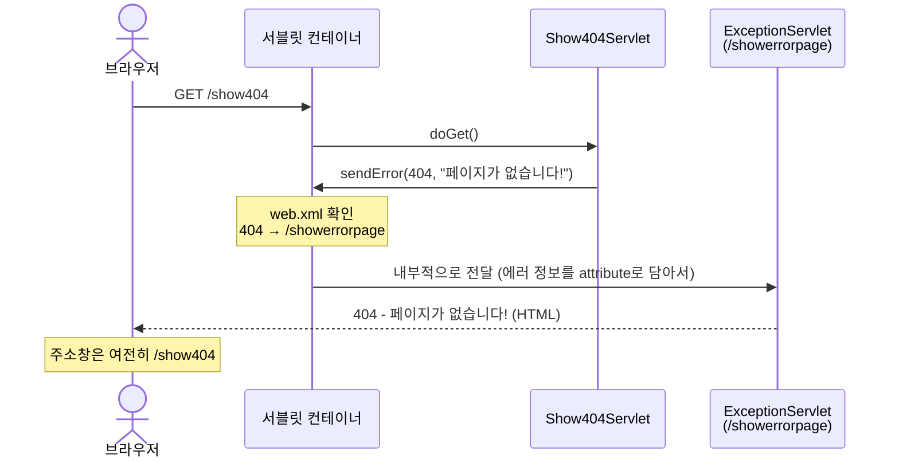
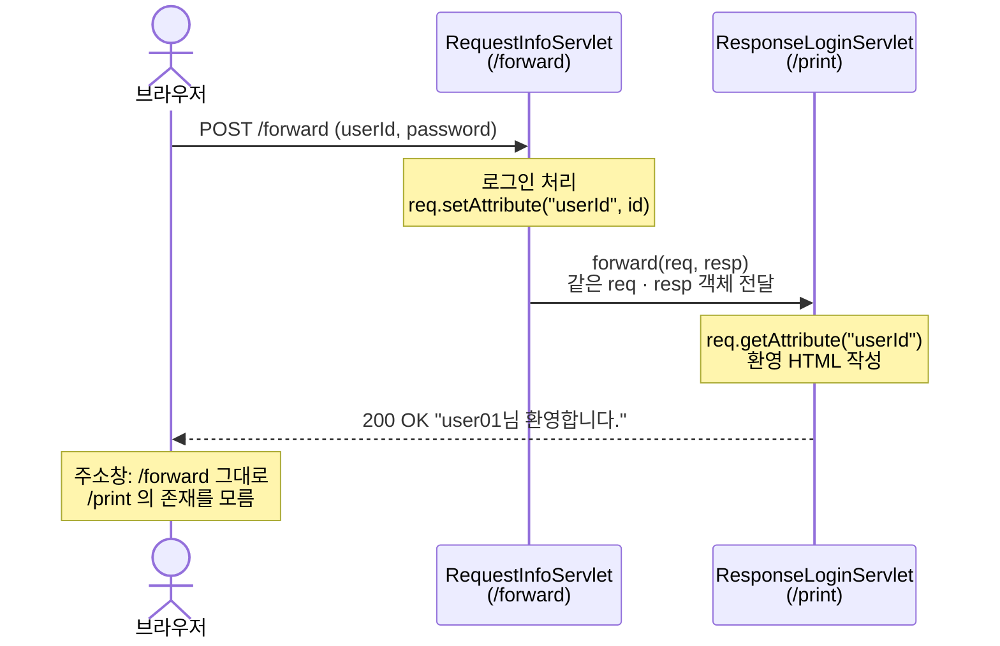
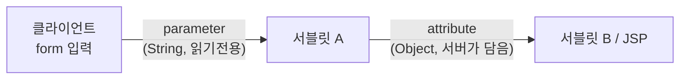
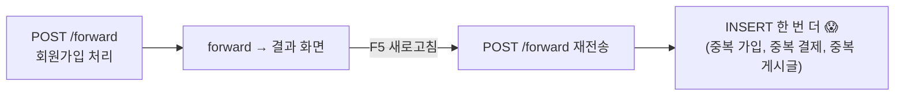
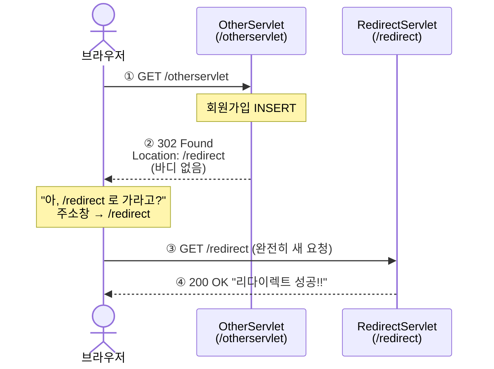
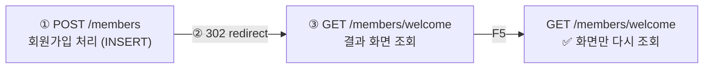

> **이번 글에서 다루는 것**
> 1. HTTP 상태 코드와 `sendError()`
> 2. `web.xml`의 `<error-page>`로 에러 화면 통일하기
> 3. **forward** — 서버 안에서 몰래 넘기기
> 4. **redirect** — 브라우저에게 다시 요청하라고 시키기
> 5. 언제 무엇을 써야 하나 (PRG 패턴)

---

## 1. HTTP 상태 코드

응답의 첫 줄 `HTTP/1.1 200 OK`에서 **200**이 상태 코드다. 앞자리만 알아도 상황을 파악할 수 있다.

| 범위 | 의미 | 대표 코드 |
|---|---|---|
| **2xx** | 성공 | `200 OK` |
| **3xx** | 다른 곳으로 가라 (리다이렉트) | `302 Found` |
| **4xx** | **클라이언트(요청) 잘못** | `400 Bad Request`, `404 Not Found`, `405 Method Not Allowed` |
| **5xx** | **서버(개발자) 잘못** | `500 Internal Server Error` |

> 수업 코드의 `"500번대 Error는 순전히 개발자의 잘못."`이 바로 이 구분이다.
> 404는 "없는 주소를 요청한 사용자", 500은 "처리하다 터진 서버 코드" 쪽 책임이다.

---

## 2. 에러를 일부러 발생시키기 — `sendError()`

```java
@WebServlet("/show404")
public class Show404Servlet extends HttpServlet {
    @Override
    protected void doGet(HttpServletRequest req, HttpServletResponse resp) throws IOException {
        resp.sendError(404, "페이지가 없습니다!");
    }
}

@WebServlet("/show500")
public class Show500Servlet extends HttpServlet {
    @Override
    protected void doGet(HttpServletRequest req, HttpServletResponse resp) throws IOException {
        resp.sendError(500, "500번대 Error는 순전히 개발자의 잘못.");
    }
}
```

`sendError(상태코드, 메시지)`는 "이 요청은 에러로 끝났다"고 선언한다. 그냥 두면 Tomcat의 기본 에러 페이지(회색 바탕의 그 화면)가 나온다.

> 💡 `HttpServletResponse.SC_NOT_FOUND`(404), `SC_INTERNAL_SERVER_ERROR`(500)처럼 상수도 제공된다. 숫자보다 의미가 잘 드러난다.

---

## 3. 에러 페이지 통일하기 — `web.xml`의 `<error-page>`

```xml
<error-page>
    <error-code>404</error-code>
    <location>/showerrorpage</location>
</error-page>

<error-page>
    <error-code>500</error-code>
    <location>/showerrorpage</location>
</error-page>
```

"404나 500이 발생하면 **`/showerrorpage` 서블릿이 화면을 대신 그려라**"는 설정이다.



### 3-1. 에러 정보 꺼내기

컨테이너는 에러 페이지로 넘길 때 정보를 **request attribute**에 담아준다.

```java
@WebServlet("/showerrorpage")
public class ExceptionServlet extends HttpServlet {
    @Override
    protected void doGet(HttpServletRequest req, HttpServletResponse resp) throws IOException {

        int statusCode = (int) req.getAttribute("jakarta.servlet.error.status_code");
        String msg     = req.getAttribute("jakarta.servlet.error.message").toString();

        // statusCode, msg 로 HTML 만들어서 응답
    }
}
```

| attribute 이름 | 들어 있는 값 |
|---|---|
| `jakarta.servlet.error.status_code` | 상태 코드 (`Integer`) |
| `jakarta.servlet.error.message` | `sendError()`에 넣은 메시지 |
| `jakarta.servlet.error.request_uri` | **에러가 난 원래 요청 URI** |
| `jakarta.servlet.error.exception` | 발생한 예외 객체 (예외로 인한 500일 때) |

> 💡 수업 코드는 원래 URL을 `jakarta.servlet.forward.request_uri`로 꺼내고 있는데, 에러 페이지에서는 **`jakarta.servlet.error.request_uri`가 에러 전용 attribute**다. 컨테이너 구현에 따라 forward 쪽 값이 없을 수 있으니 error 쪽을 쓰는 게 안전하다.

### 3-2. 더 알아두면 좋은 점

- **진짜 존재하지 않는 URL**(`/abcdef`)을 쳐도 같은 페이지가 나온다. `sendError(404)`를 직접 호출한 경우뿐 아니라, 컨테이너가 404를 판단한 경우에도 `<error-page>`가 적용된다.
- **처리되지 않은 예외**(`NullPointerException`, `NumberFormatException` 등)가 서블릿 밖으로 던져지면 500이 되고, 역시 이 페이지로 온다.
- 예외 **종류별로** 페이지를 지정할 수도 있다.

  ```xml
  <error-page>
      <exception-type>java.lang.NullPointerException</exception-type>
      <location>/showerrorpage</location>
  </error-page>
  ```

- 에러 페이지의 원리는 아래에서 배울 **forward와 같다** — 주소창은 그대로인데, 다른 서블릿이 응답을 만든다. 그래서 수업 코드 주석에 "마치 요청을 받은 서블릿이 응답까지 하는 것처럼"이라는 설명이 붙어 있다.

---

## 4. forward — 서버 안에서 일 넘기기 (f_forward)

### 4-1. 왜 넘기나?

로그인 요청을 처리하는 서블릿 하나가 **로그인 처리 + 환영 HTML 생성**까지 다 하면 책임이 너무 많다.
그래서 **"처리하는 서블릿"** 과 **"응답 화면을 만드는 서블릿"** 을 나눈다.

```java
@WebServlet("/forward")
public class RequestInfoServlet extends HttpServlet {
    @Override
    protected void doPost(HttpServletRequest req, HttpServletResponse resp)
            throws ServletException, IOException {

        String id  = req.getParameter("userId");
        String pwd = req.getParameter("password");

        // memberService.login(id, pwd);  ← 로그인 처리 (가정)

        req.setAttribute("userId", id);                         // ① 넘길 값을 req에 담고
        RequestDispatcher rd = req.getRequestDispatcher("/print");   // ② 넘길 곳 지정
        rd.forward(req, resp);                                   // ③ req, resp를 통째로 넘김
    }
}
```

```java
@WebServlet("/print")
public class ResponseLoginServlet extends HttpServlet {
    @Override
    protected void doPost(HttpServletRequest req, HttpServletResponse resp) throws IOException {
        String id = req.getAttribute("userId").toString();      // ④ 앞 서블릿이 담은 값 꺼내기
        // "id님 환영합니다." HTML 응답
    }
}
```

### 4-2. 동작 흐름



**요청은 1번, 응답도 1번.** 브라우저 입장에서는 `/forward`에 요청했고 `/forward`가 응답한 것으로 보인다.

> 📝 **수업 메모 — forward는 "나쁜 놈" (실적 가로채기)**
> 다른 사람한테 일을 시켜 놓고, **내가 한 것처럼** 알려주는 방식이다.
> 실제 응답은 `/print`가 만들었는데, 브라우저는 끝까지 `/forward`가 다 한 줄 안다.

### 4-3. forward의 핵심 특징

1. **`req`, `resp`를 공유한다** → `setAttribute()`로 담은 값을 다음 서블릿이 `getAttribute()`로 꺼낼 수 있다.
2. **URL이 바뀌지 않는다** → 클라이언트는 `/print`의 존재를 모른다.
3. **HTTP 메서드도 그대로다** → POST로 받아서 forward하면, 받는 쪽도 **`doPost()`** 가 호출된다. (그래서 `ResponseLoginServlet`이 `doGet`이 아니라 `doPost`를 오버라이딩한 것)
4. **서버 내부 이동이라 빠르다** → 네트워크를 다시 타지 않는다.

### 4-4. 🤔 `getParameter()` vs `getAttribute()` — 헷갈리는 두 메서드

| | `getParameter()` | `getAttribute()` |
|---|---|---|
| 값을 넣는 주체 | **클라이언트** (form, 쿼리스트링) | **서버 코드** (`setAttribute()`) |
| 타입 | 항상 `String` | `Object` (아무 객체나 가능) → 꺼낼 때 형변환 |
| 수정 가능? | ❌ 읽기 전용 | ✅ `setAttribute()`로 추가·변경 |
| 주 용도 | 사용자 입력 받기 | 서블릿 → 서블릿/JSP로 데이터 넘기기 |



> 📝 **수업 메모 — setter / getter**
> - **setter(`setAttribute`)** : 값을 담아서 **보내준다.** (넘기는 쪽 서블릿)
> - **getter(`getAttribute`)** : 보내준 값을 **꺼내 받는다.** (넘겨받는 쪽 서블릿 / JSP)

> `getAttribute()`는 `Object`를 돌려주므로 `toString()`이나 `(String)` 형변환이 필요하다. 값이 없으면 `null`이라 `.toString()`을 바로 부르면 NPE가 난다. **`(String) req.getAttribute(...)` 형변환은 null이어도 안전**하다는 점을 기억해두자. (04편 세션 코드에서 다시 나온다.)

### 4-5. ⚠️ forward의 함정 — 새로고침하면 POST가 다시 간다

forward 후 주소창은 `/forward` 그대로이고, **브라우저가 마지막으로 보낸 요청은 `POST /forward`** 다.
여기서 새로고침(F5)을 누르면 브라우저는 그 POST를 **똑같이 다시 보낸다.**



> 그래서 수업에서 강조한 결론: **조회(SELECT) 결과를 보여줄 때는 forward, 데이터를 바꾸는(INSERT/UPDATE/DELETE) 요청 뒤에는 redirect.**

---

## 5. redirect — 브라우저에게 다시 요청시키기 (g_redirect)

```java
@WebServlet("/otherservlet")
public class OtherServlet extends HttpServlet {
    @Override
    protected void doGet(HttpServletRequest req, HttpServletResponse resp) throws IOException {
        // memberService.signUp();  ← 회원가입 처리 (가정)
        System.out.println("회원정보 DB에 Insert 완료!");

        resp.sendRedirect("/redirect");   // "다음엔 /redirect 로 가세요"
    }
}

@WebServlet("/redirect")
public class RedirectServlet extends HttpServlet {
    @Override
    protected void doGet(HttpServletRequest req, HttpServletResponse resp) throws IOException {
        // "리다이렉트 성공!!" HTML 응답
    }
}
```

### 5-1. 동작 흐름 — 요청이 2번 일어난다



`sendRedirect()`는 서버가 직접 이동하는 게 아니라, 브라우저에게 **"302 상태 코드 + `Location` 헤더"** 를 보내는 것이다. 브라우저가 그걸 보고 **스스로 새 요청**을 보낸다.
F12 Network 탭에서 보면 요청이 **두 줄**(302, 200) 찍혀 있는 걸 확인할 수 있다.

> 📝 **수업 메모 — redirect는 "전화 연결" (무조건 GET)**
> 내가 모르는 내용을 **다른 사람에게 전화 연결**해서, 그 **새로운 사람이** 알려주는 방식이다.
> 연결된 뒤에는 상대가 바뀐 걸 손님(브라우저)도 안다 → 주소창이 바뀐다. 그리고 새로 거는 전화는 **무조건 GET**이다.

### 5-2. redirect의 핵심 특징

1. **요청이 2번** → 두 번째 요청은 완전히 새로운 `req`, `resp`. 앞에서 `setAttribute()`한 값은 **사라진다.**
2. **URL이 바뀐다** → 주소창이 `/redirect`로 변경된다.
3. **항상 GET** → 주소창 URL을 바꾸는 것 = 링크 클릭과 같으므로 두 번째 요청은 GET이다. (그래서 `RedirectServlet`은 `doGet`)
4. **새로고침해도 안전** → 마지막 요청이 `GET /redirect`이므로, F5를 눌러도 결과 화면만 다시 조회한다. INSERT는 반복되지 않는다.
5. **외부 사이트로도 보낼 수 있다** → `resp.sendRedirect("https://www.google.com")`. forward는 같은 웹 애플리케이션 안에서만 가능하다.

### 5-3. PRG 패턴 (Post → Redirect → Get)

실무에서 데이터를 변경하는 요청은 거의 항상 이 흐름을 따른다.



### 5-4. 더 알아두면 좋은 점

- **redirect 경로와 컨텍스트 패스** — `sendRedirect("/redirect")`의 `/`는 **서버 루트** 기준이다. 지금은 애플리케이션이 `/`에 배포되어 있어서 동작하지만, `/myapp`처럼 하위 경로에 배포되면 `/myapp/redirect`가 아니라 `/redirect`로 가서 404가 난다. 안전하게 쓰려면:

  ```java
  resp.sendRedirect(req.getContextPath() + "/redirect");
  ```

  반대로 **forward 경로**(`getRequestDispatcher("/print")`)는 애플리케이션 내부 기준이라 컨텍스트 패스를 붙이지 않는다.

- **forward / redirect 뒤에는 `return`** — 두 메서드 모두 호출한다고 그 자리에서 메서드가 끝나지 않는다. 아래 코드가 계속 실행되어 응답을 또 쓰려고 하면 `IllegalStateException`이 날 수 있다. 조건문 안에서 쓸 때는 바로 `return;` 하는 습관을 들이자.

- **redirect의 약점 = 이전 요청을 모른다** — 첫 요청에서 처리한 정보(예: 가입한 사용자 이름)를 두 번째 요청에서 쓰고 싶다면? 요청이 끊겨 있으니 `req.setAttribute()`로는 불가능하다. 이걸 해결하는 것이 바로 다음 글의 **쿠키와 세션**이다.

---

## ✅ 마무리 요약

| | forward | redirect |
|---|---|---|
| 코드 | `req.getRequestDispatcher("/경로").forward(req, resp)` | `resp.sendRedirect("/경로")` |
| 누가 이동? | **서버**가 내부에서 | **브라우저**가 다시 요청 |
| 요청 횟수 | 1번 | 2번 (302 → 새 요청) |
| 주소창 URL | 그대로 | 바뀜 |
| req / resp | **공유** (attribute 전달 가능) | 새로 생성 (attribute 사라짐) |
| HTTP 메서드 | 원래 메서드 유지 | 항상 GET |
| 외부 사이트 | 불가 | 가능 |
| 새로고침 시 | 원래 요청 재전송 ⚠️ | 결과 페이지만 재조회 ✅ |
| 주 용도 | 조회 결과 보여주기, JSP로 화면 위임 | INSERT·UPDATE·DELETE 이후 이동 |
| 비유 (수업 메모) | 실적 가로채기 — 남이 한 걸 내가 한 것처럼 | 전화 연결 — 새로운 사람이 알려줌 |

- 상태 코드: **4xx = 요청 잘못, 5xx = 서버 잘못**.
- `web.xml`의 `<error-page>`로 에러 화면을 한 곳에서 관리한다.
- 데이터를 바꾸는 요청 뒤에는 **PRG(Post → Redirect → Get)**.

**다음 글 →** redirect로 끊어진 요청 사이에서 정보를 유지하는 **쿠키와 세션**.
