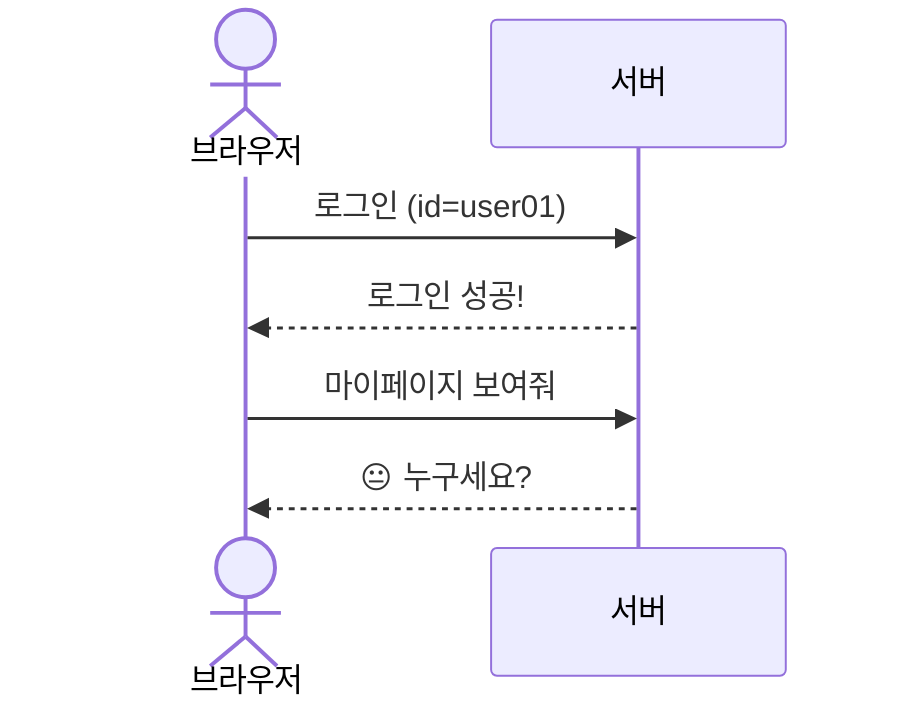
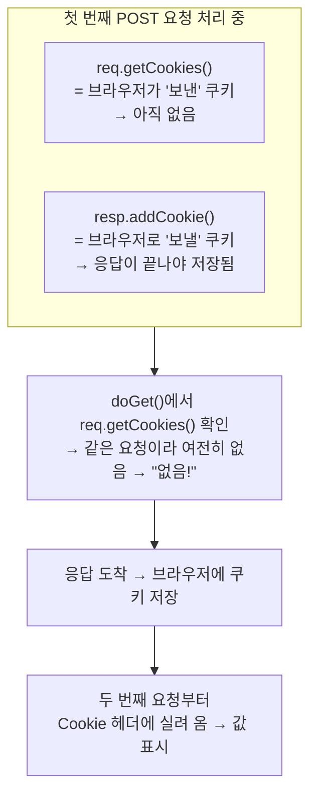
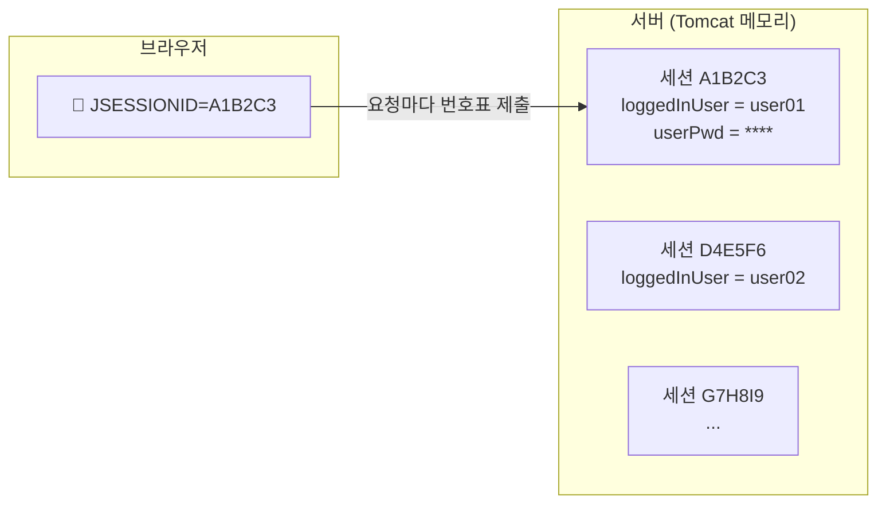
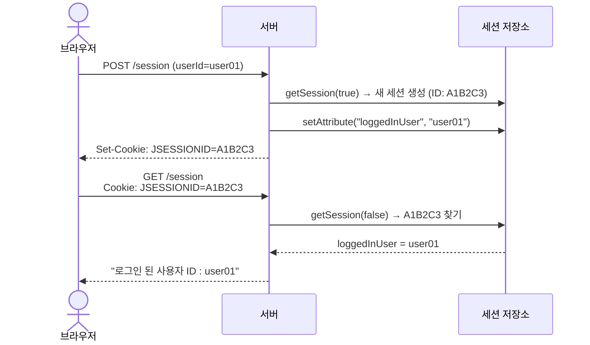
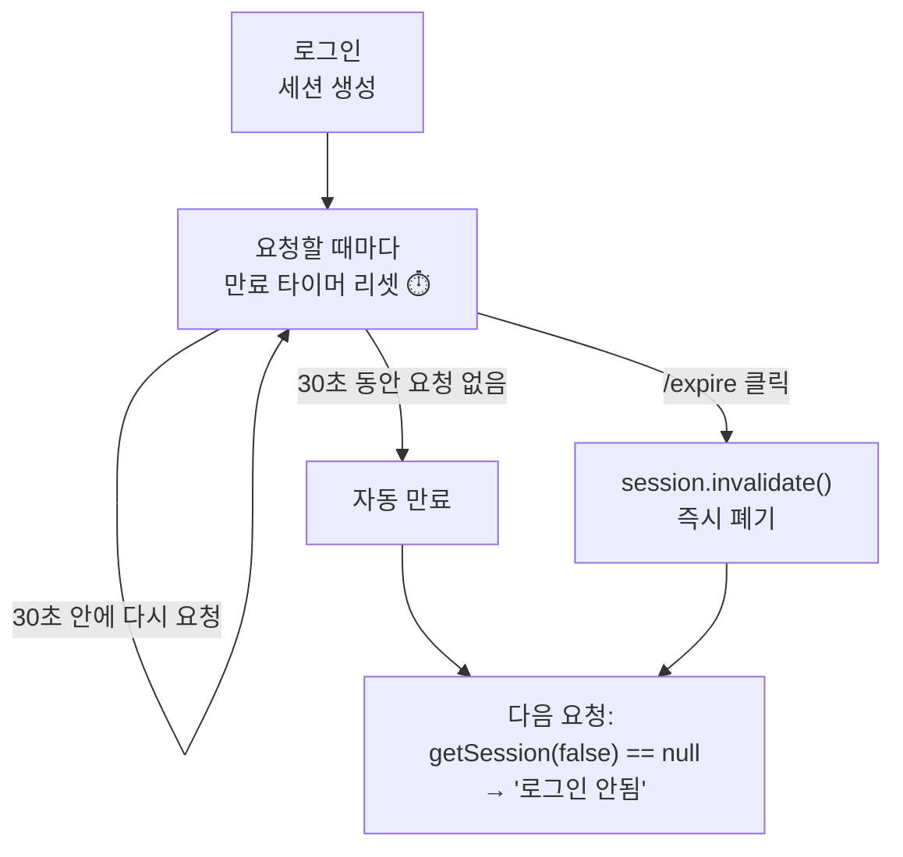
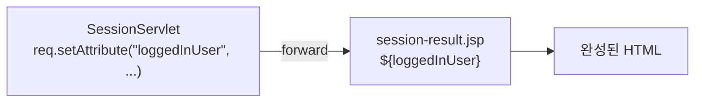
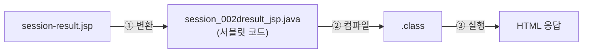
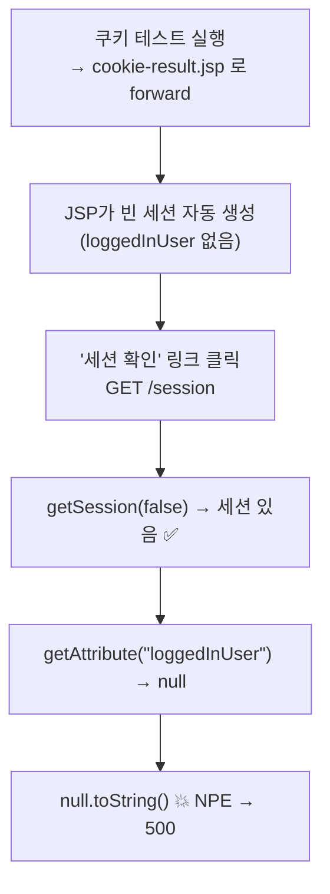

> **이번 글에서 다루는 것**
> 1. HTTP는 왜 사용자를 기억하지 못할까 (Stateless)
> 2. **쿠키** — 브라우저에 저장하기
> 3. **세션** — 서버에 저장하고 브라우저에는 번호표만
> 4. 세션 만료와 무효화
> 5. 결과 화면을 JSP로 넘기기 (EL `${}`)
> 6. 실습 코드에서 만날 수 있는 함정들

---

## 0. HTTP는 기억력이 없다 (Stateless)

HTTP는 **요청 하나, 응답 하나로 대화가 끝나는** 구조다. 서버는 방금 요청한 사람이 아까 그 사람인지 모른다.
03편의 redirect에서 "두 번째 요청은 첫 번째 요청을 모른다"고 한 것도 같은 이유다.



그래서 요청 사이에 정보를 이어주는 장치가 필요하다. 저장 위치에 따라 두 가지가 있다.

| | 쿠키 (Cookie) | 세션 (Session) |
|---|---|---|
| 저장 위치 | **브라우저** | **서버** (메모리) |
| 브라우저가 가진 것 | 데이터 자체 | 세션 ID(번호표)만 |
| 보안 | 사용자가 보고 수정 가능 ❌ | 실제 데이터는 서버에 ✅ |
| 용량 | 쿠키 1개당 약 4KB | 서버 메모리 한도 |
| 예시 | 아이디 저장, 팝업 "오늘 하루 보지 않기", 다크모드 설정 | 로그인 상태, 장바구니 |

> 📝 **수업 메모 — 쿠키는 탈취될 수 있는데 왜 쓸까?**
> - **Cookie : 브라우저**에 저장 → 탈취가 **언제든지 가능**하다.
> - 그런데도 쓰는 이유? **핸드폰을 잘 잃어버리는가?** 잃어버릴 수는 있지만 매번 잃어버리지는 않으니 들고 다닌다. 쿠키도 마찬가지로, 위험이 있다는 걸 알고 **민감하지 않은 값만** 담아서 쓴다.
> - **+ 장점 : 용량이 작다.** 서버 메모리를 쓰지 않는다.
> - **Session : 서버**에 저장 → 중요한 정보는 이쪽.
> - 쿠키 값은 사용자가 언제든 바꿀 수 있으니, 서버에서는 **검증할 수 있는 코드를 작성**해야 한다. (→ 아래 4-2)

---

## 1. 쿠키 (CookieServlet)

### 1-1. 코드

```java
@WebServlet("/cookie")
public class CookieServlet extends HttpServlet {

    @Override
    protected void doPost(HttpServletRequest req, HttpServletResponse resp)
            throws ServletException, IOException {
        String cookieValue = req.getParameter("cookieValue");

        Cookie cookie = new Cookie("userValue", cookieValue);   // ① 쿠키 생성 (이름, 값)
        cookie.setMaxAge(60 * 60);                              // ② 유효시간: 초 단위 (1시간)
        resp.addCookie(cookie);                                 // ③ 응답에 실어 보냄

        doGet(req, resp);
    }

    @Override
    protected void doGet(HttpServletRequest req, HttpServletResponse resp)
            throws ServletException, IOException {
        String savedValue = "없음!";

        Cookie[] cookies = req.getCookies();                    // ④ 브라우저가 보낸 쿠키들
        if (cookies != null) {
            for (Cookie cookie : cookies) {
                if ("userValue".equals(cookie.getName())) {
                    savedValue = cookie.getValue();
                    break;
                }
            }
        }

        req.setAttribute("savedValue", savedValue);
        req.getRequestDispatcher("/h_cookie_session/cookie-result.jsp").forward(req, resp);
    }
}
```

### 1-2. 쿠키가 오가는 방법 — 헤더

```mermaid
sequenceDiagram
    actor B as 브라우저 (쿠키 저장소)
    participant S as 서버

    B->>S: POST /cookie (cookieValue=hello)
    S-->>B: 200 OK<br/>Set-Cookie: userValue=hello; Max-Age=3600
    Note over B: 쿠키 저장 🍪<br/>userValue=hello (1시간)

    B->>S: GET /cookie<br/>Cookie: userValue=hello
    Note over S: req.getCookies() 로 읽음
    S-->>B: "쿠키에 저장 된 값 : hello"

    Note over B: 이후 같은 사이트로 가는<br/>모든 요청에 자동으로 첨부
```

- 서버 → 브라우저: **`Set-Cookie`** 응답 헤더 (`resp.addCookie()`)
- 브라우저 → 서버: **`Cookie`** 요청 헤더 (`req.getCookies()`)
- 브라우저는 같은 사이트에 요청할 때마다 **자동으로** 쿠키를 붙여 보낸다.

> 💡 F12 → **Application 탭 → Cookies**에서 저장된 쿠키를 직접 보고, 수정하고, 지울 수도 있다. "쿠키는 사용자가 마음대로 바꿀 수 있다"는 걸 눈으로 확인해보자.

### 1-3. ⚠️ 함정 — 처음 저장하자마자는 "없음!"이 뜬다

실습하면서 이상한 점을 느꼈을 수도 있다. **처음 값을 넣고 버튼을 누르면 "없음!"이 나오고, 다시 한 번 눌러야** 값이 보인다. 버그가 아니라 쿠키의 원리 때문이다.



`resp.addCookie()`는 **응답**에 쿠키를 싣는 것이고, `req.getCookies()`는 **이번 요청**에 브라우저가 들고 온 쿠키를 읽는 것이다.
같은 요청 안에서 `doPost()` → `doGet()`을 호출해도 `req`는 그대로이므로, 방금 추가한 쿠키는 보이지 않는다.

**해결 방법** — 여기서도 03편의 **redirect**가 답이다.

```java
resp.addCookie(cookie);
resp.sendRedirect("/cookie");   // 브라우저가 쿠키를 저장한 뒤 새 GET 요청 → 값이 보임
```

POST 뒤 redirect이니 PRG 패턴도 지켜진다.

### 1-4. `setMaxAge()` 값의 의미

| 값 | 의미 |
|---|---|
| 양수 (예: `3600`) | 그 **초**만큼 유지. 브라우저를 껐다 켜도 남아 있음 (영속 쿠키) |
| `0` | **즉시 삭제** — 쿠키를 지우는 방법 |
| 음수 / 설정 안 함 | 브라우저를 **닫으면 삭제** (세션 쿠키) |

쿠키를 삭제하는 API는 따로 없다. **같은 이름의 쿠키를 `maxAge = 0`으로 다시 보내는 것**이 삭제 방법이다.

```java
Cookie del = new Cookie("userValue", "");
del.setMaxAge(0);
resp.addCookie(del);
```

### 1-5. 더 알아두면 좋은 점

- **쿠키 값에는 한글·공백·`;` `,` 를 그대로 넣을 수 없다.** Tomcat은 규격(RFC 6265)에 맞지 않는 문자가 있으면 예외를 던진다. 한글을 넣고 싶다면 인코딩해서 저장하고, 꺼낼 때 디코딩한다.

  ```java
  new Cookie("userValue", URLEncoder.encode(value, StandardCharsets.UTF_8));
  URLDecoder.decode(cookie.getValue(), StandardCharsets.UTF_8);
  ```

- **민감한 정보(비밀번호, 개인정보)는 쿠키에 넣지 않는다.** 사용자가 볼 수도, 바꿀 수도 있기 때문이다.
- 보안 옵션:
  - `cookie.setHttpOnly(true)` — JavaScript(`document.cookie`)로 읽지 못하게 막음 → XSS 공격 시 쿠키 탈취 방지
  - `cookie.setSecure(true)` — HTTPS 연결에서만 전송

---

## 2. 세션 (SessionServlet)

### 2-1. 세션의 원리 — 번호표(JSESSIONID)

세션은 데이터를 **서버**에 보관하고, 브라우저에게는 **"당신 데이터는 몇 번 보관함에 있어요"라는 번호표**만 쿠키로 준다.
Tomcat에서 그 번호표 쿠키의 이름이 **`JSESSIONID`** 다.





쿠키와 달리 **세션 생성 → JSESSIONID 쿠키 발급**은 Tomcat이 자동으로 해준다. 우리는 `HttpSession` 객체만 다루면 된다.

### 2-2. 주요 메서드

```java
HttpSession session = req.getSession(true);      // 없으면 새로 만들고, 있으면 기존 것
HttpSession session = req.getSession(false);     // 있으면 기존 것, 없으면 null
HttpSession session = req.getSession();          // = getSession(true)

session.setAttribute("loggedInUser", userId);    // 저장 (Object)
String user = (String) session.getAttribute("loggedInUser");  // 꺼내기
session.removeAttribute("loggedInUser");         // 하나만 삭제
session.setMaxInactiveInterval(30);              // 30초 동안 요청 없으면 만료
session.invalidate();                            // 세션 통째로 폐기 (로그아웃)
```

| `getSession(true)` | `getSession(false)` |
|---|---|
| **로그인할 때** — 세션을 만들어야 하는 곳 | **확인할 때** — 로그인 여부만 보고 싶은 곳 |
| 항상 세션 객체 반환 | 없으면 `null` → null 체크 필수 |

> 확인만 하는 곳에서 `getSession(true)`를 쓰면, 로그인하지 않은 방문자에게도 **쓸데없이 빈 세션이 계속 만들어진다.** 서버 메모리 낭비다.

### 2-3. 수업 코드 흐름

```java
// 로그인 (POST /session)
String userId  = req.getParameter("userId");
String userPwd = req.getParameter("userPwd");

if (userId != null && !userPwd.isEmpty()) {
    HttpSession session = req.getSession(true);
    session.setAttribute("loggedInUser", userId);
    session.setAttribute("userPwd", userPwd);
    session.setMaxInactiveInterval(30);   // 30초
    doGet(req, resp);
}
```

```java
// 확인 (GET /session)
HttpSession session = req.getSession(false);
String loggedInUser = null;
if (session != null) {
    loggedInUser = session.getAttribute("loggedInUser").toString();
}
req.setAttribute("loggedInUser", loggedInUser != null ? loggedInUser : "로그인 안됨 !!");
// → session-result.jsp 로 forward
```

> 쿠키와 달리 세션은 `doPost()`에서 저장하고 바로 `doGet()`을 불러도 값이 **바로 보인다.** 세션 데이터는 서버에 있어서, 같은 요청 안에서도 이미 저장된 상태이기 때문이다. 쿠키 예제와 비교해보면 "어디에 저장되는가"의 차이가 확실히 느껴진다.

### 2-4. 세션 만료 — `setMaxInactiveInterval()` vs `invalidate()`



- `setMaxInactiveInterval(30)`은 "로그인 후 30초"가 아니라 **"마지막 요청 후 30초"** 다. (Inactive = 활동 없음) 계속 클릭하면 계속 연장된다.
- 설정하지 않으면 Tomcat 기본값 **30분**. `web.xml`에서 앱 전체 기본값을 바꿀 수 있다(분 단위).

  ```xml
  <session-config>
      <session-timeout>30</session-timeout>
  </session-config>
  ```

- **`invalidate()`** 는 세션을 즉시 폐기한다. **로그아웃**의 정석이다.

```java
@WebServlet("/expire")
public class ExpireServlet extends HttpServlet {
    @Override
    protected void doGet(HttpServletRequest req, HttpServletResponse resp) throws IOException {
        HttpSession session = req.getSession(false);   // 확인용이니 false
        if (session != null) {
            session.invalidate();
        }
        resp.sendRedirect("/session");                  // 상태를 바꿨으니 redirect
    }
}
```

`getSession(false)` + null 체크 + 상태 변경 후 redirect까지, 지금까지 배운 것이 모두 녹아 있는 모범적인 코드다.

---

## 3. 결과 화면은 JSP로 (cookie-result.jsp, session-result.jsp)

02편에서 HTML을 `StringBuilder`로 만드는 게 불편하다고 했다. 쿠키/세션 예제부터는 **서블릿은 데이터만 준비하고, 화면은 JSP에게 forward**한다.

```jsp
<%@ page contentType="text/html;charset=UTF-8" language="java" %>
<html>
  <body>
    <h1> 세션 확인! </h1>
    <p> 로그인 된 사용자 ID : ${loggedInUser} </p>
    <a href="/expire"> 세션 만료 시키기 </a>
  </body>
</html>
```



- **`${loggedInUser}`** 는 **EL(Expression Language)** 이다. request, session 등에 담긴 attribute를 이름으로 찾아서 출력해준다. `req.setAttribute()`와 짝꿍이다.
- **`<%@ page contentType="text/html;charset=UTF-8" %>`** — JSP는 이 한 줄로 응답 Content-Type을 설정한다.
- **JSP도 결국 서블릿이다.** Tomcat이 JSP 파일을 Java 서블릿 코드로 **변환 → 컴파일**해서 실행한다. HTML처럼 생긴 서블릿이라고 보면 된다.



---

## 4. ⚠️ 실습 코드에서 만날 수 있는 함정들

### 4-1. `toString()`으로 꺼내다가 NPE

```java
loggedInUser = session.getAttribute("loggedInUser").toString();
```

세션은 있는데 `loggedInUser` attribute가 **없으면** `null.toString()` → `NullPointerException` → 500 에러.

"세션이 있으면 당연히 로그인한 거 아닌가?" 싶지만 **아니다.** 대표적인 경우가 바로 **JSP**다.
JSP는 기본적으로 **페이지를 열 때 세션을 자동으로 만든다** (`session` 내장 객체를 쓸 수 있게 하려고).



수업 코드의 `doPost()`에도 적혀 있듯이, **null일 수 있는 값은 캐스트 연산자로 꺼내는 것이 안전**하다.

```java
String loggedInUser = (String) session.getAttribute("loggedInUser");   // null이면 그냥 null
```

> JSP가 세션을 만들지 않게 하려면 `<%@ page session="false" %>`를 지정할 수 있다.

### 4-2. 조건문의 null 체크 짝이 안 맞음

```java
if (userId != null && !userPwd.isEmpty()) { ... }
```

`userId`는 null 체크를 하는데 `userPwd`는 하지 않는다. `userPwd` 파라미터가 없으면 NPE가 난다.
또한 form에서 아이디 칸을 **비우고** 제출하면 `userId`는 `null`이 아니라 `""`이므로 그대로 통과한다. 두 값 모두 같은 기준으로 검사하는 게 좋다.

```java
if (userId != null && !userId.isBlank() && userPwd != null && !userPwd.isBlank()) { ... }
```

### 4-3. 비밀번호를 세션에 저장하지 않기

실습에서는 동작 확인을 위해 비밀번호를 세션에 넣고 화면에 출력했지만, 실제로는 **로그인 검증에만 쓰고 저장하지 않는다.** 세션에는 보통 **회원 번호, 아이디, 이름, 권한** 같은 식별 정보만 담는다.

---

## ✅ 마무리 요약

| | Cookie | Session |
|---|---|---|
| 저장 | 브라우저 | 서버 |
| 생성 | `new Cookie(name, value)` + `resp.addCookie()` | `req.getSession(true)` |
| 저장 | 생성자 값 | `session.setAttribute(k, v)` |
| 읽기 | `req.getCookies()` 배열 순회 | `session.getAttribute(k)` |
| 유효시간 | `setMaxAge(초)` — 생성 후 기준 | `setMaxInactiveInterval(초)` — 마지막 요청 후 기준 |
| 삭제 | 같은 이름으로 `setMaxAge(0)` | `invalidate()` |
| 적합한 데이터 | 노출돼도 괜찮은 설정값 | 로그인 정보 등 민감한 상태 |

- HTTP는 **Stateless** → 쿠키/세션으로 요청 사이의 상태를 유지한다.
- 쿠키는 탈취·수정될 수 있다 → 민감하지 않은 값만, 서버에서는 **검증 코드**로 확인.
- 세션도 결국 **`JSESSIONID` 쿠키**에 기대고 있다.
- `resp.addCookie()`한 값은 **다음 요청부터** `req.getCookies()`에 보인다.
- 확인용은 `getSession(false)`, 생성용은 `getSession(true)`.
- attribute는 `(String)` 캐스트로 꺼내야 null에 안전하다.

**다음 글 →** 모든 서블릿에 반복되는 인코딩 설정, 로그인 체크를 한 곳에서 처리하는 **필터**.
