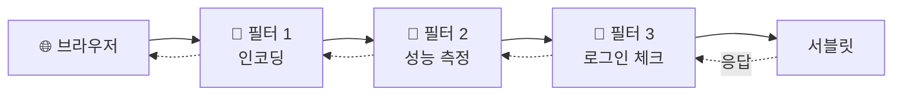
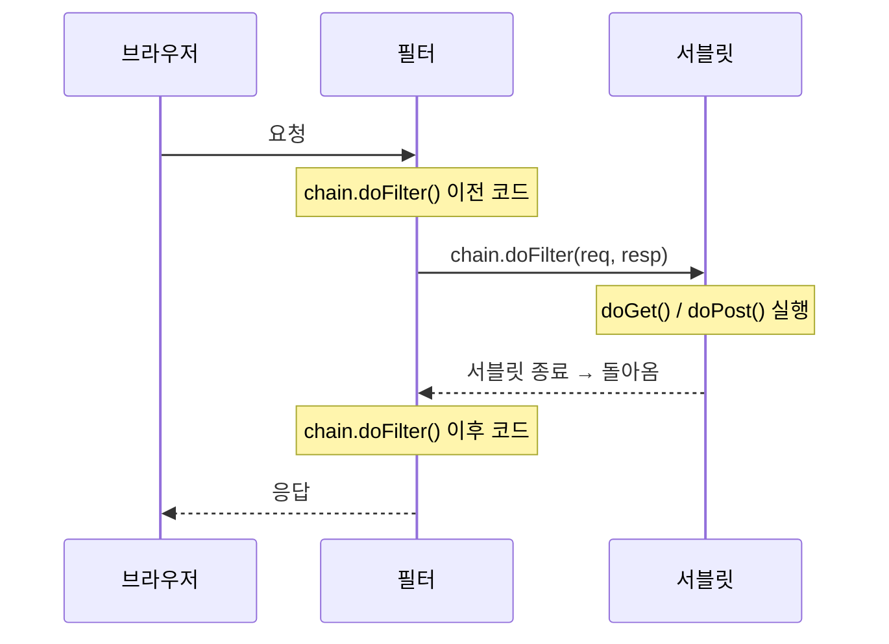
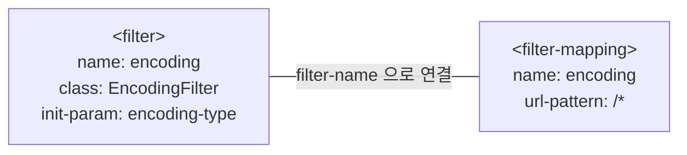
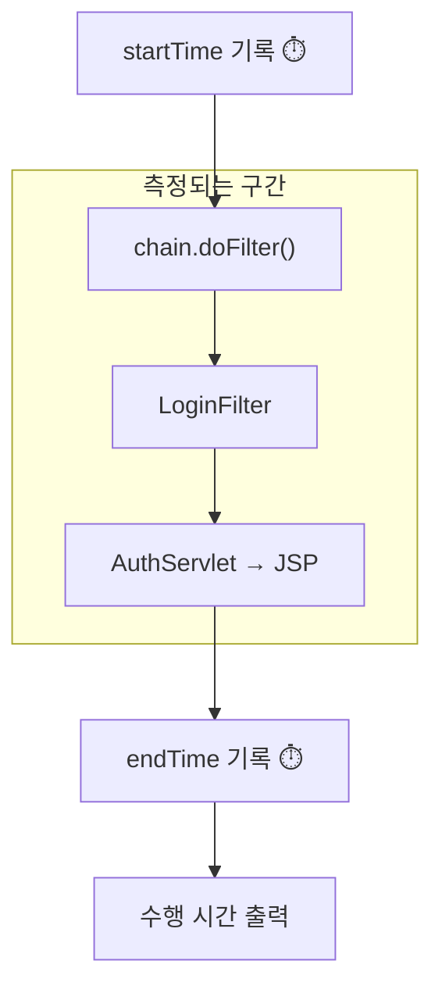
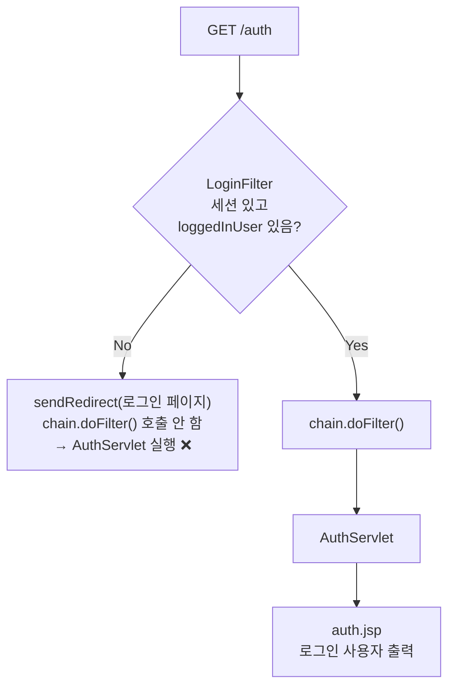
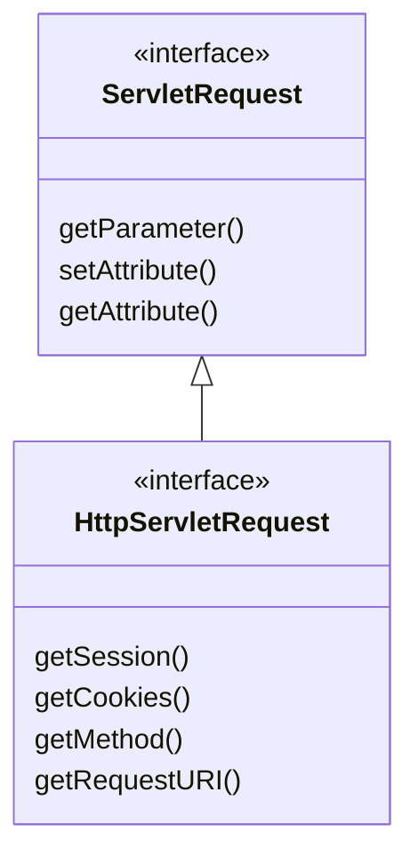
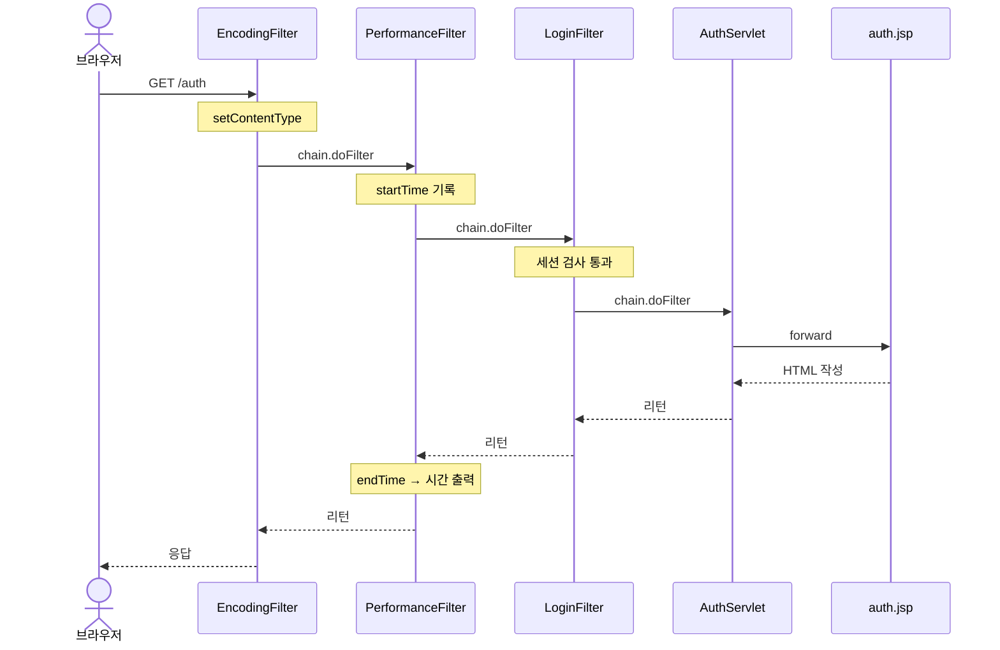
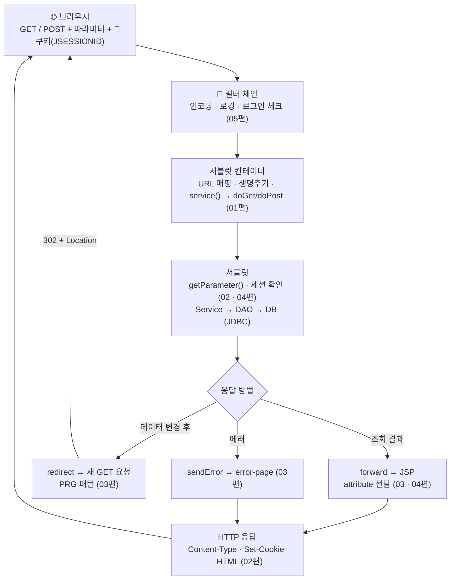

> **이번 글에서 다루는 것**
> 1. 필터가 필요한 이유와 동작 위치
> 2. `Filter` 인터페이스와 `chain.doFilter()`
> 3. 필터 등록 2가지: `@WebFilter` / `web.xml`
> 4. 실습 필터 3종: 인코딩 · 성능 측정 · 로그인 체크
> 5. 필터 순서와 함정들

---

## 0. 필터는 왜 필요할까?

지금까지 서블릿마다 이런 코드가 반복됐다.

```java
resp.setContentType("text/html; charset=UTF-8");    // 모든 응답 서블릿마다
```

```java
HttpSession session = req.getSession(false);
if (session == null || session.getAttribute("loggedInUser") == null) {
    resp.sendRedirect("/login");                     // 로그인이 필요한 서블릿마다
    return;
}
```

서블릿이 100개라면 100번 복사해야 하고, 하나라도 빠뜨리면 **한글이 깨지거나 로그인 없이 접근되는** 사고가 난다.
이렇게 **여러 요청에 공통으로 필요한 일**을 서블릿에 도달하기 **전후**에 한 번에 처리하는 것이 **필터**다.



공항 검색대를 떠올리면 쉽다. 비행기(서블릿)를 타기 전에 신분 확인, 짐 검사를 차례로 거치고, 문제가 있으면 **그 자리에서 돌려보낸다.**

---

## 1. Filter 인터페이스

```java
public interface Filter {
    default void init(FilterConfig filterConfig) throws ServletException {}
    void doFilter(ServletRequest request, ServletResponse response, FilterChain chain)
            throws IOException, ServletException;
    default void destroy() {}
}
```

서블릿과 마찬가지로 **생명주기**를 가진다.

| 메서드 | 언제 | 횟수 |
|---|---|---|
| `init()` | **서버 시작 시** | 1번 |
| `doFilter()` | 매핑된 URL로 요청이 올 때마다 | N번 |
| `destroy()` | 서버 종료 시 | 1번 |

> 💡 서블릿은 기본적으로 **첫 요청 때** 생성되지만, 필터는 **서버가 켜질 때** 바로 `init()`된다. 서버 시작 로그에 `인코딩 필터의 init() 호출됨..`, `Performance 필터 생성됨...`이 먼저 찍히는 이유다.

### 1-1. 핵심 — `chain.doFilter()`

`doFilter()` 안에서 **`chain.doFilter(request, response)`를 호출하면 다음 필터(또는 서블릿)로 진행**하고,
**호출하지 않으면 거기서 요청이 멈춘다.** 이 한 줄이 "통과"와 "차단"을 가른다.

그리고 `chain.doFilter()`를 기준으로 코드는 **앞(요청 전처리)** 과 **뒤(응답 후처리)** 로 나뉜다.

```java
public void doFilter(ServletRequest request, ServletResponse response, FilterChain chain) {
    // ⬇️ 서블릿 실행 "전"에 할 일
    chain.doFilter(request, response);   // → 다음 필터 → ... → 서블릿 실행 → 돌아옴
    // ⬆️ 서블릿 실행 "후"에 할 일
}
```



메서드 호출이 스택처럼 쌓였다가 풀리는 구조라서, 필터 여러 개는 **양파 껍질**처럼 서블릿을 감싼다.

---

## 2. 필터 등록하기 — 2가지 방법

### 2-1. 어노테이션 — `@WebFilter`

```java
@WebFilter("/*")            // 모든 요청에 동작
public class PerformanceFilter implements Filter { ... }

@WebFilter("/auth/*")       // /auth 로 시작하는 요청에만 동작
public class LoginFilter implements Filter { ... }
```

### 2-2. `web.xml`

```xml
<filter>
    <filter-name>encoding</filter-name>
    <filter-class>com.wanted.servlet.i_filter.EncodingFilter</filter-class>
    <init-param>
        <param-name>encoding-type</param-name>
        <param-value>text/html; charset=UTF-8</param-value>
    </init-param>
</filter>
<filter-mapping>
    <filter-name>encoding</filter-name>
    <url-pattern>/*</url-pattern>
</filter-mapping>
```

`<filter>`로 필터를 **선언**하고, `<filter-mapping>`으로 **어떤 URL에 적용할지** 연결한다. 둘은 `<filter-name>`으로 이어진다.



### 2-3. 무엇을 쓸까?

| | `@WebFilter` | `web.xml` |
|---|---|---|
| 작성 위치 | 필터 클래스 위 | 설정 파일 |
| 장점 | 간단, 코드와 설정이 한 곳에 | **실행 순서 지정 가능**, 코드 수정 없이 설정 변경 |
| 초기 파라미터 | `initParams` 속성으로 가능 | `<init-param>` |
| 순서 보장 | ❌ (표준상 정해져 있지 않음) | ✅ `<filter-mapping>` 작성 순서 |

> ⚠️ **필터 순서가 중요하다면 `web.xml`을 쓰자.** 어노테이션으로 등록한 필터끼리의 실행 순서는 서블릿 표준에서 보장하지 않는다. (클래스 이름 순으로 동작하는 것처럼 보여도, 그건 서버 구현에 따른 우연이다.)

---

## 3. 실습 필터 ① — EncodingFilter (공통 설정)

```java
public class EncodingFilter implements Filter {      // @WebFilter 없음 → web.xml 로 등록

    private String encodingType;

    @Override
    public void init(FilterConfig filterConfig) {
        encodingType = filterConfig.getInitParameter("encoding-type");   // web.xml 값 읽기
    }

    @Override
    public void doFilter(ServletRequest request, ServletResponse response, FilterChain chain)
            throws IOException, ServletException {
        response.setContentType(encodingType);       // "text/html; charset=UTF-8"
        chain.doFilter(request, response);
    }
}
```

- `init()`에서 `FilterConfig.getInitParameter()`로 `web.xml`의 `<init-param>` 값을 읽는다. 값을 코드에 박지 않았으니 **설정 파일만 바꿔서** 인코딩을 변경할 수 있다.
- 이 필터 덕분에 02~03편 서블릿들의 `setContentType()` 줄을 주석 처리해도 한글이 깨지지 않았던 것이다.

### ⚠️ 더 알아두면 좋은 점 — 모든 응답을 `text/html`로 만들면?

`/*`에 `setContentType("text/html; ...")`를 걸면 **CSS, JS, 이미지 같은 정적 파일 응답도** 일단 `text/html`로 설정된다.
Tomcat의 정적 파일 처리기가 보통 올바른 타입으로 다시 덮어쓰긴 하지만, JSON을 응답하는 서블릿을 만들게 되면 이 필터가 방해가 될 수 있다.

그래서 실무의 인코딩 필터는 보통 **MIME 타입은 건드리지 않고 문자 인코딩만** 지정한다. 그리고 02편에서 언급한 **POST 요청 한글 깨짐**도 같이 처리한다.

```java
request.setCharacterEncoding("UTF-8");     // 요청 Body 해석 인코딩 (POST 한글)
response.setCharacterEncoding("UTF-8");    // 응답 인코딩 (타입은 각 서블릿이 결정)
chain.doFilter(request, response);
```

> Spring에도 `CharacterEncodingFilter`라는 이름으로 똑같은 역할의 필터가 있다.

---

## 4. 실습 필터 ② — PerformanceFilter (전/후 처리)

```java
@WebFilter("/*")
public class PerformanceFilter implements Filter {

    @Override
    public void doFilter(ServletRequest request, ServletResponse response, FilterChain chain)
            throws IOException, ServletException {

        long startTime = System.currentTimeMillis();          // ⬇️ 전처리
        HttpServletRequest req = (HttpServletRequest) request;
        System.out.println("[요청 된 URL] : " + req.getRequestURI());

        chain.doFilter(request, response);                    // 서블릿 실행

        long endTime = System.currentTimeMillis();            // ⬆️ 후처리
        System.out.println("[" + req.getRequestURI() + " 의 최종 수행 시간] : " + (endTime - startTime) + "(ms)");
    }
}
```

`chain.doFilter()` 앞뒤로 시간을 재면, 그 사이에 실행된 **나머지 필터 + 서블릿 전체의 처리 시간**이 나온다. 앞뒤 구조가 가장 잘 드러나는 예제다.



이런 **로깅, 실행 시간 측정, 요청 추적**은 비즈니스 로직과 상관없이 모든 요청에 필요한 일이라 필터에 딱 맞는다.

---

## 5. 실습 필터 ③ — LoginFilter (차단)

```java
@WebFilter("/auth/*")
public class LoginFilter implements Filter {

    @Override
    public void doFilter(ServletRequest request, ServletResponse response, FilterChain chain)
            throws IOException, ServletException {

        HttpServletRequest req = (HttpServletRequest) request;
        HttpServletResponse resp = (HttpServletResponse) response;

        HttpSession session = req.getSession(false);

        if (session == null || session.getAttribute("loggedInUser") == null) {
            resp.sendRedirect("/h_cookie_session/cookie_session.html");   // 🚫 차단 → 로그인 페이지로
        } else {
            chain.doFilter(req, resp);                                     // ✅ 통과
        }
    }
}
```



### 5-1. 🤔 왜 형변환을 해야 할까?

`doFilter()`의 매개변수 타입은 `ServletRequest`인데, `getSession()`이나 `sendRedirect()`는 **HTTP 전용** 기능이라 자식 인터페이스인 `HttpServletRequest` / `HttpServletResponse`에만 있다.



필터는 원래 HTTP가 아닌 프로토콜까지 고려해서 설계됐기 때문에 부모 타입으로 받는다. 실제로 들어오는 객체는 HTTP 요청이므로 **다운캐스팅**해서 쓰면 된다.

> 💡 Servlet 4.0부터는 `HttpFilter`라는 추상 클래스가 있어서, 상속하면 처음부터 `HttpServletRequest` / `HttpServletResponse`로 받을 수 있다.

### 5-2. `/auth/*` 패턴은 `/auth`도 잡을까?

잡는다. 서블릿 URL 패턴 규칙상 `/auth/*`는 `/auth`, `/auth/`, `/auth/mypage`, `/auth/a/b`를 모두 포함한다.

| url-pattern | 매칭 예시 |
|---|---|
| `/*` | 모든 요청 |
| `/auth/*` | `/auth`, `/auth/mypage`, `/auth/a/b` |
| `*.jsp` | 확장자가 `.jsp`인 모든 요청 |
| `/auth` | 정확히 `/auth`만 |

### 5-3. 필터 덕분에 서블릿이 단순해진다

```java
@WebServlet("/auth")
public class AuthServlet extends HttpServlet {
    @Override
    protected void doGet(HttpServletRequest req, HttpServletResponse resp)
            throws ServletException, IOException {
        HttpSession session = req.getSession(false);
        String existUser = (String) session.getAttribute("loggedInUser");   // null 체크 없음!
        req.getRequestDispatcher("/i_filter/auth.jsp").forward(req, resp);
    }
}
```

`session`에 대한 null 체크가 없다. 그래도 괜찮은 이유는 **LoginFilter가 "세션 있음 + 로그인됨"을 이미 보장했기 때문**이다.
반대로 말하면, LoginFilter를 지우면 이 서블릿은 로그인하지 않은 사용자에게 바로 NPE(500)를 낸다. 필터가 실제로 지켜주고 있다는 걸 확인하는 좋은 실험이다.

> 📌 **작은 개선점 두 가지**
> - 수업 코드의 `getRequestDispatcher("i_filter/auth.jsp")`는 `/`로 시작하지 않는 **상대 경로**라 현재 요청 경로를 기준으로 해석된다. 지금은 `/auth`가 루트에 있어서 동작하지만, 서블릿 경로가 `/auth/page` 같은 식으로 깊어지면 엉뚱한 곳을 찾는다. **`/i_filter/auth.jsp`처럼 `/`로 시작**하는 게 안전하다.
> - `session.setAttribute("loggedInUser", existUser)`는 방금 꺼낸 값을 같은 이름으로 다시 넣는 것이라 생략해도 결과가 같다.

### 5-4. auth.jsp — 스크립틀릿 vs EL

```jsp
<%
   String user = (String) session.getAttribute("loggedInUser");
%>
<%= user %>
```

| 문법 | 의미 |
|---|---|
| `<% 자바 코드 %>` | **스크립틀릿** — Java 코드 실행 |
| `<%= 값 %>` | **표현식** — 값을 HTML에 출력 |
| `${이름}` | **EL** — attribute를 찾아서 출력 |

JSP에는 `request`, `response`, `session`, `out` 같은 **내장 객체**가 미리 선언되어 있어서 `session`을 바로 쓸 수 있다. (JSP가 서블릿으로 변환될 때 이 변수들이 자동으로 만들어진다.)

같은 내용을 EL로 쓰면 훨씬 짧고, null이어도 에러 없이 빈 문자열로 출력된다.

```jsp
<h3>${sessionScope.loggedInUser}</h3>
```

> 실무에서는 HTML과 Java 코드가 뒤섞이는 스크립틀릿 대신 **EL + JSTL**을 사용하는 것이 권장된다.

---

## 6. 필터가 여러 개일 때의 실행 순서

`/auth` 요청 하나에 세 필터가 모두 걸린다.

| 필터 | 등록 방식 | url-pattern | `/auth`에 적용? |
|---|---|---|---|
| EncodingFilter | web.xml | `/*` | ✅ |
| PerformanceFilter | `@WebFilter` | `/*` | ✅ |
| LoginFilter | `@WebFilter` | `/auth/*` | ✅ |



- Tomcat에서는 보통 `web.xml`에 등록한 필터가 어노테이션 필터보다 **먼저** 실행된다.
- 어노테이션 필터끼리(Performance ↔ Login)의 순서는 **보장되지 않는다.** 위 그림은 하나의 예시다.

### 6-1. forward할 때는 필터를 다시 타지 않는다

`AuthServlet`이 `auth.jsp`로 forward해도 `PerformanceFilter("/*")`가 한 번 더 실행되지는 않는다.
필터는 기본적으로 **브라우저에서 들어온 요청(`REQUEST`)** 에만 동작하기 때문이다. forward나 에러 페이지 이동에도 필터를 걸고 싶다면 `dispatcherTypes`를 지정한다.

```java
@WebFilter(value = "/*", dispatcherTypes = {DispatcherType.REQUEST, DispatcherType.FORWARD})
```

반면 **redirect는 브라우저가 보내는 새 요청**이므로 필터를 처음부터 다시 거친다. LoginFilter가 로그인 페이지로 redirect하면 그 HTML 요청에도 Encoding · Performance 필터가 동작하는 걸 콘솔에서 확인할 수 있다.

---

## 7. 필터는 어디에 쓰나

| 용도 | 예시 |
|---|---|
| 인코딩 | 요청/응답 UTF-8 설정 |
| 인증 · 인가 | 로그인 체크, 관리자 페이지 접근 제한 |
| 로깅 · 모니터링 | 요청 URL, 처리 시간 기록 |
| 보안 | XSS 입력 필터링, CORS 헤더 추가 |
| 압축 | 응답 gzip 압축 |

> 💡 나중에 배울 **Spring Security**도 내부적으로는 **수많은 필터가 체인으로 연결된 구조**다. 오늘 만든 LoginFilter가 그 축소판이다.

---

## ✅ 마무리 요약

- 필터 = **서블릿 앞뒤에서 공통 작업을 처리하는 검문소**.
- `chain.doFilter()` 호출 → **통과**, 호출 안 함 → **차단**.
- `chain.doFilter()` 앞은 **요청 전처리**, 뒤는 **응답 후처리**.
- 등록: `@WebFilter("패턴")` 또는 `web.xml`(`<filter>` + `<filter-mapping>`). **순서가 중요하면 web.xml.**
- 필터는 **서버 시작 시 `init()`**, 서블릿은 기본적으로 **첫 요청 시** 생성.
- HTTP 기능을 쓰려면 `HttpServletRequest` / `HttpServletResponse`로 **다운캐스팅**.
- 기본적으로 forward는 필터를 다시 타지 않고, redirect는 다시 탄다.

---

## 🗺️ 서블릿 시리즈 전체 그림

다섯 편에서 배운 것이 요청 하나 안에서 어떻게 맞물리는지 정리하면 이렇다.


