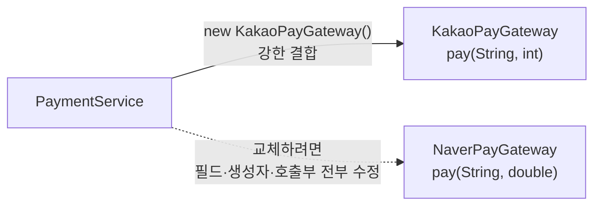
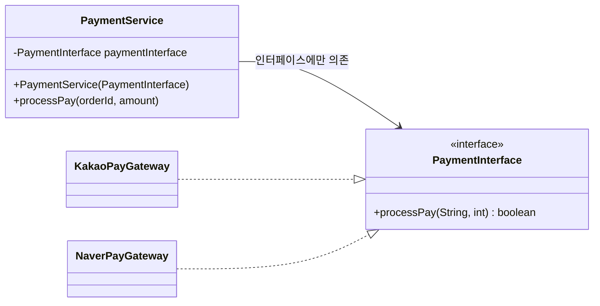
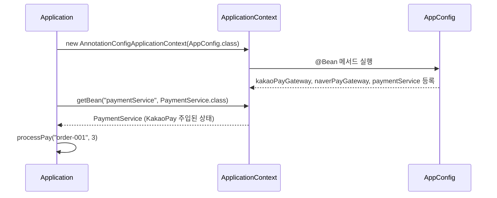
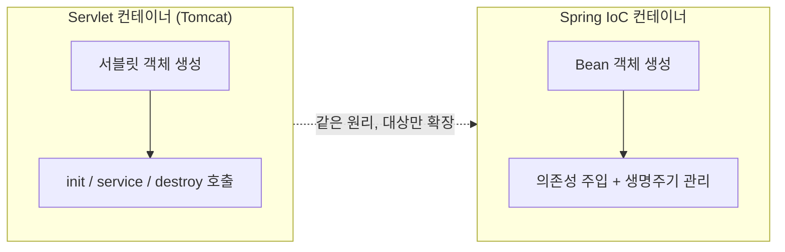
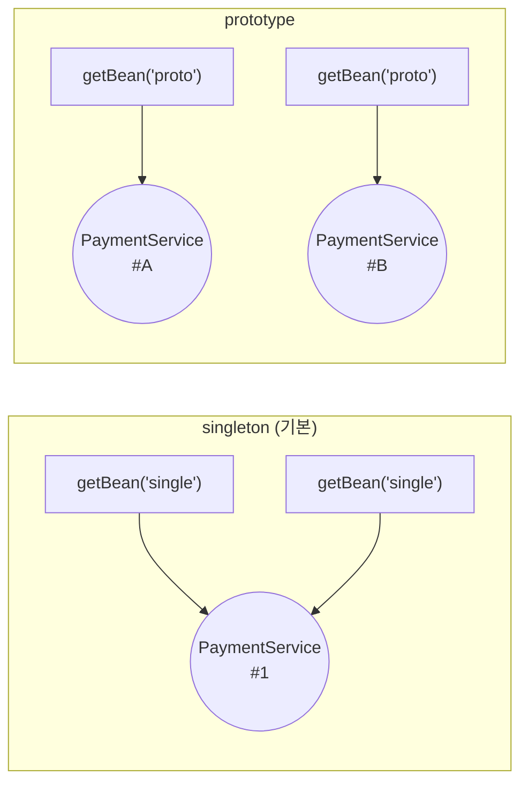
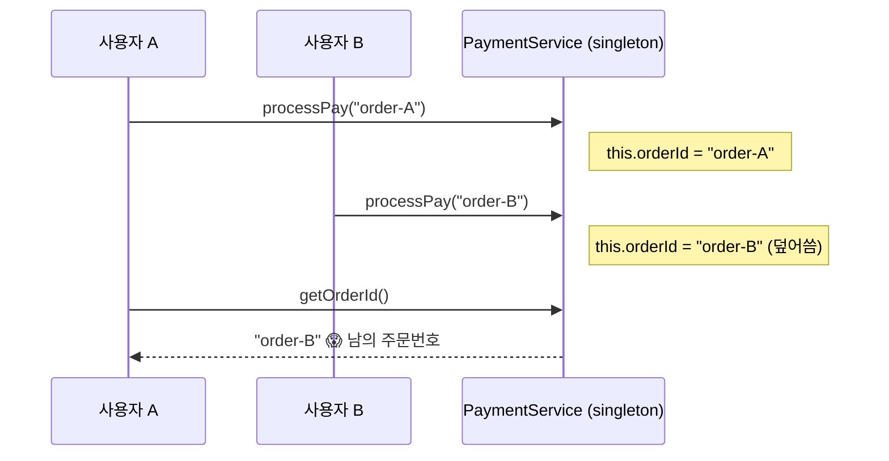
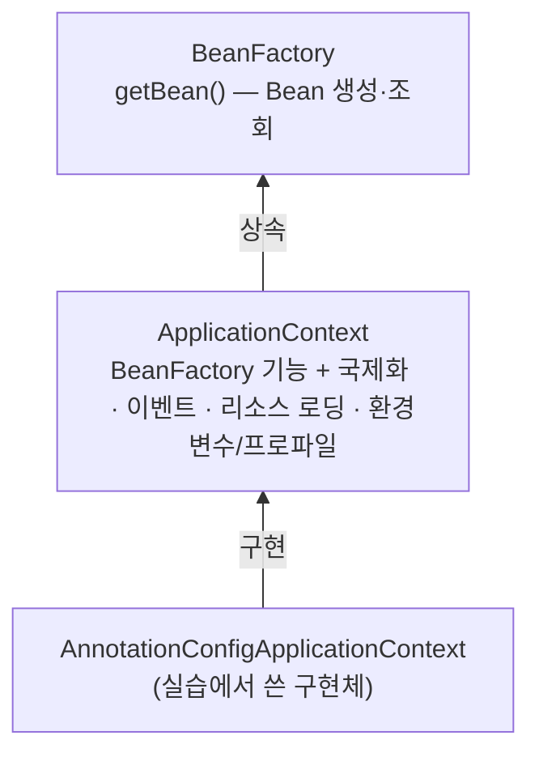
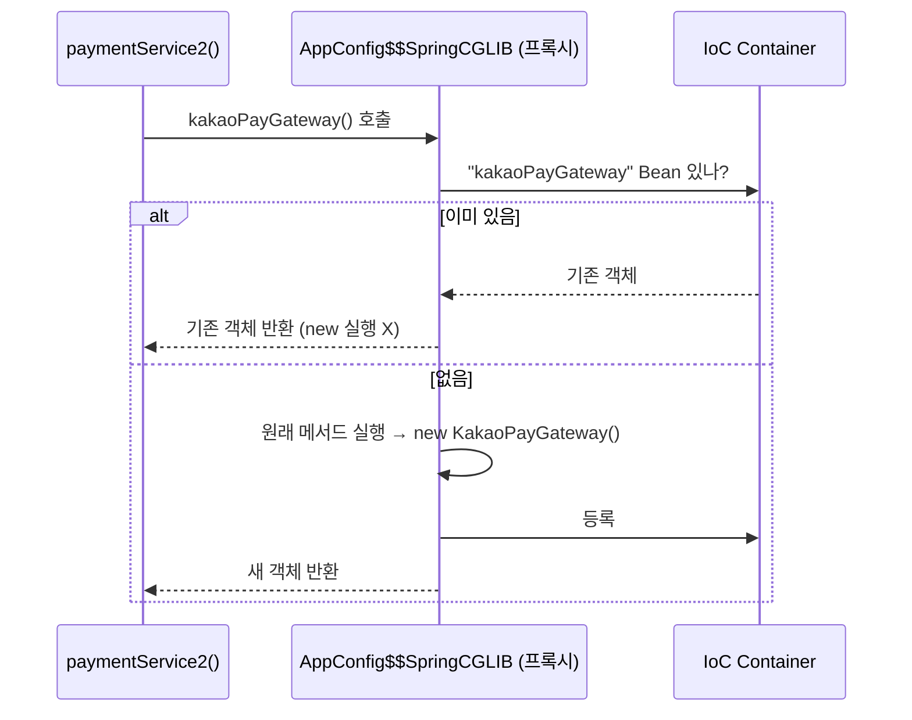
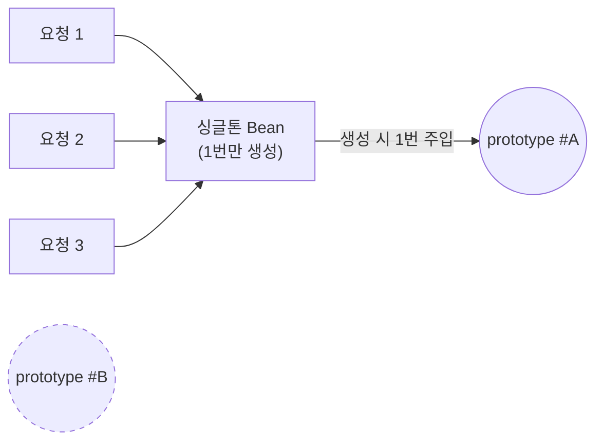
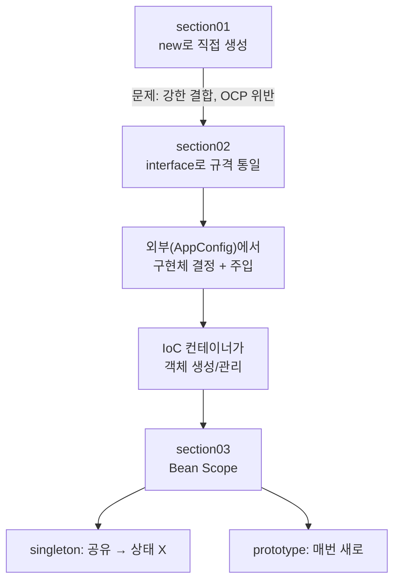

> **이번 글에서 다루는 것**
> 1. `new`로 직접 만들 때 생기는 문제 — 강한 결합과 OCP 위반
> 2. 인터페이스 + `@Configuration` / `@Bean` + `ApplicationContext`로 IoC 컨테이너 사용하기
> 3. Bean Scope — singleton과 prototype
> 4. Bean 생명주기, `@Configuration`의 비밀, 그 밖에 알아두면 좋은 점
>
> 결제 시스템(카카오페이 / 네이버페이) 예제로 **"왜 Spring이 객체를 대신 만들어주는가"**를 단계별로 정리한다.

---

## 0. 실습 환경

```groovy
dependencies {
    /* spring-context : Spring 프레임워크의 핵심 의존성. IoC container 생성 */
    implementation 'org.springframework:spring-context:7.0.8'
}
```

`spring-context` 하나만 추가하면 `ApplicationContext`(IoC 컨테이너), `@Configuration`, `@Bean`, `@ComponentScan` 등을 쓸 수 있다. Spring Boot 없이 **순수 Spring**으로 컨테이너가 어떻게 동작하는지 확인하는 실습이다.

```
com.wanted.container
├── section01   ← Spring 없이 new로 직접 생성
├── section02   ← interface + @Configuration/@Bean + ApplicationContext
└── section03   ← Bean Scope (singleton / prototype)
```

---

## 1. Section01 — Spring 없이 객체를 직접 생성할 때

### 시나리오

`Application`이 `PaymentService`를 호출하면, 서비스가 상황에 맞는 Pay(카카오/네이버)를 호출해 결제한다.

```java
public class KakaoPayGateway {
    public boolean pay(String orderId, int amount) { ... }
}

public class NaverPayGateway {
    public boolean pay(String orderId, double amount) { ... }   // ⚠️ 매개변수 타입이 다르다
}
```

```java
public class PaymentService {

//  private NaverPayGateway naverPayGateway;
    private KakaoPayGateway kakaoPayGateway;

    public PaymentService() {
//      this.naverPayGateway = new NaverPayGateway();
        this.kakaoPayGateway = new KakaoPayGateway();   // 서비스가 직접 구현체를 new
    }

    public boolean processPay(String orderId, int amount) {
//      boolean result = naverPayGateway.pay(orderId, amount);
        boolean result = kakaoPayGateway.pay(orderId, amount);
        ...
    }
}
```

### 무엇이 문제인가

"네이버페이 → 카카오페이로 바꿔주세요"라는 요구사항 하나에 **필드 타입, 생성자, 메서드 호출부를 전부** 고쳐야 한다.

1. 요구사항이 바뀌면 결제 **구현체를 직접 변경**해야 한다.
2. 구현체마다 **메서드 이름·매개변수 타입/순서**가 다르면 호출 코드도 전부 수정해야 한다. (`int` vs `double`)



### OCP(개방-폐쇄 원칙) 위반

> **소프트웨어는 확장에는 열려 있어야 하고, 변경에는 닫혀 있어야 한다.** — SOLID의 O

결제 수단을 **추가(확장)**하는 것 자체는 자연스러운 일이다. 그런데 그 때문에 **기존 코드(PaymentService)를 변경**해야 한다면 OCP를 위반한 것이다. "1개를 수정했을 때 여러 코드의 수정이 필요한 상황"이 바로 이것이다.

---

## 2. Section02 — 인터페이스 + IoC 컨테이너

### Step 1. 인터페이스로 "규격" 통일

section01의 **메서드 이름 / 매개변수 타입·순서 불일치** 문제를 인터페이스로 해결한다.

```java
public interface PaymentInterface {
    boolean processPay(String orderId, int amount);
}

public class KakaoPayGateway implements PaymentInterface {
    @Override
    public boolean processPay(String orderId, int amount) { ... }
}

public class NaverPayGateway implements PaymentInterface {
    @Override
    public boolean processPay(String orderId, int amount) { ... }
}
```

### Step 2. 서비스는 인터페이스에만 의존 + 외부에서 받기

```java
public class PaymentService {

    private final PaymentInterface paymentInterface;   // 구현체가 아니라 인터페이스 타입

    public PaymentService(PaymentInterface paymentInterface) {   // 밖에서 넣어준다
        this.paymentInterface = paymentInterface;
    }

    public boolean processPay(String orderId, int amount) {
        boolean result = paymentInterface.processPay(orderId, amount);
        ...
    }
}
```

이제 `PaymentService` 안에는 `new KakaoPayGateway()`가 **한 줄도 없다.** 무엇을 넣어줄지는 바깥에서 결정한다.



### Step 3. 설정 클래스 — 컨테이너에 등록할 객체 목록

```java
@Configuration
public class AppConfig {

    @Bean
    public KakaoPayGateway kakaoPayGateway() {
        return new KakaoPayGateway();
    }

    @Bean
    public NaverPayGateway naverPayGateway() {
        return new NaverPayGateway();
    }

    @Bean
    public PaymentService paymentService() {
        return new PaymentService(kakaoPayGateway());   // 여기서 "어떤 Pay를 쓸지" 결정
    }
}
```

| 용어 | 의미 |
|---|---|
| **Bean** | Spring(IoC 컨테이너)이 생성·관리하는 객체 |
| **@Configuration** | Bean 정의를 모아둔 **설정 클래스**임을 표시 |
| **@Bean** | 메서드의 반환 객체를 컨테이너에 Bean으로 등록. **Bean 이름 기본값 = 메서드명** |

> 💡 네이버페이로 바꾸고 싶다면? `AppConfig`에서 `kakaoPayGateway()`를 `naverPayGateway()`로 **한 줄만** 바꾸면 된다. `PaymentService`는 손대지 않으므로 **OCP를 만족**한다.

### Step 4. 컨테이너 생성 & Bean 꺼내기

```java
// IoC Container == ApplicationContext (== BeanFactory 계열)
ApplicationContext context =
        new AnnotationConfigApplicationContext(AppConfig.class);

// getBean(이름, 타입) : 컨테이너 내부의 객체를 꺼낸다
PaymentService paymentService = context.getBean("paymentService", PaymentService.class);

boolean result = paymentService.processPay("order-001", 3);
```

- `AnnotationConfigApplicationContext` : 어노테이션 기반 설정 클래스(`AppConfig`)를 읽어 컨테이너를 만든다.
- `getBean("이름", 타입.class)` : 타입 정보를 함께 줘야 형변환 없이 해당 타입 변수에 담을 수 있다.



### IoC(Inversion of Control, 제어의 역전)란

| | 기존 (section01) | IoC (section02~) |
|---|---|---|
| 객체 생성 | 개발자가 `new` | **컨테이너**가 생성 |
| 의존 객체 연결 | 클래스 내부에서 직접 | **설정(AppConfig)**에서 외부 결정 |
| 생명주기 관리 | 개발자 | **컨테이너** |
| 결합도 | 높음 | 낮음 |

객체를 만들고 연결하는 **제어권이 개발자 코드에서 프레임워크로 넘어갔기** 때문에 "역전"이라고 부른다.

> 🔁 사실 IoC는 처음 보는 개념이 아니다. [Servlet] 01편에서 서블릿 객체를 `new`로 만든 적이 없었다. **Tomcat이 서블릿을 생성하고 `init()` → `service()` → `destroy()`를 대신 호출**해줬다. 그때 "제어권이 프레임워크에 넘어간 구조"라고 했던 것을 Spring은 **일반 자바 객체(POJO) 전체**에 적용한다.



---

## 3. Section03 — Bean Scope

### 설정

```java
@Bean("single")          // 이름 기본값은 메서드명이지만 직접 지정 가능
@Scope("singleton")      // 기본값(생략해도 singleton)
public PaymentService paymentService() {
    return new PaymentService(kakaoPayGateway());
}

@Bean("proto")
@Scope("prototype")      // 요청(getBean)할 때마다 새 인스턴스
public PaymentService paymentService2() {
    return new PaymentService(kakaoPayGateway());
}
```

### 확인 방법 — 상태(필드)를 하나 심어보기

```java
public class PaymentService {
    private final PaymentInterface paymentInterface;
    private String orderId;                      // 일부러 넣은 "상태"

    public boolean processPay(String orderId, int amount) {
        this.orderId = orderId;
        ...
    }
    public String getOrderId() { return this.orderId; }
}
```

```java
PaymentService single  = context.getBean("single", PaymentService.class);
single.processPay("order-001", 3);
PaymentService single2 = context.getBean("single", PaymentService.class);

PaymentService proto  = context.getBean("proto", PaymentService.class);
proto.processPay("order-002", 3);
PaymentService proto2 = context.getBean("proto", PaymentService.class);
```

**실행 결과(핵심)**

```
single의 주문 ID  = order-001
single2의 주문 ID = order-001   ← 같은 인스턴스를 공유
proto의 주문 ID   = order-002
proto2의 주문 ID  = null        ← 새로 만든 인스턴스라 아무 값도 없음
```



| | singleton | prototype |
|---|---|---|
| 인스턴스 수 | 컨테이너당 **1개** | `getBean()` 호출마다 **새로 생성** |
| 생성 시점 | 컨테이너 시작 시 (즉시 로딩) | 요청 시 |
| 장점 | 메모리 효율, 동일 동작 예측 가능 | 요청마다 독립된 상태 |
| 비유 | 다 같이 쓰는 **공용 지갑** | 매번 새로 받는 **일회용 지갑** |

### ⚠️ 가장 주의할 점 — 싱글톤 Bean에 상태를 두지 말 것

싱글톤 Bean이 필드에 값(상태)을 저장하면 **모든 요청이 그 값을 공유**한다. A 사용자의 주문번호를 B 사용자가 보게 되는 사고가 날 수 있다.



- Bean의 필드에는 **행위 위주의 객체**(Service, DAO, 다른 Bean)만 둔다.
- 요청마다 달라지는 데이터는 **메서드 매개변수 / 지역변수 / DTO**로 주고받는다.

```java
// ❌ 상태를 필드에 저장
private String orderId;

// ✅ 요청 데이터는 DTO로 주고받기
public PaymentResult processPay(PaymentRequest request) { ... }
```

---

## 4. 추가로 알면 좋은 점

### ① `ApplicationContext`와 `BeanFactory`는 완전히 같지는 않다

실습에서는 `IoC Container == ApplicationContext == BeanFactory`로 묶어서 이해했는데, 정확히는 **상속 관계**다.



- `BeanFactory` : Bean 생성·조회라는 **최소 기능**만 있다. 기본적으로 지연 로딩한다.
- `ApplicationContext` : `BeanFactory`에 부가 기능을 더한 것. 싱글톤 Bean을 **시작 시점에 미리 생성**한다.
- 실무에서는 거의 항상 `ApplicationContext`를 쓰므로 "IoC 컨테이너 = ApplicationContext"로 불러도 무방하다.

### ② `kakaoPayGateway()`를 여러 번 호출해도 객체는 1개다 (@Configuration의 비밀)

section03에서 `paymentService()`와 `paymentService2()`가 각각 `kakaoPayGateway()`를 호출한다. 자바 코드만 보면 `new KakaoPayGateway()`가 두 번 실행될 것 같지만, **컨테이너에 있는 같은 싱글톤 객체가 반환된다.**

- `@Configuration`이 붙은 클래스는 Spring이 **CGLIB으로 프록시(바이트코드를 조작한 자식 클래스)**를 만들어 등록한다.
- 프록시는 `@Bean` 메서드 호출을 가로채서 "이미 컨테이너에 있으면 그걸 반환"한다.
- `@Configuration` 없이 `@Bean`만 쓰면(lite 모드) 이 보장이 사라진다. 그러면 **호출할 때마다 새 객체**가 만들어진다.



> 👉 설정 클래스에는 `@Configuration`을 꼭 붙이자.

### ③ `getBean()`의 다양한 형태

```java
context.getBean("paymentService");                       // 이름만 → Object 반환, 형변환 필요
context.getBean(PaymentService.class);                   // 타입만 → 같은 타입이 2개 이상이면 예외
context.getBean("paymentService", PaymentService.class); // 이름 + 타입 (실습 방식, 가장 명확)
```

section03처럼 같은 타입(`PaymentService`)의 Bean이 `single`, `proto` 두 개 있으면 `getBean(PaymentService.class)`에서 `NoUniqueBeanDefinitionException`이 발생한다.

### ④ Bean 생명주기 — 컨테이너가 관리하는 순서


```java
public class KakaoPayGateway implements PaymentInterface {

    @PostConstruct   // 의존성 주입까지 끝난 뒤 1번 호출 (ex. 외부 API 연결 준비)
    public void init() { System.out.println("카카오페이 연결 준비"); }

    @PreDestroy      // 컨테이너가 닫히기 직전 1번 호출 (ex. 연결 정리)
    public void close() { System.out.println("카카오페이 연결 종료"); }
}
```

```java
AnnotationConfigApplicationContext context =
        new AnnotationConfigApplicationContext(AppConfig.class);
...
context.close();   // 이 호출이 있어야 @PreDestroy가 실행된다
```

- `@PostConstruct` / `@PreDestroy`는 `jakarta.annotation` 패키지다. Servlet 실습에서 쓰던 `jakarta.*`와 같은 계열이다.
- `@Bean(initMethod = "init", destroyMethod = "close")`로도 지정할 수 있다. 소스를 고칠 수 없는 외부 라이브러리 클래스에 유용하다.
- `ApplicationContext` 인터페이스에는 `close()`가 없다. 그래서 닫으려면 구현체 타입(`AnnotationConfigApplicationContext`)이나 `ConfigurableApplicationContext`로 받아야 한다.

### ⑤ 그 밖의 Scope

| Scope | 범위 | 사용 환경 |
|---|---|---|
| `singleton` | 컨테이너당 1개 | 기본값 |
| `prototype` | 요청마다 새로 | 일반 |
| `request` | HTTP 요청 1개당 1개 | 웹 |
| `session` | HTTP 세션당 1개 | 웹 |
| `application` | ServletContext당 1개 | 웹 |

`request` / `session` / `application`은 Servlet 실습에서 본 **request · session · application 영역**과 그대로 대응한다.

### ⑥ prototype의 함정

- 컨테이너는 prototype Bean을 **생성·주입·초기화까지만** 하고 이후에는 관리하지 않는다. 그래서 ④의 생명주기에서 **소멸 콜백(`@PreDestroy`)이 호출되지 않는다.**
- **싱글톤 Bean이 prototype Bean을 주입받으면**, 주입은 싱글톤을 생성할 때 딱 한 번만 일어난다. 그래서 prototype이어도 **사실상 1개만** 쓰게 된다. (해결: `ObjectProvider`, `@Lookup` 등)



> 요청이 몇 번 오든 싱글톤은 처음 주입받은 `#A`만 계속 쓴다. `#B`는 만들어지지 않는다.

### ⑦ Spring 싱글톤 ≠ 디자인 패턴의 싱글톤

| | GoF 싱글톤 패턴 | Spring 싱글톤 Bean |
|---|---|---|
| 구현 | `private` 생성자 + `static getInstance()` | 평범한 클래스 |
| 보장 범위 | JVM(클래스로더) 전체에서 1개 | **컨테이너 1개 안에서** 1개 |
| 단점 | 테스트·확장 어려움 | 없음 (컨테이너가 관리) |

`PaymentService`는 `new`로 얼마든지 만들 수 있는 평범한 클래스다. 하지만 **컨테이너가 하나만 만들어 공유**하기 때문에 싱글톤으로 동작한다.

---

## 5. 한눈에 정리



- **IoC** : 객체 생성·연결의 제어권을 개발자에게서 컨테이너로 넘긴 것
- **Bean** : 컨테이너가 관리하는 객체 / `@Bean` 이름 기본값 = 메서드명
- **@Configuration + @Bean** : 컨테이너에 등록할 객체를 직접 정의 (CGLIB 프록시로 싱글톤 보장)
- **ApplicationContext** : IoC 컨테이너. `getBean(이름, 타입)`으로 꺼낸다
- **생명주기** : 생성 → 주입 → `@PostConstruct` → 사용 → `@PreDestroy` → `close()`
- **Scope** : 기본은 singleton → **싱글톤 Bean에 상태(필드)를 두지 말 것**

> 다음 글 : **[Spring] 02. DI(의존성 주입)** — Bean이 100개라면 AppConfig에 다 적어야 할까? → `@ComponentScan`과 주입 방식 3가지
