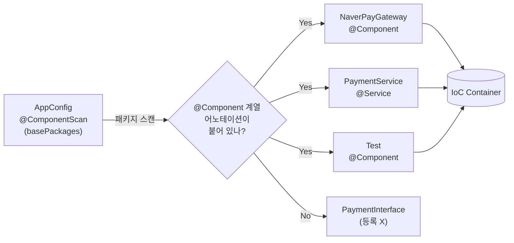
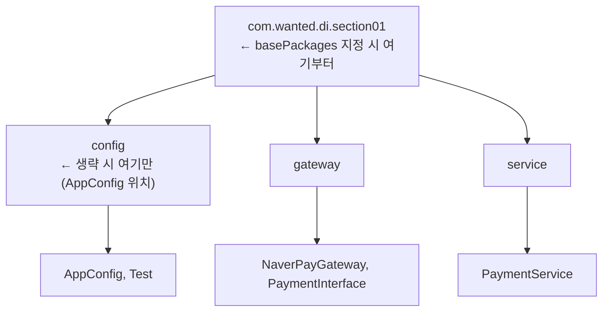
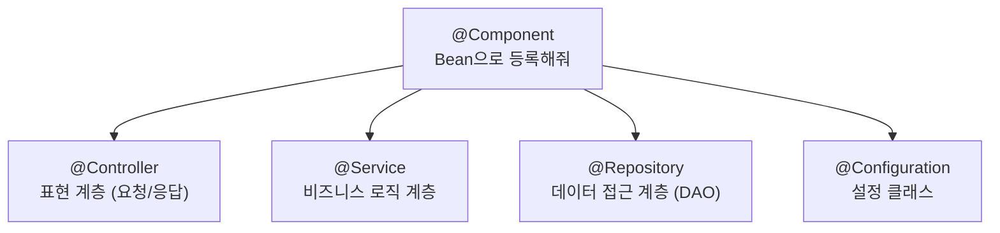
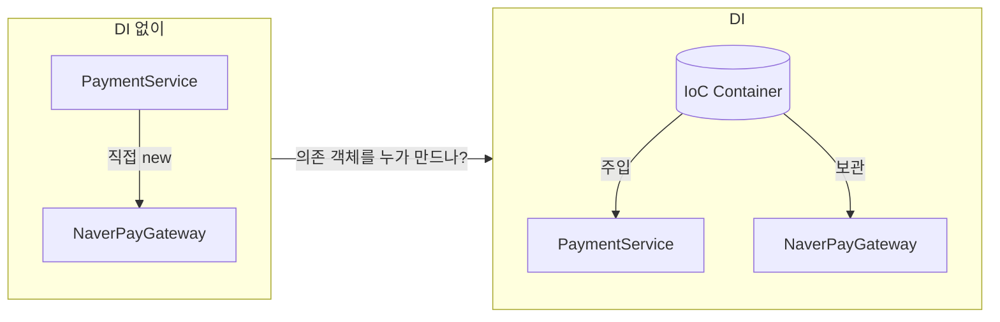
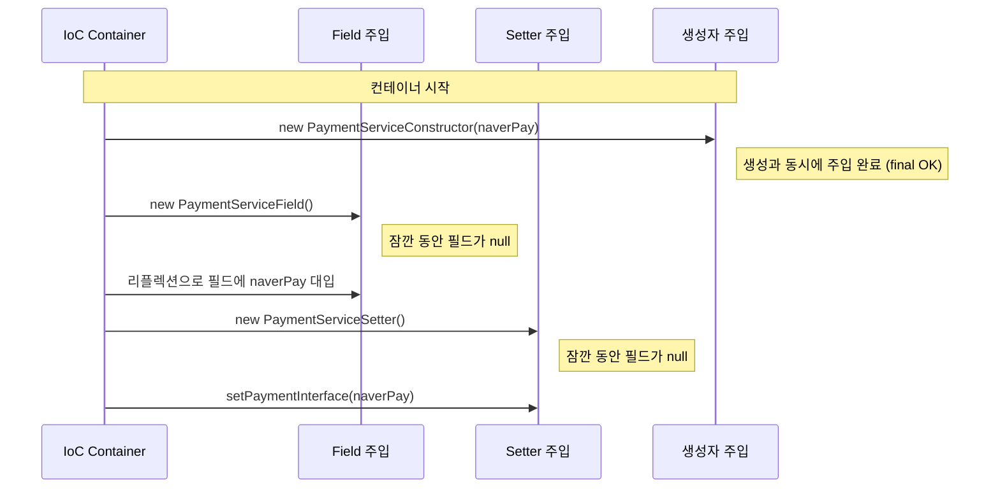
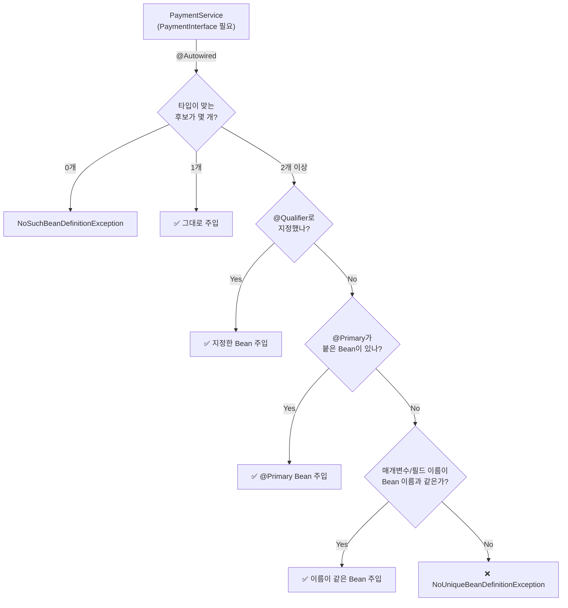
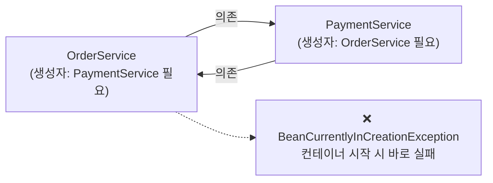
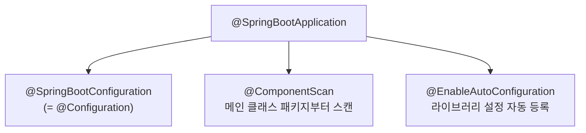
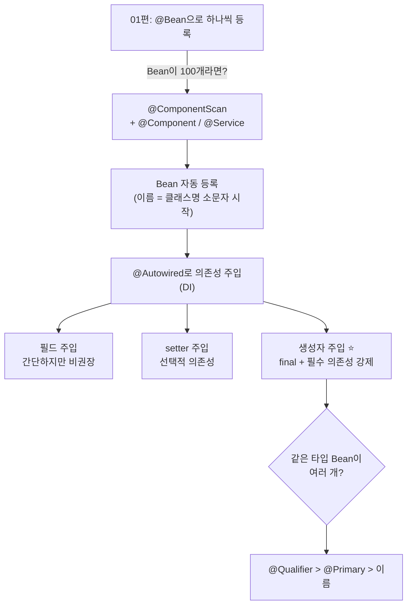

> **이번 글에서 다루는 것**
> 1. `@ComponentScan` + `@Component` / `@Service`로 Bean 자동 등록
> 2. 스캔 범위(`basePackages`)와 제외 필터(`excludeFilters`)
> 3. 의존성 주입(DI) 3가지: 필드 / setter / 생성자
> 4. 같은 타입의 Bean이 여럿일 때: `@Primary` / `@Qualifier`
>
> [Spring] 01편에서는 `AppConfig`에 `@Bean`을 하나하나 적어 컨테이너에 등록했다. 이번 글은 **"Bean이 100개라면?"**이라는 질문에서 출발한다.

```
com.wanted.di
├── section01   ← @ComponentScan + @Component / @Service 자동 등록
└── section02   ← 필드 / setter / 생성자 주입 비교
```

---

## 1. Section01 — @ComponentScan으로 Bean 자동 등록

### 문제 제기

```java
@Configuration
public class AppConfig {
    @Bean public KakaoPayGateway kakaoPayGateway() { ... }
    @Bean public NaverPayGateway naverPayGateway() { ... }
    @Bean public PaymentService paymentService() { ... }
    // ... Bean이 100개라면 100개의 메서드?
}
```

Bean마다 메서드를 직접 작성하면 설정 파일이 끝없이 길어진다. 클래스를 추가할 때마다 설정도 같이 고쳐야 한다.

### 해결 — 클래스에 표시만 하고, 스캔은 Spring이

```java
@Component                                   // "나를 Bean으로 등록해줘"
public class NaverPayGateway implements PaymentInterface {
    @Override
    public boolean processPay(String orderId, int amount) { ... }
}
```

```java
/* @Service : @Component의 특수한 형태. 서비스 계층 Bean에 붙인다 */
@Service
public class PaymentService {

    private final PaymentInterface paymentInterface;

    public PaymentService(PaymentInterface paymentInterface) {
        this.paymentInterface = paymentInterface;
    }
    ...
}
```

```java
@Configuration
@ComponentScan(basePackages = "com.wanted.di.section01")
public class AppConfig {
    // 비어 있어도 된다!
}
```

```java
ApplicationContext context = new AnnotationConfigApplicationContext(AppConfig.class);
PaymentService pay = context.getBean("paymentService", PaymentService.class);
pay.processPay("order-003", 3);   // → 네이버페이로 결제
```



### 핵심 포인트

| 항목 | 내용 |
|---|---|
| `@ComponentScan` | 지정한 패키지에서 `@Component` 계열 어노테이션이 붙은 클래스를 찾아 Bean으로 등록 |
| `basePackages` | 스캔 시작 위치. 지정한 패키지 **+ 그 하위 패키지 전부** |
| `basePackages` 생략 시 | `@ComponentScan`이 붙은 **클래스의 패키지(와 그 하위)**만 스캔 |
| Bean 이름 기본값 | **클래스명의 첫 글자를 소문자로** → `PaymentService` → `paymentService` |

> ⚠️ 실습에서 `AppConfig`는 `section01.config` 패키지에 있다. `basePackages`를 생략하면 `config` 패키지(와 그 하위)만 스캔하므로 `service`, `gateway` 패키지의 클래스를 찾지 못한다. 그래서 상위 패키지인 `com.wanted.di.section01`을 직접 지정했다.



### 그런데 `PaymentService`에는 `@Autowired`가 없는데 어떻게 주입됐을까?

`PaymentService`의 **생성자가 1개뿐**이기 때문이다. 생성자가 하나면 Spring은 `@Autowired`가 없어도 그 생성자로 객체를 만든다. 이때 매개변수 타입(`PaymentInterface`)에 맞는 Bean(`NaverPayGateway`)을 찾아 넣어준다. (section02의 생성자 주입과 같은 원리)

### 스테레오타입 어노테이션

`@Service`처럼 `@Component`를 품고 있는 어노테이션들이다. 기능은 같지만 **계층(역할)을 드러내는 이름표** 역할을 한다.



- `@Configuration`도 내부에 `@Component`를 갖고 있어서 스캔 대상이 된다.
- 이름표가 붙어 있으면 Spring이 계층별로 부가 기능을 얹을 수 있다. 예를 들어 `@Repository`는 DB 예외를 Spring의 `DataAccessException` 계열로 변환해준다.
- JDBC 실습의 `Controller → Service → DAO` 계층 구조가 그대로 이 세 어노테이션에 대응한다.

### 스캔에서 제외하기 — `excludeFilters`

```java
@ComponentScan(basePackages = "com.wanted.di.section01",
        excludeFilters = @ComponentScan.Filter(
            // 1. 클래스(타입)로 제외
            type = FilterType.ASSIGNABLE_TYPE, classes = {PaymentService.class}
            // 2. 어노테이션으로 제외
            // type = FilterType.ANNOTATION, classes = {org.springframework.stereotype.Service.class}
            // 3. 정규표현식으로 제외
            // type = FilterType.REGEX, pattern = {"com.wanted.di.section01.service.*"}
        )
)
```

| FilterType | 기준 | 예시 |
|---|---|---|
| `ASSIGNABLE_TYPE` | 특정 클래스(및 그 하위 타입) | `PaymentService.class` |
| `ANNOTATION` | 특정 어노테이션이 붙은 클래스 | `@Service` 전부 |
| `REGEX` | 클래스 전체 이름 정규식 | `...service.*` 패키지 전부 |

> 반대로 `includeFilters`로 특정 대상만 추가로 포함시킬 수도 있다.

---

## 2. Section02 — 의존성 주입(DI) 3가지 방식

### DI(Dependency Injection)란

> 개발자가 `new XXX()`로 객체 간 결합을 직접 관리하지 않고, **IoC 컨테이너가 객체 간의 의존성을 자동으로 주입**하는 것

- **IoC** = 제어권을 컨테이너에 넘긴다는 **원칙(개념)**
- **DI** = 그 원칙을 실현하는 **구체적인 방법**



`@Autowired` : IoC 컨테이너에 있는 Bean을 찾아서, 사용하는 위치에 **타입 기준으로** 주입하겠다는 의미다.

### ① 필드 주입

```java
@Service("field")
public class PaymentServiceField {

    @Autowired
    private PaymentInterface paymentInterface;
    ...
}
```

- 코드가 가장 짧다.
- ❌ `final` 사용 불가 (객체를 생성한 **후에** 값을 넣기 때문)
- ❌ 필드에 직접 `new`로 대입해도 컴파일 에러가 나지 않는다.
- ❌ Spring 없이는 값을 넣을 방법이 없다 → 순수 자바 단위 테스트가 어렵다.

### ② setter 주입

```java
@Service("setter")
public class PaymentServiceSetter {

    private PaymentInterface paymentInterface;

    @Autowired
    public void setPaymentInterface(PaymentInterface paymentInterface) {
        this.paymentInterface = paymentInterface;
    }
    ...
}
```

- ✅ **선택적 의존관계**를 가질 수 있다 (없어도 동작하는 의존성)
- ✅ 실행 중에 의존성을 교체할 수 있다
- ❌ `final` 사용 불가
- ❌ setter가 호출되지 않으면 `null` 상태 → `NullPointerException` 위험

### ③ 생성자 주입 ⭐ (Spring 공식 권장)

```java
@Service("constructor")
public class PaymentServiceConstructor {

    private final PaymentInterface paymentInterface;

    @Autowired   // 생성자가 1개뿐이면 생략 가능
    public PaymentServiceConstructor(PaymentInterface paymentInterface) {
        this.paymentInterface = paymentInterface;
    }

    public boolean processPay(String orderId, int amount) {
//      paymentInterface = new NaverPayGateway();   // ❌ 컴파일 에러! final이라 재할당 불가
        ...
    }
}
```

- ✅ 필드에 `final`을 쓸 수 있다 → 의존성이 바뀌지 않는다(**불변성 보장**)
- ✅ **필수 의존성 강제** : `final` 필드는 반드시 초기화되어야 한다. 그래서 객체 생성 시점에 의존 관계가 확정되고, 빠뜨리면 컴파일 단계에서 잡힌다.
- ✅ 생성자가 1개면 `@Autowired`를 생략할 수 있다

### 주입 시점 비교



**"태어날 때부터 완성된 상태"**인 것은 생성자 주입뿐이다. 나머지 둘은 객체가 먼저 만들어지고 값이 나중에 채워지므로 `final`을 쓸 수 없다.

### 한눈에 비교

| | 필드 주입 | setter 주입 | 생성자 주입 |
|---|:---:|:---:|:---:|
| `final` 사용 | ❌ | ❌ | ✅ |
| 필수 의존성 강제 | ❌ | ❌ | ✅ |
| 선택적 의존성 | △ | ✅ | ❌ |
| 순수 자바 테스트 | ❌ | △ | ✅ |
| 순환 참조 조기 발견 | ❌ | ❌ | ✅ (시작 시 에러) |
| 코드 길이 | 가장 짧음 | 김 | 보통 |
| 권장도 | 비권장 | 선택적 의존성일 때만 | **기본 선택** |

---

## 3. 실습 코드 체크 포인트

정리하면서 다시 보니 `section02/Application.java`에서 짚어볼 부분이 있었다.

**① Bean 이름 대소문자**

```java
@Service("Constructor")   // Bean 이름이 대문자 "Constructor"로 등록됨
...
context.getBean("constructor", PaymentServiceConstructor.class);   // 소문자로 조회
```

Bean 이름은 **대소문자를 구분**한다. 지정한 이름과 조회한 이름이 다르면 `NoSuchBeanDefinitionException`이 발생한다. 이름을 직접 지정할 때는 기본 규칙처럼 소문자로 시작하도록 맞춰두면 실수가 줄어든다.

**② 꺼낸 Bean을 실제로 호출했는지**

```java
PaymentServiceSetter pay2 = context.getBean("setter", PaymentServiceSetter.class);
pay.processPay("order-003", 3);          // pay2가 아니라 pay(field)를 호출하고 있음

PaymentServiceConstructor pay3 = context.getBean("constructor", PaymentServiceConstructor.class);
pay.processPay("order-003", 3);          // 마찬가지
```

세 방식이 각각 동작하는지 확인하려면 `pay2`, `pay3`로 호출해야 한다. 지금 코드로는 필드 주입 Bean만 세 번 실행된다.

---

## 4. 추가로 알면 좋은 점

### ① 같은 타입의 Bean이 2개 이상이면?

실습 chap02에는 `PaymentInterface` 구현체가 `NaverPayGateway` **하나뿐**이라 문제가 없었다. 여기에 `@Component`가 붙은 `KakaoPayGateway`를 추가하면 `@Autowired`는 둘 중 어느 것을 넣을지 모른다.



```java
@Component
@Primary                         // 여러 후보 중 기본으로 선택
public class KakaoPayGateway implements PaymentInterface { ... }
```

```java
public PaymentServiceConstructor(
        @Qualifier("naverPayGateway") PaymentInterface paymentInterface) {   // 특정 Bean 지정
    this.paymentInterface = paymentInterface;
}
```

- `@Qualifier`가 `@Primary`보다 우선한다.
- 보통 "주로 쓰는 것"에 `@Primary`를 붙이고, "가끔 쓰는 것"은 `@Qualifier`로 지정한다.
- 매개변수 이름 매칭(`PaymentInterface naverPayGateway`)은 마지막 수단이다. 생성자 매개변수 이름은 `-parameters` 컴파일 옵션이 있어야 런타임에 남는다(Spring 6.1부터 필수). 이름에 기대기보다 `@Qualifier`로 명시하는 편이 안전하다.

### ② 생성자 주입이 테스트에 유리한 이유

```java
// Spring 컨테이너 없이도 원하는 구현체(가짜 객체)를 넣어 테스트할 수 있다
PaymentInterface fakePay = (orderId, amount) -> true;
PaymentServiceConstructor service = new PaymentServiceConstructor(fakePay);
assertTrue(service.processPay("test-001", 1));
```

필드 주입은 필드가 `private`이라 테스트 코드에서 값을 넣을 방법이 없다.

### ③ 순환 참조(Circular Dependency)

A가 B를 의존하고 B가 A를 의존하는 구조다. A를 만들려면 B가 필요하고, B를 만들려면 A가 필요하니 둘 다 만들 수 없다. 생성자 주입은 이런 구조를 **컨테이너 시작 시점에 바로 에러**로 알려준다.



문제를 실행 초기에 발견할 수 있다는 것도 생성자 주입의 장점이다. 순환 참조가 생겼다면 대개 설계를 다시 봐야 한다는 신호다.

### ④ Lombok으로 생성자 주입 줄이기 (실무 패턴)

```java
@Service
@RequiredArgsConstructor     // final 필드를 매개변수로 받는 생성자를 자동 생성
public class PaymentService {
    private final PaymentInterface paymentInterface;
}
```

생성자가 1개이므로 `@Autowired`도 생략된다. 실무에서 가장 많이 보는 형태다.

### ⑤ `@Autowired`의 선택적 주입

```java
@Autowired(required = false)              // 주입할 Bean이 없으면 setter 자체를 호출하지 않음
public void setPaymentInterface(PaymentInterface p) { ... }

@Autowired
public void setPaymentInterface(Optional<PaymentInterface> p) { ... }   // 없으면 Optional.empty()
```

setter 주입의 "선택적 의존관계" 장점이 바로 이런 경우다.

### ⑥ `@Bean` vs `@ComponentScan`, 언제 무엇을?

| 상황 | 추천 |
|---|---|
| 내가 만든 클래스 (Service, Repository 등) | `@Component` 계열 + `@ComponentScan` |
| **외부 라이브러리 클래스** (소스에 어노테이션을 붙일 수 없음) | `@Configuration` + `@Bean` |
| 생성 과정이 복잡하거나 조건에 따라 다른 구현체를 쓸 때 | `@Bean` |

두 방식은 함께 쓰는 게 일반적이다. 예를 들어 JDBC 글에서 본 HikariCP `DataSource`는 외부 라이브러리라 `@Bean`으로 등록하고, 내가 만든 DAO·Service는 스캔으로 등록한다.

### ⑦ Spring Boot에서는?

Spring Boot의 `@SpringBootApplication` 안에는 `@ComponentScan`이 이미 들어 있다. 그래서 메인 클래스를 **최상위 패키지**에 두면 그 아래의 모든 `@Component` 계열 클래스가 자동 등록된다. 이번에 직접 `basePackages`를 지정해본 것이 Boot에서 자동으로 일어나는 일의 정체다.



---

## 5. 한눈에 정리



- **@ComponentScan** : `basePackages`(+하위)에서 `@Component` 계열 클래스를 찾아 Bean으로 등록하고, `excludeFilters`로 제외할 수 있다
- **@Service / @Repository / @Controller** : `@Component`의 역할별 이름표
- **DI** : 컨테이너가 의존 객체를 대신 넣어주는 것. `@Autowired`는 **타입** 기준
- **생성자 주입이 정답** : 불변성(`final`) + 필수 의존성 강제 + 테스트 용이 + 순환 참조 조기 발견
- 같은 타입이 여러 개면 **`@Qualifier` / `@Primary`**
