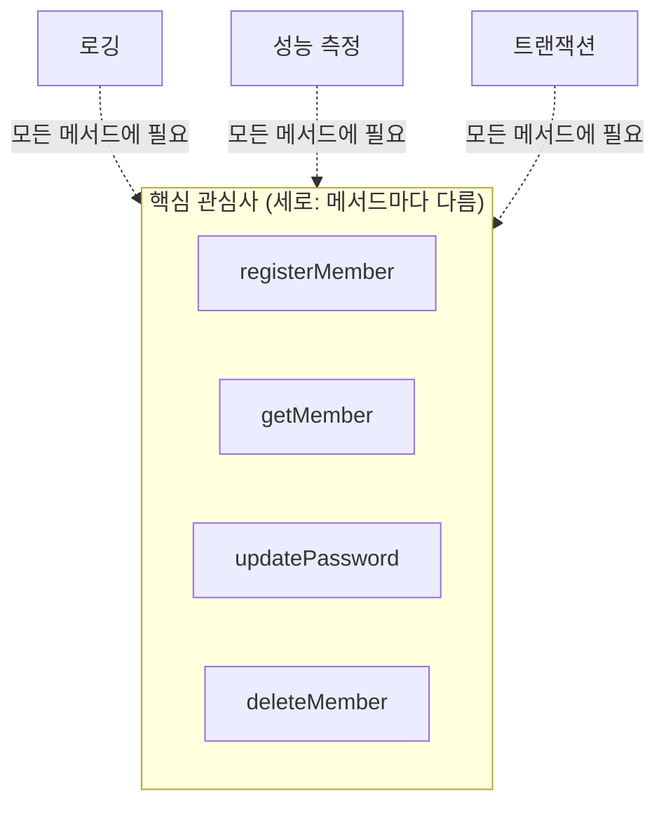
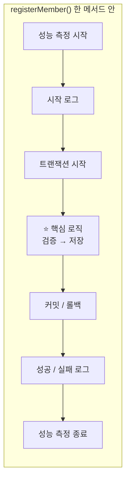
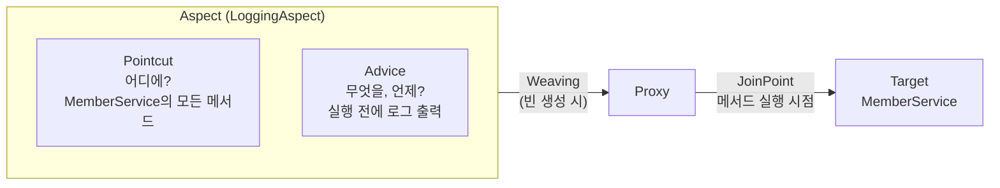
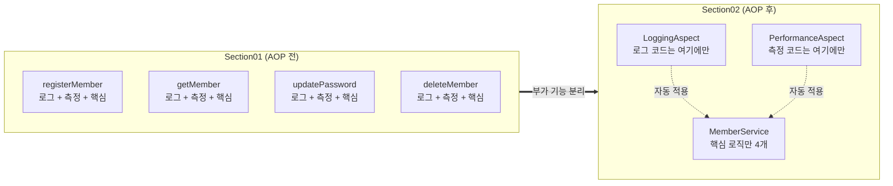
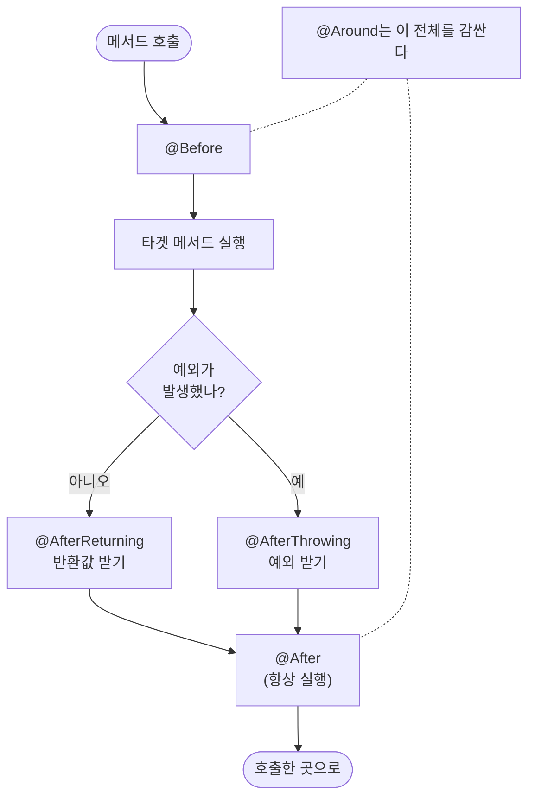
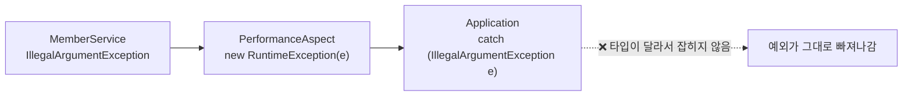
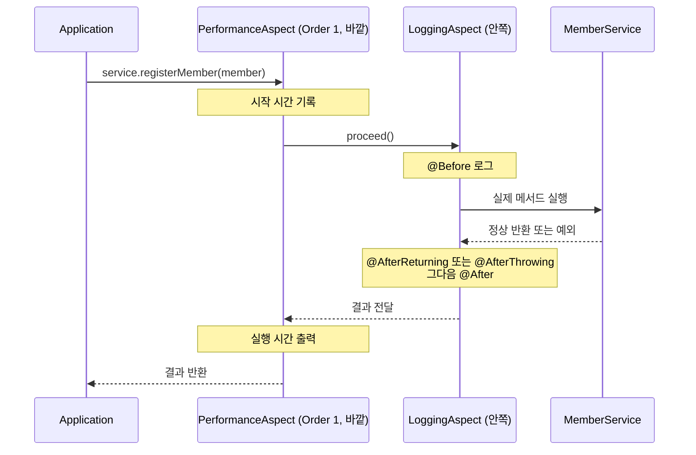
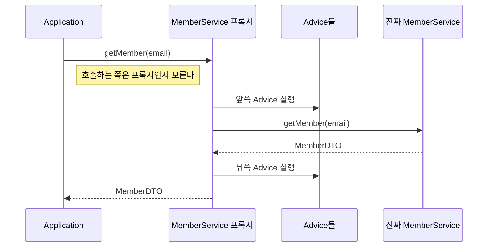
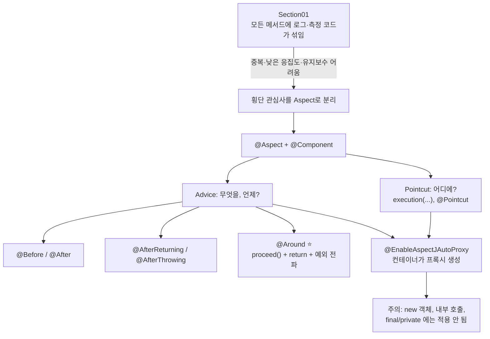

> **이번 글에서 다루는 것**
> 1. 핵심 관심사와 **횡단 관심사**: 왜 AOP가 필요한가
> 2. AOP 용어: Aspect, Advice, Pointcut, JoinPoint, Target, Proxy, Weaving
> 3. Advice 5가지(`@Before`, `@After`, `@AfterReturning`, `@AfterThrowing`, `@Around`)와 실행 순서
> 4. Pointcut 표현식 `execution`과 `@Pointcut`
> 5. 스프링 AOP가 **프록시**로 동작한다는 것과 그 때문에 생기는 주의사항
>
> [Spring] 02편까지는 객체를 **누가 만들고 연결하는가**(IoC·DI)를 다뤘다. 이번 글은 **여러 메서드에 반복되는 코드를 어떻게 한 곳에 모으는가**를 다룬다.

**AOP(Aspect Oriented Programming, 관점 지향 프로그래밍)** 는 로깅, 성능 측정, 트랜잭션처럼 여러 메서드에 반복되는 **부가 기능**을 비즈니스 로직에서 떼어내 **한 곳(Aspect)에 모아두고**, 필요한 지점에 **자동으로 끼워 넣는** 방식이다. OOP가 "무엇을(객체)" 기준으로 코드를 나눈다면 AOP는 "어떤 관심사" 기준으로 나눈다. OOP를 대체하는 게 아니라 **보완**한다.

```
com.wanted.aop
├── section01   ← AOP 적용 전: 모든 메서드에 로깅·성능 측정 코드가 섞여 있음
└── section02   ← AOP 적용 후: LoggingAspect, PerformanceAspect로 분리
```

---

## 1. 핵심 관심사와 횡단 관심사

실습 주제는 **회원 관리 프로그램**이다.

| 구분 | 내용 |
|---|---|
| 핵심 관심사 (기능) | 회원가입, 회원조회, 비밀번호 수정, 탈퇴 |
| 횡단 관심사 (비기능) | 로깅(누가 몇 시에 접근했는지), 성능 측정, 트랜잭션 |

- **핵심 관심사(Core Concern)**: 그 메서드가 존재하는 이유. 예) 회원 저장, 회원 삭제
- **횡단 관심사(Cross-cutting Concern)**: 여러 메서드에 **가로로 걸쳐** 공통으로 필요한 기능. 예) 로그, 실행 시간 측정, 트랜잭션, 보안 검사



메서드들을 세로 기둥으로 세워두면, 로깅·성능 측정·트랜잭션은 그 기둥들을 **가로로 자르며(cross-cutting)** 지나간다. 그래서 **횡단** 관심사라고 부른다.

---

## 2. Section01 — AOP 적용 전

### 의존성 (build.gradle)

```groovy
dependencies {
    implementation 'org.springframework:spring-context:7.0.8'
    implementation 'org.springframework:spring-aop:7.0.8'
    implementation 'org.aspectj:aspectjrt:1.9.25.1'
    implementation 'org.aspectj:aspectjweaver:1.9.25.1'

    compileOnly 'org.projectlombok:lombok:1.18.46'
    annotationProcessor('org.projectlombok:lombok:1.18.46')
}
```

| 라이브러리 | 역할 |
|---|---|
| `spring-context` | IoC 컨테이너, `@Component`, `@Configuration` 등 |
| `spring-aop` | 스프링의 프록시 기반 AOP 기능 |
| `aspectjweaver` | `@Aspect`, `@Before` 등 AspectJ 어노테이션과 포인트컷 표현식 해석기 |
| `aspectjrt` | AspectJ 런타임 (`aspectjweaver`가 이 내용을 포함하고 있어서 weaver만 있어도 동작한다) |

> 💡 `spring-context`는 내부적으로 `spring-aop`를 이미 의존하고 있어서 따로 적지 않아도 함께 들어온다.

### MemberDTO

```java
// DTO 는 행위 객체가 아닌 데이터 위주의 객체이다.
@NoArgsConstructor  // 기본 생성자
@AllArgsConstructor // 모든 필드 초기화 생성자
@Getter
@Setter
@ToString
public class MemberDTO {
    private String email;
    private String password;
    private String name;
    private String phone;
    private String role;
}
```

**DTO(Data Transfer Object)** 는 계층 간에 데이터를 실어 나르는 객체다. 로직보다 데이터 보관이 목적이다.

### MemberService — 부가 기능이 뒤섞인 코드

회원 가입 메서드 하나만 봐도 핵심 로직보다 부가 코드가 더 많다.

```java
public void registerMember(MemberDTO member) {
    long startTime = System.currentTimeMillis();            // 성능 측정 시작   - 횡단 관심사 #1

    try {
        System.out.println("[로그] 회원 가입 시작: " + member.getEmail()); // 로깅 - 횡단 관심사 #2
        // beginTransaction();                              // 트랜잭션 시작 - 횡단 관심사 #3

        // ----- 핵심 비즈니스 로직 시작 -----
        if (member.getEmail() == null || member.getEmail().isEmpty()) {
            throw new IllegalArgumentException("이메일은 필수입니다.");
        }
        if (member.getPassword() == null || member.getPassword().length() < 8) {
            throw new IllegalArgumentException("비밀번호는 8자 이상이어야 합니다.");
        }
        if (memberRepository.containsKey(member.getEmail())) {
            throw new IllegalArgumentException("이미 등록된 이메일입니다: " + member.getEmail());
        }
        memberRepository.put(member.getEmail(), member);
        System.out.println("회원 정보 저장 완료: " + member.getEmail());
        // ----- 핵심 비즈니스 로직 종료 -----

        // commitTransaction();                             // 트랜잭션 커밋
        System.out.println("[로그] 회원 가입 성공: " + member.getEmail());
    } catch (Exception e) {
        // rollbackTransaction();                           // 트랜잭션 롤백
        System.out.println("[로그] 회원 가입 실패: " + e.getMessage());
        throw e;
    } finally {
        long endTime = System.currentTimeMillis();          // 성능 측정 종료
        System.out.println("[성능] 회원 가입 처리 시간: " + (endTime - startTime) + "ms");
    }
}
```

- `memberRepository`는 DB 대신 쓰는 **인메모리 저장소**다. (`Map<String, MemberDTO>`, key = 이메일)
- `getMember`, `updatePassword`, `deleteMember`도 **똑같은 try-catch-finally 틀**을 반복한다. 조회(`getMember`)는 데이터를 바꾸지 않으므로 트랜잭션 코드만 빠져 있다.



핵심 로직은 가운데 한 칸뿐이고 나머지는 전부 부가 기능이다.

### 테스트 시나리오 (Application)

```java
MemberService service = new MemberService();   // 직접 new로 생성

// [테스트 1] 회원 가입
// [테스트 2] 회원 조회
// [테스트 3] 비밀번호 변경 (pass0123 → pass0234)
// [테스트 4] 회원 탈퇴
// [테스트 5] 존재하지 않는 회원 조회 → 일부러 예외 발생
```

### Section01의 문제점

| 문제 | 설명 |
|---|---|
| **1. 코드 중복** | 모든 메서드마다 로깅·성능 측정·트랜잭션 코드가 반복된다. |
| **2. 낮은 응집도** | 메서드가 핵심 로직 말고도 다른 일들을 함께 처리한다. (단일 책임 원칙 위반) |
| **3. 유지보수의 어려움** | 로그 양식이나 성능 측정 기준이 바뀌면 **모든 메서드를 일일이 수정**해야 한다. |

메서드가 4개라서 견딜 만하지만, 서비스 클래스가 30개, 메서드가 300개라면 로그 포맷 하나 바꾸는 데 300군데를 고쳐야 한다. 그리고 그중 한 곳은 꼭 빠뜨린다.

---

## 3. AOP 핵심 용어

| 용어 | 의미 | 이번 실습에서 |
|---|---|---|
| **Aspect** (관점) | 횡단 관심사를 모듈화한 것. **Advice + Pointcut** 의 묶음 | `LoggingAspect`, `PerformanceAspect` |
| **Advice** (무엇을, 언제) | 끼워 넣을 부가 기능 코드 + 실행 시점 | `logBefore()`, `performance()` 등 |
| **Pointcut** (어디에) | Advice를 적용할 대상을 고르는 **표현식** | `execution(* ...MemberService.*(..))` |
| **JoinPoint** | Advice가 끼어들 수 있는 **지점**. 스프링 AOP에서는 **메서드 실행 시점**만 해당 | `registerMember()` 실행 순간 |
| **Target** | Advice가 적용되는 **원본 객체** | `MemberService` |
| **Proxy** | Target을 감싸서 대신 호출을 받는 **대리 객체** | 스프링이 자동 생성 |
| **Weaving** (위빙) | Aspect를 Target에 **엮어서** 프록시를 만드는 과정 | 컨테이너가 빈을 만들 때 수행 |



한 문장으로 정리하면: **Aspect** 안에 **어디에(Pointcut)** 와 **무엇을 언제(Advice)** 를 정의해두면, 스프링이 **Target**을 **Proxy**로 감싸서(**Weaving**) 해당 **JoinPoint**에서 Advice를 실행해준다.

---

## 4. Section02 — AOP 적용 후

### AppConfig — AOP 활성화

```java
@Configuration                          // 설정 정보를 담은 빈
@ComponentScan("com.wanted.aop.section02")
@EnableAspectJAutoProxy                 // @Aspect 를 찾아 프록시를 자동 생성하도록 활성화
public class AppConfig {
}
```

- `@EnableAspectJAutoProxy`가 없으면 `@Aspect` 클래스가 빈으로 등록되더라도 **아무 일도 일어나지 않는다.**
- Spring Boot에서는 AOP 스타터를 추가하면 자동 설정되므로 이 어노테이션을 직접 붙이지 않아도 된다. (Spring Boot 4부터 스타터 이름은 `spring-boot-starter-aspectj`, 3까지는 `spring-boot-starter-aop`)

### MemberService — 핵심 로직만 남음

```java
@Service   // 컴포넌트 스캔 대상 → 빈으로 등록
public class MemberService {

    private Map<String, MemberDTO> memberRepository = new HashMap<>();

    public void registerMember(MemberDTO member) {
        if (member.getEmail() == null || member.getEmail().isEmpty()) {
            throw new IllegalArgumentException("이메일은 필수입니다.");
        }
        if (member.getPassword() == null || member.getPassword().length() < 8) {
            throw new IllegalArgumentException("비밀번호는 8자 이상이어야 합니다.");
        }
        if (memberRepository.containsKey(member.getEmail())) {
            throw new IllegalArgumentException("이미 등록된 이메일입니다: " + member.getEmail());
        }
        memberRepository.put(member.getEmail(), member);
        System.out.println("회원 정보 저장 완료: " + member.getEmail());
    }

    public MemberDTO getMember(String email) { /* 검증 → 조회 → 반환 */ }
    public void updatePassword(String email, String currentPassword, String newPassword) { /* 검증 → 비밀번호 확인 → 변경 */ }
    public void deleteMember(String email) { /* 검증 → 존재 확인 → 삭제 */ }
}
```

try-catch-finally, 로그, 시간 측정 코드가 **전부 사라졌다.** 메서드는 자기 일만 한다.

### Application — 컨테이너에서 꺼내 쓰기

```java
ApplicationContext context = new AnnotationConfigApplicationContext(AppConfig.class);
MemberService service = context.getBean(MemberService.class);
```

> ⚠️ section01처럼 `new MemberService()`로 직접 만들면 AOP가 **적용되지 않는다.** AOP는 컨테이너가 빈을 만들 때 프록시로 감싸주는 방식이므로, **반드시 컨테이너에서 꺼낸 빈**을 써야 한다.

### 전후 비교



---

## 5. Advice 종류 5가지

| 어노테이션 | 실행 시점 | 주 용도 |
|---|---|---|
| `@Before` | 타겟 메서드 **실행 전** | 호출 로그, 파라미터 검증, 권한 체크 |
| `@After` | 타겟 메서드 **종료 후 (성공/실패 무관)**, `finally`와 같음 | 종료 로그, 자원 정리 |
| `@AfterReturning` | 타겟 메서드가 **정상 반환**한 후 | 반환값 확인·로그 |
| `@AfterThrowing` | 타겟 메서드에서 **예외 발생** 시 | 예외 로그, 알림 |
| `@Around` | 타겟 메서드 **앞뒤 전체를 감쌈** | 성능 측정, 트랜잭션, 캐싱. 가장 강력 |

try-catch-finally에 대응시켜 보면 이해가 쉽다.

```java
// @Around 가 이 전체를 감쌀 수 있다
try {
    // @Before
    Object result = target.method();   // 타겟 메서드 실행
    // @AfterReturning
    return result;
} catch (Exception e) {
    // @AfterThrowing
    throw e;
} finally {
    // @After
}
```



### LoggingAspect

```java
@Component   // 빈으로 등록되어야 AOP가 인식할 수 있다
@Aspect      // 이 클래스가 Aspect(관점)임을 선언
public class LoggingAspect {

    // 타겟 메서드 동작 전 실행
    @Before("execution(* com.wanted.aop.section02.MemberService.*(..))")
    public void logBefore(JoinPoint joinPoint) {
        String methodName = joinPoint.getSignature().getName();
        Object[] args = joinPoint.getArgs();

        StringBuilder argStr = new StringBuilder();
        for (Object arg : args) {
            argStr.append(arg).append(" , ");
        }
        System.out.println("[Before 로그]" + methodName + " 메서드 실행 시작 됨, 매개변수 : " + argStr);
    }

    // 타겟 메서드 실행 완료 후 (성공/예외 상관없이)
    @After("execution(* com.wanted.aop.section02.MemberService.*(..))")
    public void logAfter(JoinPoint joinPoint) {
        String methodName = joinPoint.getSignature().getName();
        System.out.println("[After 로그]" + methodName + "메서드 실행 완료!");
    }

    // 정상 종료 후 — returning 으로 반환값을 받는다
    @AfterReturning(
            pointcut = "execution(* com.wanted.aop.section02.MemberService.*(..))",
            returning = "result"
    )
    public void logAfterReturning(JoinPoint joinPoint, Object result) {
        String methodName = joinPoint.getSignature().getName();
        System.out.println("[AfterReturn 로그] " + methodName + " 메소드 정상 종료, 종료 시 반환값 : " + result);
    }

    // 예외 발생 시 — throwing 으로 예외 객체를 받는다
    @AfterThrowing(
            pointcut = "execution(* com.wanted.aop.section02.MemberService.*(..))",
            throwing = "exception"
    )
    public void logAfterThrowing(JoinPoint joinPoint, Exception exception) {
        String methodName = joinPoint.getSignature().getName();
        System.out.println("[AfterThrowing 로그] " + methodName + " 메소드 실행 중 예외 발생 : " + exception.getMessage());
    }
}
```

**`JoinPoint`** 는 Advice가 적용된 지점의 정보를 담은 객체다. Advice 메서드의 매개변수로 받는다.

| 메서드 | 반환 |
|---|---|
| `getSignature().getName()` | 메서드 이름 |
| `getArgs()` | 전달된 인자 배열 |
| `getTarget()` | 원본 객체 |
| `getThis()` | 프록시 객체 |

**`returning` / `throwing` 규칙**

- `returning = "result"`: 반환값을 `result`라는 매개변수로 받겠다는 뜻이다. **어노테이션에 적은 이름과 매개변수 이름이 같아야 한다.**
  - 반환 타입이 `void`인 메서드는 `result`가 `null`로 찍힌다.
  - 매개변수 타입을 `Object` 대신 `MemberDTO`로 쓰면 **반환 타입이 MemberDTO인 메서드에만** 적용된다.
- `throwing = "exception"`: 발생한 예외를 매개변수로 받는다. 이름이 같아야 하고, 타입을 `IllegalArgumentException`처럼 좁히면 그 예외일 때만 동작한다.
- `@AfterThrowing`은 예외를 **관찰**만 한다. 예외를 삼키거나 복구하지 못하고, 예외는 그대로 호출자에게 전달된다.

### PerformanceAspect — @Around

```java
@Component
@Aspect
@Order(1)   // Aspect 간 실행 우선순위 (숫자가 작을수록 우선 = 바깥쪽)
public class PerformanceAspect {

    // @Around : Advice 중 가장 강력. Pointcut 메서드의 앞/뒤 모두에서 동작
    @Around("execution(* com.wanted.aop.section02.MemberService.*(..))")
    public Object performance(ProceedingJoinPoint joinPoint) {

        long startTime = System.currentTimeMillis();   // 시작 시간

        try {
            Object result = joinPoint.proceed();       // ⭐ 타겟 메서드 실행
            return result;
        } catch (Throwable e) {
            throw new RuntimeException(e);
        } finally {
            long endTime = System.currentTimeMillis(); // 종료 시간
            String methodName = joinPoint.getSignature().getName();
            System.out.println("[Around 성능 측정] " + methodName + " 메서드 실행 시간 : " + (endTime - startTime) + "(ms)");
        }
    }
}
```

**`@Around`의 핵심 규칙**

1. 매개변수는 `JoinPoint`가 아니라 **`ProceedingJoinPoint`** 다. 타겟 메서드 실행을 **직접 제어**할 수 있다.
2. **`proceed()`를 반드시 호출**해야 타겟 메서드가 실행된다. 호출하지 않으면 타겟 메서드는 **아예 실행되지 않는다.** (캐시처럼 일부러 이렇게 쓰는 경우도 있다)
3. 반환 타입은 **`Object`** 이고, `proceed()`의 결과를 **반드시 return** 해야 한다. 안 그러면 `getMember()`가 항상 `null`을 반환한다.
4. `proceed(Object[] args)`로 **인자를 바꿔서** 호출하거나, 반환값을 바꿔서 return 할 수도 있다.

### ⚠️ 예외를 `RuntimeException`으로 감싸면 생기는 문제

현재 코드는 `Throwable`을 잡아서 `new RuntimeException(e)`로 감싸 던진다. 그러면 원래의 `IllegalArgumentException`이 **다른 예외로 바뀌어** 호출자에게 전달된다.



```
// 기대한 출력
예외 발생!! : 존재하지 않는 회원입니다: user@example.com

// 실제 출력 (감싸진 예외의 메시지)
예외 발생!! : java.lang.IllegalArgumentException: 존재하지 않는 회원입니다: user@example.com
```

부가 기능(성능 측정)이 **원래 동작을 바꿔버린 것**이다. 보통은 예외를 그대로 다시 던진다.

```java
@Around("execution(* com.wanted.aop.section02.MemberService.*(..))")
public Object performance(ProceedingJoinPoint joinPoint) throws Throwable {
    long startTime = System.currentTimeMillis();
    try {
        return joinPoint.proceed();   // 예외는 그대로 위로 전파
    } finally {
        long endTime = System.currentTimeMillis();
        System.out.println("[Around 성능 측정] " + joinPoint.getSignature().getName()
                + " 메서드 실행 시간 : " + (endTime - startTime) + "(ms)");
    }
}
```

> 💡 AOP의 대원칙: **부가 기능은 핵심 로직의 결과(반환값, 예외)를 의도치 않게 바꾸면 안 된다.**

---

## 6. Pointcut 표현식 — `execution`

```
execution( [접근제어자]  반환타입  [패키지.클래스.]메서드이름(파라미터)  [throws 예외] )
                 ↑ 생략 가능                                              ↑ 생략 가능
```

실습 코드를 쪼개보면:

```
execution(  *        com.wanted.aop.section02.MemberService  .*    (..)  )
            반환타입   패키지.클래스                              메서드  파라미터
            (모두)                                             (모두)  (0개 이상)
```

맨 앞의 `*`는 접근 제어자가 아니라 **반환 타입**이다. 접근 제어자는 생략된 상태다.

**파라미터 패턴**

| 패턴 | 의미 |
|---|---|
| `(..)` | 매개변수 0개 이상 (아무거나) |
| `()` | 매개변수 없는 메서드 |
| `(String)` | 매개변수가 String 1개인 메서드 |
| `(String, ..)` | 첫 번째는 String, 나머지는 상관없음 |
| `(*)` | 타입 상관없이 **정확히 1개** |
| `(*, String)` | 2개, 두 번째가 String |

**자주 쓰는 패턴**

| 표현식 | 의미 |
|---|---|
| `execution(* com.wanted..*.*(..))` | `com.wanted`와 **모든 하위 패키지**의 모든 메서드 (`..` = 하위 패키지 포함) |
| `execution(* com.wanted.aop.section02.*Service.*(..))` | 이름이 `Service`로 끝나는 클래스의 모든 메서드 |
| `execution(* *..MemberService.get*(..))` | MemberService의 `get`으로 시작하는 메서드 |
| `execution(public void *(..))` | 반환 타입이 void인 모든 public 메서드 |

**`execution` 외의 지시자**

| 지시자 | 예시 | 의미 |
|---|---|---|
| `within` | `within(com.wanted.aop.section02..*)` | 해당 패키지 안의 모든 타입 |
| `@annotation` | `@annotation(com.wanted.aop.LogExecution)` | 특정 어노테이션이 붙은 메서드 |
| `bean` | `bean(memberService)` | 특정 빈 이름 (스프링 전용) |

표현식은 `&&`, `||`, `!`로 조합할 수 있다.

### `@Pointcut`으로 중복 제거하기

현재 `LoggingAspect`는 같은 표현식을 **4번** 반복한다. AOP로 중복을 없앴는데 Aspect 안에 또 중복이 생긴 셈이다. `@Pointcut`으로 이름을 붙여 재사용한다.

```java
@Component
@Aspect
public class LoggingAspect {

    // 포인트컷에 이름 붙이기 (메서드 본문은 비워둔다)
    @Pointcut("execution(* com.wanted.aop.section02.MemberService.*(..))")
    public void memberServiceMethods() {}

    @Before("memberServiceMethods()")
    public void logBefore(JoinPoint joinPoint) { ... }

    @After("memberServiceMethods()")
    public void logAfter(JoinPoint joinPoint) { ... }

    @AfterReturning(pointcut = "memberServiceMethods()", returning = "result")
    public void logAfterReturning(JoinPoint joinPoint, Object result) { ... }

    @AfterThrowing(pointcut = "memberServiceMethods()", throwing = "exception")
    public void logAfterThrowing(JoinPoint joinPoint, Exception exception) { ... }
}
```

대상 범위가 바뀌면 `@Pointcut` **한 줄만** 고치면 된다.

---

## 7. 실행 순서 — Advice와 @Order

### @Order

- 하나의 메서드에 여러 Aspect가 적용될 때 **우선순위**를 정한다.
- **숫자가 작을수록 우선순위가 높고, 더 바깥쪽**에서 감싼다.
- `@Order`가 없으면 가장 낮은 우선순위(가장 안쪽)로 취급된다.
- 이번 실습: `PerformanceAspect(@Order(1))`가 바깥, `LoggingAspect(@Order 없음)`가 안쪽이다.



양파 껍질처럼 바깥(Performance) → 안쪽(Logging) → 타겟 순으로 들어갔다가, 반대 순서로 나온다.

### 실행 결과

**[테스트 1] 회원 가입 (정상)**

```
[Before 로그]registerMember 메서드 실행 시작 됨, 매개변수 : MemberDTO(email=user@example.com, password=pass0123, name=홍길동, phone=010-1111-1111, role=USER) ,
회원 정보 저장 완료: user@example.com
[AfterReturn 로그] registerMember 메소드 정상 종료, 종료 시 반환값 : null
[After 로그]registerMember메서드 실행 완료!
[Around 성능 측정] registerMember 메서드 실행 시간 : 0(ms)
```

- `registerMember`는 `void`라서 반환값이 `null`이다.
- 같은 Aspect 안에서는 `@After`가 `@AfterReturning`/`@AfterThrowing` **뒤에** 실행된다. `@After`는 `finally`와 같은 의미이기 때문이다. (Spring 5.2.7부터 이 순서로 정리됨)

**[테스트 5] 존재하지 않는 회원 조회 (예외)**

```
[Before 로그]getMember 메서드 실행 시작 됨, 매개변수 : user@example.com ,
[AfterThrowing 로그] getMember 메소드 실행 중 예외 발생 : 존재하지 않는 회원입니다: user@example.com
[After 로그]getMember메서드 실행 완료!
[Around 성능 측정] getMember 메서드 실행 시간 : 0(ms)
예외 발생!! : java.lang.IllegalArgumentException: 존재하지 않는 회원입니다: user@example.com
```

- `@AfterReturning`은 실행되지 않는다.
- 마지막 줄 메시지 앞에 예외 클래스명이 붙은 이유는 5장에서 본 `RuntimeException` 래핑 때문이다.

---

## 8. 스프링 AOP는 어떻게 동작할까? — 프록시

스프링 AOP는 **원본 코드를 고치지 않는다.** 컨테이너가 빈을 만들 때 원본 객체를 감싼 **프록시 객체**를 만들어 빈으로 등록한다.



확인해보기:

```java
MemberService service = context.getBean(MemberService.class);
System.out.println(service.getClass());
// class com.wanted.aop.section02.MemberService$$SpringCGLIB$$0  ← 프록시!
```

**프록시 생성 방식**

| 방식 | 조건 | 원리 |
|---|---|---|
| **JDK 동적 프록시** | 타겟이 인터페이스를 구현 | 같은 인터페이스를 구현한 프록시 생성 |
| **CGLIB 프록시** | 인터페이스가 없는 클래스 (이번 실습의 MemberService) | 타겟 클래스를 **상속**한 자식 클래스 생성 |

> 💡 Spring Boot는 인터페이스가 있어도 기본으로 CGLIB을 사용한다.

### 프록시 방식이라서 생기는 주의사항

1. **`new`로 만든 객체에는 적용되지 않는다.** 컨테이너가 만든 빈만 프록시로 감싸진다.
2. **내부 호출(self-invocation)에는 적용되지 않는다.**

   ```java
   public void registerMember(MemberDTO member) {
       ...
       this.getMember(member.getEmail());  // ❌ this = 프록시가 아닌 원본 → getMember에 Advice 미적용
   }
   ```

   ```mermaid
   flowchart LR
       C["Application"] -->|"① registerMember()"| PX["프록시<br/>(Advice 적용 ✅)"]
       PX --> T["원본 MemberService"]
       T -->|"② this.getMember()<br/>프록시를 거치지 않음"| G["getMember() 원본 직접 실행<br/>(Advice 적용 ❌)"]
   ```

   외부에서 `registerMember`를 호출하면 프록시를 거치지만, 그 안의 `this.getMember()`는 원본 객체가 자기 자신을 직접 부르므로 프록시를 거치지 않는다.
3. **`final` 클래스·메서드에는 적용되지 않는다.** CGLIB는 상속으로 프록시를 만드는데 `final`은 상속·오버라이드가 안 된다. `private` 메서드도 마찬가지로 가로챌 수 없다.
4. **메서드 실행 시점만 JoinPoint가 된다.** 필드 접근, 생성자 호출 등에 끼어들려면 AspectJ(컴파일/로드 타임 위빙)를 따로 써야 한다.

---

## 9. 추가로 알면 좋은 점

### ① AOP는 이미 쓰고 있다

| 기능 | AOP와의 관계 |
|---|---|
| `@Transactional` | 메서드 앞에서 트랜잭션 시작, 정상 종료 시 커밋, 예외 시 롤백. section01의 `beginTransaction/commit/rollback` 의사코드를 스프링이 AOP로 대신 해준다 |
| `@Cacheable` | 캐시에 값이 있으면 `proceed()`를 호출하지 않고 바로 반환하는 `@Around`와 같은 원리 |
| `@Async` | 메서드를 다른 스레드에서 실행하도록 프록시가 가로챔 |
| `@PreAuthorize` (Spring Security) | 메서드 실행 전 권한 검사 (`@Before`와 비슷) |

그래서 8장의 **내부 호출 문제**는 `@Transactional`에서도 똑같이 생긴다. 같은 클래스 안에서 `@Transactional` 메서드를 호출하면 트랜잭션이 적용되지 않는 유명한 실수가 바로 이것이다.

### ② 커스텀 어노테이션으로 대상 지정하기

`execution`은 패키지·클래스 이름에 의존하므로 원하는 메서드만 콕 집기 어렵다. 어노테이션을 만들어 표시하는 방식이 실무에서 많이 쓰인다.

```java
@Target(ElementType.METHOD)          // 메서드에 붙이는 어노테이션
@Retention(RetentionPolicy.RUNTIME)  // 런타임까지 유지 (AOP가 읽을 수 있도록)
public @interface MeasureTime {
}
```

```java
@Around("@annotation(com.wanted.aop.section02.MeasureTime)")
public Object measure(ProceedingJoinPoint joinPoint) throws Throwable { ... }
```

```java
@MeasureTime          // 이 메서드만 성능 측정
public void registerMember(MemberDTO member) { ... }
```

### ③ AOP 적용 체크리스트

1. 의존성 추가 (`spring-aop`, `aspectjweaver`)
2. 설정 클래스에 `@EnableAspectJAutoProxy`
3. Aspect 클래스에 `@Component` + `@Aspect`
4. Advice 어노테이션(`@Before` 등) + Pointcut 표현식 작성
5. 타겟 객체는 반드시 **스프링 빈**으로 등록하고 **컨테이너에서 꺼내 사용**
6. `@Around`라면 `proceed()` 호출 + 결과 return + 예외는 그대로 전파

---

## 10. 한눈에 정리



| 비교 | AOP 적용 전 (section01) | AOP 적용 후 (section02) |
|---|---|---|
| 부가 기능 위치 | 각 메서드 안에 흩어짐 | Aspect 클래스 한 곳에 모임 |
| 서비스 메서드 | 핵심 로직 + 부가 코드 | 핵심 로직만 |
| 로그 양식 변경 시 | 모든 메서드 수정 | Aspect 하나만 수정 |
| 객체 생성 | `new MemberService()` | 컨테이너에서 `getBean()` (프록시) |

- **AOP** : 횡단 관심사를 Aspect로 모아 필요한 곳에 자동으로 끼워 넣는다
- **Advice 순서** : `@Before` → 타겟 → `@AfterReturning`/`@AfterThrowing` → `@After`, `@Around`는 전체를 감싼다
- **@Order** : 숫자가 작을수록 바깥쪽
- **프록시 기반** : 컨테이너 빈 + 외부 호출 + public 메서드에만 적용된다
