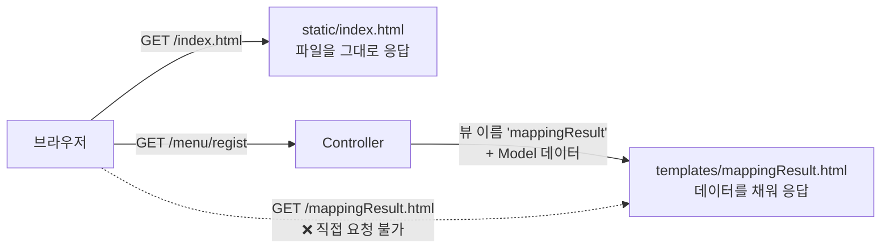
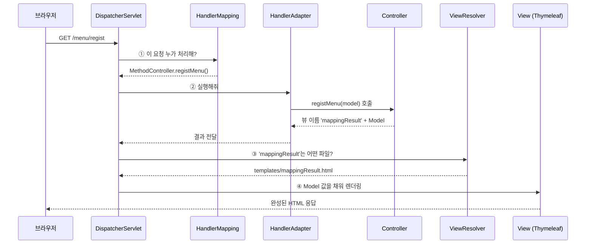
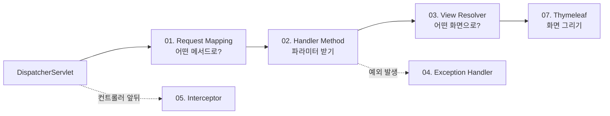
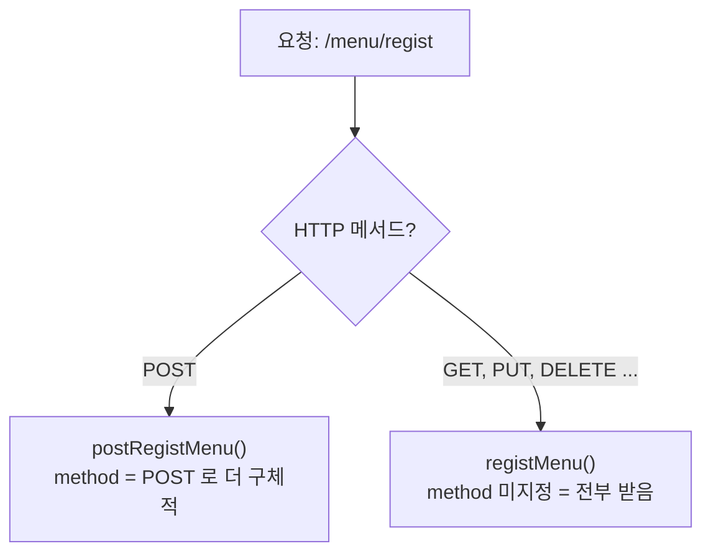
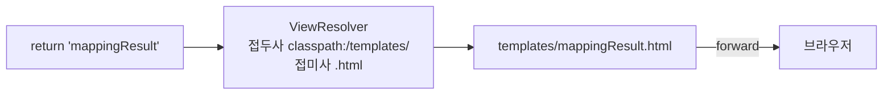
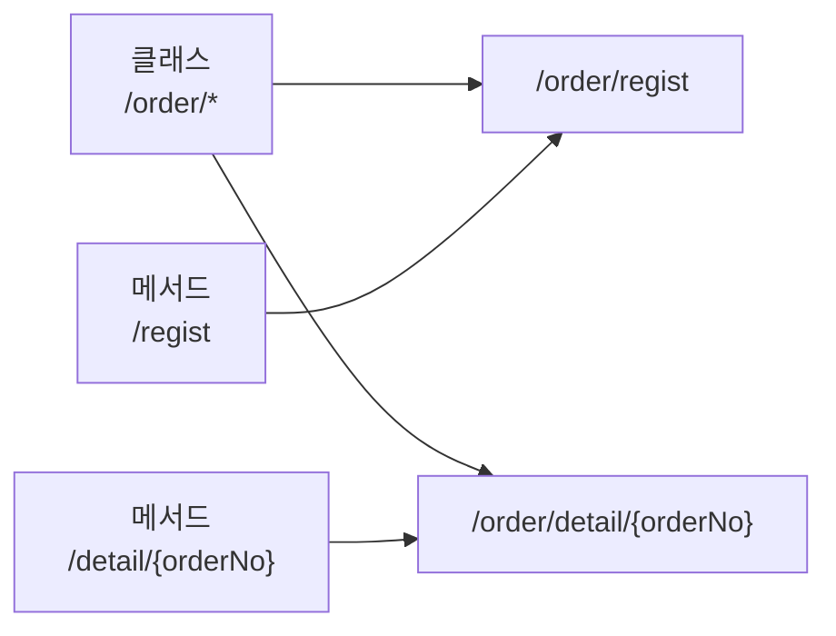
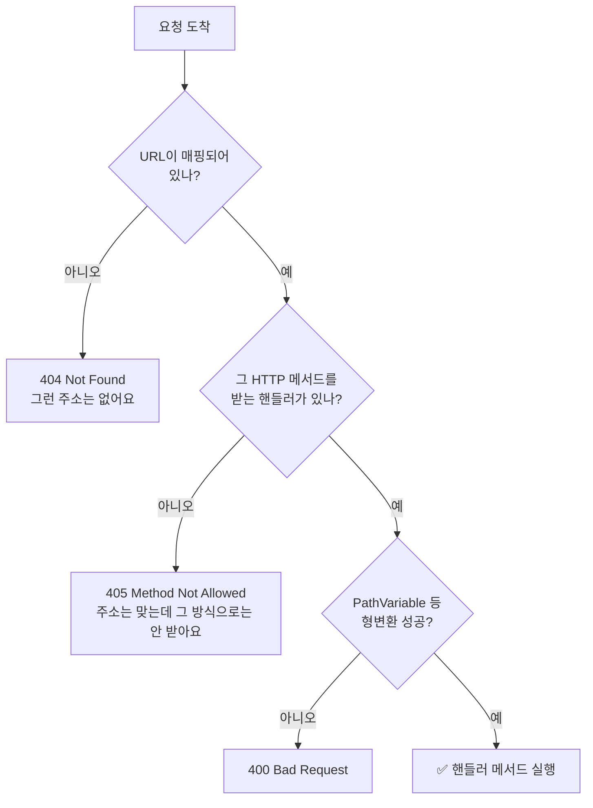
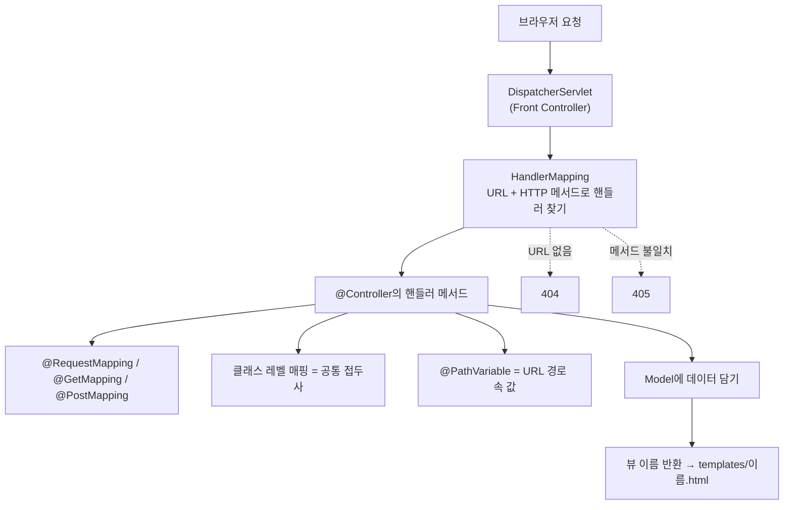

> **이번 글에서 다루는 것**
> 1. Spring Boot 웹 프로젝트 설정 (`build.gradle`, `application.yaml`, `static` vs `templates`)
> 2. Spring MVC 요청 처리 흐름: **DispatcherServlet**
> 3. 메서드 레벨 매핑: `@RequestMapping`, `@GetMapping`, `@PostMapping`, `Model`
> 4. 클래스 레벨 매핑과 `@PathVariable`
> 5. 404와 405의 차이
>
> 서블릿에서는 `@WebServlet("/경로")` + `doGet()/doPost()`로 URL과 코드를 연결했다. Spring MVC에서는 **"어떤 URL로, 어떤 HTTP 메서드로 들어온 요청을 어떤 메서드가 처리할지"** 를 어노테이션 하나로 정한다. 이것이 **Request Mapping**이다.

**Spring Web MVC 시리즈**: **01. Request Mapping** → 02. Handler Method → 03. View Resolver → 04. Exception Handler → 05. Interceptor → 06. File Upload → 07. Thymeleaf

```
com.wanted.requestmapping
├── Chap01RequestMappingApplication.java   ← @SpringBootApplication
├── MethodController.java                  ← 메서드 레벨 매핑
└── ClassController.java                   ← 클래스 레벨 매핑 + @PathVariable
```

---

## 1. 프로젝트 설정

### build.gradle

```groovy
plugins {
    id 'java'
    id 'org.springframework.boot' version '4.1.2'
    id 'io.spring.dependency-management' version '1.1.7'
}

java {
    toolchain {
        languageVersion = JavaLanguageVersion.of(21)
    }
}

dependencies {
    implementation 'org.springframework.boot:spring-boot-starter-thymeleaf'
    implementation 'org.springframework.boot:spring-boot-starter-webmvc'
    testImplementation 'org.springframework.boot:spring-boot-starter-thymeleaf-test'
    testImplementation 'org.springframework.boot:spring-boot-starter-webmvc-test'
    testRuntimeOnly 'org.junit.platform:junit-platform-launcher'
}
```

| 의존성 | 역할 |
|---|---|
| `spring-boot-starter-webmvc` | Spring MVC + **내장 Tomcat** + JSON 변환 등 웹 개발 기본 세트 |
| `spring-boot-starter-thymeleaf` | 서버에서 HTML을 만들어주는 **템플릿 엔진** Thymeleaf |
| `io.spring.dependency-management` | 라이브러리 버전을 Spring Boot가 맞춰줌 (그래서 버전을 안 적어도 된다) |

> 💡 Spring Boot 3까지는 웹 스타터 이름이 `spring-boot-starter-web`이었다. Spring Boot 4부터 모듈이 세분화되면서 `spring-boot-starter-webmvc`를 쓴다. 다른 글에서 `starter-web`이 보이면 같은 역할이라고 보면 된다.

### application.yaml

```yaml
spring:
  application:
    name: chap01-request-mapping

server:
  port: 7777   # 기본 포트 8080 대신 7777 사용
```

`.properties`로 쓰면 `spring.application.name=chap01-request-mapping`처럼 한 줄로 쓴다. 둘 중 하나만 쓰면 된다.

### 메인 클래스

```java
@SpringBootApplication
public class Chap01RequestMappingApplication {
    public static void main(String[] args) {
        SpringApplication.run(Chap01RequestMappingApplication.class, args);
    }
}
```

- `@SpringBootApplication` = `@Configuration` + `@EnableAutoConfiguration` + `@ComponentScan`
- 이 클래스가 있는 패키지(`com.wanted.requestmapping`)와 **그 하위 패키지**를 스캔해서 `@Controller`, `@Component` 등을 빈으로 등록한다. ([Spring] 02편에서 직접 지정했던 `@ComponentScan`이 여기 들어 있다)
- `main()`을 실행하면 **내장 Tomcat이 함께 켜진다.** 서블릿 실습처럼 Tomcat을 따로 설치하고 war를 배포할 필요가 없다.

### 폴더 구조 — static vs templates

```
src/main/resources
├── application.yaml
├── static/              ← 정적 파일 (html, css, js, 이미지). 요청 경로 그대로 제공
│   └── index.html       ← http://localhost:7777/ 접속 시 자동으로 보여지는 첫 페이지
└── templates/           ← Thymeleaf 템플릿. 컨트롤러를 거쳐야만 보여지는 화면
    └── mappingResult.html
```



| 폴더 | 브라우저가 직접 요청 | 서버 데이터 넣기 |
|---|:---:|:---:|
| `static/` | ✅ 경로 그대로 | ❌ |
| `templates/` | ❌ 컨트롤러를 거쳐야 함 | ✅ `${message}` 등 |

---

## 2. Spring MVC 요청 처리 흐름

수업 코드 주석에 "Servlet은 HTTP 요청을 받는 즉시 `@Controller` 클래스에 요청을 위임한다"고 되어 있다. 이 **Servlet**이 Spring MVC의 핵심인 **DispatcherServlet**이다.



| 구성 요소 | 하는 일 |
|---|---|
| **DispatcherServlet** | 모든 요청의 입구. 서블릿 시절 URL마다 서블릿을 만들던 것을 하나로 통합 (**Front Controller 패턴**) |
| **HandlerMapping** | URL + HTTP 메서드를 보고 처리할 **핸들러 메서드**를 찾음 |
| **HandlerAdapter** | 찾은 핸들러 메서드를 실제로 호출 (매개변수 준비도 여기서) |
| **Controller** | 우리가 작성하는 부분. 요청 처리 후 **뷰 이름**과 **데이터(Model)** 를 반환 |
| **ViewResolver** | 뷰 이름 → 실제 템플릿 파일 경로로 변환 |
| **View** | 템플릿에 데이터를 채워 최종 HTML 생성 |

우리는 이 중 **Controller만** 작성하고 나머지는 Spring이 해준다. 이 시리즈의 나머지 글들은 모두 이 흐름의 한 부분을 다룬다.



---

## 3. 메서드에 요청 매핑하기 — MethodController

```java
@Controller
public class MethodController {

    @RequestMapping("/menu/regist")
    public String registMenu(Model model) {
        System.out.println("동작하니?");
        model.addAttribute("message", "GET 방식의 메뉴 등록 핸들러 메서드 동작함..");
        return "mappingResult";
    }

    @RequestMapping(value = "/menu/regist", method = RequestMethod.POST)
    public String postRegistMenu(Model model) {
        model.addAttribute("message", "POST 방식의 메뉴 등록 핸들러 메서드 동작함..");
        return "mappingResult";
    }

    @GetMapping("/menu/modify")
    public String getModifyMenu(Model model) {
        model.addAttribute("message", "GET 방식의 메뉴 수정 핸들러 메서드 동작함..");
        return "mappingResult";
    }

    @PostMapping("/menu/modify")
    public String postModifyMenu(Model model) {
        model.addAttribute("message", "POST 방식의 메뉴 수정 핸들러 메서드 동작함..");
        return "mappingResult";
    }
}
```

### @Controller

- 이 클래스가 **웹 요청을 처리하는 컨트롤러**임을 선언한다.
- `@Component`를 포함하고 있어서 컴포넌트 스캔으로 **빈 등록**된다.
- 요청을 처리하는 메서드를 **핸들러 메서드(Handler Method)** 라고 부른다.

### @RequestMapping

- 서블릿의 `service()` 역할. URL과 메서드를 연결한다.
- `method`를 **지정하지 않으면 GET, POST, PUT, DELETE 등 모든 HTTP 메서드**를 받는다.
- 위 코드처럼 같은 URL에 `method = POST`인 메서드가 따로 있으면, POST 요청은 **더 구체적인** `postRegistMenu()`가 처리한다.



### @GetMapping / @PostMapping

`@RequestMapping(method = ...)`의 **축약형**이다. 실무에서는 대부분 이쪽을 쓴다.

| 축약형 | 같은 의미 | 주 용도 (REST 기준) |
|---|---|---|
| `@GetMapping` | `@RequestMapping(method = GET)` | 조회 |
| `@PostMapping` | `@RequestMapping(method = POST)` | 등록 |
| `@PutMapping` | `@RequestMapping(method = PUT)` | 전체 수정 |
| `@PatchMapping` | `@RequestMapping(method = PATCH)` | 일부 수정 |
| `@DeleteMapping` | `@RequestMapping(method = DELETE)` | 삭제 |

> 💡 HTML `<form>`의 `method`로는 **GET과 POST만** 보낼 수 있다. PUT/PATCH/DELETE는 JavaScript(`fetch`)나 REST API를 만들 때 쓰게 된다.

### Model

```java
model.addAttribute("message", "GET 방식의 메뉴 등록 핸들러 메서드 동작함..");
```

- 컨트롤러에서 만든 데이터를 **화면(View)에 전달하는 바구니**다. `key-value` 형태로 담는다.
- 핸들러 메서드의 매개변수에 `Model model`이라고 적기만 하면 Spring이 넣어준다.
- 서블릿에서 `request.setAttribute("message", ...)` 후 forward 하던 것과 같은 개념이다. 렌더링할 때 Model 값은 **request 범위**의 값으로 화면에 전달된다.

```html
<!-- templates/mappingResult.html -->
<h3 th:text="${message}"></h3>
```

### 반환값 = 뷰 이름

```java
return "mappingResult";
```



- 컨트롤러의 마지막 임무는 **어떤 화면으로 응답할지 결정하는 것**이다.
- 문자열을 반환하면 ViewResolver가 접두사 `classpath:/templates/`와 접미사 `.html`을 붙여 파일을 찾는다.
- 기본 동작은 **forward**다. (서블릿의 `request.getRequestDispatcher(...).forward(req, res)`와 같음) 자세한 내용은 03편에서 다룬다.

---

## 4. 클래스에 요청 매핑하기 — ClassController

```java
@Controller
@RequestMapping("/order/*")
public class ClassController {

    @GetMapping("/regist")
    public String registOrder(Model model) {
        model.addAttribute("message", "GET 방식의 주문 등록 핸들러 메서드 동작.");
        return "mappingResult";
    }

    // 요청 경로 : /order/detail/3
    @GetMapping("/detail/{orderNo}")
    public String pathVariable(Model model, @PathVariable("orderNo") int no) {
        model.addAttribute("message", no + "번 주문 상세조회!!");
        return "mappingResult";
    }
}
```

### 클래스 레벨 @RequestMapping

클래스에 붙인 경로는 **모든 핸들러 메서드 경로의 공통 접두사**가 된다.



- `/order/*` + `/regist` → **`/order/regist`**
- Spring은 클래스 경로가 `/*`로 끝나면 `*` 자리를 메서드 경로로 바꿔 합친다.

> 💡 실무에서는 와일드카드 없이 `@RequestMapping("/order")`로 쓰는 경우가 대부분이다. 결과는 같고 의도가 더 분명하다.

### @PathVariable

```
/order/detail/3
              └── {orderNo} 자리에 들어온 값 = PathVariable
```

- **URL 경로 자체에 포함된 값**을 꺼내는 어노테이션이다.
- `@PathVariable("orderNo") int no` → `{orderNo}`의 값을 `no` 변수에 담는다.
- URL은 문자열이지만 `int`로 선언하면 Spring이 **자동으로 형변환**한다.

```java
// 변수 이름이 {} 안의 이름과 같으면 괄호 안을 생략할 수 있다
@GetMapping("/detail/{orderNo}")
public String detail(@PathVariable int orderNo) { ... }

// 여러 개도 가능
@GetMapping("/{category}/{orderNo}")
public String detail(@PathVariable String category, @PathVariable int orderNo) { ... }
```

| 상황 | 결과 |
|---|---|
| `/order/detail/abc` 요청 (int로 변환 불가) | **400 Bad Request** |
| `/order/detail` 요청 (값 자체가 없음) | **404 Not Found** (매핑되는 경로가 없음) |

**PathVariable vs 쿼리 스트링**

| 형태 | 용도 | 예 |
|---|---|---|
| `/order/detail/3` | 특정 **자원을 식별** | 3번 주문 |
| `/order/list?page=2&sort=date` | **검색·정렬·필터** 같은 옵션 | 02편의 `@RequestParam` |

---

## 5. 실습 화면에서 확인할 수 있는 HTTP 에러

`index.html`에는 컨트롤러에 **없는 요청**도 버튼으로 들어 있다. 일부러 눌러보면 상태 코드 차이를 확인할 수 있다.

| 버튼 | 결과 | 이유 |
|---|---|---|
| GET `/order/regist` | ✅ 정상 | `@GetMapping("/regist")` 존재 |
| POST `/order/regist` | ❌ **405 Method Not Allowed** | URL은 있는데 POST를 받는 메서드가 없음 |
| GET/POST `/order/modify` | ❌ **404 Not Found** | URL 자체가 매핑되어 있지 않음 |
| POST `/order/delete` | ❌ **404 Not Found** | URL 자체가 매핑되어 있지 않음 |
| GET `/order/detail/2` | ✅ "2번 주문 상세조회!!" | 버튼 문구는 "3번"이지만 form의 action이 `/order/detail/2` |



404와 405를 구분할 수 있으면 디버깅이 훨씬 빨라진다.

---

## 6. 추가로 알면 좋은 점 — @RequestMapping의 다른 속성

```java
// 여러 URL을 하나의 메서드에 연결
@GetMapping({"/", "/main"})

// 특정 파라미터가 있을 때만 매핑
@GetMapping(value = "/menu", params = "type=drink")

// 특정 헤더가 있을 때만 매핑
@GetMapping(value = "/menu", headers = "X-API-VERSION=1")

// 요청 본문이 JSON일 때만 받기 (Content-Type)
@PostMapping(value = "/menu", consumes = "application/json")

// JSON으로 응답한다고 명시 (Accept)
@GetMapping(value = "/menu", produces = "application/json")
```

| 속성 | 조건 |
|---|---|
| `value` / `path` | URL |
| `method` | HTTP 메서드 |
| `params` | 요청 파라미터 |
| `headers` | 요청 헤더 |
| `consumes` | 요청 본문 형식 (`Content-Type`) |
| `produces` | 응답 형식 (`Accept`) |

---

## 7. 한눈에 정리



| 개념 | 핵심 |
|---|---|
| `@Controller` | 요청을 처리하는 클래스, 빈으로 등록됨 |
| `@RequestMapping` | URL ↔ 메서드 연결. method 미지정 시 모든 HTTP 메서드 허용 |
| `@GetMapping` 등 | HTTP 메서드별 축약형 |
| 클래스 레벨 매핑 | 메서드 경로 앞에 공통 접두사로 붙음 |
| `@PathVariable` | URL 경로 안의 값 꺼내기 |
| `Model` | 화면에 데이터를 전달하는 key-value 바구니 |
| 반환 문자열 | 뷰 이름 → `templates/{이름}.html` 로 forward |
| DispatcherServlet | 모든 요청의 입구. 핸들러를 찾아 실행하고 뷰를 렌더링 |
