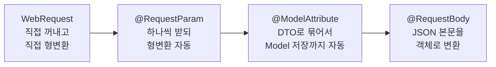
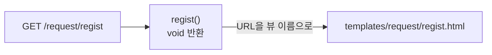
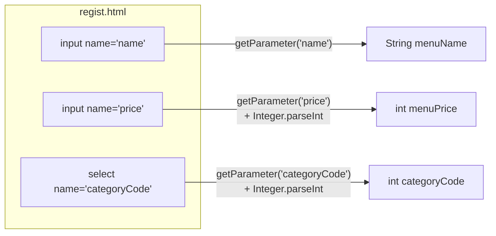
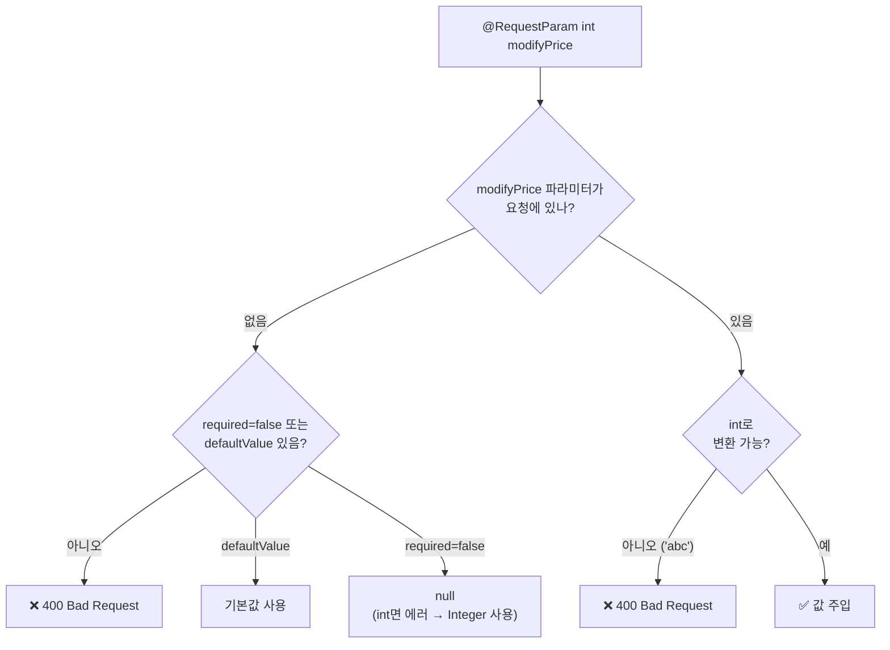
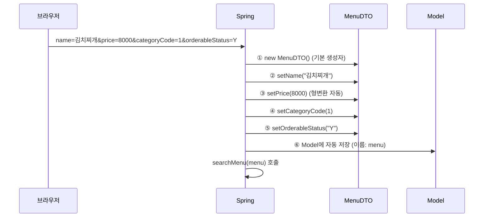
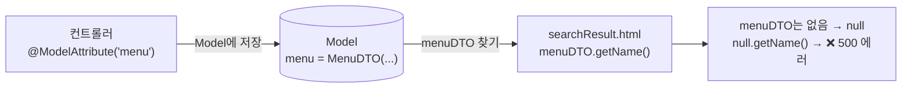
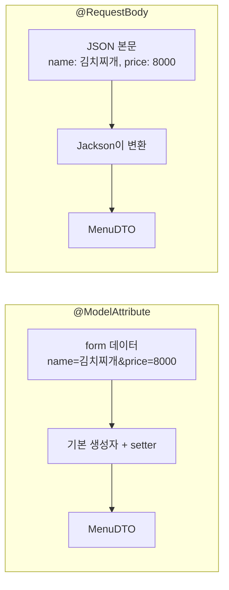
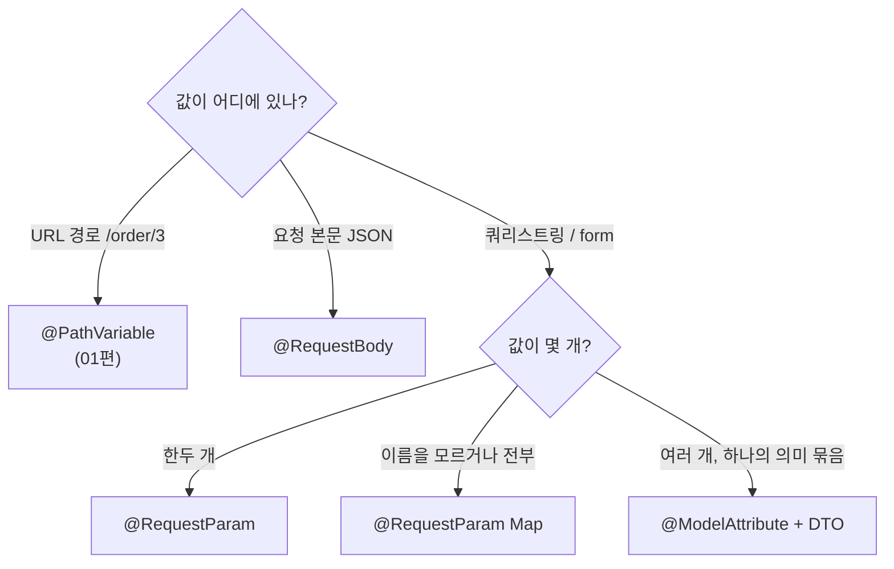

> **이번 글에서 다루는 것**
> 1. `void` 반환: 요청 URL이 곧 뷰 이름
> 2. `WebRequest`: 서블릿처럼 직접 꺼내기
> 3. `@RequestParam`: 값 하나씩 받기 (+ 옵션, Map)
> 4. `@ModelAttribute`: DTO 객체로 한 번에 받기
> 5. `@RequestBody`: JSON 본문 받기
>
> 사용자가 form이나 URL로 보낸 값을 컨트롤러에서 꺼내는 방법은 여러 가지다. 서블릿처럼 직접 꺼내는 방식에서 시작해 **점점 Spring이 더 많은 일을 대신 해주는 방식**으로 넘어간다.

**Spring Web MVC 시리즈**: 01. Request Mapping → **02. Handler Method** → 03. View Resolver → 04. Exception Handler → 05. Interceptor → 06. File Upload → 07. Thymeleaf

| 요청 | 방식 | 화면 |
|---|---|---|
| `/request/regist` | `WebRequest` | `templates/request/regist.html` |
| `/request/modify` | `@RequestParam` | `templates/request/modify.html` |
| `/request/search` | `@ModelAttribute` | `templates/request/search.html` |
| `/request/body` | `@RequestBody` | (수업 코드에는 아직 없음 → 6장에서 보충) |



왼쪽에서 오른쪽으로 갈수록 개발자가 쓰는 코드가 줄어든다.

---

## 0. 실습 준비 — MenuDTO

```java
@NoArgsConstructor
@AllArgsConstructor
@Getter
@Setter
@ToString
public class MenuDTO {
    private String name;
    private int price;
    private int categoryCode;
    private String orderableStatus;
}
```

`@ModelAttribute`가 이 DTO에 값을 채워 넣을 때 **기본 생성자 + setter**를 사용한다. 그래서 `@NoArgsConstructor`와 `@Setter`가 중요하다.

---

## 1. 컨트롤러가 화면을 반환하는 두 가지 방식

```java
@Controller
@RequestMapping("/request/*")
public class RequestController {

    @GetMapping("regist")
    public void regist() {}     // 반환값 없음!
    ...
}
```

| 반환 타입 | 뷰 결정 방식 | 예시 |
|---|---|---|
| `String` | 반환한 문자열이 뷰 이름 | `return "request/printResult";` → `templates/request/printResult.html` |
| `void` | **요청 URL이 곧 뷰 이름** | `/request/regist` 요청 → `templates/request/regist.html` |



`void`는 "화면만 보여주는" GET 요청에서 코드를 짧게 쓸 때 편하다. 대신 URL과 템플릿 폴더 구조를 반드시 똑같이 맞춰야 한다.

> 💡 `@RequestMapping("/request/*")` + `"regist"` → `/request/regist`. 메서드 경로 앞에 `/`가 없어도 Spring이 붙여준다.

---

## 2. WebRequest — 서블릿처럼 직접 꺼내기

**regist.html**

```html
<form action="/request/regist" method="post">
    <input type="text" name="name">
    <input type="number" name="price" step="1000" min="0">
    <select name="categoryCode">
        <option value="1">식사</option>
        <option value="2">음료</option>
        <option value="3">디저트</option>
    </select>
    <button type="submit">등록</button>
</form>
```

**컨트롤러**

```java
@PostMapping("regist")
public String registMenu(Model model, WebRequest request) {
    // WebRequest 는 Servlet 환경의 HttpServletRequest 역할을 한다.
    String menuName = request.getParameter("name");
    int menuPrice = Integer.parseInt(request.getParameter("price"));
    int categoryCode = Integer.parseInt(request.getParameter("categoryCode"));

    // service(menuName, menuPrice, categoryCode);

    String message = menuName + " 을(를) 신규 메뉴 목록 " + categoryCode
            + "번 카테고리에 " + menuPrice + " 원으로 등록 했습니다!";
    model.addAttribute("message", message);

    return "request/printResult";
}
```



- `getParameter("name")`의 `"name"`은 **input 태그의 `name` 속성값**이다.
- 값은 항상 `String`으로 오기 때문에 숫자는 `Integer.parseInt()`로 **직접 변환**해야 한다.
- 서블릿 코드와 거의 같아서 익숙하지만, 파라미터가 많아지면 코드가 길어진다.

> 💡 **WebRequest vs HttpServletRequest**: 매개변수에 `HttpServletRequest request`를 써도 똑같이 동작한다. `WebRequest`는 Spring이 서블릿 API를 한 번 감싼 인터페이스라서 서블릿에 덜 의존적이다. 실무에서는 둘 다 잘 안 쓰고 아래의 `@RequestParam`, `@ModelAttribute`를 주로 쓴다.

---

## 3. @RequestParam — 파라미터 하나씩 받기

**modify.html**

```html
<form action="modify" method="post">
    수정할 메뉴의 이름 : <input type="text" name="modifyName"><br>
    수정할 메뉴의 가격 : <input type="number" name="modifyPrice"><br>
    <button type="submit">수정</button>
</form>
```

**컨트롤러**

```java
@PostMapping("modify")
public String modifyMenu(Model model,
                         @RequestParam("modifyName") String name,
                         @RequestParam int modifyPrice) {
    System.out.println("name = " + name);
    System.out.println("modifyPrice = " + modifyPrice);
    return "request/printResult";
}
```

- `@RequestParam("modifyName") String name` → `name="modifyName"`인 input 값을 `name` 변수에 담는다.
- `@RequestParam int modifyPrice` → 괄호를 생략하면 **변수 이름**으로 파라미터를 찾는다.
- **형변환을 자동으로** 해준다. `int`로 선언하면 `parseInt`가 필요 없다.

### ⚠️ 이름 불일치 → 400 Bad Request

`@RequestParam`은 기본적으로 **필수(required = true)** 다. input의 `name`과 이름이 다르거나 값이 아예 없으면 **400 Bad Request**가 난다.



### 옵션

```java
// 필수가 아니게 만들기 (없으면 null)
@RequestParam(required = false) String keyword

// 값이 없거나 빈 문자열일 때 기본값 사용 (required=false 효과도 같이 생김)
@RequestParam(defaultValue = "1") int page

// 같은 이름의 값 여러 개 (체크박스 등)
@RequestParam List<String> hobbies

// 모든 파라미터를 Map으로 한 번에 받기
@RequestParam Map<String, String> params
```

> ⚠️ `int`처럼 **기본형**에 `required = false`만 주면, 값이 없을 때 `null`을 `int`에 넣을 수 없어서 에러가 난다. `Integer`를 쓰거나 `defaultValue`를 함께 준다.

> 💡 **이름을 생략해도 되는 이유**: 원래 자바는 컴파일하면 매개변수 이름이 사라진다. Spring Boot의 Gradle 플러그인이 컴파일할 때 `-parameters` 옵션을 켜주기 때문에 변수 이름을 읽을 수 있다. 이 설정이 없는 순수 Spring 프로젝트에서는 이름을 생략하면 에러가 난다.

### 수업 화면의 "메뉴 수정 폼2"

`modify.html`의 두 번째 폼은 `action="modifyAll"`, input 이름이 `modifyName2`, `modifyPrice2`로 되어 있다. 컨트롤러에 아직 핸들러가 없어서 지금은 404가 난다. `Map` 방식으로 받는 연습용으로 쓰기 좋다.

```java
@PostMapping("modifyAll")
public String modifyAll(Model model, @RequestParam Map<String, String> parameters) {
    String name = parameters.get("modifyName2");
    int price = Integer.parseInt(parameters.get("modifyPrice2"));

    model.addAttribute("message", name + " 메뉴의 가격을 " + price + "원으로 변경했습니다!");
    return "request/printResult";
}
```

---

## 4. @ModelAttribute — 객체로 한 번에 받기

**search.html**

```html
<form action="search" method="post">
    검색할 메뉴 이름 : <input type="text" name="name"><br>
    검색할 메뉴 가격 : <input type="number" name="price"><br>
    검색할 메뉴 카테고리 :
    <select name="categoryCode">...</select><br>
    검색할 판매 상태 : <input type="text" name="orderableStatus"><br>
    <input type="submit" value="검색하기">
</form>
```

**컨트롤러**

```java
@PostMapping("search")
public String searchMenu(@ModelAttribute("menu") MenuDTO menu) {
    System.out.println("menu = " + menu);
    return "request/searchResult";
}
```

### 동작 원리



1. 사용자의 입력값을 **하나의 DTO 객체로 묶어서** 받는다.
2. **input의 `name` 속성 = DTO의 필드명(setter 이름)** 이 일치해야 값이 들어간다. 일치하지 않는 값은 에러 없이 **그냥 무시**되고 기본값(null, 0)으로 남는다.
3. 받은 객체가 **Model에 자동으로 추가된다.** 따로 `model.addAttribute()`를 하지 않아도 forward 된 화면에서 쓸 수 있다.

### Model에 담기는 이름

| 작성 방식 | Model에 담기는 이름 |
|---|---|
| `@ModelAttribute MenuDTO menu` | 클래스 이름의 첫 글자를 소문자로 → **`menuDTO`** |
| `@ModelAttribute("menu") MenuDTO menu` | 지정한 이름 → **`menu`** |
| `MenuDTO menu` (어노테이션 생략) | `@ModelAttribute`와 동일하게 동작 → `menuDTO` |

### ⚠️ 실습 코드에서 발생하는 에러

컨트롤러는 `@ModelAttribute("menu")`로 **`menu`** 라는 이름으로 담는데, 결과 화면은 **`menuDTO`** 로 꺼내고 있다.

```html
<!-- searchResult.html -->
<h3 th:text="${menuDTO.getName()}"></h3>
```



Model에 `menuDTO`가 없으니 `${menuDTO}`는 `null`이 되고, null에 `.getName()`을 호출하면서 **500 에러**가 발생한다. 둘 중 하나로 이름을 맞추면 된다.

```java
// 방법 1) 컨트롤러에서 이름 지정을 빼기 → 기본 이름 menuDTO
public String searchMenu(@ModelAttribute MenuDTO menu)
```

```html
<!-- 방법 2) 화면에서 menu로 꺼내기. 메서드 호출 대신 프로퍼티 접근도 가능 -->
<h3 th:text="${menu.name}"></h3>
<h3 th:text="${menu.price}"></h3>
```

### 타입이 안 맞으면? — BindingResult

가격 칸을 비워서 보내면 빈 문자열 `""`을 `int price`로 바꿀 수 없어 **400 Bad Request**가 난다. 이런 바인딩 오류를 직접 처리하고 싶다면 `BindingResult`를 **바로 뒤에** 매개변수로 받는다.

```java
public String searchMenu(@ModelAttribute MenuDTO menu, BindingResult bindingResult) {
    if (bindingResult.hasErrors()) {
        // 어떤 필드에서 어떤 오류가 났는지 확인 가능
    }
    ...
}
```

`BindingResult`가 있으면 Spring은 400을 던지지 않고 오류 정보를 담아 메서드를 그대로 실행한다. 나중에 `@Valid`와 함께 쓰는 **입력값 검증(Validation)** 의 기초가 된다.

---

## 5. @RequestBody — JSON 본문 받기

`index.html`의 4번 버튼(`/request/body`)에 해당하는 내용이다. 수업 코드에는 아직 구현되지 않아 보충한다.

지금까지의 방식은 모두 **form 데이터**(`name=값&price=값` 형식)를 받는다. 반면 JavaScript `fetch`나 앱에서는 데이터를 보통 **JSON**으로 보낸다.

```
POST /request/body
Content-Type: application/json

{ "name": "김치찌개", "price": 8000, "categoryCode": 1, "orderableStatus": "Y" }
```

```java
@PostMapping("body")
@ResponseBody   // 뷰 이름이 아니라 반환값 자체를 응답 본문으로 보냄
public MenuDTO body(@RequestBody MenuDTO menu) {
    System.out.println("menu = " + menu);
    return menu;   // 객체 → JSON으로 자동 변환되어 응답
}
```



| 구분 | `@ModelAttribute` | `@RequestBody` |
|---|---|---|
| 받는 데이터 | 쿼리스트링, form 데이터 | HTTP 요청 **본문(body)** 전체 |
| 주 형식 | `application/x-www-form-urlencoded` | `application/json` |
| 변환 방식 | 기본 생성자 + setter | Jackson 라이브러리가 JSON → 객체 변환 |
| 주 사용처 | HTML form + 서버 렌더링 화면 | REST API |

> 💡 `@RequestBody`에 form 데이터를 보내면 **415 Unsupported Media Type** 에러가 난다. 보내는 쪽의 `Content-Type`과 받는 방식을 맞춰야 한다.

> 💡 컨트롤러의 모든 메서드가 `@ResponseBody`라면 클래스에 `@Controller` 대신 **`@RestController`** (= `@Controller` + `@ResponseBody`)를 붙인다. REST API를 만들 때 쓰게 된다.

---

## 6. 한눈에 정리 — 어떤 방법을 쓸까?



| 방법 | 코드 | 특징 |
|---|---|---|
| `WebRequest` | `request.getParameter("name")` | 서블릿과 유사. 형변환 직접 |
| `@RequestParam` | `@RequestParam int price` | 값 하나씩. 자동 형변환. 기본 필수 (없으면 400) |
| `@RequestParam Map` | `@RequestParam Map<String,String> p` | 모든 파라미터를 Map으로 |
| `@ModelAttribute` | `@ModelAttribute MenuDTO menu` | 객체로 묶어 받기. Model에 자동 저장 |
| `@PathVariable` | `@PathVariable int no` | URL 경로 안의 값 (01편) |
| `@RequestBody` | `@RequestBody MenuDTO menu` | JSON 본문 → 객체 (REST API) |

- **공통 규칙** : 화면의 `name` 속성과 서버의 **이름**(파라미터명 / 필드명)을 맞추는 것이 가장 중요하다
- **에러 코드** : 필수 파라미터 누락·형변환 실패는 **400**, Model 이름 불일치로 null 호출은 **500**, JSON 자리에 form 데이터는 **415**
