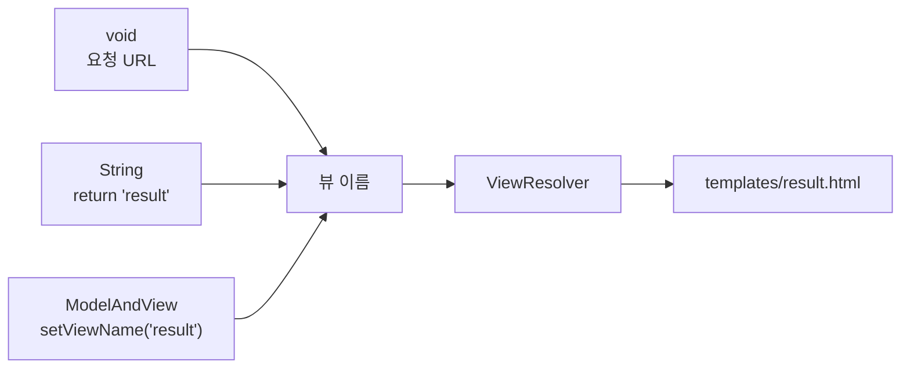
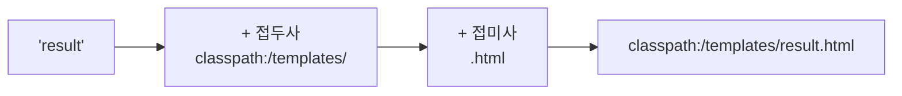
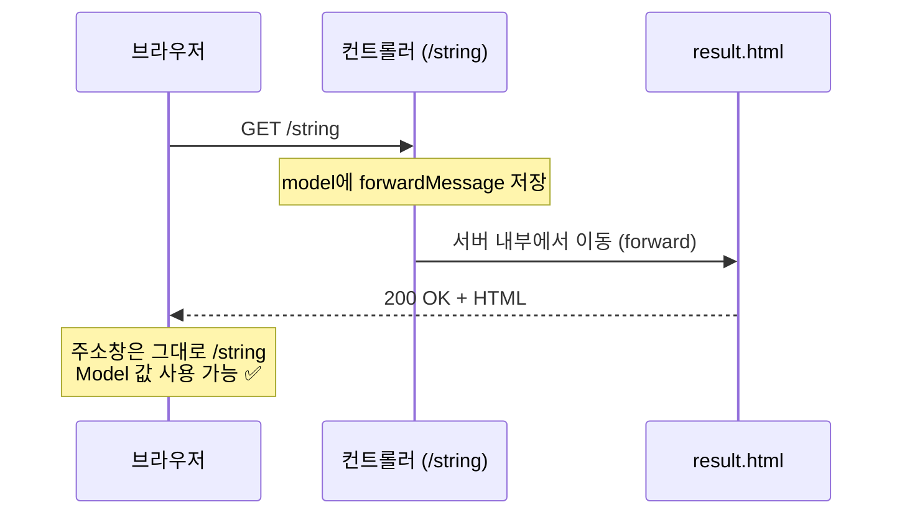
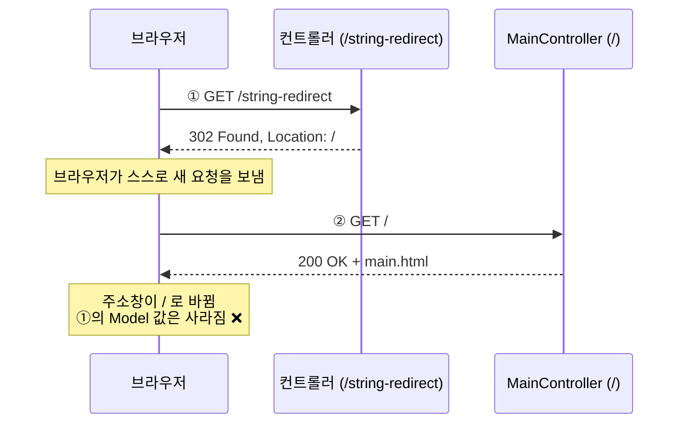
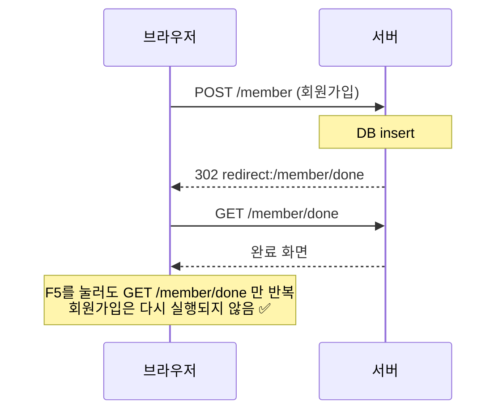
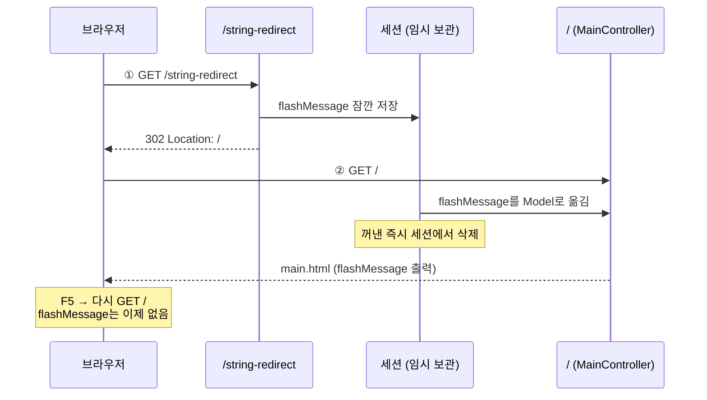
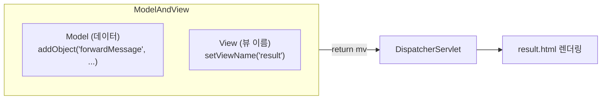
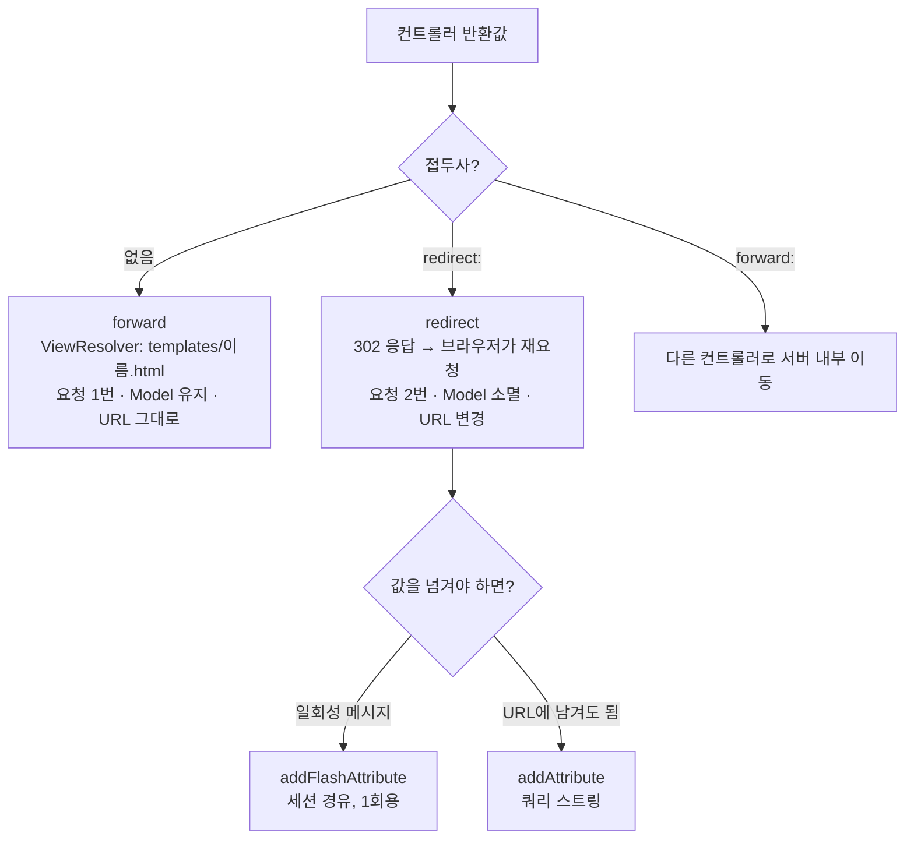

> **이번 글에서 다루는 것**
> 1. 뷰를 반환하는 3가지 방법: `void`, `String`, `ModelAndView`
> 2. **ViewResolver**가 뷰 이름을 파일 경로로 바꾸는 과정
> 3. forward와 redirect의 차이, 그리고 **PRG 패턴**
> 4. redirect 후에도 값을 넘기는 `RedirectAttributes` (`addFlashAttribute` vs `addAttribute`)
>
> **ViewResolver**는 컨트롤러가 돌려준 **뷰 이름(문자열)** 을 **실제 템플릿 파일 경로**로 바꿔주는 객체다. 컨트롤러는 기본적으로 **forward**로 화면을 반환하고, `redirect:` 접두사를 붙이면 **redirect**로 바뀐다. 서블릿 03편의 forward·redirect를 Spring 방식으로 다시 보는 글이다.

**Spring Web MVC 시리즈**: 01. Request Mapping → 02. Handler Method → **03. View Resolver** → 04. Exception Handler → 05. Interceptor → 06. File Upload → 07. Thymeleaf

```
templates
├── main.html     ← / , /main  (redirect 후 flashMessage 출력)
└── result.html   ← /string , /modelAndView  (forwardMessage 출력)
```

---

## 1. 뷰를 반환하는 3가지 방법

| 반환 타입 | 뷰 결정 방식 | 예시 |
|---|---|---|
| `void` | 요청 URL이 곧 뷰 경로 | `/request/regist` → `request/regist.html` (02편) |
| `String` | 반환한 문자열이 뷰 경로 | `return "result";` |
| `ModelAndView` | `setViewName("문자열")`의 문자열이 뷰 경로 | `mv.setViewName("result");` |



세 방식 모두 결국 **뷰 이름** 하나를 만들어 ViewResolver에게 넘긴다.

---

## 2. 메인 페이지 — 여러 URL 매핑

```java
@Controller
public class MainController {

    // {} 내부에는 여러 경로를 , 기준으로 작성할 수 있다.
    @RequestMapping(value = {"/", "/main"})
    public String mainPage() {
        System.out.println("main 페이지 핸들러메서드 동작함...");
        return "main";
    }
}
```

- `/`로 접속해도, `/main`으로 접속해도 `templates/main.html`을 보여준다.
- 이번 챕터는 `static/index.html` 대신 **컨트롤러를 거치는 `main.html`** 을 첫 화면으로 쓴다. 그래야 redirect 후 전달된 값(`${flashMessage}`)을 화면에 출력할 수 있다.

> 💡 `static/index.html`과 `/` 매핑 컨트롤러가 **둘 다** 있으면 컨트롤러가 우선한다.

---

## 3. String 반환 — 기본은 forward

```java
@GetMapping("/string")
public String stringView(Model model) {

    model.addAttribute("forwardMessage", "문자열로 View 반환");

    /* 가정: 회원가입 로직 수행 */
    // service.registMember();  insert
    System.out.println("회원가입 완료!!!!");

    // ViewResolver가 접두사 classpath:/templates/, 접미사 .html 을 붙인다.
    // → resources/templates/result.html
    return "result";
}
```

```html
<!-- result.html -->
<h3 th:text="${forwardMessage}"></h3>
```

### ViewResolver가 하는 일



- Thymeleaf 스타터를 추가하면 Spring Boot가 **`ThymeleafViewResolver`** 를 자동으로 등록한다.
- 접두사/접미사는 `application.yaml`에서 바꿀 수 있다. (기본값이라 보통 안 적는다)

```yaml
spring:
  thymeleaf:
    prefix: classpath:/templates/
    suffix: .html
```

> ⚠️ `return "/result";`처럼 앞에 `/`를 붙이면 경로가 `templates//result.html`이 된다. IDE에서는 동작해도 **jar로 배포하면 템플릿을 못 찾는** 경우가 있으니 붙이지 않는 습관을 들이자.

---

## 4. forward vs redirect

### forward — 요청 1번, 서버 안에서 화면만 바꿈



### redirect — 요청 2번, 브라우저에게 "여기로 다시 가세요"



| 구분 | forward | redirect |
|---|---|---|
| 요청 횟수 | 1번 | **2번** |
| 주소창 URL | 그대로 | **새 URL로 바뀜** |
| request/Model 데이터 | 유지 | **소멸** |
| 작성 방법 | `return "result";` | `return "redirect:/";` |
| 새로고침(F5) 시 | 마지막 요청을 **다시 실행** | redirect된 GET만 다시 실행 |

### 왜 redirect가 필요할까? — PRG 패턴

회원가입(POST) 처리 후 **forward**로 결과 화면을 보여주면, 브라우저의 마지막 요청은 여전히 POST다. 사용자가 **F5(새로고침)** 를 누르면 브라우저가 POST를 다시 보내서 **회원가입이 두 번** 처리될 수 있다.



그래서 데이터를 **변경하는 요청(등록·수정·삭제)** 후에는 redirect로 다른 GET 페이지로 보내는 것이 원칙이다. 이것을 **PRG(Post → Redirect → Get) 패턴**이라고 한다.

---

## 5. redirect와 RedirectAttributes

```java
@GetMapping("/string-redirect")
public String redirect(RedirectAttributes rttr) {

    /* 가정: 회원가입 로직 수행 */
    System.out.println("회원가입 완료!!!!");

    // model.addAttribute("forwardMessage", "문자열로 View 반환");  ← redirect 하면 소멸됨
    rttr.addFlashAttribute("flashMessage", "리다이랙트 된 페이지에서도 유지되는 값!");

    return "redirect:/";
}
```

```html
<!-- main.html -->
<h3 th:text="${flashMessage}"></h3>
```

- Spring에서 뷰 반환의 기본은 forward다. **`redirect:{보낼 URL}`** 접두사를 붙이면 redirect가 된다.
- redirect는 요청이 2번 발생하므로, 처음 Model에 담은 값은 두 번째 요청(`/`)에서 쓸 수 없다.
- 서블릿에서는 이럴 때 **session**이나 **cookie**를 썼다. Spring은 **`RedirectAttributes`** 로 더 간편한 방법을 제공한다.

### Flash Attribute는 어떻게 살아남을까?



### addFlashAttribute vs addAttribute

| 메서드 | 전달 방식 | 특징 |
|---|---|---|
| `addFlashAttribute("key", 값)` | 잠깐 **세션**에 저장 → redirect된 요청의 Model로 꺼내짐 → **즉시 삭제** | 주소창에 안 보임. 객체도 전달 가능. **한 번만** 쓸 수 있음 (새로고침하면 사라짐) |
| `addAttribute("key", 값)` | redirect URL의 **쿼리 스트링**으로 붙음 | `/?key=값` 형태로 주소창에 보임. 새로고침해도 유지. 문자열 위주 |

```java
rttr.addAttribute("id", 3);
return "redirect:/member/detail";   // → /member/detail?id=3
```

"회원가입이 완료되었습니다!" 같은 **일회성 알림 메시지**에는 flash attribute가 딱 맞다.

> 💡 실습 화면의 세 번째 버튼(`/string-redirect-attr`)은 컨트롤러에 매핑이 없어 404가 난다. 두 번째 버튼(`/string-redirect`)이 이미 flash attribute까지 포함하고 있다.

---

## 6. ModelAndView — 데이터와 뷰를 한 번에

```java
@GetMapping("modelAndView")
public ModelAndView modelAndView(ModelAndView mv) {
    mv.addObject("forwardMessage", "MV 활용 뷰와 데이터!");
    mv.setViewName("result");
    return mv;
}
```



- **Model(데이터) + View(뷰 이름)** 를 하나의 객체에 담아서 반환한다.
  - `addObject("키", 값)` ≈ `model.addAttribute("키", 값)`
  - `setViewName("이름")` ≈ `return "이름";`
- 매개변수로 받으면 Spring이 만들어서 넣어준다. `new ModelAndView()`로 직접 만들어도 된다.
- redirect도 가능하다: `mv.setViewName("redirect:/");`

### String + Model vs ModelAndView

```java
// 방식 1
public String a(Model model) {
    model.addAttribute("msg", "hi");
    return "result";
}

// 방식 2
public ModelAndView b(ModelAndView mv) {
    mv.addObject("msg", "hi");
    mv.setViewName("result");
    return mv;
}
```

결과는 완전히 같다. 요즘은 방식 1(String + Model)이 더 많이 쓰이지만 둘 다 읽을 수 있어야 한다. (07편 Thymeleaf 실습은 ModelAndView 방식을 사용한다)

---

## 7. 추가로 알면 좋은 점 — 뷰 이름 접두사

| 반환값 | 동작 |
|---|---|
| `"result"` | `templates/result.html`로 forward 후 렌더링 |
| `"redirect:/main"` | 브라우저에게 `/main`으로 다시 요청하라고 응답 (302) |
| `"redirect:https://google.com"` | 외부 사이트로도 redirect 가능 |
| `"forward:/main"` | 템플릿이 아니라 **다른 컨트롤러(`/main`)** 로 서버 내부 이동 |

---

## 8. 한눈에 정리



- 컨트롤러의 반환 방식: `void`, `String`, `ModelAndView`
- ViewResolver: 뷰 이름 + 접두사(`classpath:/templates/`) + 접미사(`.html`)
- 기본은 **forward** (요청 1번, Model 유지, URL 그대로)
- `redirect:` 접두사 → **redirect** (요청 2번, Model 소멸, URL 변경)
- redirect 후에도 값을 전달하려면 `RedirectAttributes`
  - `addFlashAttribute`: 세션 이용, 1회성, URL에 안 보임
  - `addAttribute`: 쿼리 스트링으로 전달
- 데이터 변경 요청 후에는 **PRG 패턴**으로 중복 제출 방지
