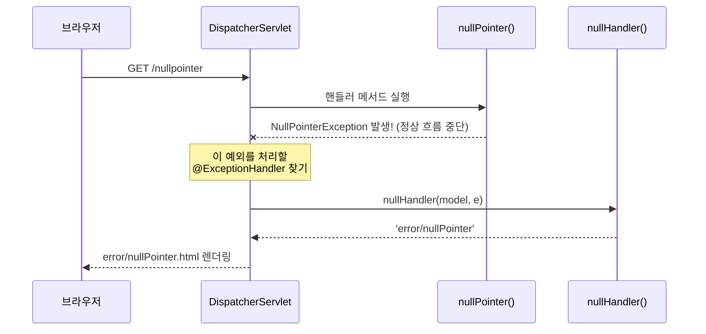
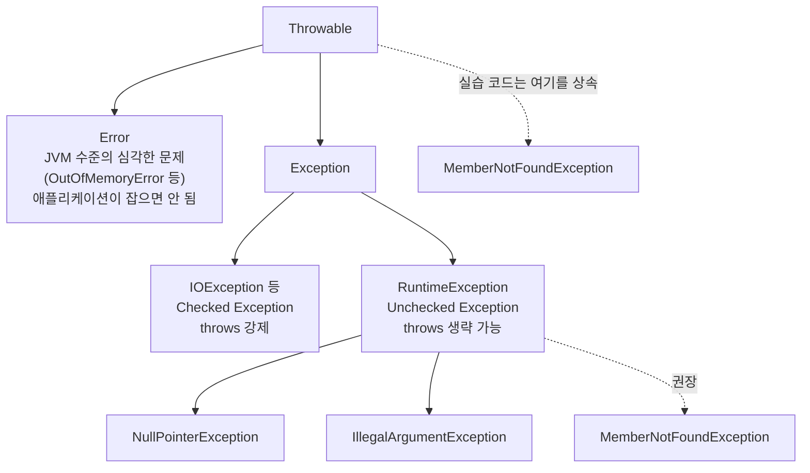
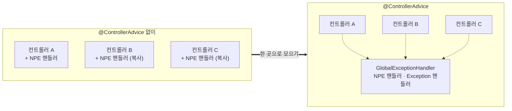
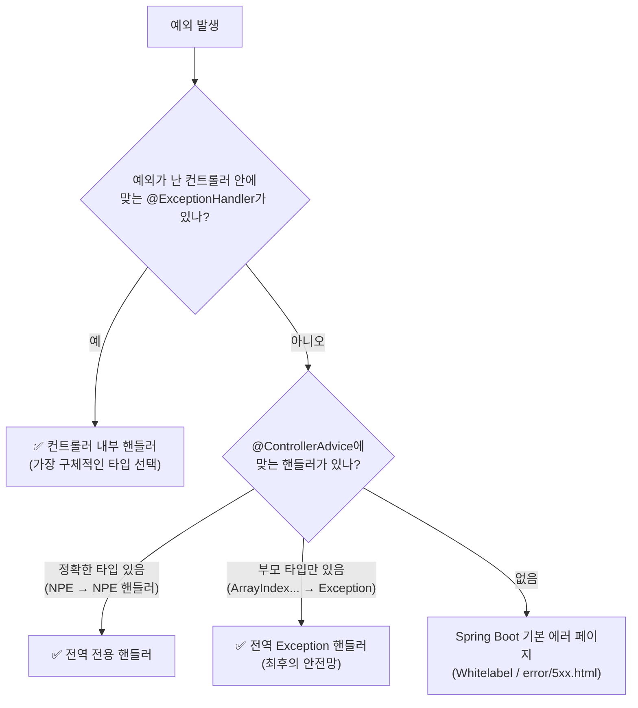
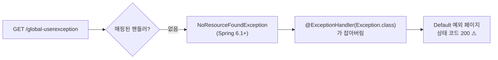
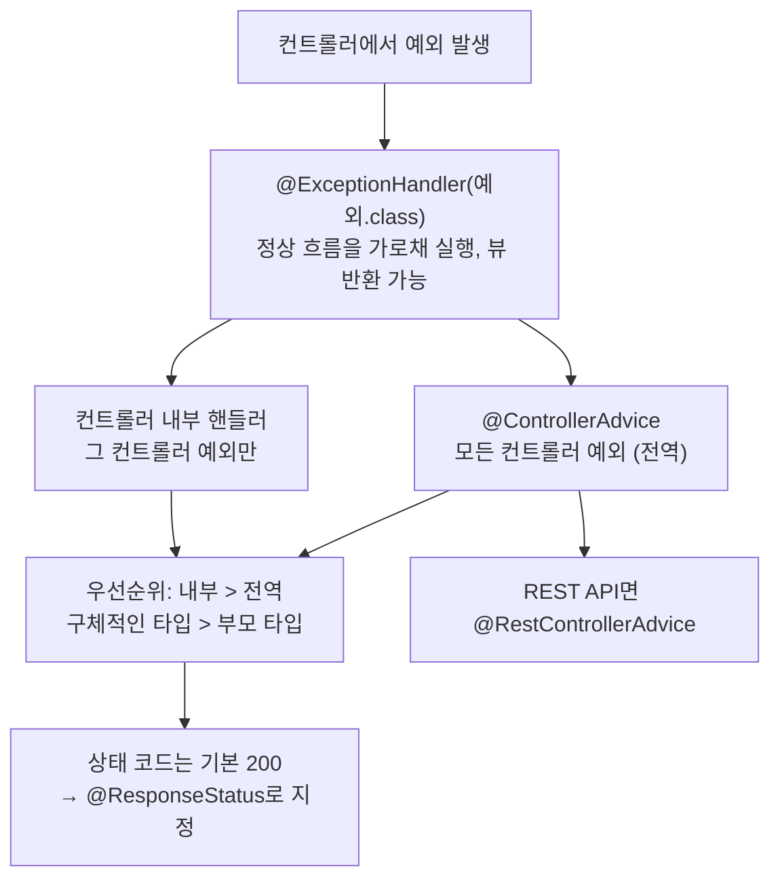

> **이번 글에서 다루는 것**
> 1. `@ExceptionHandler`: 컨트롤러 단위 예외 처리
> 2. 사용자 정의 예외와 예외 계층 (`Throwable` vs `Exception` vs `RuntimeException`)
> 3. `@ControllerAdvice`: 모든 컨트롤러의 예외를 한 곳에서 처리
> 4. 예외 핸들러의 **우선순위** (위치, 타입)
> 5. 상태 코드, `NoResourceFoundException`, `@RestControllerAdvice`
>
> 컨트롤러에서 예외가 터지면 사용자는 하얀 에러 페이지를 보게 된다. **`@ExceptionHandler`** 로 "이 예외가 나면 이 메서드가 처리해"라고 지정할 수 있고, **`@ControllerAdvice`** 로 모든 컨트롤러의 예외 처리를 **한 곳에 모을** 수 있다.

**Spring Web MVC 시리즈**: 01. Request Mapping → 02. Handler Method → 03. View Resolver → **04. Exception Handler** → 05. Interceptor → 06. File Upload → 07. Thymeleaf

| 요청 | 발생 예외 | 처리하는 곳 |
|---|---|---|
| `/nullpointer` | `NullPointerException` | `ExceptionTestController` 내부 핸들러 |
| `/userexception` | `MemberNotFoundException` (사용자 정의) | `ExceptionTestController` 내부 핸들러 |
| `/global-nullpointer` | `NullPointerException` | `GlobalExceptionHandler` (전역) |
| `/global-default` | `ArrayIndexOutOfBoundsException` | `GlobalExceptionHandler`의 `Exception` 핸들러 |

---

## 1. @ExceptionHandler — 컨트롤러 단위 예외 처리

```java
@Controller
public class ExceptionTestController {

    @GetMapping("nullpointer")
    public String nullPointer() {
        // 고의적으로 Error 발생
        String str = null;
        System.out.println(str.toLowerCase(Locale.ROOT));  // 여기서 NullPointerException 발생
        return "/";   // 실행되지 않음
    }

    /*
     * @ExceptionHandler(처리하고자 하는 예외 클래스)
     * 정의된 예외가 발생하면 예외 핸들러가 Controller의 흐름을 가로채서 동작한다.
     */
    @ExceptionHandler(NullPointerException.class)
    public String nullHandler(Model model, NullPointerException e) {
        model.addAttribute("key", e.getMessage());
        return "error/nullPointer";
    }
}
```

```html
<!-- templates/error/nullPointer.html -->
<h3>많이 놀라셨죠?</h3>
<h4>죄송합니다.</h4>
<h4 th:text="${key}"></h4>
```

### 동작 흐름



- 예외 핸들러 메서드도 일반 핸들러 메서드처럼 **뷰 이름을 반환**할 수 있다.
- 매개변수로 **발생한 예외 객체**를 받아서 메시지 등을 꺼낼 수 있다.

> 💡 **NPE 메시지**: Java 14부터 NullPointerException 메시지가 친절해졌다. 화면에 `Cannot invoke "String.toLowerCase(java.util.Locale)" because "str" is null` 처럼 **무엇이 null이었는지** 출력된다.

> ⚠️ **예외 메시지를 그대로 사용자에게 보여주지 말 것**: 실습에서는 확인용으로 `e.getMessage()`를 화면에 띄우지만, 실제 서비스에서는 내부 클래스명·변수명·SQL 등이 노출되어 **보안상 위험**하다. 사용자에게는 "일시적인 오류가 발생했습니다" 같은 안내만 보여주고, 상세 내용은 **서버 로그**에 남긴다.

---

## 2. 사용자 정의 예외

```java
public class MemberNotFoundException extends Throwable {
    public MemberNotFoundException(String message) {
        super(message);
    }
}
```

```java
@GetMapping("userexception")
public String userException() throws MemberNotFoundException {
    boolean check = true;
    if (check) {
        throw new MemberNotFoundException("아프지 말자 우리");
    }
    return "/";
}

@ExceptionHandler(MemberNotFoundException.class)
public String userException(Model model, MemberNotFoundException e) {
    model.addAttribute("key", e.getMessage());
    return "error/nullPointer";
}
```

- "회원이 없음"처럼 **비즈니스 상황**을 표현하는 예외를 직접 만들 수 있다.
- 예외 이름만 봐도 무슨 문제인지 알 수 있어서 코드 가독성이 좋아진다.

### ⚠️ `Throwable`이 아니라 `Exception`(또는 `RuntimeException`)을 상속하자



`Throwable`은 `Error`까지 포함하는 최상위 클래스라서 사용자 정의 예외의 부모로는 적절하지 않다. 게다가 `Exception`의 자식이 아니기 때문에, Spring은 이 예외를 핸들러 메서드 밖으로 꺼낼 때 `IllegalStateException`으로 **한 번 감싸서** 처리한다. 실습처럼 같은 컨트롤러에 전용 핸들러가 있으면 원인(cause)을 따라가 찾아주지만, 전용 핸들러가 없으면 아래 전역 `Exception` 핸들러에 **감싸진 `IllegalStateException`** 이 대신 들어온다. 원래 예외와 메시지가 바뀌어 보이는 것이다.

```java
// 일반적인 사용자 정의 예외
public class MemberNotFoundException extends RuntimeException {
    public MemberNotFoundException(String message) {
        super(message);
    }
}
```

| 부모 클래스 | 특징 | 언제 |
|---|---|---|
| `Exception` | Checked. 메서드에 `throws`를 꼭 적어야 함 | 호출하는 쪽이 반드시 대응해야 할 때 |
| `RuntimeException` | Unchecked. `throws` 생략 가능 | **Spring에서 대부분 이쪽을 사용** (트랜잭션 롤백도 기본적으로 RuntimeException 기준) |

---

## 3. @ControllerAdvice — 전역 예외 처리

### 문제: 다른 컨트롤러의 핸들러는 동작하지 않는다

```java
@Controller
public class GlobalTestController {

    // ExceptionTestController 에 작성한 NullPointer 핸들러는 여기서 동작하지 않는다.
    // 다른 클래스 내부에 있는 메서드는 알 수 없기 때문이다.
    @GetMapping("global-nullpointer")
    public String globalNull() {
        String str = null;
        System.out.println(str.toLowerCase(Locale.ROOT));
        return "/";
    }

    @GetMapping("global-default")
    public String anyException() {
        int[] iarr = new int[0];
        System.out.println(iarr[1]);   // ArrayIndexOutOfBoundsException
        return "/";
    }
}
```

컨트롤러 안에 작성한 `@ExceptionHandler`는 **그 컨트롤러 안에서 발생한 예외만** 처리한다. 컨트롤러가 10개라면 같은 핸들러를 10번 복사해야 한다.

### 해결: @ControllerAdvice

```java
/*
 * Advice는 AOP 챕터에서 반복적으로 동작해야 하는 코드를 뭉쳐둔 메서드를 지칭하는 단어였다.
 * @ControllerAdvice는 공통으로 발생할 수 있는 예외처리 핸들러를 묶어둔 클래스를 지칭한다.
 */
@ControllerAdvice
public class GlobalExceptionHandler {

    @ExceptionHandler(NullPointerException.class)
    public String nullHandler(Model model, NullPointerException e) {
        System.out.println("전역 예외처리 핸들러 동작!!!");
        model.addAttribute("key", e.getMessage());
        return "error/nullPointer";
    }

    @ExceptionHandler(Exception.class)
    public String defaultException(Model model, Exception e) {
        model.addAttribute("class", e.getClass());
        model.addAttribute("message", e.getMessage());
        return "error/default";
    }
}
```

```html
<!-- templates/error/default.html -->
<h1>Default 예외 페이지!</h1>
<h3 th:text="|${class} 에러 발생! 원인 : ${message}|"></h3>
```



- `@ControllerAdvice`가 붙은 클래스의 `@ExceptionHandler`는 **모든 컨트롤러**에 적용된다.
- [Spring] 03편 AOP에서 본 것처럼, 여러 곳에 흩어질 **횡단 관심사(예외 처리)** 를 한 곳에 모은 것이다.
- `@Component`를 포함하고 있어서 빈으로 등록된다.

---

## 4. 예외 핸들러의 우선순위

### ① 위치: 같은 컨트롤러 내부 > 전역(@ControllerAdvice)

| 요청 | 결과 |
|---|---|
| `/nullpointer` | `ExceptionTestController` 안에 NPE 핸들러가 있으므로 **내부 핸들러** 동작 (전역 핸들러의 "전역 예외처리 핸들러 동작!!!"은 출력 안 됨) |
| `/global-nullpointer` | `GlobalTestController`엔 핸들러가 없으므로 **전역 핸들러** 동작 |

### ② 타입: 더 구체적인(자식) 예외 타입이 우선

`GlobalExceptionHandler`에는 `NullPointerException` 핸들러와 `Exception` 핸들러가 둘 다 있다. NPE는 `Exception`의 자식이기도 하지만, **더 정확히 일치하는** `NullPointerException` 핸들러가 선택된다. `ArrayIndexOutOfBoundsException`은 전용 핸들러가 없으므로 부모 타입인 `Exception` 핸들러로 간다.



그래서 `@ExceptionHandler(Exception.class)`는 "**나머지 모든 예외**"를 받는 최후의 안전망(default) 역할을 한다. switch 문의 `default`와 비슷하다.

---

## 5. 추가로 알면 좋은 점

### ① 상태 코드가 200으로 나간다

`@ExceptionHandler`가 뷰를 반환하면 에러 페이지가 보이긴 하지만, HTTP 상태 코드는 **200 OK** 로 응답된다. 브라우저 개발자 도구(F12) → Network 탭에서 확인할 수 있다. 정확한 상태 코드를 주려면 `@ResponseStatus`를 붙인다.

```java
@ResponseStatus(HttpStatus.NOT_FOUND)   // 404로 응답
@ExceptionHandler(MemberNotFoundException.class)
public String memberNotFound(Model model, MemberNotFoundException e) { ... }

@ResponseStatus(HttpStatus.INTERNAL_SERVER_ERROR)   // 500으로 응답
@ExceptionHandler(Exception.class)
public String defaultException(Model model, Exception e) { ... }
```

### ② 없는 URL도 `Exception` 핸들러에 잡힌다

실습 화면의 "전역 - 사용자 정의의 예외" 버튼(`/global-userexception`)은 컨트롤러에 매핑이 없다. 그런데 눌러보면 404 화면 대신 **Default 예외 페이지**가 뜬다.



Spring 6.1부터는 매핑되지 않은 요청을 처리할 때 **`NoResourceFoundException`** 을 던진다. 이것도 `Exception`의 자식이라서 `@ExceptionHandler(Exception.class)`가 잡는다. 게다가 ①번 때문에 상태 코드는 200이 된다. `Exception` 전체를 잡는 핸들러를 만들 때 주의해야 할 부분이다.

### ③ 예외 핸들러에서 쓸 수 있는 매개변수

예외 객체 외에도 `Model`, `HttpServletRequest`, `WebRequest`, `HttpSession`, `Locale` 등을 받을 수 있다. 단, `Model`은 **항상 빈 상태로** 전달된다. 원래 컨트롤러가 담았던 값은 들어 있지 않다.

### ④ Spring Boot의 기본 에러 페이지

`@ExceptionHandler`가 없으면 Spring Boot가 기본 에러 페이지(**Whitelabel Error Page**)를 보여준다. 템플릿 폴더에 상태 코드 이름으로 파일을 만들어두면 자동으로 그 화면을 쓴다.

```
templates/error/
├── 404.html      ← 404 일 때
├── 500.html      ← 500 일 때
└── 4xx.html      ← 400번대 전체
```

### ⑤ REST API에서는 @RestControllerAdvice

JSON을 응답하는 API 서버라면 화면 대신 **에러 정보를 JSON으로** 돌려줘야 한다.

```java
@RestControllerAdvice   // = @ControllerAdvice + @ResponseBody
public class ApiExceptionHandler {

    @ExceptionHandler(MemberNotFoundException.class)
    public ResponseEntity<Map<String, String>> handle(MemberNotFoundException e) {
        return ResponseEntity
                .status(HttpStatus.NOT_FOUND)
                .body(Map.of("message", e.getMessage()));
    }
}
```

### ⑥ 적용 범위 좁히기

```java
@ControllerAdvice(basePackages = "com.wanted.exceptionhandler.member")   // 특정 패키지만
@ControllerAdvice(assignableTypes = {GlobalTestController.class})       // 특정 컨트롤러만
```

---

## 6. 한눈에 정리



| 개념 | 핵심 |
|---|---|
| `@ExceptionHandler(예외.class)` | 지정한 예외가 발생하면 정상 흐름을 가로채 실행. 뷰 반환 가능 |
| 컨트롤러 내부 핸들러 | 그 컨트롤러의 예외만 처리 |
| `@ControllerAdvice` | 모든 컨트롤러의 예외를 한 곳에서 처리 (전역) |
| 우선순위 (위치) | 컨트롤러 내부 > 전역 |
| 우선순위 (타입) | 구체적인 예외 > 부모 예외 (`Exception`은 최후의 안전망) |
| 사용자 정의 예외 | `RuntimeException`(또는 `Exception`) 상속 권장. `Throwable` 상속은 지양 |
| 상태 코드 | 기본 200 → `@ResponseStatus`로 지정 |
