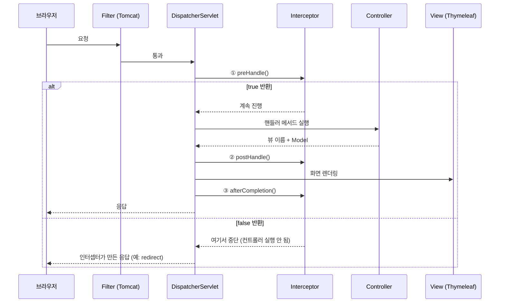
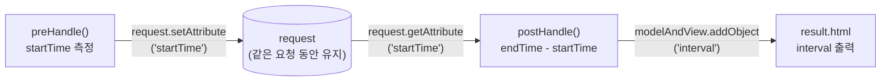
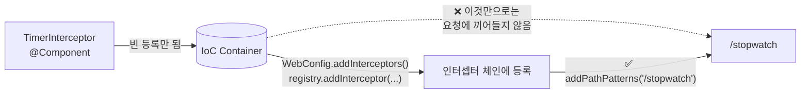
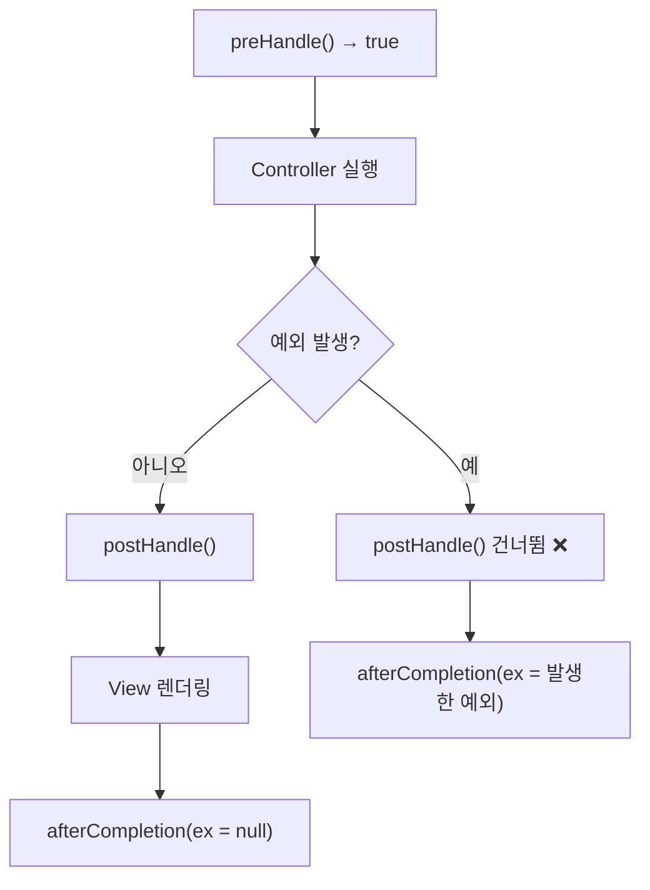
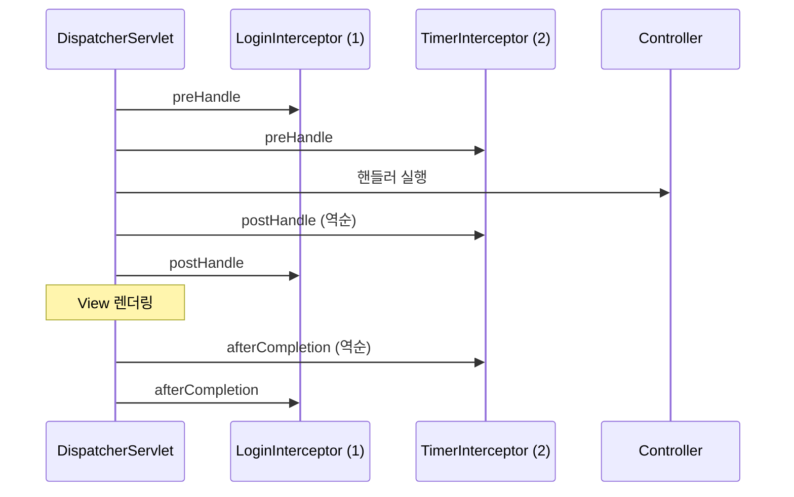
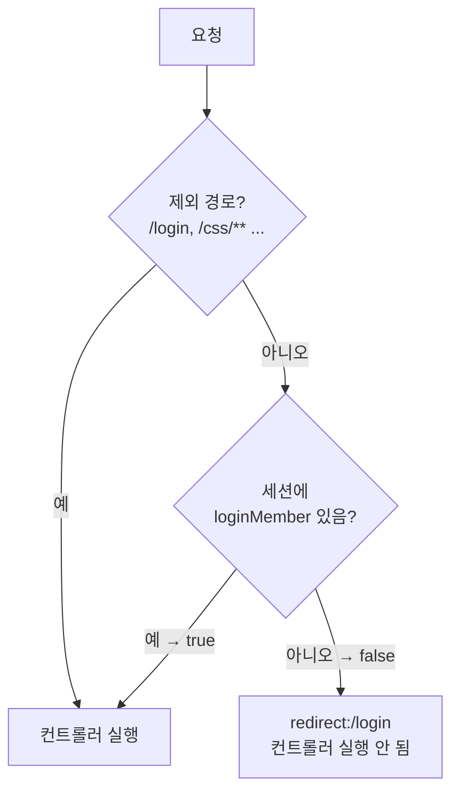
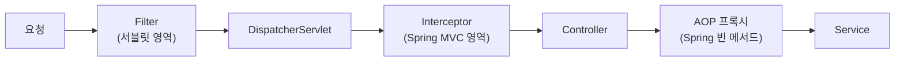
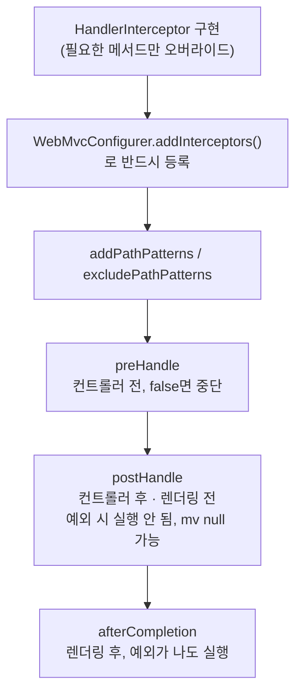

> **이번 글에서 다루는 것**
> 1. 인터셉터의 세 메서드 `preHandle` / `postHandle` / `afterCompletion`과 실행 시점
> 2. 실습: 핸들러 메서드 실행 시간 측정 (`TimerInterceptor`)
> 3. ⚠️ `WebMvcConfigurer`에 **등록해야** 동작한다 (수업 코드에서 빠진 부분)
> 4. 예외가 났을 때, 인터셉터가 여러 개일 때의 실행 순서
> 5. Filter vs Interceptor vs AOP
>
> **Interceptor(인터셉터)** 는 DispatcherServlet이 컨트롤러를 호출하기 **전과 후**에 끼어들어 공통 작업(로그인 체크, 실행 시간 측정, 로그 등)을 수행하는 객체다. 서블릿 05편의 Filter와 목적은 비슷하지만 **Spring MVC 안쪽**에서 동작한다.

**Spring Web MVC 시리즈**: 01. Request Mapping → 02. Handler Method → 03. View Resolver → 04. Exception Handler → **05. Interceptor** → 06. File Upload → 07. Thymeleaf

```
com.wanted.interceptor
├── InterceptorController.java   ← /stopwatch (2초 대기)
├── TimerInterceptor.java        ← 시작/종료 시간 측정
└── WebConfig.java               ← 인터셉터 등록
```

---

## 1. 인터셉터는 어디에 끼어들까?



| 메서드 | 실행 시점 | 주 용도 |
|---|---|---|
| `preHandle` | 컨트롤러 **실행 전** | 로그인/권한 체크, 시작 시간 기록 |
| `postHandle` | 컨트롤러 **실행 후, 뷰 렌더링 전** | Model에 공통 데이터 추가 |
| `afterCompletion` | **뷰 렌더링 후** (예외 발생 여부와 무관) | 자원 정리, 최종 로그, 예외 로그 |

---

## 2. 실습: 핸들러 메서드 실행 시간 측정

### 컨트롤러

```java
@Controller
public class InterceptorController {

    @GetMapping("stopwatch")
    public String handle() throws InterruptedException {
        System.out.println("stopwatch 요청을 처리하는 핸들러 메서드 동작..");
        Thread.sleep(2000);   // 2초간 정지
        return "result";
    }
}
```

컨트롤러는 **시간 측정에 대해 아무것도 모른다.** 측정은 인터셉터가 담당한다.

### TimerInterceptor

```java
@Component
public class TimerInterceptor implements HandlerInterceptor {
    // Interceptor 는 Controller 의 핸들러 메서드 전과 후에 동작한다.

    // 컨트롤러 도달 전
    @Override
    public boolean preHandle(HttpServletRequest request, HttpServletResponse response,
                             Object handler) throws Exception {
        System.out.println("preHandle() 동작함..");

        long startTime = System.currentTimeMillis();
        request.setAttribute("startTime", startTime);

        // true : 다음 인터셉터가 있다면 호출 / 없다면 컨트롤러의 핸들러 메서드 호출
        return true;
    }

    // 컨트롤러 핸들러 메서드 실행 후
    @Override
    public void postHandle(HttpServletRequest request, HttpServletResponse response,
                           Object handler, @Nullable ModelAndView modelAndView) throws Exception {
        System.out.println("postHandler() 호출됨..");

        long endTime = System.currentTimeMillis();
        long startTime = (long) request.getAttribute("startTime");

        modelAndView.addObject("interval", endTime - startTime);
    }
}
```

```html
<!-- result.html -->
<h3 th:text="| 핸들러메서드 호출 수행 시간 : ${interval} |"></h3>
```

### 값이 어떻게 전달될까?



**포인트**

- **`HandlerInterceptor`** 인터페이스를 구현한다. 세 메서드 모두 `default` 메서드라서 **필요한 것만** 오버라이드하면 된다.
- `preHandle`의 반환값
  - `true` → 다음 인터셉터 또는 컨트롤러로 진행
  - `false` → **여기서 요청 처리 중단.** 컨트롤러가 실행되지 않는다. (로그인 안 된 사용자를 막을 때 사용)
- **`request.setAttribute()`로 값 전달**: `preHandle`과 `postHandle`은 별개의 메서드라 지역 변수를 공유할 수 없다. 같은 요청 동안 유지되는 request 객체에 시작 시간을 담아두고 꺼내 쓴다.
- `postHandle`의 `ModelAndView`에 값을 추가하면 **화면에서 꺼내 쓸 수 있다.** 컨트롤러가 담지 않은 값을 인터셉터가 대신 넣어준 것이다.
- `handler` 매개변수: 실행될 핸들러 정보. 보통 `HandlerMethod` 타입이라 어떤 컨트롤러의 어떤 메서드인지 알 수 있다.

> 💡 `@Nullable`은 "이 값이 null일 수 있다"는 표시다. Spring 7부터 **JSpecify**(`org.jspecify.annotations.Nullable`) 표준 어노테이션을 사용한다. IntelliJ에서 메서드를 자동 오버라이드하면 같이 생성된다.

---

## 3. ⚠️ 인터셉터 등록 — 수업 코드에서 빠진 부분

```java
/*
 * WebMvcConfigurer
 * Spring MVC 패턴의 기본설정은 유지하며
 * 추가적인 커스터마이징이 필요할 때 구현하는 인터페이스
 * ex) 인터셉터 추가, CORS 설정, 정적 리소스 핸들링 등등
 */
@Configuration
public class WebConfig implements WebMvcConfigurer {
}
```

현재 `WebConfig`는 **비어 있다.** `TimerInterceptor`에 `@Component`가 붙어 빈으로 등록은 되지만, 빈으로 등록된다고 인터셉터로 동작하지는 않는다. **어떤 요청에 적용할지 등록**해줘야 한다. 이대로 실행하면 콘솔에 `preHandle() 동작함..`이 찍히지 않고 화면의 시간도 비어 있다.



```java
@Configuration
public class WebConfig implements WebMvcConfigurer {

    private final TimerInterceptor timerInterceptor;

    // 생성자 주입 (@Component로 빈 등록된 인터셉터를 주입받음)
    public WebConfig(TimerInterceptor timerInterceptor) {
        this.timerInterceptor = timerInterceptor;
    }

    @Override
    public void addInterceptors(InterceptorRegistry registry) {
        registry.addInterceptor(timerInterceptor)
                .addPathPatterns("/stopwatch");          // 이 경로에만 적용
                // .addPathPatterns("/**")               // 모든 경로에 적용
                // .excludePathPatterns("/css/**", "/images/**", "/error");  // 제외할 경로
    }
}
```

등록 후 `/stopwatch`를 요청하면:

```
preHandle() 동작함..
stopwatch 요청을 처리하는 핸들러 메서드 동작..
postHandler() 호출됨..
```

화면에는 `핸들러메서드 호출 수행 시간 : 2003` 정도(약 2초, ms 단위)가 출력된다.

### 경로 패턴

| 패턴 | 의미 |
|---|---|
| `/stopwatch` | 정확히 이 경로 |
| `/member/*` | `/member/` 바로 아래 한 단계 (`/member/list` ⭕, `/member/a/b` ❌) |
| `/member/**` | `/member/` 아래 **모든 하위 경로** |
| `/**` | 모든 경로 |

> 💡 `addPathPatterns`를 생략하면 **모든 요청**에 적용된다. CSS, JS, 이미지 같은 정적 리소스 요청에도 인터셉터가 돌 수 있으니 필요하면 `excludePathPatterns`로 빼준다.

---

## 4. 실습 코드를 더 안전하게

### ① modelAndView가 null일 수 있다

`postHandle`의 `ModelAndView`가 `@Nullable`인 데는 이유가 있다. 컨트롤러가 화면이 아니라 데이터를 바로 응답하는 경우(`@ResponseBody`, `@RestController`)에는 `null`이 들어온다. 그 상태로 `addObject()`를 부르면 **NullPointerException**이 발생한다.

```java
if (modelAndView != null) {
    modelAndView.addObject("interval", endTime - startTime);
}
```

### ② 예외가 나면 postHandle은 실행되지 않는다



컨트롤러에서 예외가 터지면 `postHandle`은 **건너뛴다.** 시작/종료 로그처럼 "무조건" 실행되어야 하는 작업은 `afterCompletion`에 둔다. ([Spring] 03편 AOP의 `@AfterReturning`과 `@After`의 관계와 비슷하다)

```java
@Override
public void afterCompletion(HttpServletRequest request, HttpServletResponse response,
                            Object handler, @Nullable Exception ex) throws Exception {
    long startTime = (long) request.getAttribute("startTime");
    System.out.println("[전체 처리 시간 - 렌더링 포함] " + (System.currentTimeMillis() - startTime) + "ms");

    if (ex != null) {
        System.out.println("예외 발생: " + ex.getMessage());
    }
}
```

- 04편의 `@ExceptionHandler`가 예외를 처리해버린 경우에는 `ex`가 null로 들어올 수 있다.
- `afterCompletion`은 **`preHandle`이 `true`를 반환한 인터셉터에 대해서만** 호출된다. `false`로 막았다면 그 인터셉터의 `afterCompletion`도 실행되지 않는다.

### ③ 측정 범위의 차이

| 구간 | 측정 내용 |
|---|---|
| `preHandle` ~ `postHandle` | **핸들러 메서드 실행 시간만** (실습 코드) |
| `preHandle` ~ `afterCompletion` | 뷰 렌더링까지 포함한 **전체 처리 시간** |

---

## 5. 인터셉터가 여러 개일 때의 순서

```java
registry.addInterceptor(loginInterceptor).order(1);
registry.addInterceptor(timerInterceptor).order(2);
```



`preHandle`은 등록(order) 순서대로, `postHandle`과 `afterCompletion`은 **역순**으로 실행된다. 양파 껍질처럼 바깥에서 안으로 들어갔다가 안에서 바깥으로 나온다. [Spring] 03편 AOP의 `@Order`와 같은 구조다.

---

## 6. 실무 예시 — 로그인 체크 인터셉터

```java
@Component
public class LoginCheckInterceptor implements HandlerInterceptor {

    @Override
    public boolean preHandle(HttpServletRequest request, HttpServletResponse response,
                             Object handler) throws Exception {
        HttpSession session = request.getSession(false);   // 세션이 없으면 새로 만들지 않음

        if (session == null || session.getAttribute("loginMember") == null) {
            response.sendRedirect("/login");   // 로그인 페이지로 보냄
            return false;                      // 컨트롤러 실행 막기
        }
        return true;
    }
}
```

```java
registry.addInterceptor(loginCheckInterceptor)
        .addPathPatterns("/**")
        .excludePathPatterns("/", "/login", "/signup", "/css/**", "/js/**");
```



이렇게 하면 모든 컨트롤러에 로그인 체크 코드를 넣을 필요가 없다.

---

## 7. Filter vs Interceptor vs AOP

세 가지 모두 "공통 기능을 핵심 로직 밖으로 빼낸다"는 목적은 같지만, **끼어드는 위치**가 다르다.



| 구분 | Filter | Interceptor | AOP |
|---|---|---|---|
| 관리 주체 | 서블릿 컨테이너 (Tomcat) | Spring MVC | Spring |
| 적용 위치 | DispatcherServlet **이전** | DispatcherServlet ~ 컨트롤러 사이 | 모든 빈의 **메서드** |
| 기준 | URL | URL 패턴 | 패키지·클래스·메서드 (Pointcut) |
| 알 수 있는 정보 | request, response | request, response, **실행될 핸들러** | 메서드 인자, 반환값 |
| 주 용도 | 인코딩, 보안(Spring Security), CORS | 로그인 체크, 권한, 공통 Model 데이터 | 트랜잭션, 로깅, 성능 측정 |

- **Spring 이전**, 서블릿 수준에서 처리할 일 → Filter
- **웹 요청(URL) 단위**로 처리할 일 → Interceptor
- **서비스 계층 메서드** 단위로 처리할 일 → AOP

---

## 8. 한눈에 정리



| 개념 | 핵심 |
|---|---|
| `HandlerInterceptor` | 인터셉터 인터페이스. 필요한 메서드만 오버라이드 |
| `preHandle` | 컨트롤러 전. `false` 반환 시 요청 중단 |
| `postHandle` | 컨트롤러 후, 렌더링 전. 예외 시 실행 안 됨. `ModelAndView` null 가능 |
| `afterCompletion` | 렌더링 후. 예외가 나도 실행 (`preHandle`이 true였을 때만) |
| `WebMvcConfigurer` | MVC 설정 확장 인터페이스. `addInterceptors()`로 **반드시 등록** |
| 경로 지정 | `addPathPatterns`, `excludePathPatterns` |
| 값 공유 | `request.setAttribute()`로 pre ↔ post 간 값 전달 |
| 순서 | pre는 등록 순, post·after는 역순 |
