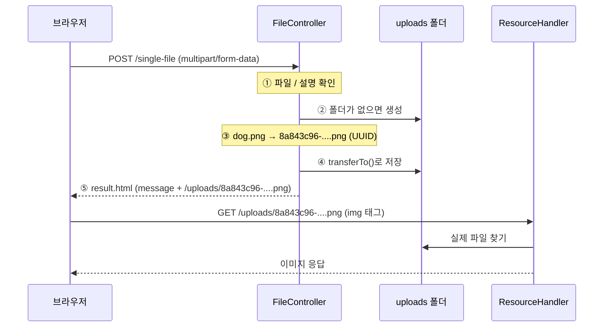
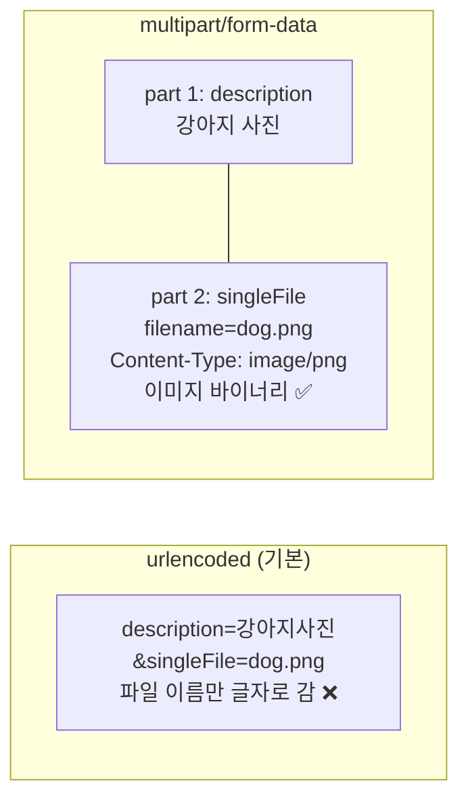
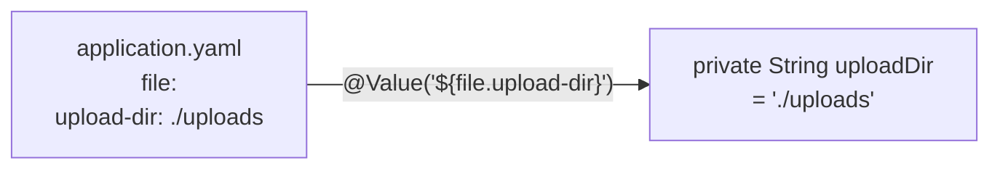
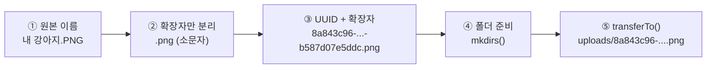
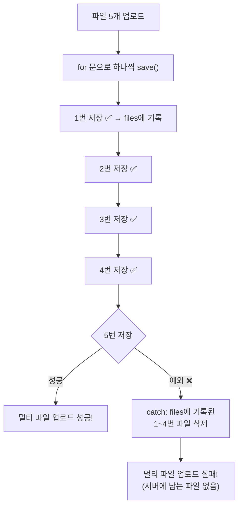
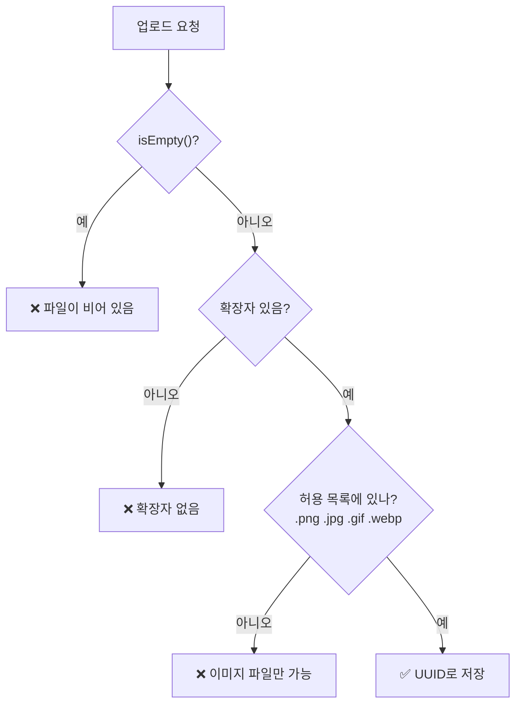
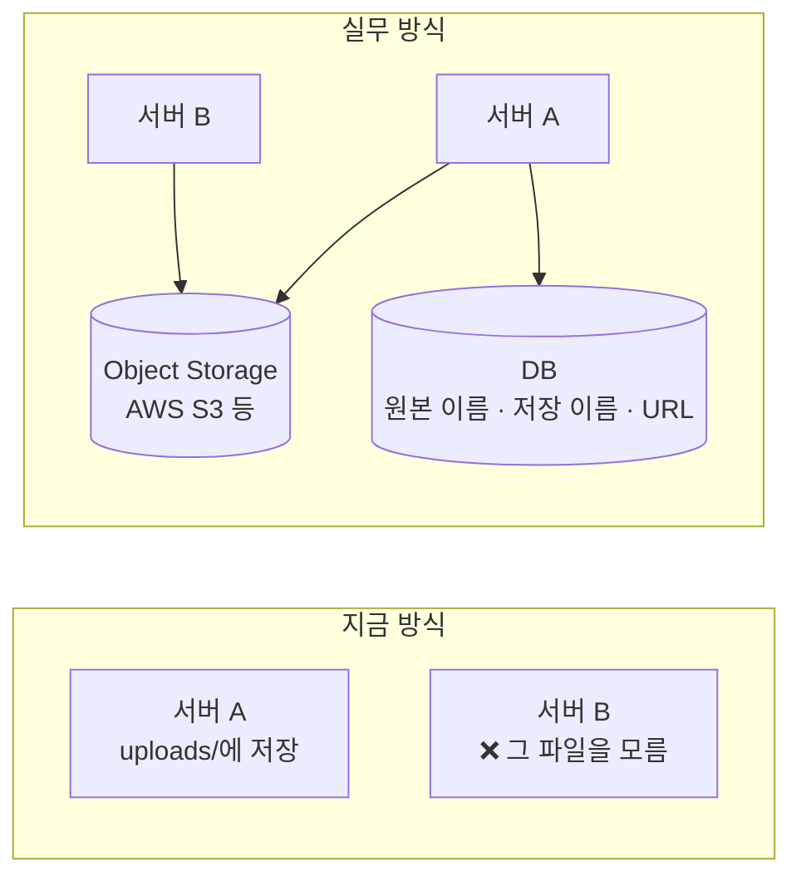
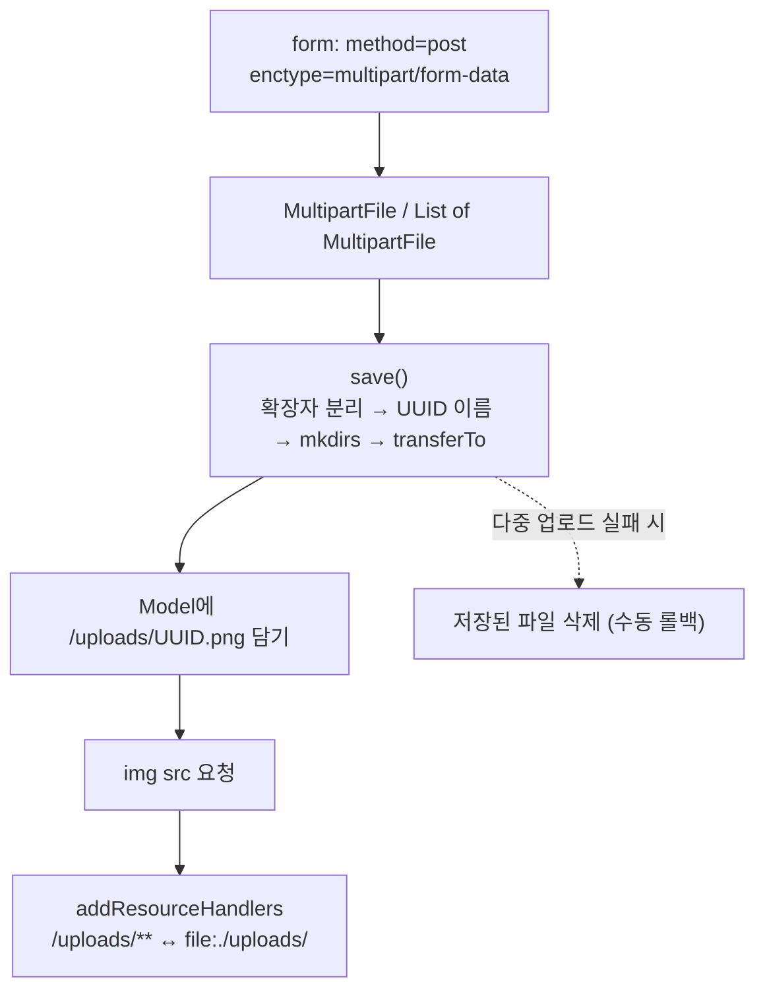

> **이번 글에서 다루는 것**
> 1. 파일 업로드 설정: `spring.servlet.multipart.*`와 `@Value`
> 2. `enctype="multipart/form-data"`가 필요한 이유
> 3. 단일 / 다중 파일 업로드 (`MultipartFile`, `List<MultipartFile>`)
> 4. 파일 이름을 **UUID**로 바꿔 저장하는 이유
> 5. **리소스 핸들러**로 업로드한 이미지를 브라우저에 보여주기
> 6. 실습 코드의 약점과 보완
>
> 파일은 일반 텍스트 파라미터와 달리 **`multipart/form-data`** 형식으로 전송된다. Spring은 업로드된 파일을 **`MultipartFile`** 객체로 받게 해주고, 우리는 이를 **겹치지 않는 이름(UUID)** 으로 서버 폴더에 저장한 뒤, **리소스 핸들러**로 브라우저에서 볼 수 있게 연결한다.

**Spring Web MVC 시리즈**: 01. Request Mapping → 02. Handler Method → 03. View Resolver → 04. Exception Handler → 05. Interceptor → **06. File Upload** → 07. Thymeleaf

> ⚠️ 수업 화면에도 적혀 있듯이, 이번 챕터처럼 **서버 로컬 폴더에 파일을 저장하는 방식**은 실무에서는 권장하지 않는다. 다만 지금 배운 기술 범위에서는 최선의 방식이고 원리를 이해하는 데 중요하다. (이유는 7장에서 정리)

---

## 1. 파일 업로드 전체 흐름



1. 사용자가 업로드한 **파일 / 설명** 확인
2. 파일 저장 경로 확인, 경로(폴더)가 없다면 **생성**
3. 원본 파일명을 **UUID 기반의 새로운 이름**으로 변경
4. 생성된 경로에 파일 **저장**
5. 결과 메시지와 **파일에 접근할 URL**을 Model에 담아 응답

---

## 2. 설정 — application.yaml

```yaml
spring:
  application:
    name: chap06-file-upload
  servlet:
    multipart:
      max-file-size: 200MB       # 파일 1개의 최대 크기
      max-request-size: 1000MB   # 요청 1번에 담긴 모든 파일 + 데이터의 합계 최대 크기

# 파일을 어디에 저장할지 경로 지정 (직접 만든 설정 키)
file:
  upload-dir: ./uploads
```

- Spring Boot의 기본값은 `max-file-size: 1MB`, `max-request-size: 10MB`다. 사진 한 장만 올려도 넘을 수 있어서 늘려준다.
- 크기를 초과하면 **`MaxUploadSizeExceededException`** 이 발생한다. 04편의 `@ExceptionHandler`로 잡아서 안내 화면을 보여줄 수 있다.
- `file.upload-dir`은 Spring이 정한 설정이 아니라 **우리가 만든 이름**이다. 아래의 `@Value`로 꺼내 쓴다.

> 💡 **`./uploads`는 어디일까?** `./`는 **애플리케이션을 실행한 작업 디렉터리** 기준이다. IntelliJ에서 실행하면 보통 프로젝트 폴더(`chap06-file-upload/uploads`)가 된다. 실행 위치에 따라 경로가 달라질 수 있어서, 실제 배포 환경에서는 `/var/app/uploads`처럼 **절대 경로**를 쓰는 경우가 많다.

---

## 3. 화면 — enctype이 핵심

```html
<h3>single-file 업로드하기(단일파일)</h3>
<form action="single-file" method="post" enctype="multipart/form-data">
    파일 : <input type="file" name="singleFile"> <br>
    파일 설명 : <input type="text" name="description"><br>
    <input type="submit">
</form>

<h3>multi-file 업로드하기(다중파일)</h3>
<form action="multi-file" method="post" enctype="multipart/form-data">
    파일 : <input type="file" name="multiFile" multiple> <br>
    파일 설명 : <input type="text" name="description"><br>
    <input type="submit">
</form>
```

| 속성 | 의미 |
|---|---|
| `method="post"` | 파일은 용량이 커서 URL에 담을 수 없다. **반드시 POST** |
| `enctype="multipart/form-data"` | 데이터를 여러 **부분(part)** 으로 나눠 보내는 인코딩. 이게 없으면 파일 이름만 문자열로 전송되고 **파일 내용은 안 간다** |
| `multiple` | 파일 선택창에서 여러 개를 고를 수 있게 함 |

### multipart가 뭘까?

기본 form 인코딩(`application/x-www-form-urlencoded`)은 `name=값&name=값` 형태의 **텍스트**만 보낼 수 있다. 파일 같은 바이너리 데이터는 담을 수 없다. `multipart/form-data`는 요청 본문을 **경계선(boundary)** 으로 구분해서 텍스트와 파일을 각각 따로 담아 보낸다.



실제 요청 본문은 이렇게 생겼다.

```
------boundary123
Content-Disposition: form-data; name="description"

강아지 사진
------boundary123
Content-Disposition: form-data; name="singleFile"; filename="dog.png"
Content-Type: image/png

(이미지 바이너리 데이터...)
------boundary123--
```

---

## 4. 단일 파일 업로드

```java
@Controller
public class FileController {

    // .yaml 에 지정한 설정값 불러오기
    @Value("${file.upload-dir}")
    private String uploadDir;

    @PostMapping("single-file")
    public ModelAndView single(@RequestParam MultipartFile singleFile,
                               @RequestParam String description,
                               ModelAndView mv) {
        System.out.println("singleFile = " + singleFile);
        System.out.println("description = " + description);

        try {
            String savedName = save(singleFile);
            mv.addObject("message", "파일 업로드 성공!!");
            mv.addObject("files", "/uploads/" + savedName);
        } catch (IOException e) {
            mv.addObject("message", "파일 업로드 실패.." + e.getMessage());
        }

        mv.setViewName("result");
        return mv;
    }
}
```

### @Value



- `application.yaml`(또는 `.properties`)의 설정값을 필드에 주입한다.
- 경로를 코드에 직접 쓰지 않고 설정 파일로 빼두면, **환경(개발/운영)마다 다른 경로**를 코드 수정 없이 쓸 수 있다.

### MultipartFile

`input`의 `name`(`singleFile`)과 같은 이름으로 받으면 업로드된 파일이 `MultipartFile` 객체로 들어온다. (02편의 `@RequestParam` 규칙 그대로)

| 메서드 | 반환 | 설명 |
|---|---|---|
| `getOriginalFilename()` | `String` | 사용자 PC에서의 원래 파일 이름 (`dog.png`) |
| `getSize()` | `long` | 파일 크기 (byte) |
| `getContentType()` | `String` | 파일 종류 (`image/png`) |
| `isEmpty()` | `boolean` | 파일을 선택하지 않았는지 |
| `transferTo(File)` | `void` | 지정한 위치에 파일 **저장** |
| `getInputStream()` / `getBytes()` | | 파일 내용을 직접 읽기 |

---

## 5. 파일 저장 메서드 — save()

```java
// 파일을 저장하고, 저장된 파일의 이름을 반환한다.
private String save(MultipartFile file) throws IOException {

    // ① 원본 파일명 추출                          // test.png
    String originName = file.getOriginalFilename();

    // ② 확장자 분리 (마지막 . 부터 끝까지) + 소문자 변환   // .PNG → .png
    String ext = originName.substring(originName.lastIndexOf(".")).toLowerCase(Locale.ROOT);

    // ③ 중복 방지를 위해 UUID로 새 이름 생성       // 스크린샷.png → 8a843c96-...-b587d07e5ddc.png
    String savedName = UUID.randomUUID().toString() + ext;

    // ④ 저장할 폴더 생성 (이미 있으면 아무 일도 안 함)
    File dir = new File(uploadDir).getAbsoluteFile();
    dir.mkdirs();

    // ⑤ 폴더 안에 새 이름으로 저장
    file.transferTo(new File(dir, savedName));

    return savedName;
}
```



### 왜 파일 이름을 바꿀까?

| 원본 이름 그대로 저장하면 | 문제 |
|---|---|
| A가 `profile.png`, B도 `profile.png` 업로드 | **나중 파일이 먼저 파일을 덮어씀** |
| `내 사진 (1).png` | 공백·한글·특수문자로 URL에서 문제 발생 가능 |
| `../../config.yml` | 악의적인 이름으로 **다른 폴더에 저장**을 시도할 수 있음 (경로 조작 공격) |

**UUID(Universally Unique Identifier)** 는 `8a843c96-9362-47dd-883d-b587d07e5ddc`처럼 사실상 **겹칠 확률이 0에 가까운** 128비트 랜덤 식별자다. 확장자만 원본에서 가져오고 이름은 UUID로 바꾸면 위 문제를 모두 피할 수 있다.

> 💡 원본 이름은 버리는 게 아니라 **DB에 함께 저장**해둔다. 다운로드할 때 사용자에게는 원래 이름(`dog.png`)으로 보여줘야 하기 때문이다. 아래의 `FileDTO`가 그 정보를 담는 객체다.

### `mkdir()` vs `mkdirs()`

| 메서드 | 동작 |
|---|---|
| `mkdir()` | 바로 위 폴더가 있어야만 생성 |
| `mkdirs()` | 중간 경로의 폴더까지 **전부** 생성 |

### `getAbsoluteFile()`을 쓰는 이유

`transferTo()`에 **상대 경로** File을 주면 작업 디렉터리가 아니라 **서블릿 컨테이너(Tomcat)의 임시 폴더** 기준으로 해석될 수 있다. 엉뚱한 곳에 저장되거나 에러가 나는 것을 막기 위해 절대 경로로 바꿔서 넘긴다.

---

## 6. 다중 파일 업로드

```java
@PostMapping("multi-file")
public ModelAndView multiFileUpload(@RequestParam("multiFile") List<MultipartFile> multipartFile,
                                    String description, ModelAndView mv) {

    // 여러 개의 파일 정보를 담을 DTO 리스트
    List<FileDTO> files = new ArrayList<>();
    // 화면에서 접근할 URL 저장용
    List<String> savedFiles = new ArrayList<>();

    try {
        for (MultipartFile file : multipartFile) {
            String savedName = save(file);
            files.add(new FileDTO(file.getOriginalFilename(), savedName, uploadDir, description));
            savedFiles.add("/uploads/" + savedName);
        }

        mv.addObject("message", "멀티 파일 업로드 성공!");
        mv.addObject("files", savedFiles);
    } catch (Exception e) {
        // 5개 중 4개는 저장되고 1개만 실패한다면?
        // → 트랜잭션의 rollback 처럼, 이전에 저장된 파일들을 삭제한다.
        for (FileDTO file : files) {
            new File(new File(uploadDir).getAbsoluteFile(), file.getSavedName()).delete();
        }
        mv.addObject("message", "멀티 파일 업로드 실패!");
    }

    mv.setViewName("result");
    return mv;
}
```

```java
@NoArgsConstructor @AllArgsConstructor @Getter @Setter @ToString
public class FileDTO {
    private String originFileName;   // 원본 이름
    private String savedName;        // 서버에 저장된 이름 (UUID)
    private String filePath;         // 저장 경로
    private String description;      // 파일 설명
}
```

- `List<MultipartFile>`로 받으면 같은 `name`으로 넘어온 파일들이 리스트에 담긴다.
- `String description`에는 `@RequestParam`이 없지만 동작한다. String·int 같은 **단순 타입**은 어노테이션을 생략해도 `@RequestParam`처럼 처리된다. (단, 이때는 **필수가 아니다**)
- `FileDTO` 리스트는 지금은 롤백용으로만 쓰지만, 나중에 DB 연동을 배우면 이 정보를 **DB에 저장**하게 된다.

### 하나라도 실패하면 전부 취소 — 수동 롤백



**"전부 성공 아니면 전부 취소"** 를 위해, 실패하면 그때까지 저장한 파일을 지운다. DB 트랜잭션의 롤백(rollback) 개념을 파일에 직접 구현한 것이다.

---

## 7. 업로드한 이미지 화면에 보여주기 — 리소스 핸들러

### 결과 화면

```html
<h3 th:text="${message}"></h3>
<!-- th:each 는 java의 for 문 -->
<div th:each="file : ${files}">
    
</div>
```

`` → 브라우저가 이 **URL로 이미지를 요청**한다. 그런데 `uploads` 폴더는 `static`도 아니고 컨트롤러도 없다. 그대로면 404다.

> 💡 단일 업로드는 `files`에 문자열 하나, 다중 업로드는 리스트를 담는다. `th:each`는 반복할 수 없는 값을 받으면 그 값 1개로 한 번 반복하기 때문에 같은 화면을 함께 쓸 수 있다.

### WebConfig — URL과 실제 폴더 연결

```java
/*
 * WebMvcConfigurer
 * -> 인터셉터 등록, 정적인 리소스 핸들링!!
 */
@Configuration
public class WebConfig implements WebMvcConfigurer {

    @Value("${file.upload-dir}")
    private String uploadDir;

    @Override
    public void addResourceHandlers(ResourceHandlerRegistry registry) {
        //  → 브라우저가 이미지 요청
        // 요청 URL(/uploads/**)과 실제 저장 폴더 경로를 연결한다.
        registry.addResourceHandler("/uploads/**")
                .addResourceLocations("file:" + uploadDir + "/");
    }
}
```


| 부분 | 의미 |
|---|---|
| `addResourceHandler("/uploads/**")` | 이 **URL 패턴**으로 오는 요청을 |
| `addResourceLocations("file:...")` | 이 **실제 위치**에서 찾아서 응답한다 |
| `file:` 접두사 | 디스크(파일 시스템) 경로라는 뜻. `classpath:`는 프로젝트 resources 내부 |
| 끝의 `/` | 폴더라는 표시. **빠뜨리면 파일을 못 찾는다** |

05편에서 `addInterceptors()`를 오버라이드했듯이, `WebMvcConfigurer`의 `addResourceHandlers()`를 오버라이드해서 **정적 리소스 경로를 추가**한 것이다. (`static` 폴더가 `/`로 서비스되는 것도 Spring Boot가 이 방식으로 미리 등록해둔 것)

---

## 8. 실습 코드의 약점과 보완

### ① 파일을 선택하지 않으면 에러

파일을 고르지 않고 제출하면 이름이 `""`(빈 문자열)인 파일이 넘어온다. `lastIndexOf(".")`가 `-1`이 되고 `substring(-1)`에서 **`StringIndexOutOfBoundsException`** 이 발생한다. 확장자가 없는 파일(`README`)도 마찬가지다.

```java
private String save(MultipartFile file) throws IOException {
    if (file.isEmpty()) {
        throw new IllegalArgumentException("파일이 비어 있습니다.");
    }

    String originName = file.getOriginalFilename();
    int dotIndex = originName.lastIndexOf(".");
    if (dotIndex == -1) {
        throw new IllegalArgumentException("확장자가 없는 파일은 업로드할 수 없습니다.");
    }
    String ext = originName.substring(dotIndex).toLowerCase(Locale.ROOT);
    ...
}
```

단일 업로드 메서드는 `IOException`만 잡고 있어서 이런 예외는 처리되지 않고 500 에러가 된다. `catch (Exception e)`로 넓히거나 04편의 예외 핸들러로 처리하자.

### ② 확장자 검사 (보안)

지금은 **아무 파일이나** 올릴 수 있다. `.html`, `.js`, `.jsp`, `.exe` 같은 파일이 올라가서 `/uploads/`로 열리면 보안 문제가 생길 수 있다. **허용할 확장자만** 받는 화이트리스트 방식이 기본이다.

```java
private static final Set<String> ALLOWED = Set.of(".png", ".jpg", ".jpeg", ".gif", ".webp");

if (!ALLOWED.contains(ext)) {
    throw new IllegalArgumentException("이미지 파일만 업로드할 수 있습니다.");
}
```



### ③ uploads 폴더는 Git에 올리지 않기

업로드된 파일은 소스 코드가 아니다. `.gitignore`에 추가해두자.

```
### Upload files ###
/uploads/
```

### ④ 왜 실무에서는 권장하지 않을까?

| 로컬 폴더 저장의 문제 | 설명 |
|---|---|
| 서버가 여러 대일 때 | 서버 A에 저장된 파일을 서버 B가 모름 |
| 재배포·서버 교체 시 | 컨테이너(Docker)나 새 서버로 바뀌면 파일이 **사라짐** |
| 용량·백업 | 서버 디스크가 가득 차고, 백업도 직접 해야 함 |



그래서 실무에서는 **AWS S3** 같은 **외부 파일 저장소(Object Storage)** 에 파일을 올리고, DB에는 원본 이름·저장 이름·URL만 기록하는 방식을 많이 쓴다. 지금 배운 흐름(이름 변경 → 저장 → URL 반환)은 저장 위치만 바뀔 뿐 그대로 이어진다.

---

## 9. 한눈에 정리



| 개념 | 핵심 |
|---|---|
| `enctype="multipart/form-data"` | 파일 전송에 필수. `method="post"`와 함께 |
| `MultipartFile` | 업로드된 파일 객체. `transferTo()`로 저장 |
| `List<MultipartFile>` | 다중 파일 (`multiple` 속성) |
| `spring.servlet.multipart.*` | 파일·요청 최대 크기 설정 |
| `@Value("${키}")` | yaml 설정값 주입 |
| UUID | 파일명 중복·특수문자·경로 조작 방지 |
| 수동 롤백 | 다중 업로드 실패 시 이미 저장한 파일 삭제 |
| `addResourceHandlers` | URL(`/uploads/**`) ↔ 실제 폴더(`file:./uploads/`) 연결 |
