> **이번 글에서 다루는 것**
> 1. 프로젝트 구성과 **내추럴 템플릿**의 의미
> 2. 표현식 6종: `${}` `*{}` `#{}` `@{}` `~{}` `[[ ]]`
> 3. 출력: `th:text` vs `th:utext` (XSS 주의), 인라인 표현식과 JavaScript
> 4. 제어문: `th:if` / `th:unless` / `th:switch` / `th:each`
> 5. `th:with`, SpringEL, Utility Objects
> 6. **Fragment**로 공통 영역 재사용 (`th:replace` vs `th:insert`)
> 7. form 바인딩, Security 연동, 개발 편의 설정
>
> **Thymeleaf(타임리프)** 는 HTML 태그에 `th:` 속성을 붙여 서버 데이터를 채워 넣는 **서버 사이드 템플릿 엔진**이다. HTML 파일을 그냥 열어도 깨지지 않는 **내추럴 템플릿(Natural Template)** 이라는 점이 가장 큰 특징이다. 01~06편에서 `th:text="${message}"` 정도만 써왔다면, 이번 글에서 문법을 한 번에 정리한다.

**Spring Web MVC 시리즈**: 01. Request Mapping → 02. Handler Method → 03. View Resolver → 04. Exception Handler → 05. Interceptor → 06. File Upload → **07. Thymeleaf**

---

## 1. 프로젝트 구성

### 패키지 구조와 컴포넌트 스캔

```
com.wanted.thymeleaf
├── config
│   ├── Chap07ThymeleafApplication.java   ← @SpringBootApplication
│   └── ContextConfiguration.java         ← @ComponentScan 추가 설정
├── controller
│   └── LectureController.java
└── model.dto
    ├── MemberDTO.java
    └── SelectCriteria.java
```

```java
/*
 * @SpringBootApplication은 자신이 위치한 패키지(com.wanted.thymeleaf.config)와 그 하위만 스캔한다.
 * controller 패키지는 config 하위가 아니므로 상위 패키지를 기준으로 스캔 범위를 따로 지정한다.
 */
@Configuration
@ComponentScan(basePackages = "com.wanted.thymeleaf")
public class ContextConfiguration {
}
```

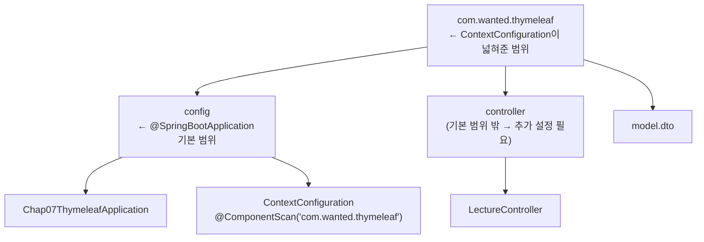

- 메인 클래스가 `config` 패키지에 있어서 형제 패키지인 `controller`를 기본적으로는 스캔하지 못한다.
- `ContextConfiguration`은 `config` 안에 있어서 스캔되고, 이 클래스의 `@ComponentScan`이 범위를 `com.wanted.thymeleaf` 전체로 넓혀준다.

> 💡 보통은 이런 설정이 필요 없도록 **메인 클래스를 최상위 패키지(`com.wanted.thymeleaf`)에 둔다.** 컨트롤러가 404가 나는데 원인을 모르겠다면 메인 클래스의 위치부터 확인해보자.

### 컨트롤러 — ModelAndView 방식

```java
@Controller
@RequestMapping("/lecture")
public class LectureController {

    @GetMapping("/expression")
    public ModelAndView expression(ModelAndView mv) {
        mv.addObject("member", new MemberDTO("홍길동", 20, '남', "서울시 서초구"));
        mv.addObject("hello", "hello!<h3>Thymeleaf</h3>");   // text vs utext 비교용
        mv.setViewName("lecture/expression");
        return mv;
    }
    // conditional, etc, fragment ... (각 장에서 소개)
}
```

- `setViewName("lecture/expression")` → `classpath:/templates/lecture/expression.html`
- 뷰 이름 앞에 `/`를 붙이지 않는다. (03편에서 본 jar 배포 문제)

### 기본 설정 (application.yaml)

아래 값은 Spring Boot 기본값이라 **적지 않아도 동일하게 동작**한다.

```yaml
spring:
  thymeleaf:
    prefix: classpath:/templates/
    suffix: .html
  messages:
    basename: messages   # 메시지 표현식 #{...}이 읽을 파일 → resources/messages.properties
```

### 네임스페이스 선언

```html
<html xmlns:th="http://www.thymeleaf.org">
```

`th:` 속성을 쓰기 위한 **네임스페이스** 선언이다. 없어도 Thymeleaf는 동작하지만, 선언해두면 **IDE가 `th:` 문법을 인식해서 자동완성과 경고**를 제공한다.

### 내추럴 템플릿이란?

```html
<p th:text="${ member.name }">이름이 여기 들어갑니다</p>
```

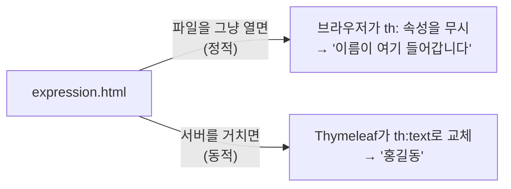

`th:` 속성은 브라우저가 모르는 속성이라 그냥 무시된다. 그래서 디자이너는 파일을 바로 열어 레이아웃을 확인하고, 서버에서는 같은 파일에 실제 데이터가 채워진다. 이 글의 여러 문법(주석, JS 인라인 등)이 이 특징과 연결된다.

---

## 2. 주석

```html
<!--/* parser-level 주석 */-->
<!--/*/ prototype-only 주석 /*/-->
```

| 종류 | 정적으로 열었을 때 (파일 그대로) | Thymeleaf 처리 후 (서버 응답) |
|---|---|---|
| 일반 HTML 주석 `<!-- -->` | 주석 | 주석 (브라우저 **소스 보기에 노출됨**) |
| **parser-level** `<!--/* */-->` | 주석 | **완전히 제거** → 사용자에게 안 보임 |
| **prototype-only** `<!--/*/ /*/-->` | 주석 | 주석 표시가 사라지고 **내용이 화면에 나타남** |

> 💡 개발 메모나 내부 설명은 parser-level 주석으로 쓰면 사용자 브라우저에 노출되지 않는다.

---

## 3. 표현식 한눈에 보기

| 표현식 | 이름 | 용도 |
|---|---|---|
| `${...}` | 변수 표현식 | Model 값, 요청 파라미터, 세션 값 꺼내기 |
| `*{...}` | 선택 변수 표현식 | `th:object`로 선택한 객체의 필드 꺼내기 |
| `#{...}` | 메시지 표현식 | `messages.properties`의 값 꺼내기 |
| `@{...}` | 링크 표현식 | URL 만들기 |
| `~{...}` | 조각 표현식 | 다른 템플릿의 일부(Fragment) 가져오기 |
| `[[...]]`, `[(...)]` | 인라인 표현식 | 태그 속성이 아닌 본문/스크립트 안에서 값 출력 |

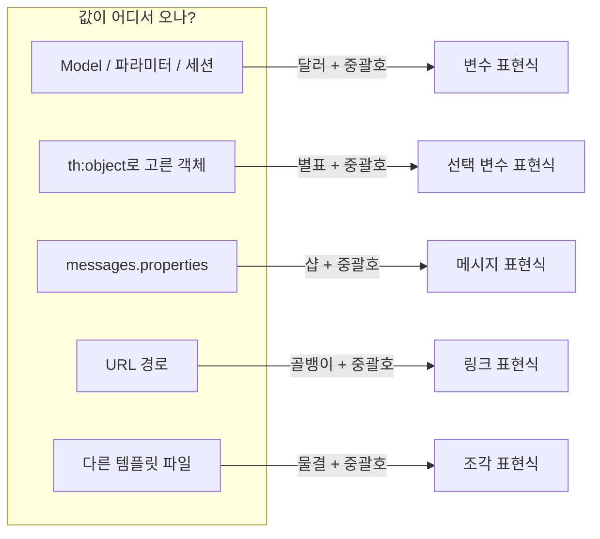

---

## 4. 변수 표현식 `${...}`

값을 꺼내는 **위치**에 따라 쓰는 방법이 다르다.

| 값의 위치 | 작성 방법 |
|---|---|
| Model(ModelAndView)에 담은 값 | `${ 이름 }` (앞에 아무것도 안 붙임) |
| 요청 파라미터 (쿼리스트링) | `${ param.이름 }` |
| 세션(session) attribute | `${ session.이름 }` |

```html
<!-- /lecture/expression?title=표현식&no=5&no=6 으로 요청 -->
<p th:text="${ param.title }"></p>   <!-- 표현식 -->
<p th:text="${ param.no[0] }"></p>   <!-- 5 : 같은 이름이 여러 개면 배열처럼 인덱스로 -->
<p th:text="${ param.no[1] }"></p>   <!-- 6 -->
<!-- <p th:text="${ param.no[2] }"></p>  존재하지 않는 인덱스 → 에러 -->
```

> ⚠️ 이 페이지는 반드시 `index.html`의 버튼(`?title=표현식&no=5&no=6`)으로 들어가야 한다. 주소창에 `/lecture/expression`만 입력하면 `param.no`가 null이라서 `param.no[0]`에서 **500 에러**가 발생한다.

> ⚠️ Thymeleaf 3.1(Spring Boot 3)부터는 보안상 `${ #request }`, `${ #response }`, `${ #session }` 같은 서블릿 객체에 **직접 접근할 수 없다.** 오래된 블로그 글의 예제가 동작하지 않는 이유 중 하나다. 대신 `param`, `session` 같은 축약 객체를 쓰거나, 필요한 값을 컨트롤러에서 Model에 담아 넘긴다.

---

## 5. 메시지 표현식 `#{...}`

```properties
# resources/messages.properties
message.value=hello world
```

```html
<p th:text="#{ message.value }"></p>   <!-- hello world -->
```

- 여러 페이지에서 쓰는 **공통 문구**를 한 파일에서 관리할 때 쓴다.
- **다국어 처리(i18n)** 의 기반이 된다. `messages_en.properties`, `messages_ko.properties`를 만들어두면 사용자의 언어 설정(Locale)에 맞는 파일을 자동으로 고른다.

---

## 6. 링크 표현식 `@{...}`

```html
<link rel="stylesheet" th:href="@{/css/common.css}">

<a th:href="@{/}">메인으로</a>

<!-- 괄호 안에 쿼리스트링 파라미터 작성 → /lecture/expression?title=링크&no=1 -->
<a th:href="@{/lecture/expression(title='링크', no=1)}">파라미터를 포함한 링크</a>
```

- `/`로 시작하는 경로에는 애플리케이션의 **context path를 자동으로 붙여준다.** 서버가 `/myapp` 같은 경로 아래에 배포되어도 링크를 고칠 필요가 없다.
- 한글·특수문자 파라미터를 **자동으로 URL 인코딩**해준다.

**경로 중간에 변수 넣기**

```html
<!-- 방법 1) 경로 변수 문법 → /member/3 -->
<a th:href="@{/member/{id}(id=${ member.id })}">상세</a>

<!-- 방법 2) 리터럴 치환 → /numbering/1 -->
<a th:href="@{|/numbering/${ numStat.count }|}">번호</a>
```

| 작성 | 결과 |
|---|---|
| `@{/lecture/expression(title='링크', no=1)}` | `/lecture/expression?title=%EB%A7%81%ED%81%AC&no=1` |
| `@{/member/{id}(id=3)}` | `/member/3` (01편의 `@PathVariable`과 짝) |

---

## 7. 선택 변수 표현식 `*{...}`

```html
<p th:text="${ member.name }"></p>

<!-- th:object로 객체를 선택해두면 *{필드명}으로 바로 꺼낼 수 있다 -->
<p th:object="${ member }" th:text="*{ age }"></p>

<div th:object="${ member }">
    <p th:text="*{ address }"></p>   <!-- 자식 태그에서도 사용 가능 -->
</div>
```

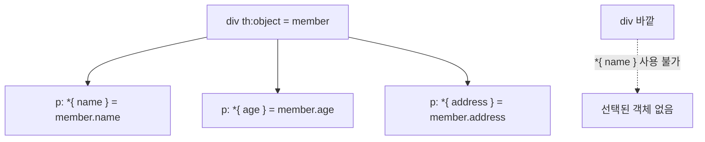

- `th:object`가 선언된 태그와 **그 안쪽**에서 `*{필드}` = `${선택한객체.필드}`
- 한 객체의 필드를 여러 개 출력할 때 반복을 줄여준다.
- form을 만들 때 `th:object` + `th:field`와 함께 많이 쓴다. (17장)

---

## 8. 출력: th:text, th:utext, th:value

```java
mv.addObject("hello", "hello!<h3>Thymeleaf</h3>");
```

```html
<li th:text="${ hello }"></li>
<li th:utext="${ hello }"></li>
<li><input type="text" th:value="'타임리프'"></li>
```

| 속성 | 결과 | 설명 |
|---|---|---|
| `th:text` | `hello!<h3>Thymeleaf</h3>` 가 **글자 그대로** 보임 | HTML을 **escape** 처리 (`<` → `&lt;`) |
| `th:utext` | `hello!` + 큰 제목 **Thymeleaf** | escape 하지 않음 → 태그로 해석 (unescaped text) |
| `th:value` | input에 `타임리프` 입력됨 | 태그의 `value` 속성 지정 |

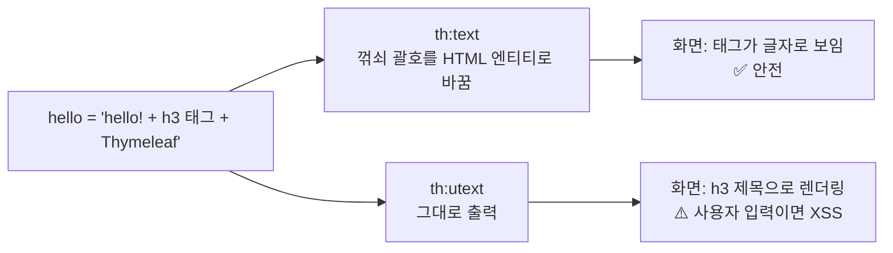

- 문자열 리터럴은 `'...'`로 감싸는 것이 원칙이다. (공백 없는 단순 문자는 생략해도 동작)
- 태그 안에 원래 적혀 있던 내용은 `th:text` 값으로 **교체**된다. 그래서 정적으로 열면 원래 내용이, 서버를 거치면 데이터가 보인다. (내추럴 템플릿)

### ⚠️ th:utext와 XSS

`th:utext`는 DB에 HTML 태그가 포함된 글을 저장했을 때 유용하지만, **사용자가 입력한 값**을 그대로 출력하면 `<script>alert('해킹')</script>` 같은 코드가 다른 사용자의 브라우저에서 실행된다. 이것을 **XSS(Cross-Site Scripting) 공격**이라고 한다. **기본은 `th:text`**, `th:utext`는 신뢰할 수 있는 값에만 쓴다.

---

## 9. 인라인 표현식 `[[...]]`, `[(...)]`

태그 속성(`th:text`)을 쓰지 않고 **본문에 바로** 값을 출력한다.

| 인라인 | 같은 의미 |
|---|---|
| `[[ ${hello} ]]` | `th:text` (escape O) |
| `[( ${hello} )]` | `th:utext` (escape X) |

```html
<li th:inline="text">[[${ hello }]]</li>   <!-- th:inline="text"는 생략해도 기본 적용 -->
<li>[(${ hello })]</li>
<li th:inline="none">[[${ hello }]]</li>   <!-- 인라인 해석 안 함 → 글자 그대로 출력 -->
```

`th:inline="none"`은 대괄호를 인라인 문법으로 해석하지 않고 **단순 문자열**로 처리한다. 수업 페이지에서 `[[...]]` 문법 자체를 설명 글로 보여줄 때 사용했다.

### JavaScript 안에서 사용하기

```html
<script th:inline="javascript">
    window.onload = function () {

        // 1) 동적 페이지에서는 정상: let hello = "hello!<h3>Thymeleaf<\/h3>";
        //    하지만 html 파일을 그냥 열면(정적) 자바스크립트 문법 오류
        // let hello = [[${ hello }]];

        // 2) 동적 페이지에서 따옴표 중복 오류: let hello = ""hello!..."";
        // let hello = "[[${ hello }]]";

        // 3) 내추럴 템플릿 (권장)
        //    정적 페이지 → 주석 뒤의 '기본값' 사용
        //    동적 페이지 → 주석과 기본값이 지워지고 서버 값으로 교체
        let hello = /*[[${ hello }]]*/ '기본값';

        alert(hello);
    }
</script>
```

| 작성 방식 | 정적으로 열 때 | 서버를 거칠 때 |
|---|---|---|
| ① `let hello = [[${hello}]];` | ❌ JS 문법 오류 | ✅ `"hello!..."` |
| ② `let hello = "[[${hello}]]";` | ✅ 문자열 | ❌ 따옴표 중복 `""hello!...""` |
| ③ `let hello = /*[[${hello}]]*/ '기본값';` | ✅ `'기본값'` | ✅ `"hello!..."` |

③은 정적일 때는 `/* ... */`가 그냥 JS 주석이라 `'기본값'`이 쓰이고, 서버를 거치면 주석과 기본값이 통째로 서버 값으로 바뀐다. 두 상황 모두 정상 동작하는 **내추럴 템플릿** 방식이다.

- `<script>`에는 **`th:inline="javascript"`를 반드시** 작성해야 한다. 그래야 값의 타입에 맞게 JS 리터럴로 바꿔준다. (문자열은 `"..."`로 감싸고, `</`를 `<\/`로 바꾸는 등 JS용 escape 적용)
- 작성하지 않으면 일반 텍스트 인라인으로 처리되어 **따옴표가 붙지 않고**, escape도 JS용이 아닌 **HTML용**(`<` → `&lt;`)이 적용된다.
- 객체나 List를 넘기면 **JSON 형태**로 변환되어 JS 객체로 바로 쓸 수 있다.
- 결과는 브라우저에서 **우클릭 → 페이지 소스 보기**로 확인해보자.

---

## 10. 리터럴 치환 `|...|` 과 th:block

### 리터럴 치환

```html
<p th:object="${ member }" th:text="|name = '*{ name }'|"></p>
<!-- name = '홍길동' -->
```

`+` 연산자 없이 문자열과 변수를 **합칠 수 있다.** (JavaScript의 템플릿 문자열(백틱)과 비슷)

```html
<!-- 같은 결과, 리터럴 치환이 훨씬 읽기 쉽다 -->
<p th:text="'name = ' + ${ member.name }"></p>
<p th:text="|name = ${ member.name }|"></p>
```

### th:block

```html
<th:block th:object="${ member }">
    <p th:text="*{ age }"></p>
</th:block>
```

```html
<!-- 렌더링 결과: th:block 자체는 사라진다 -->
<p>20</p>
```

- 렌더링 후 **자기 자신은 사라지는** Thymeleaf 전용 가상 태그.
- 의미 없는 `<div>`를 만들지 않고 **범위만** 지정하고 싶을 때 쓴다. (`th:object`, `th:if`, `th:each`의 범위 지정 등)

---

## 11. 제어문 — 조건

컨트롤러: `num = 1`, `str = "바나나"`

### th:if / th:unless

```html
<p th:if="${ num > 0 }">넘어온 값은 0보다 크다.</p>          <!-- 출력 O -->
<p th:if="${ num < 0 }">넘어온 값은 0보다 작다.</p>          <!-- 출력 X -->
<p th:unless="${ num < 0 }">넘어온 값은 0보다 작지 않다.</p>  <!-- 출력 O : 조건이 false일 때 -->

<th:block th:if="${ str == '사과' }"><p>사과 좋아요!</p></th:block>
<th:block th:if="${ str == '바나나' }"><p>바나나 좋아요!</p></th:block>   <!-- 출력 -->
```

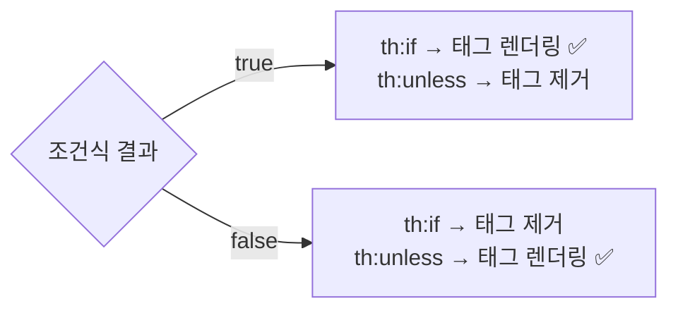

- `th:if`: 조건이 **true**일 때 태그를 렌더링. false면 태그 **자체가 사라진다.** (CSS로 숨기는 것이 아님)
- `th:unless`: 조건이 **false**일 때 렌더링. (if의 반대)
- 다중 조건은 `and`, `or`, `not`(또는 `!`)

```html
<p th:if="${ num > 0 and num <= 10 }">1부터 10까지의 양수</p>
<p th:if="${ str != null and str == '바나나' }">바나나 좋아요!</p>
<p th:if="${ !#strings.isEmpty(str) and str == '바나나' }">바나나 좋아요!</p>
```

> 💡 **th:if의 true 판정 기준**: boolean뿐 아니라 값의 상태로도 판단한다. `null`이면 false. 숫자 `0`, 문자열 `"false"`, `"off"`, `"no"`도 false로 본다. 그 외 값이 있으면 true.

### th:switch / th:case

```html
<th:block th:switch="${ str }">
    <span th:case="사과">사과가 선택되었습니다</span>
    <span th:case="바나나">바나나가 선택되었습니다</span>   <!-- 출력 -->
    <span th:case="*">사과도 바나나도 아닙니다</span>       <!-- default -->
</th:block>
```

`th:case="*"`는 어떤 case에도 해당하지 않을 때 선택된다. (switch문의 `default`) 자바와 달리 **break가 필요 없고**, 처음 일치한 case 하나만 출력된다.

### 비교 연산자를 문자로

| 기호 | 문자 |
|---|---|
| `==` | `eq` |
| `!=` | `ne` |
| `>` | `gt` |
| `<` | `lt` |
| `>=` | `ge` |
| `<=` | `le` |

HTML 속성 안에서 `<`, `>` 기호가 태그와 헷갈릴 수 있을 때 문자 버전을 쓴다.

---

## 12. 제어문 — 반복 th:each

```html
<tr th:each="member : ${ memberList }">
    <td th:text="${ member.name }"></td>
    <td th:text="${ member.age }"></td>
    <td th:text="${ member.gender }"></td>
    <td th:text="${ member.address }"></td>
</tr>
```

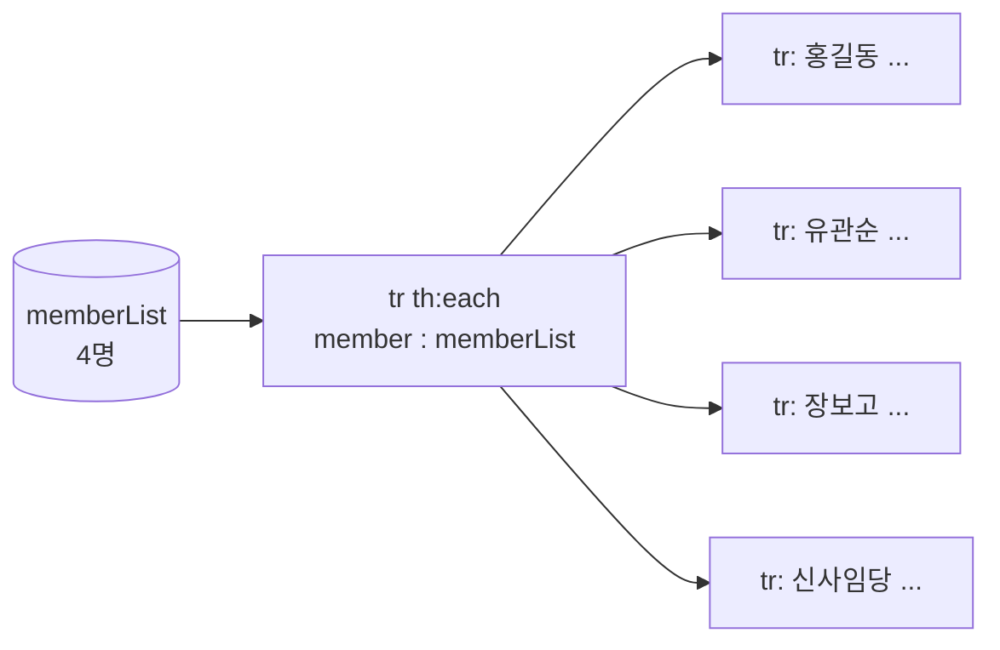

- 자바의 향상된 for문(`for (MemberDTO member : memberList)`)과 같다.
- `th:each`가 붙은 **태그 자체가 반복**된다. (위 예시에서는 `<tr>`이 4번 생김)

### 반복 상태 변수 (stat)

```html
<tr th:each="member, stat : ${ memberList }">
    <td th:text="${ stat.index }"></td>
    <td th:text="${ stat.count }"></td>
    ...
</tr>
```

| 속성 | 의미 | 1번째 | 2번째 | 4번째(마지막) |
|---|---|:---:|:---:|:---:|
| `index` | 0부터 시작하는 인덱스 | 0 | 1 | 3 |
| `count` | 1부터 시작하는 순번 | 1 | 2 | 4 |
| `size` | 전체 개수 | 4 | 4 | 4 |
| `current` | 현재 반복 중인 객체 | member1 | member2 | member4 |
| `even` / `odd` | 짝수 / 홀수 번째 여부 (count 기준) | odd | even | even |
| `first` / `last` | 첫 번째 / 마지막 여부 | first | - | last |

- 두 번째 변수를 생략하면 **`변수명 + Stat`** 으로 자동 생성된다. → `member`의 상태는 `memberStat`
- 활용 예: `stat.odd`로 줄무늬 테이블 만들기, `stat.last`일 때만 구분 기호 빼기

### #numbers.sequence로 숫자 반복

```html
<th:block th:each="num : ${ #numbers.sequence(5, 10) }">   <!-- 5부터 10까지 -->
    <a th:href="@{|/numbering/${ numStat.count }|}" th:text="번호 + ${ num }"></a>
</th:block>
```

- 자바의 `for (int i = 5; i <= 10; i++)`처럼 숫자 범위를 반복할 때 쓴다. **페이지 번호 버튼**을 만들 때 자주 쓴다.
- `/numbering/...`은 링크 생성 예제일 뿐 컨트롤러가 없어서 클릭하면 404가 난다.

---

## 13. 기타 — th:with, SpringEL

컨트롤러 (`/lecture/etc`):

```java
SelectCriteria selectCriteria = new SelectCriteria(1, 10, 3);   // 시작 1, 끝 10, 현재 3페이지

// 키 이름 없이 객체만 담으면 클래스 이름의 첫 글자를 소문자로 바꾼 이름이 키가 된다.
// SelectCriteria → "selectCriteria"
mv.addObject(selectCriteria);

mv.addObject("member", member);
mv.addObject("memberList", memberList);

// HashMap은 순서 보장 X → th:each 출력 순서를 유지하기 위해 LinkedHashMap 사용
Map<String, MemberDTO> memberMap = new LinkedHashMap<>();
memberMap.put("m01", new MemberDTO("홍길동", 20, '남', "서울시 서초구"));
...
mv.addObject("memberMap", memberMap);
```

### th:with — 지역 변수

```html
<th:block th:with="start = ${ selectCriteria.startPage }, last = ${ selectCriteria.endPage }">
    <th:block th:each="p : ${ #numbers.sequence(start, last) }">
        <!-- 현재 페이지 버튼만 비활성화 -->
        <th:block th:if="${ selectCriteria.pageNo eq p }">
            <button th:text="${ p }" disabled></button>
        </th:block>
        <th:block th:if="${ selectCriteria.pageNo ne p }">
            <button th:text="${ p }"></button>
        </th:block>
    </th:block>
</th:block>
```

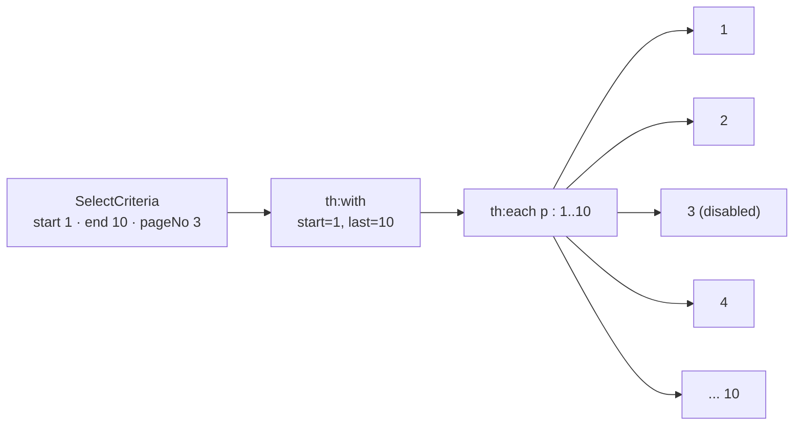

- `th:with`로 선언한 변수는 **그 태그 안쪽에서만** 쓸 수 있다.
- 결과: `[1] [2] [3(비활성)] [4] ... [10]` → **페이징 버튼**의 기본 구조

같은 결과를 조건부 속성으로 더 짧게 쓸 수도 있다. 조건이 false면 `disabled` 속성 자체가 생기지 않는다.

```html
<button th:each="p : ${ #numbers.sequence(start, last) }"
        th:text="${ p }"
        th:disabled="${ selectCriteria.pageNo eq p }"></button>
```

### SpringEL로 객체·List·Map 꺼내기

변수 표현식 `${...}`은 Spring이 제공하는 **SpringEL(Spring Expression Language)** 로 해석된다. 메서드 호출, 인덱스 접근 같은 기능을 쓸 수 있다.

```html
<!-- Object -->
<li th:text="${ member.name }"></li>
<li th:text="${ member['age'] }"></li>
<li th:text="${ member.getGender() }"></li>

<!-- List -->
<li th:text="${ memberList[1].name }"></li>
<li th:text="${ memberList[1]['age'] }"></li>
<li th:text="${ memberList[1].getGender() }"></li>
<li th:text="${ memberList.get(1).getGender() }"></li>
<li th:text="${ memberList.get(1).address }"></li>

<!-- Map -->
<li th:text="${ memberMap['m03'].name }"></li>
<li th:text="${ memberMap['m03']['age'] }"></li>
<li th:text="${ memberMap['m03'].getGender() }"></li>

<!-- Map 반복 : 각 요소는 Map.Entry → key, value -->
<li th:each="entry : ${ memberMap }" th:text="|${ entry.key } : ${ entry.value.name }|"></li>
```

| 대상 | 꺼내는 방법 |
|---|---|
| 객체 | `.필드명`, `['필드명']`, `.getter()` |
| List | `[인덱스]`, `.get(인덱스)` |
| Map | `['키']`, Map 반복 시 `entry.key` / `entry.value` |

- `.필드명`, `['필드명']`, `.getter()` 세 가지 모두 **내부적으로 getter를 호출**한다.
- 필드가 `private`이라서 **getter가 없으면 세 방식 모두 에러**가 난다. (DTO에 getter가 꼭 필요한 이유)

### null을 안전하게 다루는 문법

```html
<!-- 안전 탐색 연산자 ?. : member가 null이면 에러 대신 null -->
<p th:text="${ member?.name }"></p>

<!-- 엘비스 연산자 ?: : 값이 null이면 오른쪽 기본값 (MemberDTO에 nickname 필드가 있다고 가정) -->
<p th:text="${ member.nickname ?: '닉네임 없음' }"></p>

<!-- 삼항 연산자 -->
<p th:text="${ member.age >= 20 ? '성인' : '미성년' }"></p>
```

02편의 `searchResult.html`처럼 null 객체의 메서드를 호출해서 500 에러가 나는 상황을 `?.`로 막을 수 있다.

---

## 14. Utility Objects (`#`으로 시작)

Thymeleaf가 기본 제공하는 도우미 객체들이다.

| 객체 | 용도 | 예시 |
|---|---|---|
| `#strings` | 문자열 | `${ #strings.isEmpty(str) }`, `${ #strings.toUpperCase(str) }` |
| `#numbers` | 숫자 서식·범위 | `${ #numbers.sequence(1, 5) }`, `${ #numbers.formatInteger(price, 3, 'COMMA') }` → `8,000` |
| `#objects` | 객체 | `${ #objects.nullSafe(obj, '기본') }` |
| `#arrays`, `#lists`, `#maps` | 컬렉션 | `${ #lists.isEmpty(memberList) }`, `${ #lists.size(memberList) }` |
| `#messages` | 메시지(i18n) | |
| `#dates`, `#calendars` | `java.util.Date`, `Calendar` 서식 | |
| `#temporals` | **`LocalDate`, `LocalDateTime`** 서식 | `${ #temporals.format(now, 'yyyy-MM-dd HH:mm') }` |

> 💡 요즘 자바에서는 날짜를 `LocalDateTime`으로 다루는 경우가 많다. 이때는 `#dates`가 아니라 **`#temporals`** 를 쓴다.

전체 목록은 [Thymeleaf 공식 문서 Appendix B](https://www.thymeleaf.org/doc/tutorials/3.1/usingthymeleaf.html#appendix-b-expression-utility-objects)에서 볼 수 있다.

---

## 15. Fragment — 공통 영역 재사용

### 왜 필요할까?

웹 페이지에는 **Header, Nav, Footer, Aside**처럼 모든 페이지에 반복되는 영역이 많다. 페이지마다 복사해두면 메뉴 하나 바꿀 때 **페이지 수만큼** 수정해야 한다. Fragment는 공통 영역을 **한 파일에 정의하고 가져다 쓰는** 기능이다.

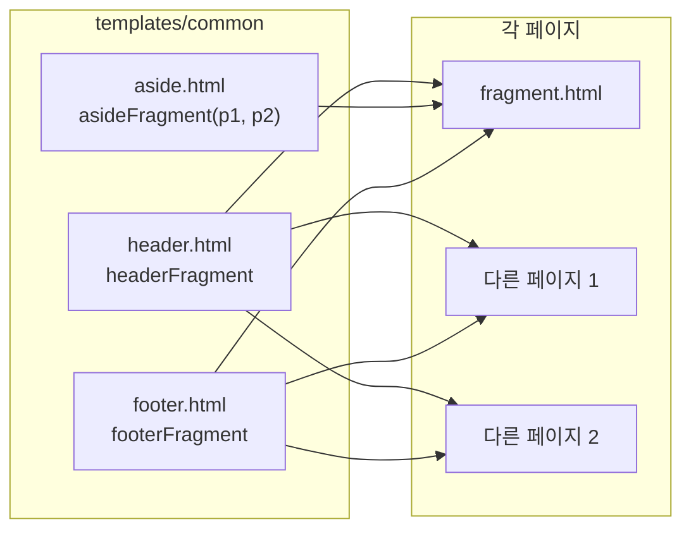

헤더를 고치면 `header.html` 한 곳만 수정하면 된다.

### 조각 정의 — th:fragment

```html
<!-- templates/common/header.html -->
<header th:fragment="headerFragment" class="header">
    <h1> header Fragment</h1>
</header>
```

```html
<!-- templates/common/footer.html -->
<footer th:fragment="footerFragment" class="footer">
    <h1> footer Fragment</h1>
</footer>
```

```html
<!-- templates/common/aside.html : 매개변수를 받는 fragment -->
<aside th:fragment="asideFragment(parameter, parameter1)" class="aside">
    <ul>
        <li th:text="${parameter}"></li>
        <li th:text="${parameter1}"></li>
    </ul>
</aside>
```

`th:fragment="조각이름"`이 붙은 태그 **부분만** 다른 페이지로 가져간다. 그 파일의 `<head>`, `<body>` 등 나머지는 사용되지 않는다.

### 조각 가져오기 — th:replace, th:insert

```java
mv.addObject("test1", "values1");
mv.addObject("test2", "values2");
mv.setViewName("lecture/fragment");
```

```html
<!-- templates/lecture/fragment.html -->
<header th:replace="~{common/header :: headerFragment}">
    <h1>나는 header</h1>
</header>

<aside th:replace="~{common/aside :: asideFragment(${test1}, ${test2})}"></aside>

<main class="main">...</main>

<footer th:insert="~{common/footer :: footerFragment}">
    <h2>나는 footer</h2>
</footer>
```

**작성 방법**: `~{ 템플릿 경로 :: Fragment 이름 }`

- 템플릿 경로는 `templates` 폴더 기준, `.html` 생략 (`common/header` → `templates/common/header.html`)
- 경로 앞에 `/`를 붙이지 않는다.

### th:replace vs th:insert

**렌더링 결과**

```html
<!-- th:replace : 태그 자체를 통째로 교체 ('나는 header' 사라짐) -->
<header class="header"><h1> header Fragment</h1></header>

<!-- th:insert : 바깥 태그는 유지, 안쪽 내용만 fragment로 교체 -->
<footer><footer class="footer"><h1> footer Fragment</h1></footer></footer>
```

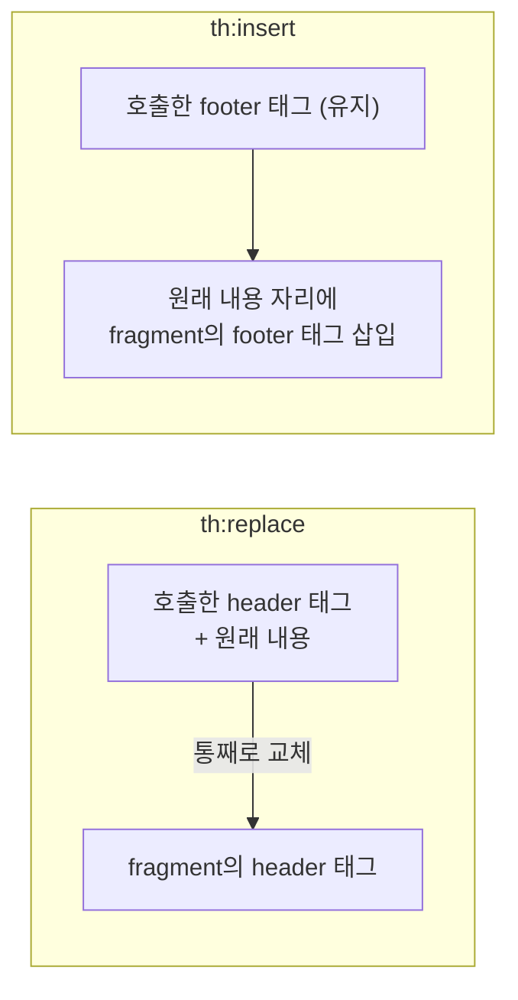

| 속성 | 호출한 태그 | 결과 |
|---|---|---|
| `th:replace` | **사라짐** | fragment 태그로 통째로 교체 |
| `th:insert` | **남음** | 그 태그 안에 fragment(태그 포함)가 들어감 |

> 💡 대부분은 태그가 중복되지 않는 `th:replace`를 쓴다. 위 `th:insert` 결과처럼 `<footer>` 안에 `<footer>`가 또 생기는 것을 피할 수 있다.

### 매개변수 전달

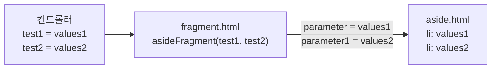

`asideFragment(${test1}, ${test2})` → aside.html의 `parameter`, `parameter1`에 `values1`, `values2`가 들어간다. 페이지마다 제목이나 활성 메뉴만 다르게 보여주는 **동적 공통 UI**를 만들 수 있다.

> 💡 정적 파일(CSS)도 `th:href="@{/css/common.css}"`처럼 링크 표현식으로 불러오면, 공통 `<head>` 영역도 fragment로 만들어 재사용할 수 있다. 페이지 전체 틀(레이아웃)을 통째로 관리하고 싶다면 **Thymeleaf Layout Dialect**라는 확장 라이브러리도 있다.

---

## 16. Security 연동 미리보기 — sec:authorize

```html
<th:block sec:authorize="isAuthenticated()">로그인 했음</th:block>
<th:block sec:authorize="isAnonymous()">로그인 하지 않음</th:block>
```

- 로그인 여부에 따라 보여줄 영역을 다르게 처리하는 문법이다. **Spring Security**를 적용한 후에 쓸 수 있다.
- 현재 프로젝트에는 Security가 없어서 `sec` 속성을 해석하지 못하고 **두 문장이 모두 출력**된다. 그래서 수업 코드에서는 주석 처리되어 있다.
- 사용하려면 Security 스타터와 Thymeleaf Security 확장을 추가한다. (확장 모듈 이름은 Spring Security 버전에 맞춰 확인)

```groovy
implementation 'org.springframework.boot:spring-boot-starter-security'
implementation 'org.thymeleaf.extras:thymeleaf-extras-springsecurity6'
```

```html
<html xmlns:th="http://www.thymeleaf.org"
      xmlns:sec="http://www.thymeleaf.org/extras/spring-security">
```

---

## 17. form 바인딩 — th:object + th:field

수업 범위 밖이지만 등록·수정 화면에서 바로 쓰게 되는 문법이다. 02편의 `@ModelAttribute`와 짝을 이룬다.

```java
@GetMapping("/member/edit")
public String editForm(Model model) {
    model.addAttribute("member", new MemberDTO("홍길동", 20, '남', "서울시 서초구"));
    return "member/edit";
}
```

```html
<form th:action="@{/member/edit}" th:object="${ member }" method="post">
    <input type="text" th:field="*{ name }">
    <input type="number" th:field="*{ age }">
    <button>수정</button>
</form>
```

렌더링 결과:

```html
<input type="text" id="name" name="name" value="홍길동">
<input type="number" id="age" name="age" value="20">
```

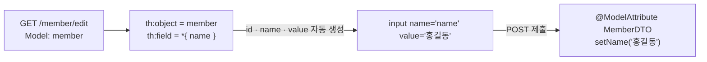

`th:field` 하나가 `id`, `name`, `value`를 **한 번에** 만들어준다. `name`이 DTO 필드명과 자동으로 일치하므로, 02편에서 강조한 "**name 속성과 필드명 맞추기**" 실수를 원천적으로 막을 수 있다.

---

## 18. 개발 편의 설정

템플릿을 수정할 때마다 서버를 재시작하기 번거롭다면 캐시를 끈다.

```yaml
spring:
  thymeleaf:
    cache: false   # 개발 중에만! 운영에서는 true (기본값)
```

`spring-boot-devtools` 의존성을 추가하면 개발 중 템플릿 캐시가 자동으로 꺼지고, 코드 변경 시 자동 재시작 기능도 쓸 수 있다.

---

## 19. 한눈에 정리

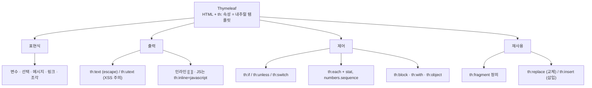

| 분류 | 문법 | 핵심 |
|---|---|---|
| 표현식 | `${}` `*{}` `#{}` `@{}` `~{}` | 변수 / 선택 객체 / 메시지 / 링크 / 조각 |
| 출력 | `th:text`, `th:utext`, `th:value` | escape O / escape X(XSS 주의) / value 속성 |
| 인라인 | `[[ ]]`, `[( )]`, `th:inline` | 본문·스크립트 안 출력. JS는 `th:inline="javascript"` |
| 문자열 | 리터럴 치환 (파이프 기호로 감싸기) | `+` 없이 합치기 |
| 범위 | `th:block`, `th:object`, `th:with` | 가상 태그 / 객체 선택 / 지역 변수 |
| 조건 | `th:if`, `th:unless`, `th:switch`·`th:case` | false면 태그 자체가 사라짐 |
| 반복 | `th:each`, stat, `#numbers.sequence` | 상태 변수는 `변수명Stat`으로도 사용 |
| 재사용 | `th:fragment`, `th:replace`, `th:insert` | 공통 영역 분리. replace=교체, insert=삽입 |
| 주석 | parser-level / prototype-only | 서버 처리 후 제거 / 서버 처리 후 노출 |
