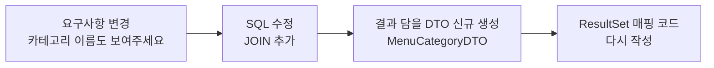
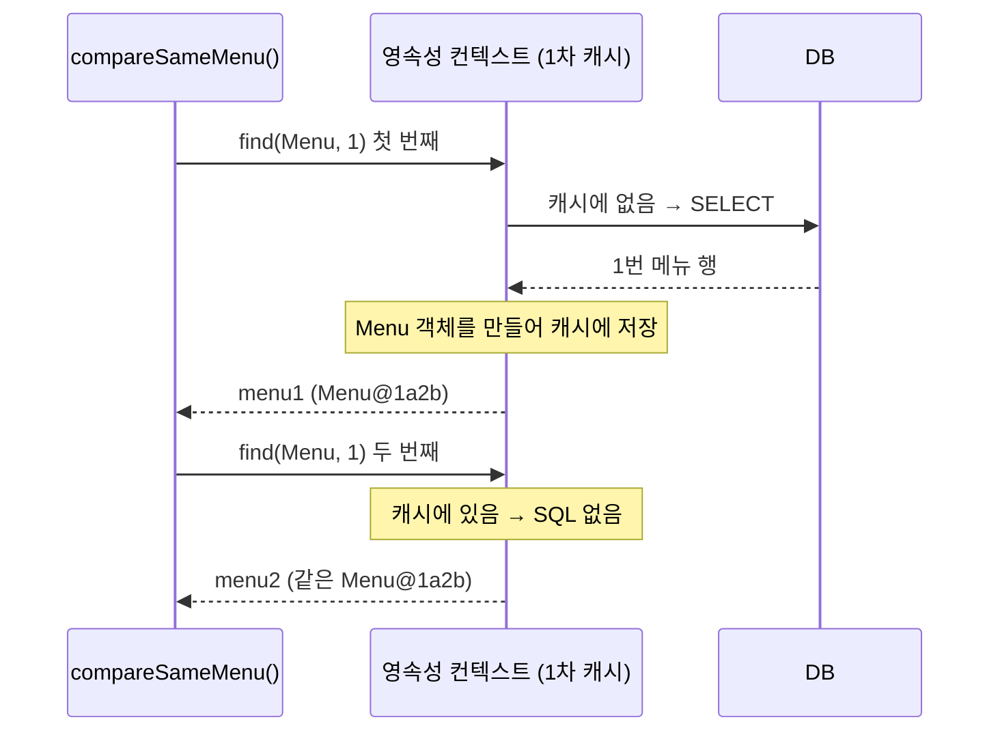
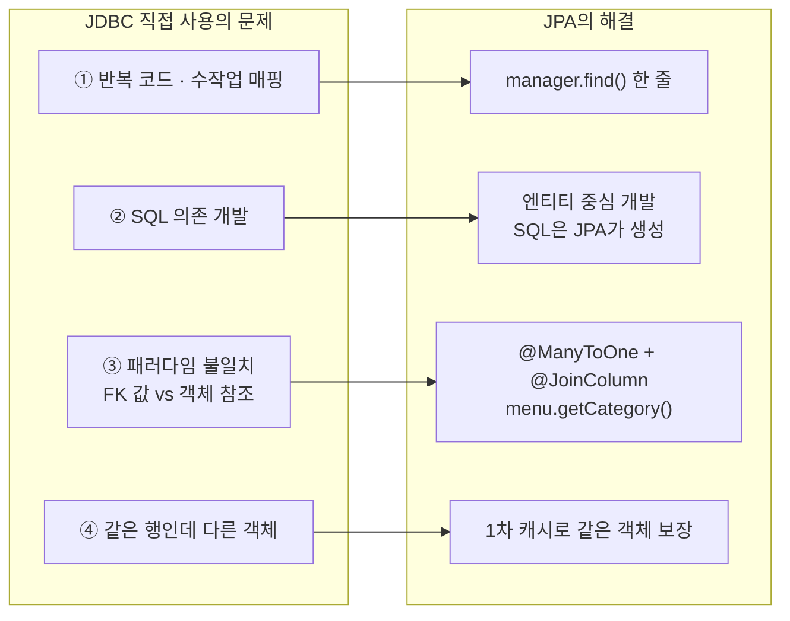

> **이번 글에서 다루는 것**
> 1. ORM · JPA · Hibernate · Spring Data JPA 용어 정리
> 2. Spring Boot + JPA 프로젝트 설정 (`ddl-auto`)
> 3. JDBC를 직접 쓸 때의 4가지 문제: 반복 코드, SQL 의존, **패러다임 불일치**, **동일성 보장**
> 4. JPA가 각 문제를 어떻게 해결하는지 (`@Entity`, `EntityManager`, 1차 캐시)
>
> **JPA(Java Persistence API)** 는 자바 객체와 데이터베이스 테이블을 연결(매핑)해주는 **ORM 기술의 표준**이다. 개발자는 SQL과 `ResultSet` 변환 코드 대신 **객체를 다루듯이** 코드를 작성하고, SQL은 JPA가 대신 만들어 실행한다. JDBC 글에서 직접 작성했던 코드가 얼마나 줄어드는지 비교하며 본다.

**JPA 시리즈**: **01. JPA 입문** → 02. 영속성 컨텍스트 → 03. 엔티티 매핑과 트랜잭션 → 04. 미니 프로젝트

```
com.wanted.jpa
├── section01   ← JdbcProblem : JDBC를 직접 쓸 때의 문제 4가지
└── section02   ← JpaSolution : 같은 기능을 JPA로 해결
```

---

## 1. 용어 먼저 정리

| 용어 | 의미 |
|---|---|
| **ORM** (Object Relational Mapping) | 객체(Object)와 관계형 DB(Relational)를 **자동으로 매핑**해주는 기술 |
| **JPA** | 자바 진영 ORM의 **표준 명세(인터페이스 모음)**. 그 자체로는 동작하는 코드가 없다 |
| **Hibernate** | JPA 명세를 실제로 **구현한 라이브러리**. Spring Boot의 기본 JPA 구현체 |
| **Spring Data JPA** | JPA를 더 쉽게 쓰도록 Spring이 한 번 더 감싼 모듈 (`JpaRepository` 등. 04편에서 사용) |

<div style="margin:1.5em 0;overflow-x:auto"><svg viewBox="0 0 720 300" width="100%" role="img" aria-label="JDBC 직접 사용과 JPA 사용 구조 비교" xmlns="http://www.w3.org/2000/svg" style="max-width:720px;font-family:'Pretendard','Noto Sans KR','Noto Sans CJK KR','Apple SD Gothic Neo','Malgun Gothic',sans-serif"><defs><marker id="jpa1-a1" viewBox="0 0 10 10" refX="9" refY="5" markerWidth="7" markerHeight="7" orient="auto"><path d="M0,0 L10,5 L0,10 z" fill="#3a3530"/></marker></defs><rect width="720" height="300" rx="12" fill="#fbf8f1"/><text x="185" y="34" text-anchor="middle" font-size="15" font-weight="700" fill="#b5523b">JDBC 직접 사용</text><text x="535" y="34" text-anchor="middle" font-size="15" font-weight="700" fill="#2f7f73">JPA 사용</text><line x1="360" y1="20" x2="360" y2="285" stroke="#d8d0c4" stroke-dasharray="4 4"/><rect x="60" y="50" width="250" height="44" rx="8" fill="#e2eaf5" stroke="#3d6a9e"/><text x="185" y="77" text-anchor="middle" font-size="13" fill="#2b2724">Java 애플리케이션</text><line x1="185" y1="94" x2="185" y2="112" stroke="#3a3530" stroke-width="1.5" marker-end="url(#jpa1-a1)"/><rect x="40" y="114" width="290" height="58" rx="8" fill="#f8e1dc" stroke="#b5523b" stroke-dasharray="5 3"/><text x="185" y="138" text-anchor="middle" font-size="13" font-weight="700" fill="#b5523b">개발자가 직접 작성</text><text x="185" y="158" text-anchor="middle" font-size="12" fill="#2b2724">SQL · Connection 관리 · ResultSet → 객체</text><line x1="185" y1="172" x2="185" y2="190" stroke="#3a3530" stroke-width="1.5" marker-end="url(#jpa1-a1)"/><rect x="60" y="192" width="250" height="38" rx="8" fill="#efebe4" stroke="#8a8178"/><text x="185" y="216" text-anchor="middle" font-size="13" fill="#2b2724">JDBC API</text><line x1="185" y1="230" x2="185" y2="246" stroke="#3a3530" stroke-width="1.5" marker-end="url(#jpa1-a1)"/><rect x="60" y="248" width="250" height="36" rx="8" fill="#2b2724"/><text x="185" y="271" text-anchor="middle" font-size="13" fill="#fbf8f1">Database (MySQL)</text><rect x="410" y="50" width="250" height="44" rx="8" fill="#e2eaf5" stroke="#3d6a9e"/><text x="535" y="70" text-anchor="middle" font-size="13" fill="#2b2724">Java 애플리케이션</text><text x="535" y="86" text-anchor="middle" font-size="11" fill="#6b625a">manager.find(Menu.class, 1)</text><line x1="535" y1="94" x2="535" y2="112" stroke="#3a3530" stroke-width="1.5" marker-end="url(#jpa1-a1)"/><rect x="390" y="114" width="290" height="58" rx="8" fill="#e3f1ee" stroke="#2f7f73" stroke-width="1.5"/><text x="535" y="138" text-anchor="middle" font-size="13" font-weight="700" fill="#2f7f73">JPA (구현체 Hibernate)</text><text x="535" y="158" text-anchor="middle" font-size="12" fill="#2b2724">SQL 생성 · 객체 매핑 · 1차 캐시</text><line x1="535" y1="172" x2="535" y2="190" stroke="#3a3530" stroke-width="1.5" marker-end="url(#jpa1-a1)"/><rect x="410" y="192" width="250" height="38" rx="8" fill="#efebe4" stroke="#8a8178"/><text x="535" y="216" text-anchor="middle" font-size="13" fill="#2b2724">JDBC API (내부적으로 사용)</text><line x1="535" y1="230" x2="535" y2="246" stroke="#3a3530" stroke-width="1.5" marker-end="url(#jpa1-a1)"/><rect x="410" y="248" width="250" height="36" rx="8" fill="#2b2724"/><text x="535" y="271" text-anchor="middle" font-size="13" fill="#fbf8f1">Database (MySQL)</text></svg></div>

JPA를 쓴다고 JDBC가 사라지는 것은 아니다. **JPA도 내부적으로는 JDBC를 사용**한다. 개발자가 직접 하던 반복 작업을 JPA가 대신 해주는 것이다.

---

## 2. 프로젝트 설정

### build.gradle

```groovy
dependencies {
    implementation 'org.springframework.boot:spring-boot-starter-data-jpa'
    runtimeOnly 'com.mysql:mysql-connector-j'
    compileOnly 'org.projectlombok:lombok'
    annotationProcessor 'org.projectlombok:lombok'
    ...
}
```

| 의존성 | 역할 |
|---|---|
| `spring-boot-starter-data-jpa` | JPA 표준 + Hibernate + Spring Data JPA + 커넥션 풀(HikariCP) |
| `mysql-connector-j` | MySQL과 통신하는 JDBC 드라이버. 실행할 때만 필요해서 `runtimeOnly` |

### application.yaml

```yaml
spring:
  # mysql 의존성을 추가하면 DB 정보를 작성해야 애플리케이션이 실행된다.
  datasource:
    driver-class-name: com.mysql.cj.jdbc.Driver
    url: jdbc:mysql://localhost:3306/menudb
    username: wanted
    password: wanted
  jpa:
    show-sql: true          # JPA가 만든 SQL을 콘솔에 출력
    hibernate:
      ddl-auto: none        # 테이블 자동 생성 전략
    properties:
      hibernate:
        format_sql: true    # 출력되는 SQL을 보기 좋게 줄바꿈
```

**`ddl-auto` 옵션**

| 값 | 동작 | 언제 |
|---|---|---|
| `create` | 실행 시 기존 테이블 **삭제 후** 새로 생성 | 학습, 초기 개발 |
| `create-drop` | `create` + 종료 시 테이블 삭제 | 테스트 |
| `update` | 엔티티와 테이블을 비교해 **변경된 부분만** 반영 (컬럼 추가 등) | 개발 중 |
| `validate` | 엔티티와 테이블이 맞는지 **검사만** (다르면 실행 실패) | 운영 |
| `none` | 아무것도 안 함. 미리 작성해둔 DDL 스크립트로만 테이블 관리 | 운영, 이번 실습 |

> ⚠️ 운영 DB에 `create`나 `update`를 쓰면 **데이터가 삭제되거나 테이블이 의도치 않게 바뀔 수 있다.** 운영 환경은 `validate` 또는 `none`이 원칙이다.

> 💡 DB 비밀번호를 `application.yaml`에 그대로 적고 GitHub에 올리면 그대로 노출된다. 실습용이 아니라면 환경 변수(`${DB_PASSWORD}`)로 분리하자.

---

## 3. Section01 — JDBC를 직접 사용할 때의 문제점

Spring이 `DataSource`(커넥션 풀)는 만들어주지만, **SQL 작성·실행·`ResultSet` → 객체 변환은 모두 개발자 몫**이다.

```java
@Component
public class JdbcProblem {

    private final DataSource dataSource;   // Spring이 만들어 준 커넥션 풀

    public JdbcProblem(DataSource dataSource) {
        this.dataSource = dataSource;
    }
    ...
}
```

### 문제 1. 반복 코드와 수작업 매핑

```java
public void findAllMenu() {
    String query = "SELECT menu_code, menu_name, menu_price, category_code, orderable_status FROM tbl_menu";
    List<Menu> menuList = new ArrayList<>();

    // try-with-resources : 블럭이 끝나면 Connection, Statement, ResultSet 자동 반납
    try (Connection con = dataSource.getConnection();
         Statement stmt = con.createStatement();
         ResultSet rset = stmt.executeQuery(query)) {

        while (rset.next()) {
            // 조회 결과(행) 1개를 객체 1개로 직접 옮겨 담는다.
            Menu menu = new Menu();
            menu.setMenuCode(rset.getInt("menu_code"));
            menu.setMenuName(rset.getString("menu_name"));
            menu.setMenuPrice(rset.getInt("menu_price"));
            menu.setCategoryCode(rset.getInt("category_code"));
            menu.setOrderableStatus(rset.getString("orderable_status"));
            menuList.add(menu);
        }
    } catch (SQLException e) {
        throw new RuntimeException(e);
    }
}
```

- Connection, Statement, ResultSet을 **생성하고 반납하는 코드가 조회마다 반복**된다.
- `ResultSet`의 컬럼 값을 객체 필드에 **하나씩 옮겨 담는 코드**도 직접 써야 한다.
- 결과: 개발 시간 증가, 불필요한 반복, 유지보수성 악화. 컬럼 이름 오타 하나도 **실행해봐야** 알 수 있다.

### 문제 2. SQL에 의존적인 개발

요구사항이 바뀐다: **"메뉴 목록을 조회할 때 카테고리 이름도 같이 보여주세요!"**

```java
String query = "SELECT m.menu_code, m.menu_name, m.menu_price, c.category_name, m.orderable_status " +
               "FROM tbl_menu m " +
               "JOIN tbl_category c ON m.category_code = c.category_code " +
               "ORDER BY m.menu_code";

List<MenuCategoryDTO> menuList = new ArrayList<>();   // 결과를 담을 클래스도 새로 만들어야 함
// ... 1번과 거의 같은 JDBC 코드를 또 작성 ...
```

요구사항 하나가 바뀌었을 뿐인데 연쇄적으로 수정된다.



**객체 중심이 아니라 SQL(테이블) 중심으로 개발**하게 되는 것이다. 이런 식이면 SQL이 바뀔 때마다 `MenuCategoryDTO` 같은 클래스가 계속 늘어난다.

### 문제 3. 패러다임 불일치

**테이블과 객체는 "관계"를 표현하는 방식이 다르다.**

<div style="margin:1.5em 0;overflow-x:auto"><svg viewBox="0 0 720 270" width="100%" role="img" aria-label="테이블은 외래키 값으로, 객체는 참조로 연관관계를 표현한다" xmlns="http://www.w3.org/2000/svg" style="max-width:720px;font-family:'Pretendard','Noto Sans KR','Noto Sans CJK KR','Apple SD Gothic Neo','Malgun Gothic',sans-serif"><defs><marker id="jpa1-a2" viewBox="0 0 10 10" refX="9" refY="5" markerWidth="7" markerHeight="7" orient="auto"><path d="M0,0 L10,5 L0,10 z" fill="#b5523b"/></marker><marker id="jpa1-a3" viewBox="0 0 10 10" refX="9" refY="5" markerWidth="7" markerHeight="7" orient="auto"><path d="M0,0 L10,5 L0,10 z" fill="#2f7f73"/></marker></defs><rect width="720" height="270" rx="12" fill="#fbf8f1"/><text x="180" y="30" text-anchor="middle" font-size="15" font-weight="700" fill="#2b2724">테이블 (SQL)</text><text x="540" y="30" text-anchor="middle" font-size="15" font-weight="700" fill="#2b2724">객체 (Java)</text><line x1="360" y1="15" x2="360" y2="255" stroke="#d8d0c4" stroke-dasharray="4 4"/><g font-family="'D2Coding','JetBrains Mono',Consolas,monospace" font-size="11"><rect x="15" y="50" width="185" height="24" fill="#3d6a9e"/><text x="25" y="66" fill="#fff" font-weight="700">tbl_menu</text><rect x="15" y="74" width="185" height="120" fill="#fff" stroke="#3d6a9e"/><text x="25" y="92" fill="#2b2724">menu_code</text><text x="190" y="92" text-anchor="end" fill="#3d6a9e" font-weight="700">PK</text><text x="25" y="116" fill="#2b2724">menu_name</text><text x="25" y="140" fill="#2b2724">menu_price</text><rect x="16" y="147" width="183" height="22" fill="#f8e1dc"/><text x="25" y="162" fill="#b5523b" font-weight="700">category_code</text><text x="190" y="162" text-anchor="end" fill="#b5523b" font-weight="700">FK</text><text x="25" y="186" fill="#2b2724">orderable_status</text><rect x="225" y="98" width="125" height="24" fill="#3d6a9e"/><text x="235" y="114" fill="#fff" font-weight="700">tbl_category</text><rect x="225" y="122" width="125" height="72" fill="#fff" stroke="#3d6a9e"/><rect x="226" y="126" width="123" height="22" fill="#f8e1dc"/><text x="235" y="141" fill="#b5523b" font-weight="700">category_code</text><text x="235" y="164" fill="#2b2724">category_name</text><text x="235" y="186" fill="#2b2724">ref_category_code</text><rect x="380" y="50" width="170" height="24" fill="#2f7f73"/><text x="390" y="66" fill="#fff" font-weight="700">Menu</text><rect x="380" y="74" width="170" height="120" fill="#fff" stroke="#2f7f73"/><text x="390" y="92" fill="#2b2724">menuCode</text><text x="390" y="116" fill="#2b2724">menuName</text><text x="390" y="140" fill="#2b2724">menuPrice</text><rect x="381" y="147" width="168" height="22" fill="#e3f1ee"/><text x="390" y="162" fill="#2f7f73" font-weight="700">category : Category</text><text x="390" y="186" fill="#2b2724">orderableStatus</text><rect x="580" y="98" width="125" height="24" fill="#2f7f73"/><text x="590" y="114" fill="#fff" font-weight="700">Category</text><rect x="580" y="122" width="125" height="72" fill="#fff" stroke="#2f7f73"/><text x="590" y="141" fill="#2b2724">categoryCode</text><text x="590" y="164" fill="#2b2724">categoryName</text><text x="590" y="186" fill="#2b2724">refCategoryCode</text></g><path d="M200,158 C212,158 212,137 223,137" fill="none" stroke="#b5523b" stroke-width="1.8" marker-end="url(#jpa1-a2)"/><path d="M550,158 C566,158 562,110 578,110" fill="none" stroke="#2f7f73" stroke-width="1.8" marker-end="url(#jpa1-a3)"/><rect x="25" y="210" width="320" height="44" rx="8" fill="#f8e1dc"/><text x="185" y="229" text-anchor="middle" font-size="12.5" fill="#2b2724">숫자 "값"으로만 연결되어 있다</text><text x="185" y="246" text-anchor="middle" font-size="12.5" font-weight="700" fill="#b5523b">→ JOIN 또는 SQL을 한 번 더 실행</text><rect x="375" y="210" width="320" height="44" rx="8" fill="#e3f1ee"/><text x="535" y="229" text-anchor="middle" font-size="12.5" fill="#2b2724">객체 "참조"로 연결되어 있다</text><text x="535" y="246" text-anchor="middle" font-size="12.5" font-weight="700" fill="#2f7f73">→ menu.getCategory() 로 바로 탐색</text></svg></div>

| 관점 | 1:N 관계 표현 |
|---|---|
| SQL | 엔티티 간 연관성을 **FK 값**으로 가진다 (`tbl_menu`는 `category_code`라는 **숫자**를 가짐) |
| Java | 연관된 객체를 **필드(참조)** 로 가진다 (`Menu`가 `Category` 객체를 가짐) |

그런데 JDBC 방식은 테이블에 맞춰 객체를 만들기 때문에 `Menu`가 `categoryCode` 값만 갖고 있다. 카테고리 정보가 필요하면:

```java
public void findMenuAndCategory(int menuCode) {
    Menu menu = findMenuByMenuCode(menuCode);

    // menu.getCategory() 처럼 객체를 탐색할 수 없다.
    // categoryCode 값으로 카테고리를 다시 조회해야 한다.
    Category category = findCategoryByCategoryCode(menu.getCategoryCode());
}
```

SQL을 **한 번 더 실행하고 직접 조립**해야 한다. 이렇게 객체 모델과 테이블 모델이 맞지 않는 것을 **패러다임 불일치**라고 한다.

> 💡 `ref_category_code`는 NULL이 허용되는 컬럼이라 `rset.getInt()`로 꺼내면 NULL이 `0`으로 바뀌어버린다. 그래서 `rset.getObject("ref_category_code", Integer.class)`로 꺼내고, 필드도 `int`가 아니라 **`Integer`** 로 선언한다.

### 문제 4. 동일성 보장 문제 ⭐

```java
public void compareSameMenu(int menuCode) {
    Menu menu1 = findMenuByMenuCode(menuCode);
    Menu menu2 = findMenuByMenuCode(menuCode);

    System.out.println("menu1 == menu2 : " + (menu1 == menu2));   // false

    menu1.setMenuName("이름 변경 테스트");
    System.out.println("menu1.getMenuName() = " + menu1.getMenuName());   // 이름 변경 테스트
    System.out.println("menu2.getMenuName() = " + menu2.getMenuName());   // 원래 이름 그대로
}
```

DB의 **같은 행**을 꺼냈는데 **서로 다른 객체**에 담긴다. 그래서 한 객체를 수정해도 **다른 객체는 수정 사실을 모른다.** 같은 데이터가 메모리에 여러 버전으로 존재하게 되어 버그의 원인이 된다.

---

## 4. Section02 — JPA로 해결하기

### 엔티티(Entity) 매핑

```java
@Entity                       // JPA가 관리하는 객체라는 것을 명시
@Table(name = "tbl_menu")     // 매핑될 테이블 이름
@NoArgsConstructor
@AllArgsConstructor
@Getter
@ToString
public class Menu {

    @Id                                // 엔티티는 반드시 식별자(PK)가 필요
    @Column(name = "menu_code")        // 필드 ↔ 컬럼 매칭
    private int menuCode;

    @Column(name = "menu_name")
    private String menuName;

    @Column(name = "menu_price")
    private int menuPrice;

    // categoryCode(FK 값) 대신 Category 엔티티 자체를 필드로 가진다.
    @ManyToOne                               // 다(Menu) : 1(Category) 관계
    @JoinColumn(name = "category_code")      // 어떤 FK 컬럼으로 연결되는지
    private Category category;

    @Column(name = "orderable_status")
    private String orderableStatus;

    public void changeMenuName(String s) {
        this.menuName = s;
    }
}
```

```java
@Entity
@Table(name = "tbl_category")
public class Category {
    @Id
    @Column(name = "category_code")
    private int categoryCode;

    @Column(name = "category_name")
    private String categoryName;

    @Column(name = "ref_category_code")
    private Integer refCategoryCode;
}
```

| 어노테이션 | 의미 |
|---|---|
| `@Entity` | JPA가 관리하는 클래스(엔티티)임을 선언 |
| `@Table(name)` | 매핑할 테이블 이름. 생략하면 클래스 이름 사용 |
| `@Id` | 기본 키(PK) 필드. **엔티티에 반드시 있어야 함** |
| `@Column(name)` | 매핑할 컬럼 이름. 생략하면 필드 이름 사용 |
| `@ManyToOne` | N:1 연관관계. 여러 Menu가 하나의 Category에 속함 |
| `@JoinColumn(name)` | 연관관계에 사용할 **FK 컬럼** 이름 |

**엔티티 클래스 작성 규칙**

- **기본 생성자 필수** (`public` 또는 `protected`). JPA는 리플렉션으로 `new Menu()` 후 값을 채우기 때문이다. 그래서 `@NoArgsConstructor`가 붙어 있다.
- `final` 클래스, `final` 필드는 쓰면 안 된다. (프록시 객체 생성에 필요)
- 엔티티는 DB의 한 행이므로 `@Setter`를 무분별하게 열기보다, 이 코드의 `changeMenuName()`처럼 **의미 있는 이름의 메서드**로 값을 바꾸는 것이 좋다.

### EntityManager

```java
@Component
public class JpaSolution {

    /*
     * PersistenceContext는 Entity 객체를 관리하는 컨테이너이다.
     * 애플리케이션에서 만든 Entity를 EntityManager를 통해 PersistenceContext에 넣거나 조회할 수 있다.
     */
    @PersistenceContext
    private EntityManager manager;
    ...
}
```

- **EntityManager**: 엔티티를 저장·조회·수정·삭제하는 **JPA의 핵심 객체**. "1번 메뉴 찾아줘"라고 요청하면 SQL을 만들어 실행한다.
- **영속성 컨텍스트(Persistence Context)**: EntityManager 안에서 엔티티를 **보관·관리하는 공간**. 02편에서 자세히 다룬다.

### 해결 1 — SQL·JDBC 코드·매핑 자동화

```java
public void findMenu(int menuCode) {
    Menu foundMenu = manager.find(Menu.class, menuCode);   // 엔티티 타입, PK 값
    System.out.println(foundMenu);
}
```

JDBC에서 수십 줄이던 코드가 **한 줄**이 됐다. SQL 작성, JDBC 코드, DB 데이터 ↔ 객체 매핑을 JPA가 자동으로 해준다. `show-sql: true`이므로 콘솔에서 JPA가 만든 SQL을 확인할 수 있다.

```sql
select
    m1_0.menu_code,
    c1_0.category_code,
    c1_0.category_name,
    c1_0.ref_category_code,
    m1_0.menu_name,
    m1_0.menu_price,
    m1_0.orderable_status
from
    tbl_menu m1_0
left join
    tbl_category c1_0
        on c1_0.category_code=m1_0.category_code
where
    m1_0.menu_code=?
```

### 해결 2 — 패러다임 불일치 해결 (객체 그래프 탐색)

위 SQL을 보면 **JOIN이 자동으로** 들어가 있다. `Menu`가 `Category`를 필드로 가지고 있으니, JPA가 카테고리까지 함께 조회해 객체에 채워준다.

```java
Menu foundMenu = manager.find(Menu.class, 2);
String categoryName = foundMenu.getCategory().getCategoryName();   // 객체 그래프 탐색
```

```
Menu(menuCode=2, menuName=..., menuPrice=..., category=Category(categoryCode=10, categoryName=기타, refCategoryCode=2), orderableStatus=Y)
```

요구사항이 "카테고리 이름도 보여주세요"로 바뀌어도 SQL, DTO, 매핑 코드를 고칠 필요가 없다. **객체를 따라가기만 하면 된다.**

> 💡 **@ManyToOne의 기본 조회 방식**: `@ManyToOne`은 기본값이 **즉시 로딩(`FetchType.EAGER`)** 이라 Menu를 조회할 때 Category를 항상 JOIN해서 가져온다. 실무에서는 필요할 때만 조회하는 **지연 로딩(`FetchType.LAZY`)** 을 기본으로 쓰는 것이 권장된다. 즉시 로딩은 목록 조회 시 예상치 못한 쿼리가 대량으로 나가는 **N+1 문제**의 원인이 되기 때문이다. 연관관계 매핑을 배울 때 다시 나오는 중요한 주제다.

### 해결 3 — 동일성 보장 ⭐

```java
@Transactional(readOnly = true)
public void compareSameMenu(int menuCode) {

    System.out.println("================1번째 조회================");
    Menu menu1 = manager.find(Menu.class, menuCode);

    System.out.println("================2번째 조회================");
    Menu menu2 = manager.find(Menu.class, menuCode);

    System.out.println("menu1 == menu2 : " + (menu1 == menu2));   // true!

    menu1.changeMenuName("테스트!");
    System.out.println("menu1 = " + menu1.getMenuName());   // 테스트!
    System.out.println("menu2 = " + menu2.getMenuName());   // 테스트!  ← 같은 객체이므로
}
```

> **같은 트랜잭션 안에서 같은 PK로 조회한 엔티티는 항상 같은 객체(==)를 반환한다.**

<div style="margin:1.5em 0;overflow-x:auto"><svg viewBox="0 0 720 260" width="100%" role="img" aria-label="JDBC는 조회마다 새 객체를 만들고 JPA는 1차 캐시의 같은 객체를 반환한다" xmlns="http://www.w3.org/2000/svg" style="max-width:720px;font-family:'Pretendard','Noto Sans KR','Noto Sans CJK KR','Apple SD Gothic Neo','Malgun Gothic',sans-serif"><defs><marker id="jpa1-a4" viewBox="0 0 10 10" refX="9" refY="5" markerWidth="7" markerHeight="7" orient="auto"><path d="M0,0 L10,5 L0,10 z" fill="#3a3530"/></marker></defs><rect width="720" height="260" rx="12" fill="#fbf8f1"/><text x="180" y="30" text-anchor="middle" font-size="15" font-weight="700" fill="#b5523b">JDBC</text><text x="540" y="30" text-anchor="middle" font-size="15" font-weight="700" fill="#2f7f73">JPA (같은 트랜잭션 안)</text><line x1="360" y1="15" x2="360" y2="245" stroke="#d8d0c4" stroke-dasharray="4 4"/><rect x="25" y="95" width="105" height="50" rx="8" fill="#2b2724"/><text x="77" y="116" text-anchor="middle" font-size="12" fill="#fbf8f1">DB</text><text x="77" y="133" text-anchor="middle" font-size="11" fill="#d8d0c4">menu_code = 1</text><rect x="205" y="55" width="135" height="44" rx="8" fill="#fff" stroke="#b5523b"/><text x="272" y="74" text-anchor="middle" font-size="12" font-weight="700" fill="#2b2724">menu1</text><text x="272" y="91" text-anchor="middle" font-size="11" fill="#6b625a">Menu@1a2b</text><rect x="205" y="140" width="135" height="44" rx="8" fill="#fff" stroke="#b5523b"/><text x="272" y="159" text-anchor="middle" font-size="12" font-weight="700" fill="#2b2724">menu2</text><text x="272" y="176" text-anchor="middle" font-size="11" fill="#6b625a">Menu@3c4d</text><line x1="130" y1="110" x2="202" y2="80" stroke="#3a3530" stroke-width="1.5" marker-end="url(#jpa1-a4)"/><line x1="130" y1="130" x2="202" y2="160" stroke="#3a3530" stroke-width="1.5" marker-end="url(#jpa1-a4)"/><text x="160" y="84" text-anchor="middle" font-size="11" fill="#6b625a">SELECT ①</text><text x="160" y="166" text-anchor="middle" font-size="11" fill="#6b625a">SELECT ②</text><rect x="40" y="205" width="290" height="34" rx="8" fill="#f8e1dc"/><text x="185" y="227" text-anchor="middle" font-size="13" font-weight="700" fill="#b5523b">menu1 == menu2 → false</text><rect x="385" y="95" width="95" height="50" rx="8" fill="#2b2724"/><text x="432" y="116" text-anchor="middle" font-size="12" fill="#fbf8f1">DB</text><text x="432" y="133" text-anchor="middle" font-size="11" fill="#d8d0c4">menu_code = 1</text><rect x="530" y="50" width="165" height="70" rx="8" fill="#e3f1ee" stroke="#2f7f73" stroke-width="1.5"/><text x="612" y="70" text-anchor="middle" font-size="12" font-weight="700" fill="#2f7f73">1차 캐시</text><rect x="545" y="80" width="135" height="28" rx="4" fill="#fff" stroke="#2f7f73"/><text x="612" y="99" text-anchor="middle" font-size="11" font-family="'D2Coding','JetBrains Mono',Consolas,monospace" fill="#2b2724">@Id 1 → Menu@1a2b</text><line x1="480" y1="110" x2="527" y2="95" stroke="#3a3530" stroke-width="1.5" marker-end="url(#jpa1-a4)"/><text x="505" y="82" text-anchor="middle" font-size="10.5" fill="#2f7f73" font-weight="700">SELECT 1번만</text><rect x="530" y="155" width="75" height="34" rx="8" fill="#fff" stroke="#2f7f73"/><text x="567" y="177" text-anchor="middle" font-size="12" font-weight="700" fill="#2b2724">menu1</text><rect x="620" y="155" width="75" height="34" rx="8" fill="#fff" stroke="#2f7f73"/><text x="657" y="177" text-anchor="middle" font-size="12" font-weight="700" fill="#2b2724">menu2</text><line x1="567" y1="155" x2="590" y2="111" stroke="#2f7f73" stroke-width="1.5" marker-end="url(#jpa1-a4)"/><line x1="657" y1="155" x2="634" y2="111" stroke="#2f7f73" stroke-width="1.5" marker-end="url(#jpa1-a4)"/><rect x="390" y="205" width="300" height="34" rx="8" fill="#e3f1ee"/><text x="540" y="227" text-anchor="middle" font-size="13" font-weight="700" fill="#2f7f73">menu1 == menu2 → true</text></svg></div>

**수업 중 의문: "`@Transactional`을 단 순간 같은 주소값이 나온다. 다른 인스턴스 같은데 같은 값?"**

실제로 **같은 인스턴스**다. 동작 순서는 다음과 같다.



1. 첫 번째 `find()`: 영속성 컨텍스트의 **1차 캐시**에 1번 메뉴가 없으므로 DB에 SELECT → 결과를 1차 캐시에 저장하고 그 객체를 반환
2. 두 번째 `find()`: 1차 캐시에 이미 1번 메뉴가 있으므로 **SQL 없이** 캐시에 있는 **그 객체를 그대로** 반환

그래서 콘솔에도 SELECT가 **한 번만** 찍힌다. "1번째 조회" 아래에만 SQL이 보이고 "2번째 조회" 아래에는 아무것도 없다.

> 💡 **`@Transactional`을 빼면 왜 다른 객체일까?** `@PersistenceContext`로 주입받은 EntityManager는 진짜 EntityManager가 아니라 **현재 트랜잭션에 맞는 EntityManager를 찾아 연결해주는 대리 객체(프록시)** 다. 트랜잭션이 없으면 `find()`를 호출할 때마다 **새 EntityManager(= 새 영속성 컨텍스트)** 가 만들어졌다가 바로 닫힌다. 1차 캐시를 공유하지 못하니 SELECT가 두 번 나가고 객체도 달라진다. 즉 동일성 보장의 범위는 **"같은 영속성 컨텍스트"** 이고, 보통 **같은 트랜잭션**과 같다.

**`@Transactional` 정리**

- 메서드가 시작될 때 트랜잭션을 시작하고, 정상 종료되면 **commit**, 예외가 발생하면 **rollback**을 자동으로 처리한다.
- `readOnly = true`는 **조회 전용** 트랜잭션이다.

> 💡 위 예제에서 `menu1.changeMenuName("테스트!")`로 이름을 바꿨지만 **DB에는 반영되지 않는다.** `readOnly = true` 트랜잭션에서는 Hibernate가 변경 사항을 DB로 보내는 작업(flush)을 하지 않기 때문이다. 변경 감지(Dirty Checking)는 02편에서 다룬다.

---

## 5. 한눈에 정리



| JDBC의 문제 | JPA의 해결 |
|---|---|
| 반복되는 JDBC 코드, 수작업 매핑 | `manager.find(Menu.class, 1)` 한 줄. SQL·매핑 자동 |
| SQL에 의존적인 개발 (요구사항 변경 → SQL·DTO·매핑 연쇄 수정) | 엔티티 중심 개발. 필요한 SQL은 JPA가 생성 |
| 패러다임 불일치 (FK 값 vs 객체 참조) | `@ManyToOne` + `@JoinColumn`으로 객체 참조 매핑, `menu.getCategory()` 탐색 |
| 같은 행인데 다른 객체 | 같은 트랜잭션 안에서는 1차 캐시로 **같은 객체 보장** |

- **핵심 키워드** : ORM, JPA(표준) / Hibernate(구현체), `@Entity`, `@Id`, `EntityManager`, 영속성 컨텍스트, 1차 캐시, `@Transactional`
