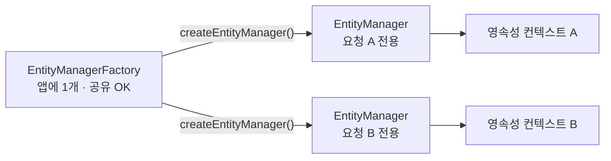
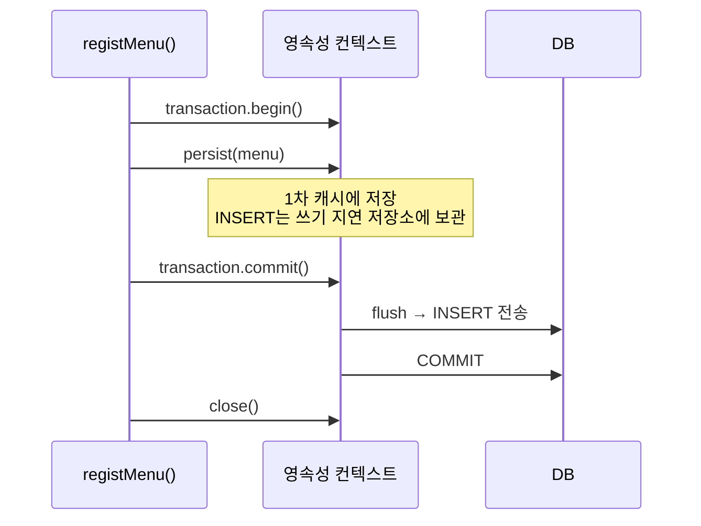
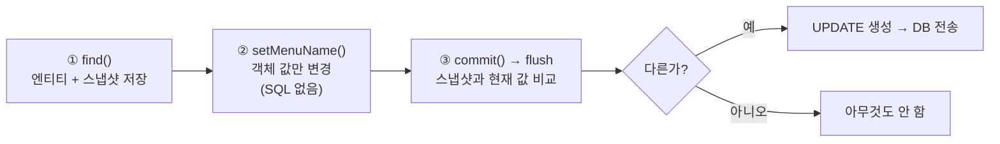
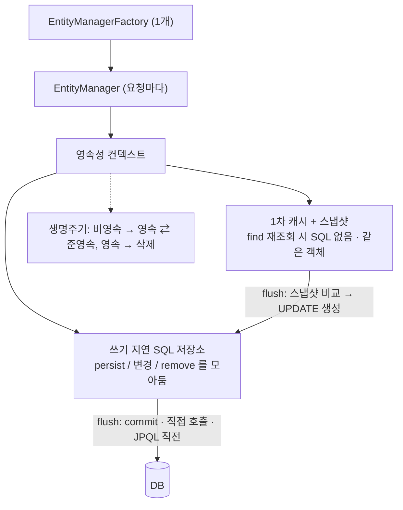

> **이번 글에서 다루는 것**
> 1. EntityManagerFactory와 EntityManager의 차이
> 2. 영속성 컨텍스트의 구조: **1차 캐시 · 스냅샷 · 쓰기 지연 SQL 저장소 · flush**
> 3. EntityManager로 CRUD: `find` / `persist` / 변경 감지 / `remove`
> 4. 엔티티 생명주기: 비영속 · 영속 · 준영속 · 삭제
> 5. `flush`와 `merge`를 정확히 이해하기
>
> **영속성 컨텍스트(Persistence Context)** 는 "엔티티를 영구 저장하는 환경"으로, EntityManager 안에서 엔티티를 **보관(1차 캐시)하고, 변경을 추적(스냅샷)하고, SQL을 모아뒀다가(쓰기 지연) 한 번에 DB로 보내는(flush)** 중간 관리자다. 01편의 동일성 보장도, 03편의 `@Transactional`도 모두 이 공간을 중심으로 돌아간다.

**JPA 시리즈**: 01. JPA 입문 → **02. 영속성 컨텍스트** → 03. 엔티티 매핑과 트랜잭션 → 04. 미니 프로젝트

```
com.wanted.persistence
├── section01   ← EntityManagerCRUD : find / persist / 변경 감지 / remove
└── section02   ← EntityLifeCycle   : 비영속 · 영속 · 준영속 · 삭제 · merge
```

---

## 1. EntityManagerFactory와 EntityManager

```java
@Component
public class EntityManagerCRUD {

    // @PersistenceContext
    // private EntityManager manager;
    private final EntityManagerFactory factory;

    public EntityManagerCRUD(EntityManagerFactory factory) {
        this.factory = factory;
    }

    public void findMenuByMenuCode(int menuCode) {
        // manager는 요청 1회마다 생성하고, 요청이 끝나면 없앤다.
        EntityManager manager = factory.createEntityManager();

        Menu foundMenu = manager.find(Menu.class, menuCode);
        System.out.println("foundMenu = " + foundMenu);

        manager.close();
    }
}
```

| 구분 | EntityManagerFactory | EntityManager |
|---|---|---|
| 개수 | 애플리케이션 전체에 **1개** | 요청(작업)마다 **새로 생성** |
| 생성 비용 | 크다 (DB 연결 정보, 엔티티 매핑 정보 분석) | 작다 |
| 여러 스레드 공유 | 가능 (thread-safe) | **불가능** (thread-unsafe) |
| 역할 | EntityManager를 만드는 공장 | 엔티티 CRUD + 영속성 컨텍스트 관리 |



EntityManager는 여러 요청이 함께 쓰면 안 된다. 그래서 수업 코드는 **기능(메서드) 1번 실행마다 EntityManager를 만들고 `close()`** 한다.

> 💡 **01편과 03편에서는 `@PersistenceContext`로 필드에 주입했는데 괜찮을까?** 괜찮다. Spring이 `@PersistenceContext`로 넣어주는 것은 진짜 EntityManager가 아니라 **현재 트랜잭션에 맞는 EntityManager를 찾아 연결해주는 프록시**라서 여러 스레드가 써도 안전하다. 이번 챕터는 영속성 컨텍스트의 동작을 **눈으로 확인하기 위해** 일부러 Factory에서 직접 만들고 닫는 방식을 쓴 것이다.

---

## 2. 영속성 컨텍스트의 구조

<div style="margin:1.5em 0;overflow-x:auto"><svg viewBox="0 0 720 320" width="100%" role="img" aria-label="영속성 컨텍스트 내부 구조: 1차 캐시, 스냅샷, 쓰기 지연 SQL 저장소, flush" xmlns="http://www.w3.org/2000/svg" style="max-width:720px;font-family:'Pretendard','Noto Sans KR','Noto Sans CJK KR','Apple SD Gothic Neo','Malgun Gothic',sans-serif"><defs><marker id="jpa2-a1" viewBox="0 0 10 10" refX="9" refY="5" markerWidth="7" markerHeight="7" orient="auto"><path d="M0,0 L10,5 L0,10 z" fill="#3a3530"/></marker></defs><rect width="720" height="320" rx="12" fill="#fbf8f1"/><rect x="15" y="105" width="125" height="110" rx="10" fill="#e2eaf5" stroke="#3d6a9e"/><text x="77" y="128" text-anchor="middle" font-size="13" font-weight="700" fill="#2b2724">애플리케이션</text><g font-family="'D2Coding','JetBrains Mono',Consolas,monospace" font-size="11" fill="#3d6a9e"><text x="77" y="150" text-anchor="middle">persist()</text><text x="77" y="166" text-anchor="middle">find()</text><text x="77" y="182" text-anchor="middle">setXxx()</text><text x="77" y="198" text-anchor="middle">remove()</text></g><line x1="140" y1="160" x2="172" y2="160" stroke="#3a3530" stroke-width="1.5" marker-end="url(#jpa2-a1)"/><rect x="175" y="20" width="390" height="285" rx="12" fill="#e3f1ee" stroke="#2f7f73" stroke-width="1.5"/><text x="370" y="44" text-anchor="middle" font-size="14" font-weight="700" fill="#2f7f73">EntityManager · 영속성 컨텍스트</text><rect x="195" y="58" width="350" height="24" rx="4" fill="#2f7f73"/><text x="370" y="75" text-anchor="middle" font-size="12" font-weight="700" fill="#fff">1차 캐시 (Map : @Id → 엔티티)</text><rect x="195" y="82" width="350" height="88" fill="#fff" stroke="#2f7f73"/><g font-size="11.5"><text x="220" y="100" text-anchor="middle" font-weight="700" fill="#6b625a">@Id</text><text x="320" y="100" text-anchor="middle" font-weight="700" fill="#6b625a">엔티티 (현재 값)</text><text x="470" y="100" text-anchor="middle" font-weight="700" fill="#6b625a">스냅샷 (조회 시점 값)</text><line x1="195" y1="107" x2="545" y2="107" stroke="#cfe3de"/><line x1="245" y1="82" x2="245" y2="170" stroke="#cfe3de"/><line x1="395" y1="82" x2="395" y2="170" stroke="#cfe3de"/><text x="220" y="128" text-anchor="middle" fill="#2b2724">1</text><text x="320" y="128" text-anchor="middle" fill="#2b2724">열무김치라떼</text><text x="470" y="128" text-anchor="middle" fill="#2b2724">열무김치라떼</text><line x1="195" y1="138" x2="545" y2="138" stroke="#cfe3de"/><rect x="246" y="139" width="298" height="30" fill="#fbecd6"/><text x="220" y="159" text-anchor="middle" fill="#2b2724">2</text><text x="320" y="159" text-anchor="middle" font-weight="700" fill="#c47f22">바나나스무디</text><text x="470" y="159" text-anchor="middle" fill="#2b2724">우럭스무디</text></g><text x="370" y="188" text-anchor="middle" font-size="11" fill="#c47f22">↓ 2번은 스냅샷과 다르다 → 변경 감지 → UPDATE 생성</text><rect x="195" y="198" width="350" height="24" rx="4" fill="#c47f22"/><text x="370" y="215" text-anchor="middle" font-size="12" font-weight="700" fill="#fff">쓰기 지연 SQL 저장소</text><rect x="195" y="222" width="350" height="70" fill="#fff" stroke="#c47f22"/><g font-family="'D2Coding','JetBrains Mono',Consolas,monospace" font-size="11" fill="#2b2724"><text x="207" y="242">INSERT INTO tbl_menu ...</text><text x="535" y="242" text-anchor="end" fill="#6b625a" font-family="'Pretendard','Noto Sans KR','Noto Sans CJK KR',sans-serif">← persist</text><text x="207" y="262">UPDATE tbl_menu SET ...</text><text x="535" y="262" text-anchor="end" fill="#6b625a" font-family="'Pretendard','Noto Sans KR','Noto Sans CJK KR',sans-serif">← 변경 감지</text><text x="207" y="282">DELETE FROM tbl_menu ...</text><text x="535" y="282" text-anchor="end" fill="#6b625a" font-family="'Pretendard','Noto Sans KR','Noto Sans CJK KR',sans-serif">← remove</text></g><rect x="600" y="215" width="105" height="70" rx="10" fill="#2b2724"/><text x="652" y="255" text-anchor="middle" font-size="14" font-weight="700" fill="#fbf8f1">DB</text><line x1="545" y1="255" x2="597" y2="255" stroke="#3a3530" stroke-width="2" marker-end="url(#jpa2-a1)"/><text x="572" y="246" text-anchor="middle" font-size="11.5" font-weight="700" fill="#b5523b">flush()</text><path d="M630,215 L630,124 L548,124" fill="none" stroke="#3d6a9e" stroke-width="1.5" stroke-dasharray="5 3" marker-end="url(#jpa2-a1)"/><g font-size="11" fill="#3d6a9e"><text x="640" y="150">find() 시</text><text x="640" y="166">캐시에 없으면</text><text x="640" y="182">SELECT</text></g></svg></div>

| 구성 요소 | 역할 |
|---|---|
| **1차 캐시** | 조회·저장한 엔티티를 `@Id`를 key로 보관. 같은 PK를 다시 조회하면 **DB에 가지 않고** 여기서 꺼냄 |
| **스냅샷** | 엔티티가 처음 영속 상태가 될 때의 값을 복사해둔 것. 나중에 **무엇이 바뀌었는지** 비교하는 기준 |
| **쓰기 지연 SQL 저장소** | INSERT·UPDATE·DELETE를 **바로 실행하지 않고 모아두는** 곳 |
| **flush** | 쓰기 지연 저장소의 SQL을 **DB로 전송**하는 작업 |

---

## 3. Section01 — EntityManager로 CRUD

### 조회 : `find(엔티티 타입, PK)`

```java
EntityManager manager = factory.createEntityManager();
Menu foundMenu = manager.find(Menu.class, menuCode);
manager.close();
```

- 1차 캐시 확인 → 없으면 DB에 SELECT → 결과를 1차 캐시에 저장 → 반환
- **조회는 트랜잭션 없이도** 가능하다.
- 해당 PK의 데이터가 없으면 `null`을 반환한다.

### 등록 : `persist(엔티티)`

```java
public void registMenu(Menu menu) {
    EntityManager manager = factory.createEntityManager();

    // DML(INSERT, UPDATE, DELETE)은 트랜잭션이 매우 중요하다.
    // 오류가 발생하면 반드시 롤백이 필요하다.
    EntityTransaction transaction = manager.getTransaction();
    transaction.begin();   // 이 아래부터 트랜잭션 적용

    try {
        // CUD 작업 시 SQL을 DB에 바로 반영하지 않고 "쓰기 지연 SQL 저장소"에 모아둔다.
        manager.persist(menu);
        // commit()이 호출되면 flush가 자동 실행된다.
        transaction.commit();
        System.out.println("등록 된 메뉴 : " + menu);
    } catch (Exception e) {
        transaction.rollback();
    } finally {
        manager.close();
    }
}
```



- **INSERT·UPDATE·DELETE는 반드시 트랜잭션 안에서** 해야 한다. 트랜잭션 없이 변경하면 DB에 반영되지 않고, `flush()`를 호출하면 `TransactionRequiredException`이 발생한다.
- `persist()`는 엔티티를 **영속성 컨텍스트에 저장**하는 것이지, DB에 바로 INSERT하는 것이 아니다.
- `commit()` → 자동으로 `flush()` → 쓰기 지연 저장소의 INSERT 실행 → DB 커밋
- **try-catch-finally 패턴**: 성공하면 commit, 실패하면 rollback, 어떤 경우든 `close()`.

> ⚠️ **실습 코드에서 확인할 점 두 가지**
> 1. `catch (Exception e) { transaction.rollback(); }`은 예외를 **출력하지 않고 삼켜버린다.** 등록이 실패해도 콘솔에 아무것도 안 나와서 원인을 알 수 없다. 최소한 `e.printStackTrace()` 또는 메시지 출력을 추가하자.
> 2. 이 챕터의 `Menu`는 `@Id`에 **`@GeneratedValue`가 없다.** 콘솔 입력으로 만든 `newMenu`의 `menuCode`는 int 기본값 `0`인 채로 INSERT된다. MySQL 기본 설정에서는 AUTO_INCREMENT 컬럼에 0을 넣으면 새 번호를 자동으로 매기지만, **자바 객체의 `menuCode`는 여전히 0**으로 남아 "등록 된 메뉴"가 `menuCode=0`으로 출력된다. PK를 DB가 만들게 하려면 `@GeneratedValue(strategy = GenerationType.IDENTITY)`를 붙여야 한다. (03편에서 다룸)

### 수정 : 메서드가 없다 → 변경 감지(Dirty Checking)

```java
public void modifyMenuName(int menuCode, String menuName) {
    EntityManager manager = factory.createEntityManager();

    Menu foundMenu = manager.find(Menu.class, menuCode);   // ① 조회 → 스냅샷 저장
    System.out.println("수정 전 메뉴 : " + foundMenu);

    EntityTransaction transaction = manager.getTransaction();
    transaction.begin();

    try {
        foundMenu.setMenuName(menuName);                    // ② 객체 값만 변경
        System.out.println("=======commit 하기 전=======");
        transaction.commit();                               // ③ 스냅샷 비교 → UPDATE 실행
    } catch (Exception e) {
        transaction.rollback();
    }

    System.out.println("수정 후 메뉴 : " + manager.find(Menu.class, menuCode));
    manager.close();
}
```

JPA에는 `update()` 메서드가 **없다.** 영속 상태의 엔티티 값을 바꾸기만 하면 된다.



1. 엔티티를 처음 조회(`find`)하는 순간, 영속성 컨텍스트가 그 상태를 **스냅샷**으로 보관한다.
2. `setMenuName()`으로 객체의 값만 바꾼다. (이때 SQL은 실행되지 않음)
3. `commit()` → flush 시점에 **스냅샷과 현재 엔티티를 비교**한다.
4. 바뀐 부분이 있으면 UPDATE 쿼리를 만들어 쓰기 지연 저장소에 등록하고 DB로 전송한다.

이 과정을 **변경 감지(Dirty Checking)** 라고 한다.

**콘솔 출력 순서 확인 포인트**

```
select ... from tbl_menu where menu_code=?      ← ① find
수정 전 메뉴 : Menu(..., menuName=우럭스무디, ...)
=======commit 하기 전=======
update tbl_menu set ... where menu_code=?        ← ③ commit 시점에 실행!
수정 후 메뉴 : Menu(..., menuName=바나나스무디, ...)   ← SELECT 없이 1차 캐시에서 꺼냄
```

`setMenuName()`은 "commit 하기 전" 출력보다 **먼저** 실행되지만, UPDATE는 그 **아래**에 찍힌다.

> 💡 Hibernate의 UPDATE는 기본적으로 **바뀐 컬럼만이 아니라 모든 컬럼**을 SET 한다. 그래야 엔티티마다 UPDATE 문 형태가 하나로 고정되어 미리 준비해두고 재사용할 수 있기 때문이다.

### 삭제 : `remove(엔티티)`

```java
public void removeMenu(int menuCode) {
    EntityManager manager = factory.createEntityManager();

    Menu removeMenu = manager.find(Menu.class, menuCode);   // 먼저 조회 (영속 상태로 만들기)

    EntityTransaction transaction = manager.getTransaction();
    transaction.begin();
    try {
        manager.remove(removeMenu);
        transaction.commit();                                // 이 시점에 DELETE 전송
    } catch (Exception e) {
        transaction.rollback();
    }

    Menu removedMenu = manager.find(Menu.class, menuCode);
    System.out.println("removedMenu = " + removedMenu);     // null
    manager.close();
}
```

- 삭제할 엔티티는 **먼저 조회해서 영속성 컨텍스트가 관리하는 상태**여야 한다.
- `remove()`를 호출해도 DELETE는 **commit 시점**에 DB로 전송된다.

> 💡 실습 데이터(`menudb`)에서 이미 주문된 메뉴는 `tbl_order_menu`가 FK로 참조하고 있을 수 있다. 그런 메뉴를 삭제하면 **FK 제약조건 위반**으로 실패한다. 04편의 "주문 이력이 있는 메뉴는 삭제 불가" 정책이 이 문제를 다룬다.

---

## 4. Section02 — 엔티티의 생명주기

<div style="margin:1.5em 0;overflow-x:auto"><svg viewBox="0 0 720 330" width="100%" role="img" aria-label="엔티티 생명주기 상태 전이도: 비영속, 영속, 준영속, 삭제" xmlns="http://www.w3.org/2000/svg" style="max-width:720px;font-family:'Pretendard','Noto Sans KR','Noto Sans CJK KR','Apple SD Gothic Neo','Malgun Gothic',sans-serif"><defs><marker id="jpa2-a2" viewBox="0 0 10 10" refX="9" refY="5" markerWidth="7" markerHeight="7" orient="auto"><path d="M0,0 L10,5 L0,10 z" fill="#3a3530"/></marker></defs><rect width="720" height="330" rx="12" fill="#fbf8f1"/><rect x="295" y="16" width="130" height="46" rx="8" fill="#2b2724"/><text x="360" y="45" text-anchor="middle" font-size="14" font-weight="700" fill="#fbf8f1">DB</text><rect x="30" y="135" width="140" height="62" rx="12" fill="#efebe4" stroke="#8a8178" stroke-width="1.5"/><text x="100" y="162" text-anchor="middle" font-size="15" font-weight="700" fill="#2b2724">비영속</text><text x="100" y="182" text-anchor="middle" font-size="11" fill="#6b625a">new / transient</text><rect x="290" y="135" width="140" height="62" rx="12" fill="#e3f1ee" stroke="#2f7f73" stroke-width="2"/><text x="360" y="162" text-anchor="middle" font-size="15" font-weight="700" fill="#2f7f73">영속</text><text x="360" y="182" text-anchor="middle" font-size="11" fill="#6b625a">managed</text><rect x="550" y="135" width="140" height="62" rx="12" fill="#f8e1dc" stroke="#b5523b" stroke-width="1.5"/><text x="620" y="162" text-anchor="middle" font-size="15" font-weight="700" fill="#b5523b">삭제</text><text x="620" y="182" text-anchor="middle" font-size="11" fill="#6b625a">removed</text><rect x="290" y="262" width="140" height="56" rx="12" fill="#fbecd6" stroke="#c47f22" stroke-width="1.5"/><text x="360" y="287" text-anchor="middle" font-size="15" font-weight="700" fill="#c47f22">준영속</text><text x="360" y="306" text-anchor="middle" font-size="11" fill="#6b625a">detached</text><g font-family="'D2Coding','JetBrains Mono',Consolas,monospace" font-size="11.5" font-weight="700"><line x1="170" y1="166" x2="287" y2="166" stroke="#3a3530" stroke-width="1.5" marker-end="url(#jpa2-a2)"/><text x="229" y="158" text-anchor="middle" fill="#2f7f73">persist()</text><line x1="430" y1="155" x2="547" y2="155" stroke="#3a3530" stroke-width="1.5" marker-end="url(#jpa2-a2)"/><text x="489" y="147" text-anchor="middle" fill="#b5523b">remove()</text><line x1="550" y1="180" x2="433" y2="180" stroke="#3a3530" stroke-width="1.5" marker-end="url(#jpa2-a2)"/><text x="489" y="197" text-anchor="middle" fill="#2f7f73">persist()</text><line x1="335" y1="197" x2="335" y2="259" stroke="#3a3530" stroke-width="1.5" marker-end="url(#jpa2-a2)"/><text x="327" y="218" text-anchor="end" fill="#c47f22">detach()</text><text x="327" y="233" text-anchor="end" fill="#c47f22">clear()</text><text x="327" y="248" text-anchor="end" fill="#c47f22">close()</text><line x1="385" y1="262" x2="385" y2="200" stroke="#3a3530" stroke-width="1.5" marker-end="url(#jpa2-a2)"/><text x="393" y="236" fill="#2f7f73">merge()</text><line x1="335" y1="62" x2="335" y2="132" stroke="#3d6a9e" stroke-width="1.5" marker-end="url(#jpa2-a2)"/><text x="327" y="102" text-anchor="end" fill="#3d6a9e">find() / JPQL</text><line x1="385" y1="135" x2="385" y2="65" stroke="#3d6a9e" stroke-width="1.5" marker-end="url(#jpa2-a2)"/><text x="393" y="102" fill="#3d6a9e">flush() / commit()</text></g><path d="M620,135 L620,39 L428,39" fill="none" stroke="#b5523b" stroke-width="1.2" stroke-dasharray="5 3" marker-end="url(#jpa2-a2)"/><text x="525" y="32" text-anchor="middle" font-size="11" fill="#b5523b">flush 시 DELETE</text><text x="100" y="220" text-anchor="middle" font-size="11.5" fill="#6b625a">new Menu()</text><text x="100" y="236" text-anchor="middle" font-size="11.5" fill="#6b625a">JPA와 무관한 객체</text><text x="445" y="290" font-size="11.5" fill="#6b625a">변경 감지 X · 1차 캐시 X</text></svg></div>

| 상태 | 의미 | 만드는 방법 |
|---|---|---|
| **비영속** (new/transient) | 객체를 생성만 한 상태. 영속성 컨텍스트와 **전혀 관련 없음** | `new Menu()` |
| **영속** (managed) | 영속성 컨텍스트가 **관리하는** 상태 | `persist()`, `find()`, JPQL 조회, `merge()` 반환값 |
| **준영속** (detached) | 관리받다가 **분리된** 상태 | `detach()`, `clear()`, `close()` |
| **삭제** (removed) | 영속성 컨텍스트와 DB에서 **삭제될** 상태 | `remove()` |

- `manager.contains(엔티티)`로 현재 영속 상태인지 확인할 수 있다.
- 실습 3~5번은 데이터를 변경하기 때문에, 실습 데이터를 지키려고 마지막에 `transaction.rollback()`을 한다. 그래서 콘솔에 UPDATE·DELETE가 찍혀도 DB에는 남지 않는다.

### 비영속 (new / transient)

```java
Menu foundMenu = manager.find(Menu.class, menuCode);   // 영속

Menu newMenu = new Menu();                              // 비영속
newMenu.setMenuCode(foundMenu.getMenuCode());
newMenu.setMenuName(foundMenu.getMenuName());
// ... 모든 값을 똑같이 복사

System.out.println("foundMenu == newMenu : " + (foundMenu == newMenu));          // false
System.out.println("foundMenu 는 영속 상태인가? " + manager.contains(foundMenu)); // true
System.out.println("newMenu 는 영속 상태인가? " + manager.contains(newMenu));     // false
```

**자료형도 같고 값도 똑같지만**, `new`로 만든 객체는 JPA가 모르는 객체다. PK 값이 같다고 영속 상태가 되지는 않는다.

### 영속 (managed) — 1차 캐시와 동일성 보장

```java
System.out.println("===== 첫 번째 조회 =====");
Menu foundMenu = manager.find(Menu.class, menuCode);   // SELECT 실행 → 1차 캐시 저장
System.out.println("===== 두 번째 조회 =====");
Menu newMenu = manager.find(Menu.class, menuCode);     // SQL 없음 → 1차 캐시에서 반환

System.out.println("foundMenu == newMenu : " + (foundMenu == newMenu));   // true
```

```
===== 첫 번째 조회 =====
select ... from tbl_menu m1_0 where m1_0.menu_code=?
===== 두 번째 조회 =====
foundMenu.hashCode() = 1234567
newMenu.hashCode()   = 1234567
foundMenu == newMenu : true
```

같은 EntityManager 안에서는 **SELECT가 1번만** 실행되고 **같은 객체(==)** 가 반환된다. 01편의 동일성 보장이 바로 이 원리다.

### 준영속 (detached) + flush

```java
EntityManager manager = factory.createEntityManager();
EntityTransaction transaction = manager.getTransaction();
transaction.begin();

Menu foundMenu1 = manager.find(Menu.class, menuCode1);
Menu foundMenu2 = manager.find(Menu.class, menuCode2);

manager.detach(foundMenu2);   // 2번만 영속성 컨텍스트에서 분리

foundMenu1.setMenuPrice(foundMenu1.getMenuPrice() + 1000);
foundMenu2.setMenuPrice(foundMenu2.getMenuPrice() + 1000);

System.out.println(menuCode1 + "번 메뉴는 영속 상태인가? " + manager.contains(foundMenu1));  // true
System.out.println(menuCode2 + "번 메뉴는 영속 상태인가? " + manager.contains(foundMenu2));  // false

System.out.println("===== flush =====");
manager.flush();

transaction.rollback();
manager.close();
```

<div style="margin:1.5em 0;overflow-x:auto"><svg viewBox="0 0 720 230" width="100%" role="img" aria-label="detach와 flush 실행 타임라인: 영속 상태인 메뉴만 UPDATE가 실행된다" xmlns="http://www.w3.org/2000/svg" style="max-width:720px;font-family:'Pretendard','Noto Sans KR','Noto Sans CJK KR','Apple SD Gothic Neo','Malgun Gothic',sans-serif"><rect width="720" height="230" rx="12" fill="#fbf8f1"/><text x="360" y="26" text-anchor="middle" font-size="13" font-weight="700" fill="#2b2724">콘솔에 SQL이 찍히는 시점</text><line x1="40" y1="108" x2="690" y2="108" stroke="#3a3530" stroke-width="2"/><g font-size="11.5" fill="#2b2724" text-anchor="middle"><circle cx="75" cy="108" r="6" fill="#3a3530"/><text x="75" y="132">begin()</text><circle cx="180" cy="108" r="6" fill="#3d6a9e"/><text x="180" y="132">find(1)</text><text x="180" y="147">find(2)</text><circle cx="295" cy="108" r="6" fill="#c47f22"/><text x="295" y="132">detach(menu2)</text><circle cx="415" cy="108" r="6" fill="#3a3530"/><text x="415" y="132">두 메뉴 모두</text><text x="415" y="147">가격 +1000</text><circle cx="540" cy="108" r="7" fill="#b5523b"/><text x="540" y="132" font-weight="700" fill="#b5523b">flush()</text><circle cx="645" cy="108" r="6" fill="#3a3530"/><text x="645" y="132">rollback()</text></g><rect x="135" y="52" width="90" height="34" rx="6" fill="#e2eaf5" stroke="#3d6a9e"/><text x="180" y="74" text-anchor="middle" font-size="11.5" font-weight="700" fill="#3d6a9e">SELECT ×2</text><text x="415" y="74" text-anchor="middle" font-size="11" fill="#8a8178">SQL 없음 (쓰기 지연)</text><rect x="480" y="52" width="120" height="34" rx="6" fill="#f8e1dc" stroke="#b5523b"/><text x="540" y="74" text-anchor="middle" font-size="11.5" font-weight="700" fill="#b5523b">UPDATE ×1</text><line x1="180" y1="86" x2="180" y2="100" stroke="#3d6a9e"/><line x1="540" y1="86" x2="540" y2="100" stroke="#b5523b"/><rect x="40" y="168" width="310" height="48" rx="8" fill="#e3f1ee"/><text x="195" y="187" text-anchor="middle" font-size="12.5" font-weight="700" fill="#2f7f73">menu1 (영속)</text><text x="195" y="205" text-anchor="middle" font-size="12" fill="#2b2724">스냅샷과 다름 → UPDATE</text><rect x="370" y="168" width="310" height="48" rx="8" fill="#fbecd6"/><text x="525" y="187" text-anchor="middle" font-size="12.5" font-weight="700" fill="#c47f22">menu2 (준영속)</text><text x="525" y="205" text-anchor="middle" font-size="12" fill="#2b2724">관리 대상 아님 → 무시</text></svg></div>

**확인 포인트**

- 가격 변경 코드는 "===== flush =====" 출력보다 **먼저** 실행되지만, UPDATE는 그 **아래**에 찍힌다. → **쓰기 지연**
- 두 메뉴 모두 가격을 바꿨지만 **영속 상태인 menu1의 UPDATE만** 실행된다. 준영속 엔티티는 값을 바꿔도 변경 감지가 동작하지 않는다.

**준영속으로 만드는 3가지 방법**

| 메서드 | 범위 |
|---|---|
| `detach(엔티티)` | **특정 엔티티 하나**만 분리 |
| `clear()` | 영속성 컨텍스트를 **초기화** → 관리하던 모든 엔티티가 준영속 |
| `close()` | 영속성 컨텍스트를 **종료** → 관리하던 모든 엔티티가 준영속 |

### flush 정리 ⭐

flush가 일어나면:

1. **변경 감지**: 영속 상태 엔티티를 스냅샷과 비교
2. 변경된 엔티티의 UPDATE를 만들어 쓰기 지연 SQL 저장소에 등록
3. 쓰기 지연 저장소의 SQL(INSERT, UPDATE, DELETE)을 **DB로 전송**

flush가 호출되는 시점:

| 시점 | 방식 |
|---|---|
| `transaction.commit()` | 자동 |
| `manager.flush()` | 직접 호출 |
| **JPQL 쿼리 실행 직전** | 자동 (JPQL은 DB에서 조회하므로, 아직 안 보낸 변경 내용을 먼저 반영해야 정확한 결과가 나옴) |

**헷갈리기 쉬운 것**

| 착각 | 사실 |
|---|---|
| flush하면 영속성 컨텍스트가 비워진다 | ❌ **1차 캐시는 그대로** 유지된다 (비우는 건 `clear()`) |
| flush하면 DB에 확정된다 | ❌ SQL을 **전송만** 할 뿐 commit이 아니다 |
| flush 후에는 되돌릴 수 없다 | ❌ 이 예제처럼 flush 후 **rollback하면 전송된 SQL도 취소**된다 |

### 삭제 (removed)

```java
Menu foundMenu = manager.find(Menu.class, menuCode);
manager.remove(foundMenu);                              // 즉시 삭제 상태

Menu refoundMenu = manager.find(Menu.class, menuCode);  // null (SELECT도 안 나감)

System.out.println("삭제한 엔티티 객체 = " + foundMenu);          // 자바 객체는 그대로 존재
System.out.println("다시 조회한 결과 = " + refoundMenu);          // null
System.out.println("삭제한 엔티티는 영속 상태인가? " + manager.contains(foundMenu));  // false

System.out.println("===== flush =====");
manager.flush();                                        // 여기서 DELETE 전송
```

- `remove()`를 호출하면 엔티티는 **즉시 삭제 상태**가 되지만, DELETE 구문은 쓰기 지연 저장소에 등록되었다가 flush 시점에 실행된다.
- 삭제 상태의 엔티티를 다시 조회하면 `null`이 반환된다.
- `foundMenu` 변수의 **자바 객체 자체는 메모리에 남아 있다.** JPA의 관리 대상에서 빠지고 DB에서 지워질 예정일 뿐이다.
- 트랜잭션을 commit하지 않으면 영구 반영되지 않는다.

### 병합 : `merge()`

```java
Menu detachMenu = manager.find(Menu.class, menuCode);
manager.detach(detachMenu);

detachMenu.setMenuName(menuName);           // 준영속 상태에서 변경 → 변경 감지 대상 아님

System.out.println("===== merge =====");
Menu mergedMenu = manager.merge(detachMenu);

System.out.println("detachMenu == mergedMenu : " + (detachMenu == mergedMenu));       // false
System.out.println("detachMenu 는 영속 상태인가? " + manager.contains(detachMenu));   // false
System.out.println("mergedMenu 는 영속 상태인가? " + manager.contains(mergedMenu));   // true
System.out.println("mergedMenu.getMenuName() = " + mergedMenu.getMenuName());         // 변경된 이름

System.out.println("===== flush =====");
manager.flush();                            // mergedMenu 기준 UPDATE 실행
```

<div style="margin:1.5em 0;overflow-x:auto"><svg viewBox="0 0 720 230" width="100%" role="img" aria-label="merge 동작 과정: 준영속 엔티티의 값을 새 영속 엔티티에 복사해서 반환한다" xmlns="http://www.w3.org/2000/svg" style="max-width:720px;font-family:'Pretendard','Noto Sans KR','Noto Sans CJK KR','Apple SD Gothic Neo','Malgun Gothic',sans-serif"><defs><marker id="jpa2-a3" viewBox="0 0 10 10" refX="9" refY="5" markerWidth="7" markerHeight="7" orient="auto"><path d="M0,0 L10,5 L0,10 z" fill="#3a3530"/></marker></defs><rect width="720" height="230" rx="12" fill="#fbf8f1"/><text x="360" y="28" text-anchor="middle" font-size="13" font-weight="700" fill="#2b2724" font-family="'D2Coding','JetBrains Mono',Consolas,monospace">manager.merge(detachMenu)</text><rect x="20" y="52" width="150" height="66" rx="10" fill="#fbecd6" stroke="#c47f22" stroke-width="1.5"/><text x="95" y="78" text-anchor="middle" font-size="13" font-weight="700" fill="#c47f22">detachMenu</text><text x="95" y="98" text-anchor="middle" font-size="11.5" fill="#2b2724">준영속 · 이름 변경됨</text><line x1="170" y1="85" x2="200" y2="85" stroke="#3a3530" stroke-width="1.5" marker-end="url(#jpa2-a3)"/><rect x="203" y="52" width="165" height="66" rx="10" fill="#fff" stroke="#3d6a9e" stroke-width="1.5"/><text x="285" y="78" text-anchor="middle" font-size="12.5" font-weight="700" fill="#3d6a9e">① PK로 1차 캐시 조회</text><text x="285" y="98" text-anchor="middle" font-size="11.5" fill="#2b2724">없으면 DB에서 SELECT</text><line x1="368" y1="85" x2="398" y2="85" stroke="#3a3530" stroke-width="1.5" marker-end="url(#jpa2-a3)"/><rect x="401" y="52" width="150" height="66" rx="10" fill="#fff" stroke="#3d6a9e" stroke-width="1.5"/><text x="476" y="78" text-anchor="middle" font-size="12.5" font-weight="700" fill="#3d6a9e">② 영속 엔티티에</text><text x="476" y="98" text-anchor="middle" font-size="11.5" fill="#2b2724">준영속 값을 복사</text><line x1="551" y1="85" x2="581" y2="85" stroke="#3a3530" stroke-width="1.5" marker-end="url(#jpa2-a3)"/><rect x="584" y="52" width="120" height="66" rx="10" fill="#e3f1ee" stroke="#2f7f73" stroke-width="2"/><text x="644" y="78" text-anchor="middle" font-size="13" font-weight="700" fill="#2f7f73">mergedMenu</text><text x="644" y="98" text-anchor="middle" font-size="11.5" fill="#2b2724">③ 영속 · 반환</text><rect x="20" y="136" width="330" height="48" rx="8" fill="#fbecd6"/><text x="185" y="155" text-anchor="middle" font-size="12.5" font-weight="700" fill="#c47f22">detachMenu는 계속 준영속</text><text x="185" y="173" text-anchor="middle" font-size="12" fill="#2b2724">detachMenu == mergedMenu → false</text><rect x="370" y="136" width="330" height="48" rx="8" fill="#e3f1ee"/><text x="535" y="155" text-anchor="middle" font-size="12.5" font-weight="700" fill="#2f7f73">mergedMenu는 영속</text><text x="535" y="173" text-anchor="middle" font-size="12" fill="#2b2724">flush 시 mergedMenu 기준 UPDATE</text><text x="360" y="210" text-anchor="middle" font-size="11.5" fill="#6b625a">※ PK로 조회한 엔티티가 DB에도 없다면 새 엔티티로 보고 INSERT 한다</text></svg></div>

`merge()`는 **준영속 엔티티를 영속 상태로 "되돌리는" 것이 아니다.**

1. 전달된 엔티티의 PK로 1차 캐시에서 엔티티를 찾는다. (없으면 DB에서 SELECT)
2. 찾아온 **영속 엔티티에 준영속 엔티티의 값을 복사**한다.
3. 값이 복사된 **영속 엔티티를 반환**한다.

그래서 **반환값(`mergedMenu`)을 받아서 써야 한다.** 파라미터로 넘긴 `detachMenu`는 여전히 준영속이다. 이 예제에서는 `detach()`로 1차 캐시에서 빠졌기 때문에, "===== merge =====" 아래에 **SELECT가 한 번 더** 찍힌다.

> 💡 **merge는 언제 쓰일까?** 웹 애플리케이션에서 화면으로 보냈다가 다시 돌아온 데이터처럼, **이전 트랜잭션에서 조회한 객체**는 이미 준영속이다. 이걸 DB에 반영할 때 merge를 쓸 수 있다. 다만 merge는 **모든 필드를 덮어쓰기** 때문에, 화면에서 일부 값이 비어서 오면 그 값이 `null`로 저장될 위험이 있다. 그래서 보통 **"PK로 다시 조회(영속) → 필요한 값만 변경 → 변경 감지"** 방식을 권장한다. 04편 미니 프로젝트의 `modifyMenuName()`이 이 방식이다.

---

## 5. 영속성 컨텍스트가 주는 이점

| 이점 | 설명 | 이 글에서 확인한 곳 |
|---|---|---|
| **1차 캐시** | 같은 PK 재조회 시 DB 접근 없이 반환 | 4장 영속 |
| **동일성 보장** | 같은 영속성 컨텍스트에서 같은 PK = 같은 객체 (`==`) | 4장 영속 |
| **쓰기 지연** | SQL을 모았다가 flush 때 한 번에 전송 | 3장 persist, 4장 flush |
| **변경 감지** | 값만 바꾸면 UPDATE 자동 생성 | 3장 수정 |
| **지연 로딩** | 연관 엔티티를 실제로 쓸 때 조회 (`FetchType.LAZY`) | 연관관계 매핑에서 다룸 |

> 💡 **Spring에서는 이 코드가 어떻게 바뀔까?** 이번 챕터의 `createEntityManager()` → `begin()` → `commit()/rollback()` → `close()` 패턴은 03편부터 **`@Transactional` 하나로** 대체된다. Spring이 메서드 시작 시 트랜잭션과 영속성 컨텍스트를 열고, 끝날 때 commit(또는 rollback)하고 닫아준다. 동작 원리는 이번 챕터에서 본 것과 완전히 같다.

---

## 6. 한눈에 정리



| 개념 | 핵심 |
|---|---|
| EntityManagerFactory | 앱에 1개, thread-safe, EntityManager 생성 |
| EntityManager | 요청마다 생성, thread-unsafe, 영속성 컨텍스트 관리 |
| `find` | 1차 캐시 → 없으면 SELECT. 트랜잭션 없이 가능 |
| `persist` | 영속성 컨텍스트에 저장. INSERT는 flush 때 |
| 수정 | 메서드 없음. 값 변경 → **변경 감지** → UPDATE |
| `remove` | 삭제 상태. DELETE는 flush 때 |
| 생명주기 | 비영속 → (persist/find) → 영속 ⇄ (detach/merge) 준영속, 영속 → (remove) → 삭제 |
| `flush` | SQL 전송. 캐시 유지, commit 아님, rollback 가능 |
| `merge` | 준영속 값을 **영속 엔티티에 복사**해 반환. 반환값을 사용해야 함 |
