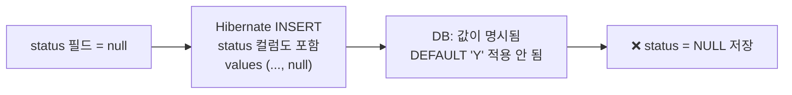
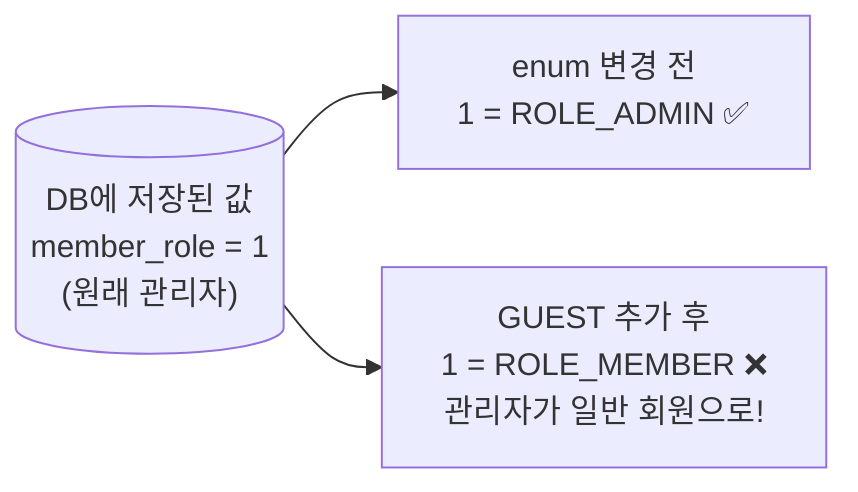
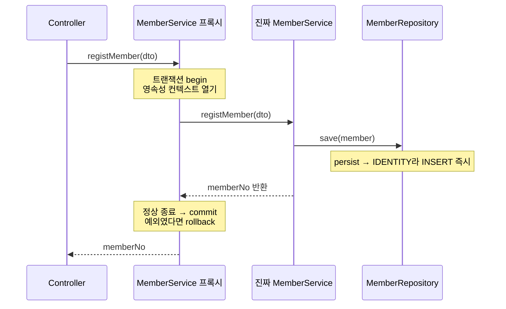
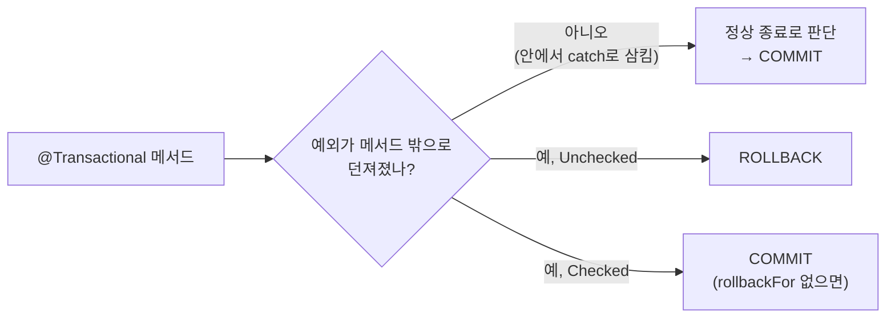
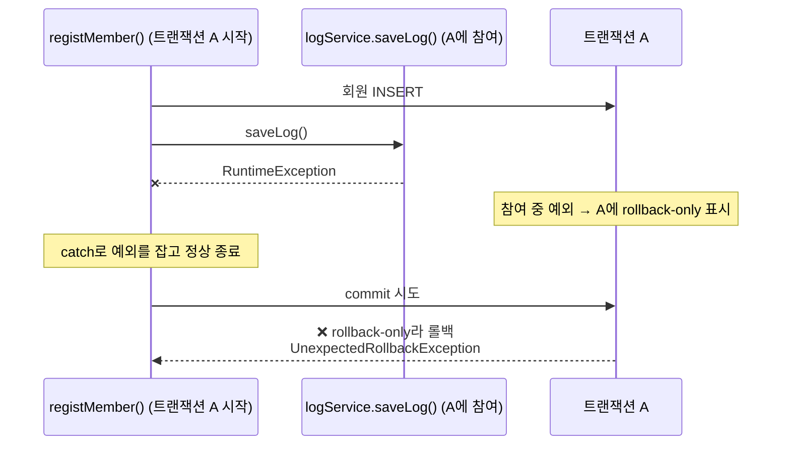
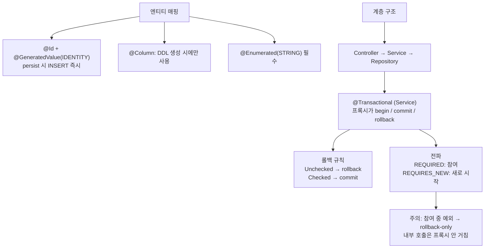

> **이번 글에서 다루는 것**
> 1. `ddl-auto: create`로 엔티티 매핑이 DDL로 바뀌는 과정 확인하기
> 2. `@GeneratedValue` 전략과 **IDENTITY가 쓰기 지연이 안 되는 이유**
> 3. `@Column`, 날짜 타입, **`@Enumerated(STRING)`**
> 4. Controller · Service · Repository 계층과 `@Transactional`
> 5. 블로그 키워드 ① Checked / Unchecked 예외와 롤백 규칙
> 6. 블로그 키워드 ② 트랜잭션 전파(Propagation)
>
> 엔티티 클래스에 붙이는 어노테이션(`@Id`, `@GeneratedValue`, `@Column`, `@Enumerated` 등)은 **"이 필드를 DB에서 어떻게 저장할지"** 를 정의한다. 그리고 이 엔티티를 **Controller → Service → Repository** 계층으로 나눠 다루면서, 트랜잭션은 **Service의 `@Transactional`** 이 책임진다. 02편에서 직접 쓰던 `begin()/commit()/rollback()`이 어떻게 사라지는지가 핵심이다.

**JPA 시리즈**: 01. JPA 입문 → 02. 영속성 컨텍스트 → **03. 엔티티 매핑과 트랜잭션** → 04. 미니 프로젝트

---

## 1. 이번 실습 설정 — `ddl-auto: create`

```yaml
spring:
  jpa:
    show-sql: true
    hibernate:
      ddl-auto: create     # 실행할 때마다 테이블을 지우고 엔티티 기준으로 새로 만든다
    properties:
      hibernate:
        format_sql: true
```

이번에는 미리 만든 테이블이 아니라, **엔티티에 적은 매핑 정보로 JPA가 테이블을 직접 생성**한다. 실행하면 콘솔에 `drop table if exists tbl_member` → `create table tbl_member (...)`가 찍힌다. 어노테이션을 바꿔가며 **생성되는 DDL이 어떻게 달라지는지** 확인하는 것이 이번 실습의 핵심이다.

> ⚠️ `create`는 실행할 때마다 **테이블을 지우고 다시 만든다.** 이전에 등록한 회원 데이터도 함께 사라진다. 학습용으로만 쓰자.

---

## 2. 엔티티 매핑 한눈에 보기

```java
@NoArgsConstructor
@AllArgsConstructor
@Getter
@ToString
@Entity
@Table(name = "tbl_member")
public class Member {

    @Id
    @Column(name = "member_no")
    @GeneratedValue(strategy = GenerationType.IDENTITY)
    private int memberNo;

    @Column(name = "member_id", nullable = false, unique = true, columnDefinition = "varchar(10)")
    private String memberId;

    @Column(name = "member_pwd", nullable = false)
    private String memberPwd;

    @Column(name = "member_name")
    private String memberName;

    @Column(name = "phone", unique = true)
    private String phone;

    @Column(name = "address", length = 900)
    private String address;

    @Column(name = "enroll_date")
    private LocalDateTime enrollDate;

    @Column(name = "member_role")
    @Enumerated(EnumType.STRING)
    private MemberRole memberRole;

    @Column(name = "status", columnDefinition = "char(1) default 'Y'")
    private String status;

    // PK(memberNo)를 제외한 생성자 : PK는 DB가 만들어 주므로 받지 않는다.
    public Member(String memberId, String memberPwd, String memberName, String phone,
                  String address, LocalDateTime enrollDate, MemberRole memberRole, String status) { ... }
}
```

<div style="margin:1.5em 0;overflow-x:auto"><svg viewBox="0 0 720 360" width="100%" role="img" aria-label="Member 엔티티의 필드와 어노테이션이 tbl_member 테이블의 컬럼으로 생성되는 모습" xmlns="http://www.w3.org/2000/svg" style="max-width:720px;font-family:'Pretendard','Noto Sans KR','Noto Sans CJK KR','Apple SD Gothic Neo','Malgun Gothic',sans-serif"><defs><marker id="jpa3-a1" viewBox="0 0 10 10" refX="9" refY="5" markerWidth="6" markerHeight="6" orient="auto"><path d="M0,0 L10,5 L0,10 z" fill="#8a8178"/></marker></defs><rect width="720" height="360" rx="12" fill="#fbf8f1"/><text x="190" y="40" text-anchor="middle" font-size="13.5" font-weight="700" fill="#2f7f73">Member 엔티티 (Java)</text><text x="555" y="40" text-anchor="middle" font-size="13.5" font-weight="700" fill="#3d6a9e">tbl_member 테이블 (생성된 DDL)</text><rect x="15" y="55" width="350" height="285" rx="8" fill="#fff" stroke="#2f7f73"/><rect x="405" y="55" width="300" height="285" rx="8" fill="#fff" stroke="#3d6a9e"/><rect x="16" y="58" width="348" height="28" fill="#e3f1ee"/><rect x="406" y="58" width="298" height="28" fill="#e3f1ee"/><rect x="16" y="268" width="348" height="28" fill="#fbecd6"/><rect x="406" y="268" width="298" height="28" fill="#fbecd6"/><g font-family="'D2Coding','JetBrains Mono',Consolas,monospace"><g font-size="12" font-weight="700" fill="#2b2724"><text x="27" y="77">memberNo</text><text x="27" y="107">memberId</text><text x="27" y="137">memberPwd</text><text x="27" y="167">memberName</text><text x="27" y="197">phone</text><text x="27" y="227">address</text><text x="27" y="257">enrollDate</text><text x="27" y="287">memberRole</text><text x="27" y="317">status</text></g><g font-size="11" fill="#2f7f73"><text x="122" y="77">@Id @GeneratedValue(IDENTITY)</text><text x="122" y="107">nullable, unique, varchar(10)</text><text x="122" y="137">nullable = false</text><text x="122" y="167">@Column(name)</text><text x="122" y="197">unique = true</text><text x="122" y="227">length = 900</text><text x="122" y="257">LocalDateTime</text><text x="122" y="287">@Enumerated(STRING)</text><text x="122" y="317">columnDefinition</text></g><g font-size="10.5" fill="#2b2724"><text x="415" y="77">member_no INT AUTO_INCREMENT PK</text><text x="415" y="107">member_id VARCHAR(10) NOT NULL UNIQUE</text><text x="415" y="137">member_pwd VARCHAR(255) NOT NULL</text><text x="415" y="167">member_name VARCHAR(255)</text><text x="415" y="197">phone VARCHAR(255) UNIQUE</text><text x="415" y="227">address VARCHAR(900)</text><text x="415" y="257">enroll_date DATETIME(6)</text><text x="415" y="287">member_role ENUM('ROLE_ADMIN','ROLE_MEMBER')</text><text x="415" y="317">status CHAR(1) DEFAULT 'Y'</text></g></g><g stroke="#8a8178" stroke-width="1.2" marker-end="url(#jpa3-a1)"><line x1="367" y1="73" x2="402" y2="73"/><line x1="367" y1="103" x2="402" y2="103"/><line x1="367" y1="133" x2="402" y2="133"/><line x1="367" y1="163" x2="402" y2="163"/><line x1="367" y1="193" x2="402" y2="193"/><line x1="367" y1="223" x2="402" y2="223"/><line x1="367" y1="253" x2="402" y2="253"/><line x1="367" y1="283" x2="402" y2="283"/><line x1="367" y1="313" x2="402" y2="313"/></g></svg></div>

### `@GeneratedValue` — PK 자동 생성 전략

| 전략 | 동작 | 사용 DB |
|---|---|---|
| `IDENTITY` | PK 생성을 **DB에 위임** (MySQL의 `AUTO_INCREMENT`) | MySQL, MariaDB |
| `SEQUENCE` | DB의 **시퀀스 객체**에서 번호를 받아옴 | Oracle, PostgreSQL |
| `TABLE` | 키 생성 전용 테이블을 만들어 사용 | 모든 DB (성능 불리) |
| `AUTO` | DB에 맞춰 자동 선택 (**기본값**) | - |

**IDENTITY만 쓰기 지연이 안 된다** ⭐

<div style="margin:1.5em 0;overflow-x:auto"><svg viewBox="0 0 720 220" width="100%" role="img" aria-label="IDENTITY는 persist 시점에 INSERT가 바로 실행되고 SEQUENCE는 commit 시점에 실행된다" xmlns="http://www.w3.org/2000/svg" style="max-width:720px;font-family:'Pretendard','Noto Sans KR','Noto Sans CJK KR','Apple SD Gothic Neo','Malgun Gothic',sans-serif"><rect width="720" height="220" rx="12" fill="#fbf8f1"/><text x="25" y="80" font-size="14" font-weight="700" fill="#2f7f73">IDENTITY</text><text x="25" y="97" font-size="11" fill="#6b625a">MySQL</text><line x1="130" y1="85" x2="700" y2="85" stroke="#3a3530" stroke-width="2"/><circle cx="180" cy="85" r="6" fill="#3a3530"/><text x="180" y="110" text-anchor="middle" font-size="11.5" fill="#2b2724">persist()</text><rect x="220" y="40" width="140" height="30" rx="6" fill="#f8e1dc" stroke="#b5523b"/><text x="290" y="60" text-anchor="middle" font-size="12" font-weight="700" fill="#b5523b">INSERT 즉시 실행</text><line x1="290" y1="70" x2="290" y2="80" stroke="#b5523b"/><circle cx="290" cy="85" r="6" fill="#b5523b"/><text x="290" y="110" text-anchor="middle" font-size="11.5" fill="#2b2724">DB가 PK 생성</text><circle cx="440" cy="85" r="6" fill="#2f7f73"/><text x="440" y="110" text-anchor="middle" font-size="11.5" fill="#2f7f73" font-weight="700">getMemberNo() 가능</text><circle cx="640" cy="85" r="6" fill="#3a3530"/><text x="640" y="110" text-anchor="middle" font-size="11.5" fill="#2b2724">commit()</text><line x1="20" y1="132" x2="700" y2="132" stroke="#e6dfd4"/><text x="25" y="175" font-size="14" font-weight="700" fill="#3d6a9e">SEQUENCE</text><text x="25" y="192" font-size="11" fill="#6b625a">Oracle 등</text><line x1="130" y1="180" x2="700" y2="180" stroke="#3a3530" stroke-width="2"/><circle cx="180" cy="180" r="6" fill="#3a3530"/><text x="180" y="205" text-anchor="middle" font-size="11.5" fill="#2b2724">persist()</text><rect x="215" y="137" width="150" height="30" rx="6" fill="#e2eaf5" stroke="#3d6a9e"/><text x="290" y="157" text-anchor="middle" font-size="12" font-weight="700" fill="#3d6a9e">시퀀스에서 PK만 조회</text><line x1="290" y1="167" x2="290" y2="175" stroke="#3d6a9e"/><circle cx="290" cy="180" r="6" fill="#3d6a9e"/><circle cx="440" cy="180" r="6" fill="#2f7f73"/><text x="440" y="205" text-anchor="middle" font-size="11.5" fill="#2f7f73" font-weight="700">getMemberNo() 가능</text><rect x="565" y="137" width="150" height="30" rx="6" fill="#f8e1dc" stroke="#b5523b"/><text x="640" y="157" text-anchor="middle" font-size="12" font-weight="700" fill="#b5523b">commit → INSERT</text><line x1="640" y1="167" x2="640" y2="175" stroke="#b5523b"/><circle cx="640" cy="180" r="6" fill="#b5523b"/></svg></div>

- 영속성 컨텍스트는 엔티티를 **PK로 관리**한다. 그래서 `persist()` 시점에 PK가 반드시 있어야 한다.
- **IDENTITY**는 INSERT를 실행해봐야 DB가 PK를 알려준다. 그래서 `persist()` 하는 순간 **INSERT가 바로 실행**된다. (쓰기 지연 X)
- **SEQUENCE**는 `persist()` 때 시퀀스에서 **PK만 먼저** 가져오고, INSERT는 flush 시점에 실행한다. (쓰기 지연 O)

이 덕분에 `MemberService.registMember()`는 `persist()` 직후 바로 `member.getMemberNo()`로 생성된 번호를 돌려줄 수 있다.

> 💡 **PK 필드는 `int`보다 `Integer`(래퍼 타입)가 권장된다.** `int`는 기본값이 `0`이라 "아직 저장 안 된 엔티티"와 "PK가 0인 엔티티"를 구분하기 애매하다. `Integer`나 `Long`이면 `null` = 아직 저장 전으로 명확하게 판단할 수 있다.

### `@Column` 주요 속성

| 속성 | 의미 | 기본값 |
|---|---|---|
| `name` | 매핑할 컬럼 이름 | 필드 이름 |
| `nullable` | `false`면 **NOT NULL** 제약조건 | `true` |
| `unique` | **UNIQUE** 제약조건 추가 | `false` |
| `length` | 문자열 컬럼 길이 | `255` |
| `columnDefinition` | 컬럼 정의(타입, 기본값 등)를 **직접 작성** | - |

> ⚠️ 위 속성들은 **JPA가 테이블을 생성(DDL)할 때만** 사용된다. 이미 만들어진 테이블에는 영향이 없고, `nullable = false`라고 적어도 자바 코드에서 null을 막아주지는 않는다. 입력값 검증은 04편의 `@Valid` 같은 별도 수단으로 해야 한다.

> ⚠️ **`columnDefinition`의 `default 'Y'`는 생각대로 동작하지 않을 수 있다.** DB의 DEFAULT 값은 INSERT 문에서 **그 컬럼을 아예 빼야** 적용된다. 그런데 Hibernate는 기본적으로 모든 컬럼을 INSERT 문에 넣고, 필드가 null이면 **`status = null`을 명시적으로** 보낸다. 그래서 DEFAULT 'Y'가 아니라 **null이 저장**된다. 이번 실습은 콘솔 입력 시 `setStatus("Y")`를 하기 때문에 문제가 드러나지 않을 뿐이다. 기본값은 자바 쪽에서 정하는 게 확실하다. (예: 생성 메서드 안에서 `"Y"`로 고정, 04편의 `Menu.create()` 방식)



### 날짜·시간 타입

| 자바 타입 | 저장 형태 | 예시 |
|---|---|---|
| `LocalDate` | 날짜만 | `2026-11-03` |
| `LocalDateTime` | 날짜 + 시간 | `2026-11-03 14:30:00` |

Hibernate 5 이상은 `java.time` 패키지를 **자동 지원**한다. 예전 방식(`java.util.Date` + `@Temporal`)은 더 이상 쓸 필요가 없다.

### `@Enumerated` — enum 매핑 ⭐

```java
/* enum 타입은 시스템 정책상 정해진 값만 쓰도록 강제할 수 있다. ex) 성별, 권한 */
public enum MemberRole {
    ROLE_MEMBER, ROLE_ADMIN;
}
```

| 방식 | 저장 값 | 장점 | 단점 |
|---|---|---|---|
| `EnumType.ORDINAL` (기본값) | `0`, `1` (순서 번호) | 저장 공간이 작음 | 가독성 낮음, **순서가 바뀌면 데이터가 꼬임** |
| `EnumType.STRING` (**권장**) | `'ROLE_MEMBER'` (이름) | 가독성 좋음, 순서 변경에 안전 | 저장 크기가 조금 큼 (큰 문제 아님) |

**ORDINAL이 위험한 이유**

```java
// 처음
public enum MemberRole { ROLE_MEMBER, ROLE_ADMIN }               // MEMBER=0, ADMIN=1
// 나중에 맨 앞에 GUEST 추가
public enum MemberRole { ROLE_GUEST, ROLE_MEMBER, ROLE_ADMIN }   // GUEST=0, MEMBER=1, ADMIN=2
```



DB에 이미 `1`로 저장된 관리자(ADMIN)가 이제 **일반 회원(MEMBER)** 으로 읽힌다. 에러도 나지 않아서 발견하기 어렵다. 그래서 실무에서는 **반드시 `STRING`** 을 쓴다.

> 💡 Hibernate 6 + MySQL에서는 `STRING` 매핑 시 컬럼이 MySQL의 `enum('ROLE_ADMIN','ROLE_MEMBER')` 타입으로 생성된다. 일반 문자열 컬럼으로 만들고 싶다면 `@Column(columnDefinition = "varchar(20)")`처럼 직접 지정한다.

---

## 3. 계층 구조 — Controller · Service · Repository

<div style="margin:1.5em 0;overflow-x:auto"><svg viewBox="0 0 720 250" width="100%" role="img" aria-label="Controller, Service, Repository, DB 계층과 주고받는 데이터, 트랜잭션 범위" xmlns="http://www.w3.org/2000/svg" style="max-width:720px;font-family:'Pretendard','Noto Sans KR','Noto Sans CJK KR','Apple SD Gothic Neo','Malgun Gothic',sans-serif"><defs><marker id="jpa3-a2" viewBox="0 0 10 10" refX="9" refY="5" markerWidth="7" markerHeight="7" orient="auto"><path d="M0,0 L10,5 L0,10 z" fill="#3a3530"/></marker></defs><rect width="720" height="250" rx="12" fill="#fbf8f1"/><rect x="301" y="46" width="413" height="112" rx="10" fill="none" stroke="#2f7f73" stroke-width="1.5" stroke-dasharray="6 4"/><text x="507" y="36" text-anchor="middle" font-size="12" font-weight="700" fill="#2f7f73">@Transactional 범위 : 시작 begin → 정상 종료 commit / 예외 rollback</text><rect x="15" y="62" width="115" height="58" rx="8" fill="#efebe4" stroke="#8a8178"/><text x="72" y="87" text-anchor="middle" font-size="12" font-weight="700" fill="#2b2724">Application</text><text x="72" y="105" text-anchor="middle" font-size="11" fill="#6b625a">콘솔 입력</text><rect x="161" y="62" width="115" height="58" rx="8" fill="#e2eaf5" stroke="#3d6a9e"/><text x="218" y="87" text-anchor="middle" font-size="11.5" font-weight="700" fill="#2b2724">Controller</text><text x="218" y="105" text-anchor="middle" font-size="11" fill="#6b625a">요청 받기·응답</text><rect x="307" y="62" width="115" height="58" rx="8" fill="#e3f1ee" stroke="#2f7f73"/><text x="364" y="87" text-anchor="middle" font-size="11.5" font-weight="700" fill="#2b2724">Service</text><text x="364" y="105" text-anchor="middle" font-size="11" fill="#6b625a">흐름·트랜잭션</text><rect x="453" y="62" width="115" height="58" rx="8" fill="#fbecd6" stroke="#c47f22"/><text x="510" y="87" text-anchor="middle" font-size="11.5" font-weight="700" fill="#2b2724">Repository</text><text x="510" y="105" text-anchor="middle" font-size="11" fill="#6b625a">EntityManager</text><rect x="599" y="62" width="108" height="58" rx="8" fill="#2b2724"/><text x="653" y="87" text-anchor="middle" font-size="12" font-weight="700" fill="#fbf8f1">DB</text><text x="653" y="105" text-anchor="middle" font-size="11" fill="#d8d0c4">tbl_member</text><g stroke="#3a3530" stroke-width="1.5" marker-end="url(#jpa3-a2)"><line x1="130" y1="91" x2="158" y2="91"/><line x1="276" y1="91" x2="304" y2="91"/><line x1="422" y1="91" x2="450" y2="91"/><line x1="568" y1="91" x2="596" y2="91"/></g><g font-size="11" font-weight="700" text-anchor="middle"><rect x="120" y="168" width="50" height="20" rx="10" fill="#e2eaf5"/><text x="145" y="182" fill="#3d6a9e">DTO</text><rect x="266" y="168" width="50" height="20" rx="10" fill="#e2eaf5"/><text x="291" y="182" fill="#3d6a9e">DTO</text><rect x="409" y="168" width="56" height="20" rx="10" fill="#e3f1ee"/><text x="437" y="182" fill="#2f7f73">Entity</text><rect x="558" y="168" width="50" height="20" rx="10" fill="#efebe4"/><text x="583" y="182" fill="#6b625a">SQL</text></g><text x="60" y="182" text-anchor="middle" font-size="11" font-weight="700" fill="#8a8178">전달 데이터</text><text x="60" y="223" text-anchor="middle" font-size="11" font-weight="700" fill="#8a8178">역할</text><g font-size="11" fill="#2b2724" text-anchor="middle"><text x="218" y="215">화면·입력을 알고</text><text x="218" y="231">로직은 모름</text><text x="364" y="215">DTO ↔ Entity 변환</text><text x="364" y="231">비즈니스 규칙</text><text x="510" y="215">persist / find</text><text x="510" y="231">DB 접근만</text></g></svg></div>

### Repository (DAO)

```java
/*
 * JDBC에서는 DB 접근 객체를 DAO라고 부른다.
 * Spring 환경에서 JPA를 사용할 때는 DAO 계층을 Repository로 표현하므로
 * DAO == Repository 로 인식하자!
 */
@Repository
public class MemberRepository {

    @PersistenceContext
    private EntityManager manager;

    public void save(Member member) {
        manager.persist(member);          // 전달받은 엔티티를 영속성 컨텍스트에 저장
    }

    public Member findByMerberNo(int memberNo) {
        return manager.find(Member.class, memberNo);
    }
}
```

- `@Repository`: DB 접근 계층임을 표시하는 `@Component`. 추가로 DB 예외를 Spring의 공통 예외(`DataAccessException`)로 바꿔주는 기능이 있다.
- 02편처럼 Factory에서 직접 EntityManager를 만들지 않고 `@PersistenceContext`로 주입받는다. Service의 `@Transactional`이 열어준 영속성 컨텍스트를 그대로 사용하게 된다.

### Service — 비즈니스 로직과 트랜잭션

```java
@Service
public class MemberService {

    private final MemberRepository memberRepository;

    @Autowired
    public MemberService(MemberRepository memberRepository) {
        this.memberRepository = memberRepository;
    }

    /*
     * Service
     * 1. 비즈니스 로직 작성 (시스템 정책)
     * 2. DAO(Repository)의 메서드를 호출한다.
     * 3. 트랜잭션 관리 - 여러 로직 중 하나라도 실패하면 rollback이 매우 중요!
     */
    @Transactional    // 시작 시 begin / 정상 종료 commit / 예외 발생 rollback
    public int registMember(MemberRegistDTO dto) {

        // 1. DTO -> Entity
        Member member = new Member(
                dto.getMemberId(), dto.getMemberPwd(), dto.getMemberName(), dto.getPhone(),
                dto.getAddress(), dto.getEnrollDate(), dto.getMemberRole(), dto.getStatus()
        );

        // 2. Entity를 Repository에 전달
        memberRepository.save(member);

        return member.getMemberNo();   // IDENTITY라서 persist 직후 PK가 채워져 있다
    }

    // 읽기 전용 트랜잭션은 불필요한 변경 감지를 하지 않는다.
    @Transactional(readOnly = true)
    public MemberRegistDTO findByMemberNo(int memberNo) {

        Member foundMember = memberRepository.findByMerberNo(memberNo);

        // Entity -> DTO 변환 (반환 타입이 DTO라서 엔티티를 그대로 반환할 수 없다)
        return new MemberRegistDTO(
                foundMember.getMemberId(), foundMember.getMemberPwd(),
                foundMember.getMemberName(), foundMember.getPhone()
        );
    }
}
```

**02편 코드와 비교** — 같은 일을 하지만 Spring이 반복 코드를 대신한다.

| 02편 (직접 제어) | 03편 (Spring) |
|---|---|
| `factory.createEntityManager()` | `@PersistenceContext` 주입 |
| `transaction.begin()` | `@Transactional` 메서드 시작 |
| `transaction.commit()` | 메서드 정상 종료 |
| `catch → transaction.rollback()` | 예외 발생 시 자동 rollback |
| `manager.close()` | 트랜잭션 종료 시 자동 |



> 💡 `@Transactional`도 결국 **AOP**다. Spring이 MemberService를 프록시로 감싸고, `@Around` advice처럼 메서드 앞뒤에서 begin/commit/rollback을 실행한다. ([Spring] 03편 AOP에서 다룬 프록시 원리 그대로)

**`readOnly = true`의 효과**

- Hibernate가 flush를 하지 않는다 → 실수로 값을 바꿔도 UPDATE가 나가지 않음
- 변경 감지용 **스냅샷을 만들지 않아** 메모리와 성능에 유리
- 코드를 읽는 사람에게 "이 메서드는 조회만 한다"는 의도를 전달

### DTO와 Entity를 나누는 이유

| | DTO | Entity |
|---|---|---|
| 목적 | 계층 간 **데이터 전달** | DB 테이블과 **매핑** |
| 사용 범위 | Controller ↔ Service | Service ↔ Repository |
| 변경 영향 | 화면이 바뀌면 바뀜 | 테이블이 바뀌면 바뀜 |
| setter | 자유롭게 | 무분별한 setter 지양 |

엔티티를 Controller까지 그대로 내보내면 화면 요구사항 때문에 엔티티를 고치게 되고, 영속 상태의 엔티티가 의도치 않게 변경될 위험도 있다.

### 실습 코드 체크 포인트

1. `findByMemberNo()`는 없는 번호를 조회하면 `foundMember`가 `null`이라 **NullPointerException**이 난다. null 확인 후 "회원이 없습니다" 예외를 던지는 것이 좋다. (04편에서는 `Optional` + `orElseThrow()`로 처리)
2. 조회 결과를 등록용 DTO(`MemberRegistDTO`)에 담으면서 **비밀번호까지** 함께 반환·출력하고 있다. 실무라면 응답용 DTO를 따로 만들어 **비밀번호는 절대 내보내지 않는다.**
3. Repository 메서드 이름 `findByMerberNo`는 `findByMemberNo`의 오타다. 04편의 Spring Data JPA는 **메서드 이름을 해석해서 쿼리를 만들기 때문에**, 그때는 오타가 바로 에러가 된다.

---

## 4. 블로그 키워드 ① — Checked / Unchecked 예외와 `@Transactional` ⭐

수업 중 "블로그 작성 키워드"로 나온 주제다. 면접에서도 자주 나온다.

<div style="margin:1.5em 0;overflow-x:auto"><svg viewBox="0 0 720 245" width="100%" role="img" aria-label="Transactional 메서드에서 Unchecked 예외는 롤백, Checked 예외는 기본적으로 커밋" xmlns="http://www.w3.org/2000/svg" style="max-width:720px;font-family:'Pretendard','Noto Sans KR','Noto Sans CJK KR','Apple SD Gothic Neo','Malgun Gothic',sans-serif"><defs><marker id="jpa3-a3" viewBox="0 0 10 10" refX="9" refY="5" markerWidth="7" markerHeight="7" orient="auto"><path d="M0,0 L10,5 L0,10 z" fill="#3a3530"/></marker></defs><rect width="720" height="245" rx="12" fill="#fbf8f1"/><rect x="225" y="18" width="270" height="44" rx="10" fill="#2b2724"/><text x="360" y="45" text-anchor="middle" font-size="13" font-weight="700" fill="#fbf8f1">@Transactional 메서드에서 예외 발생</text><line x1="320" y1="62" x2="190" y2="98" stroke="#3a3530" stroke-width="1.5" marker-end="url(#jpa3-a3)"/><line x1="400" y1="62" x2="530" y2="98" stroke="#3a3530" stroke-width="1.5" marker-end="url(#jpa3-a3)"/><rect x="40" y="100" width="300" height="62" rx="10" fill="#f8e1dc" stroke="#b5523b" stroke-width="1.5"/><text x="190" y="124" text-anchor="middle" font-size="13" font-weight="700" fill="#b5523b">Unchecked 예외</text><text x="190" y="145" text-anchor="middle" font-size="11.5" fill="#2b2724">RuntimeException 계열 · Error</text><rect x="380" y="100" width="300" height="62" rx="10" fill="#fbecd6" stroke="#c47f22" stroke-width="1.5"/><text x="530" y="124" text-anchor="middle" font-size="13" font-weight="700" fill="#c47f22">Checked 예외</text><text x="530" y="145" text-anchor="middle" font-size="11.5" fill="#2b2724">Exception 계열 (IOException 등)</text><line x1="190" y1="162" x2="190" y2="180" stroke="#3a3530" stroke-width="1.5" marker-end="url(#jpa3-a3)"/><line x1="530" y1="162" x2="530" y2="180" stroke="#3a3530" stroke-width="1.5" marker-end="url(#jpa3-a3)"/><rect x="100" y="182" width="180" height="44" rx="10" fill="#b5523b"/><text x="190" y="209" text-anchor="middle" font-size="14" font-weight="700" fill="#fff">ROLLBACK</text><rect x="440" y="182" width="180" height="44" rx="10" fill="#c47f22"/><text x="530" y="203" text-anchor="middle" font-size="14" font-weight="700" fill="#fff">COMMIT</text><text x="530" y="219" text-anchor="middle" font-size="10.5" fill="#fff">(기본 동작 · 주의!)</text></svg></div>

### Spring의 기본 규칙

| 예외 종류 | 예 | `@Transactional` 기본 동작 |
|---|---|---|
| **Unchecked** (`RuntimeException`, `Error`) | `IllegalArgumentException`, `NullPointerException` | **rollback** |
| **Checked** (`Exception`의 나머지 자식) | `IOException`, 직접 던진 `SQLException` | **commit** ❗ |

**왜 Checked는 커밋할까?** Spring(정확히는 EJB 시절부터의 관례)은 Checked 예외를 "**호출한 쪽이 처리할 수 있는 예상된 상황**"(비즈니스적 결과)으로, Unchecked 예외를 "**복구할 수 없는 오류**"로 본다. 그래서 Checked 예외는 "작업은 정상 처리됐고, 결과로 예외를 알린 것"으로 취급해 커밋한다.

```java
@Transactional
public void regist(MemberRegistDTO dto) throws IOException {
    memberRepository.save(...);          // INSERT 실행됨
    throw new IOException("파일 저장 실패");  // Checked → 그래도 COMMIT! 회원은 저장된다
}
```

### 원하는 대로 바꾸기

```java
// Checked 예외도 롤백하고 싶을 때
@Transactional(rollbackFor = Exception.class)

// 특정 Unchecked 예외는 롤백하지 않고 싶을 때
@Transactional(noRollbackFor = DuplicateNameException.class)
```

### 자주 하는 실수: 예외를 잡아버리면 커밋된다

```java
@Transactional
public void regist(...) {
    try {
        memberRepository.save(...);
        somethingThrowsRuntimeException();
    } catch (RuntimeException e) {
        System.out.println("에러 무시");   // 예외가 메서드 밖으로 안 나감 → Spring은 모름 → COMMIT
    }
}
```



`@Transactional`은 **메서드 밖으로 던져진 예외**를 보고 롤백을 결정한다. 안에서 잡고 끝내면 정상 종료로 판단한다.

> 💡 그래서 실무에서는 비즈니스 예외를 **`RuntimeException`을 상속해서** 만드는 경우가 대부분이다. 04편의 `BusinessException`도 `RuntimeException`을 상속한다.

---

## 5. 블로그 키워드 ② — 트랜잭션 전파 (Propagation) ⭐

**트랜잭션 전파**란 "트랜잭션이 이미 진행 중인 상태에서 `@Transactional` 메서드를 또 호출하면 어떻게 할 것인가"에 대한 규칙이다.

```java
@Service
public class MemberService {
    private final LogService logService;

    @Transactional
    public void registMember(...) {
        memberRepository.save(member);   // 트랜잭션 A 진행 중
        logService.saveLog("회원가입");   // 이 메서드도 @Transactional 이라면?
    }
}
```

<div style="margin:1.5em 0;overflow-x:auto"><svg viewBox="0 0 720 280" width="100%" role="img" aria-label="REQUIRED는 기존 트랜잭션에 참여하고 REQUIRES_NEW는 새 트랜잭션을 연다" xmlns="http://www.w3.org/2000/svg" style="max-width:720px;font-family:'Pretendard','Noto Sans KR','Noto Sans CJK KR','Apple SD Gothic Neo','Malgun Gothic',sans-serif"><rect width="720" height="280" rx="12" fill="#fbf8f1"/><text x="182" y="32" text-anchor="middle" font-size="14" font-weight="700" fill="#2f7f73">REQUIRED (기본값)</text><text x="537" y="32" text-anchor="middle" font-size="14" font-weight="700" fill="#c47f22">REQUIRES_NEW</text><rect x="20" y="48" width="325" height="160" rx="10" fill="#e3f1ee" stroke="#2f7f73" stroke-width="1.5"/><text x="35" y="68" font-size="12" font-weight="700" fill="#2f7f73">트랜잭션 A</text><rect x="40" y="80" width="285" height="40" rx="8" fill="#fff" stroke="#2f7f73"/><text x="182" y="105" text-anchor="middle" font-size="12" fill="#2b2724">registMember() · 회원 INSERT</text><rect x="40" y="135" width="285" height="58" rx="8" fill="#fff" stroke="#2f7f73" stroke-dasharray="5 3"/><text x="182" y="158" text-anchor="middle" font-size="12" fill="#2b2724">saveLog() · 로그 INSERT</text><text x="182" y="177" text-anchor="middle" font-size="11" fill="#2f7f73">기존 트랜잭션 A에 참여</text><text x="182" y="232" text-anchor="middle" font-size="12" fill="#2b2724">하나라도 실패하면</text><text x="182" y="250" text-anchor="middle" font-size="12" font-weight="700" fill="#b5523b">회원 + 로그 모두 rollback</text><rect x="375" y="48" width="325" height="160" rx="10" fill="#e3f1ee" stroke="#2f7f73" stroke-width="1.5"/><text x="390" y="68" font-size="12" font-weight="700" fill="#2f7f73">트랜잭션 A</text><rect x="395" y="80" width="285" height="40" rx="8" fill="#fff" stroke="#2f7f73"/><text x="537" y="105" text-anchor="middle" font-size="12" fill="#2b2724">registMember() · 회원 INSERT</text><rect x="395" y="130" width="285" height="66" rx="8" fill="#fbecd6" stroke="#c47f22" stroke-width="1.5"/><text x="410" y="148" font-size="11.5" font-weight="700" fill="#c47f22">트랜잭션 B (새로 시작)</text><text x="537" y="170" text-anchor="middle" font-size="12" fill="#2b2724">saveLog() · 로그 INSERT</text><text x="537" y="187" text-anchor="middle" font-size="11" fill="#6b625a">A는 잠시 보류(suspend)</text><text x="537" y="232" text-anchor="middle" font-size="12" fill="#2b2724">A와 B는 각자 commit / rollback</text><text x="537" y="250" text-anchor="middle" font-size="12" font-weight="700" fill="#c47f22">회원가입이 실패해도 로그는 남길 수 있다</text></svg></div>

### 전파 옵션

| 옵션 | 기존 트랜잭션이 **있으면** | 기존 트랜잭션이 **없으면** |
|---|---|---|
| **`REQUIRED`** (기본값) | **참여** | 새로 시작 |
| **`REQUIRES_NEW`** | 기존 것을 **보류**하고 **새로 시작** | 새로 시작 |
| `SUPPORTS` | 참여 | 트랜잭션 없이 실행 |
| `MANDATORY` | 참여 | **예외 발생** |
| `NOT_SUPPORTED` | 기존 것을 보류하고 **트랜잭션 없이** 실행 | 트랜잭션 없이 실행 |
| `NEVER` | **예외 발생** | 트랜잭션 없이 실행 |
| `NESTED` | 기존 트랜잭션 안에 **저장점(savepoint)** 을 만들고 실행 | 새로 시작 |

```java
@Service
public class LogService {
    @Transactional(propagation = Propagation.REQUIRES_NEW)
    public void saveLog(String message) { ... }
}
```

실무에서는 **`REQUIRED`와 `REQUIRES_NEW`** 를 확실히 이해하는 것이 가장 중요하다.

### 면접에서 자주 나오는 함정 두 가지

**① REQUIRED에서 안쪽이 실패하면 → `UnexpectedRollbackException`**

```java
@Transactional
public void registMember(...) {
    memberRepository.save(member);
    try {
        logService.saveLog(...);      // REQUIRED, 안에서 RuntimeException 발생
    } catch (RuntimeException e) {
        // 바깥에서 잡았으니 회원은 저장되겠지?
    }
}
```



결과는 **회원도 저장되지 않는다.** 안쪽 메서드가 같은 트랜잭션에 참여한 상태에서 예외를 던지면, Spring은 그 트랜잭션 전체에 **"롤백만 가능(rollback-only)"** 표시를 해둔다. 바깥에서 예외를 잡고 commit을 시도해도 이 표시 때문에 롤백되고, **`UnexpectedRollbackException`** 이 발생한다. 로그 실패와 무관하게 회원가입을 성공시키고 싶다면 `saveLog`를 **`REQUIRES_NEW`** 로 분리해야 한다.

**② 같은 클래스 안에서 호출하면 전파 설정이 무시된다**

```java
@Service
public class MemberService {
    @Transactional
    public void registMember(...) {
        this.saveLog(...);   // ← 프록시를 거치지 않음!
    }

    @Transactional(propagation = Propagation.REQUIRES_NEW)
    public void saveLog(...) { ... }
}
```

`@Transactional`은 **프록시(AOP)** 로 동작하기 때문에, 같은 클래스 내부에서 `this.메서드()`로 호출하면 프록시를 거치지 않는다. 그래서 `REQUIRES_NEW`가 **적용되지 않는다.** ([Spring] 03편 AOP의 "내부 호출(self-invocation)" 문제와 같은 원리) 전파를 다르게 하고 싶은 메서드는 **별도의 빈(클래스)** 으로 분리해야 한다.

---

## 6. 한눈에 정리



| 개념 | 핵심 |
|---|---|
| `ddl-auto: create` | 엔티티 기준으로 테이블 재생성. 학습용 |
| `@GeneratedValue(IDENTITY)` | DB의 AUTO_INCREMENT 사용. persist 시 INSERT 즉시 실행 |
| `@Column` | name, nullable, unique, length, columnDefinition (DDL 생성 시 사용) |
| `LocalDate` / `LocalDateTime` | 별도 설정 없이 매핑 |
| `@Enumerated` | **STRING** 사용 (ORDINAL은 순서 변경 시 데이터가 꼬임) |
| 계층 구조 | Controller(요청) → Service(흐름·트랜잭션·DTO 변환) → Repository(DB 접근) |
| `@Transactional` | begin/commit/rollback 자동. `readOnly`로 조회 최적화 |
| 롤백 규칙 | Unchecked → rollback, **Checked → commit**, `rollbackFor`로 변경 |
| 전파 | REQUIRED(참여), REQUIRES_NEW(새로 시작). 내부 호출 시 무시됨 |
