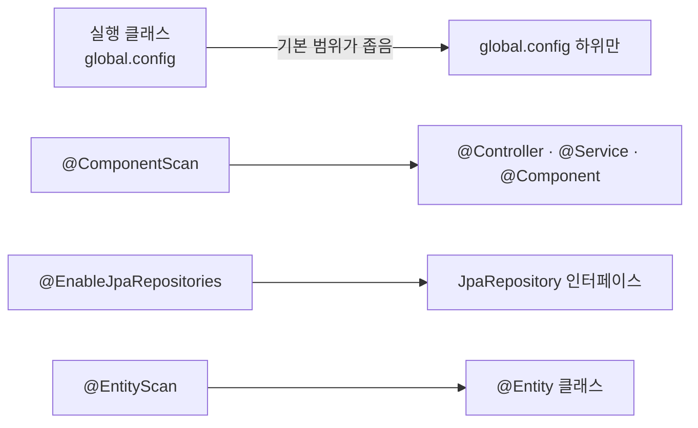
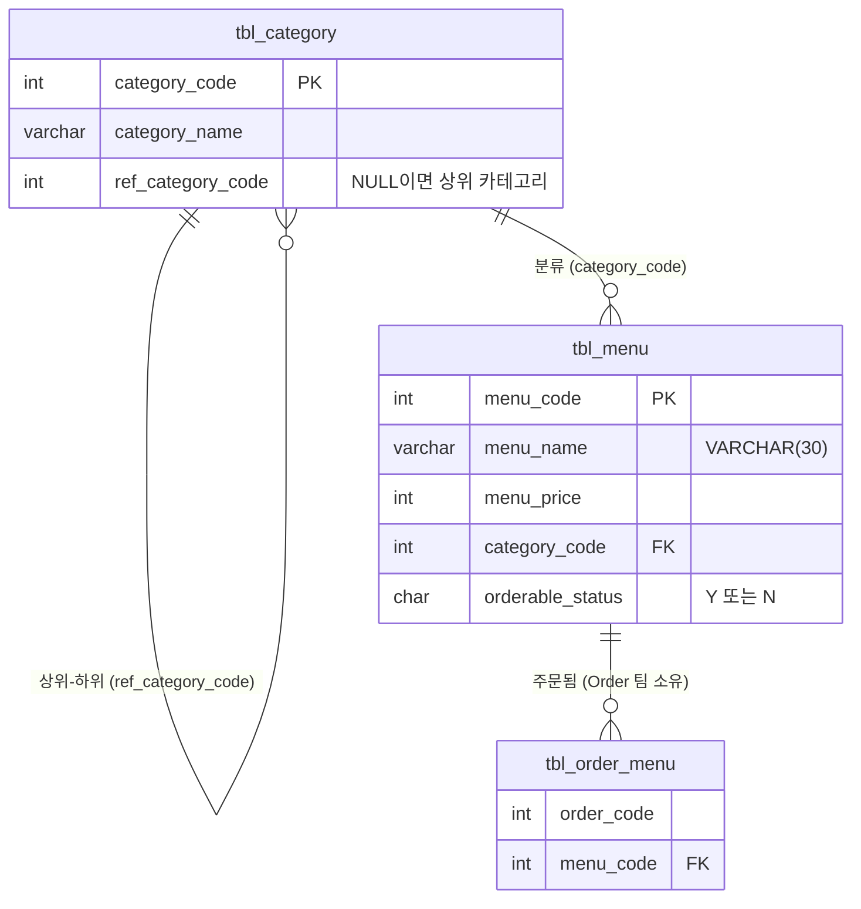
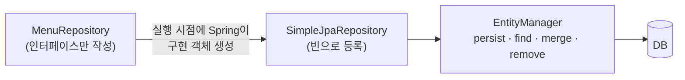
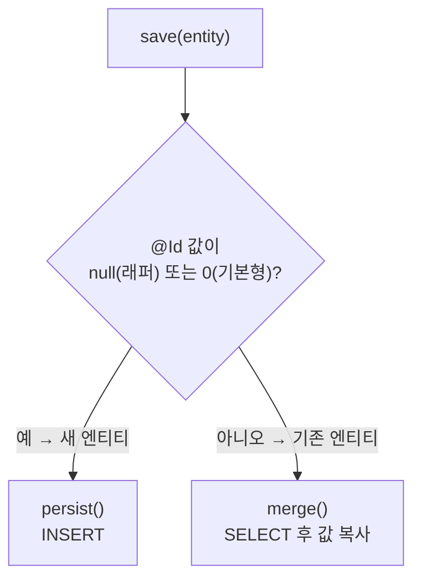
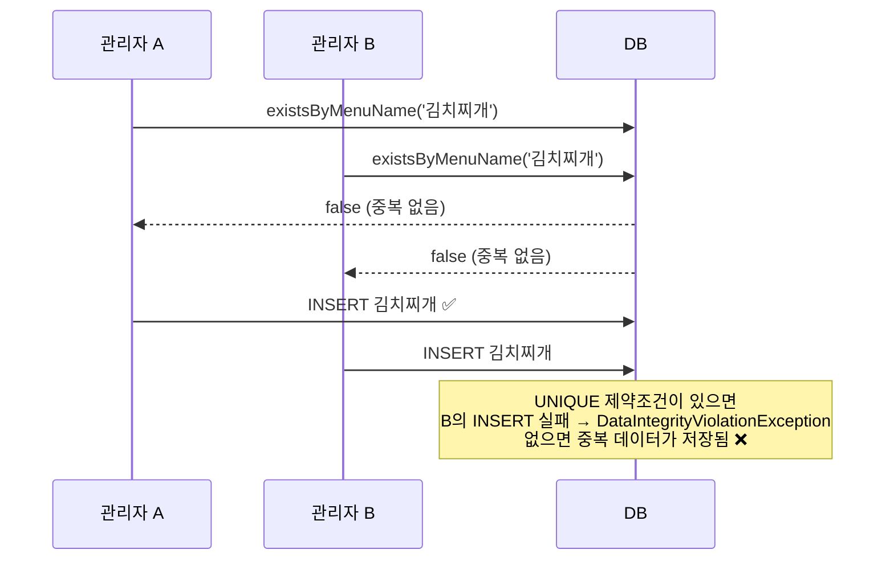
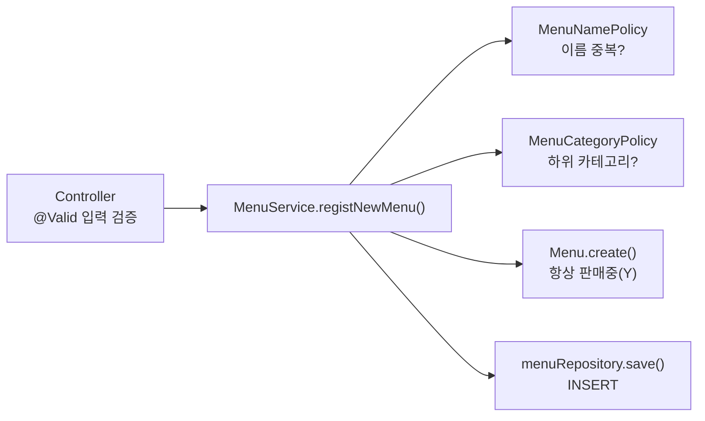
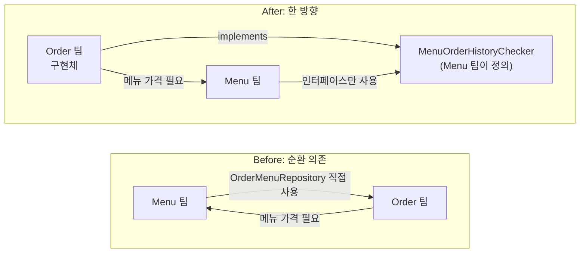
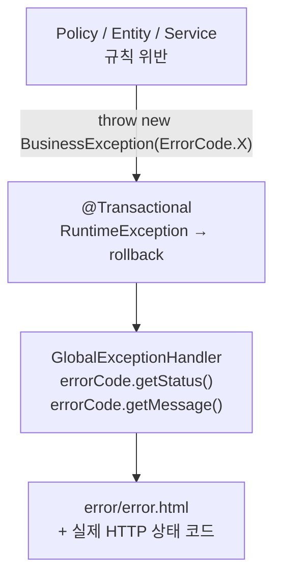
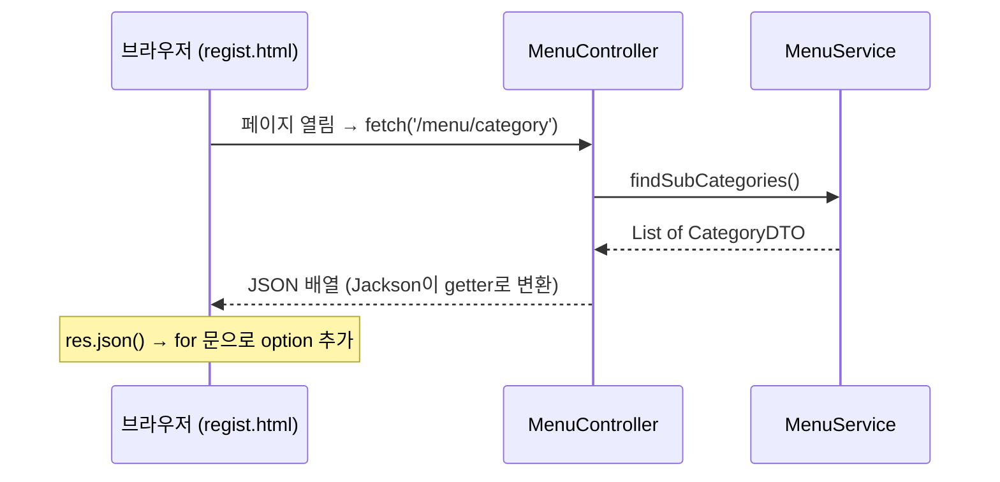
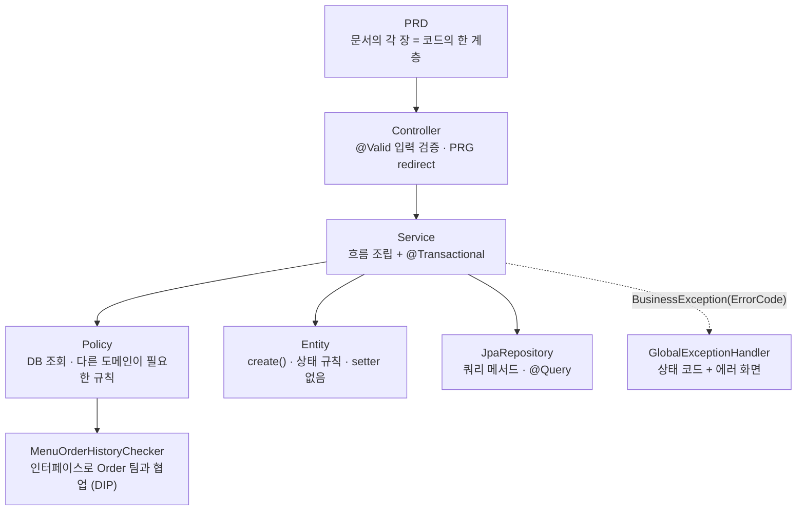

> **이번 글에서 다루는 것**
> 1. PRD(제품 요구사항 문서)를 코드 계층으로 옮기는 방법
> 2. 엔티티 설계: setter 없는 엔티티, 정적 팩토리 `create()`, ID 참조
> 3. **Spring Data JPA**: `JpaRepository`, 쿼리 메서드, `@Query`
> 4. 규칙은 어디에 둘까? **입력(DTO) / 도메인(Entity) / 비즈니스(Policy)** ⭐
> 5. 다른 팀과의 협업: 인터페이스와 **의존성 역전(DIP)** ⭐
> 6. `ErrorCode` + `BusinessException` + `GlobalExceptionHandler`
>
> 레스토랑 메뉴를 조회·등록·수정·판매중지·삭제하는 웹 서비스를 **PRD** 를 보고 만드는 프로젝트다. **Spring Data JPA**로 DB 접근 코드를 줄이고, 규칙을 **입력 / 도메인 / 비즈니스** 로 나눠 각자 책임지게 하는 것이 핵심이다. JPA 01~03편과 Spring MVC 시리즈에서 배운 내용이 한 프로젝트 안에서 모두 쓰인다.

**JPA 시리즈**: 01. JPA 입문 → 02. 영속성 컨텍스트 → 03. 엔티티 매핑과 트랜잭션 → **04. 미니 프로젝트**

---

## 1. 프로젝트 개요

| 항목 | 내용 |
|---|---|
| 제품 | 레스토랑 메뉴 관리 웹 서비스 |
| 사용자 | 매장 관리자 |
| 목표 | 메뉴 정보를 한 곳에서 관리하고, **잘못된 데이터가 저장되지 않게** 한다 |
| 담당 | **Menu 팀** (우리). 주문 데이터는 **Order 팀** 소유 |
| 기술 | Java 21, Spring Boot 3.5, Spring Data JPA, Thymeleaf, MySQL 8 |

### PRD란?

> **"이 문서 하나만 보고 개발할 수 있어야 한다."**
> 코드를 짜다가 막히면 코드가 아니라 **문서를 먼저 본다.** 문서에 답이 없다면 코드를 짜기 전에 문서부터 고친다.

PRD의 각 장은 **코드의 한 계층**에 그대로 대응한다.

| PRD 문서 | 코드로 옮겨지는 곳 |
|---|---|
| 화면 설계 | `templates/**.html`, Controller의 View 이름, Model 이름 |
| API 명세 | `MenuController`의 `@GetMapping` / `@PostMapping` |
| 정책 정의 | `MenuDTO`(입력 검증), `Menu`(도메인 규칙), `policy` 패키지(비즈니스 규칙) |
| 에러 정의 | `ErrorCode`, `GlobalExceptionHandler` |
| DB 설계 | `Menu`, `Category` 엔티티 매핑, Repository |
| 협업 계약 | `MenuOrderHistoryChecker` 인터페이스 |

### 기능 목록

| ID | 기능 | API | 관련 정책 |
|---|---|---|---|
| F-01 | 메뉴 1건 조회 | `GET /menu/{menuCode}` | POL-11 |
| F-02 | 전체 메뉴 조회 (메뉴번호 오름차순) | `GET /menu/list` | - |
| F-03 | 가격으로 메뉴 검색 (입력 가격 **초과**, 가격 오름차순) | `GET /menu/search?menuPrice=` | POL-02 |
| F-04 | 메뉴 등록 | `POST /menu/regist` | POL-01~04, 08, 09 |
| F-05 | 메뉴 이름 수정 | `POST /menu/modify` | POL-01, 08, 11 |
| F-06 | 메뉴 판매중지 / 판매재개 | `POST /menu/stop`, `/menu/resume` | POL-05, 06, 11 |
| F-07 | 메뉴 삭제 | `POST /menu/delete` | POL-07, 10, 11 |

- 등록 / 수정 / 삭제 / 상태 변경은 성공 후 **redirect** 한다. 새로고침해도 요청이 반복되지 않게 하는 **PRG 패턴**이다. ([Spring MVC] 03편 참고)
- 카테고리 목록(`GET /menu/category`)만 화면이 아니라 **JSON**을 응답한다.

---

## 2. 전체 구조

<div style="margin:1.5em 0;overflow-x:auto"><svg viewBox="0 0 720 320" width="100%" role="img" aria-label="미니 프로젝트 계층 구조: Controller, Service, Policy, Entity, Repository, GlobalExceptionHandler" xmlns="http://www.w3.org/2000/svg" style="max-width:720px;font-family:'Pretendard','Noto Sans KR','Noto Sans CJK KR','Apple SD Gothic Neo','Malgun Gothic',sans-serif"><defs><marker id="jpa4-a1" viewBox="0 0 10 10" refX="9" refY="5" markerWidth="7" markerHeight="7" orient="auto"><path d="M0,0 L10,5 L0,10 z" fill="#3a3530"/></marker><marker id="jpa4-a2" viewBox="0 0 10 10" refX="9" refY="5" markerWidth="7" markerHeight="7" orient="auto"><path d="M0,0 L10,5 L0,10 z" fill="#b5523b"/></marker></defs><rect width="720" height="320" rx="12" fill="#fbf8f1"/><rect x="20" y="20" width="160" height="46" rx="8" fill="#efebe4" stroke="#8a8178"/><text x="100" y="40" text-anchor="middle" font-size="12.5" font-weight="700" fill="#2b2724">브라우저</text><text x="100" y="57" text-anchor="middle" font-size="11" fill="#6b625a">Thymeleaf 화면 · fetch</text><line x1="100" y1="66" x2="100" y2="107" stroke="#3a3530" stroke-width="1.5" marker-end="url(#jpa4-a1)"/><text x="108" y="92" font-size="10.5" fill="#6b625a">HTTP 요청</text><rect x="20" y="110" width="160" height="74" rx="10" fill="#e2eaf5" stroke="#3d6a9e" stroke-width="1.5"/><text x="100" y="134" text-anchor="middle" font-size="13" font-weight="700" fill="#3d6a9e">MenuController</text><text x="100" y="154" text-anchor="middle" font-size="11" fill="#2b2724">요청 받기 · @Valid 선언</text><text x="100" y="170" text-anchor="middle" font-size="11" fill="#2b2724">View / redirect 결정</text><line x1="180" y1="147" x2="242" y2="147" stroke="#3a3530" stroke-width="1.5" marker-end="url(#jpa4-a1)"/><text x="211" y="140" text-anchor="middle" font-size="10.5" font-weight="700" fill="#3d6a9e">DTO</text><rect x="245" y="110" width="175" height="74" rx="10" fill="#e3f1ee" stroke="#2f7f73" stroke-width="2"/><text x="332" y="134" text-anchor="middle" font-size="13" font-weight="700" fill="#2f7f73">MenuService</text><text x="332" y="154" text-anchor="middle" font-size="11" fill="#2b2724">흐름 조립 · @Transactional</text><text x="332" y="170" text-anchor="middle" font-size="11" fill="#2b2724">Entity ↔ DTO 변환</text><rect x="490" y="18" width="210" height="58" rx="10" fill="#fbecd6" stroke="#c47f22" stroke-width="1.5"/><text x="595" y="42" text-anchor="middle" font-size="12.5" font-weight="700" fill="#c47f22">Policy · 비즈니스 규칙</text><text x="595" y="61" text-anchor="middle" font-size="11" fill="#2b2724">이름 중복 · 하위 카테고리 · 주문 이력</text><rect x="490" y="96" width="210" height="58" rx="10" fill="#e3f1ee" stroke="#2f7f73" stroke-width="1.5"/><text x="595" y="120" text-anchor="middle" font-size="12.5" font-weight="700" fill="#2f7f73">Entity · 도메인 규칙</text><text x="595" y="139" text-anchor="middle" font-size="11" fill="#2b2724">Menu.create() · validateDeletable()</text><rect x="490" y="174" width="210" height="58" rx="10" fill="#e2eaf5" stroke="#3d6a9e" stroke-width="1.5"/><text x="595" y="198" text-anchor="middle" font-size="12.5" font-weight="700" fill="#3d6a9e">Repository · DB 접근</text><text x="595" y="217" text-anchor="middle" font-size="11" fill="#2b2724">JpaRepository 상속 (구현은 Spring)</text><line x1="420" y1="135" x2="487" y2="52" stroke="#3a3530" stroke-width="1.5" marker-end="url(#jpa4-a1)"/><line x1="420" y1="147" x2="487" y2="126" stroke="#3a3530" stroke-width="1.5" marker-end="url(#jpa4-a1)"/><line x1="420" y1="160" x2="487" y2="200" stroke="#3a3530" stroke-width="1.5" marker-end="url(#jpa4-a1)"/><path d="M700,60 L712,60 L712,190 L703,190" fill="none" stroke="#8a8178" stroke-dasharray="4 3" marker-end="url(#jpa4-a1)"/><rect x="545" y="262" width="100" height="42" rx="8" fill="#2b2724"/><text x="595" y="288" text-anchor="middle" font-size="13" font-weight="700" fill="#fbf8f1">MySQL</text><line x1="595" y1="232" x2="595" y2="259" stroke="#3a3530" stroke-width="1.5" marker-end="url(#jpa4-a1)"/><rect x="20" y="240" width="280" height="62" rx="10" fill="#f8e1dc" stroke="#b5523b" stroke-width="1.5"/><text x="160" y="264" text-anchor="middle" font-size="12.5" font-weight="700" fill="#b5523b">GlobalExceptionHandler</text><text x="160" y="284" text-anchor="middle" font-size="11" fill="#2b2724">예외 → 상태코드 + error/error.html</text><path d="M100,184 L100,237" fill="none" stroke="#b5523b" stroke-dasharray="5 3" marker-end="url(#jpa4-a2)"/><text x="108" y="214" font-size="10.5" fill="#b5523b">검증 실패</text><path d="M332,184 L332,212 L250,212 L250,237" fill="none" stroke="#b5523b" stroke-dasharray="5 3" marker-end="url(#jpa4-a2)"/><text x="340" y="208" font-size="10.5" fill="#b5523b">BusinessException</text></svg></div>

### 패키지 구조

```
com.wanted.project
├── domain
│   ├── menu
│   │   ├── controller   MenuController
│   │   └── model
│   │       ├── dao      MenuRepository, CategoryRepository
│   │       ├── dto      MenuDTO, CategoryDTO
│   │       ├── entity   Menu, Category
│   │       ├── policy   MenuNamePolicy, MenuCategoryPolicy, MenuDeletionPolicy,
│   │       │            MenuOrderHistoryChecker (Order 팀과의 계약)
│   │       └── service  MenuService
│   └── order            FakeMenuOrderHistoryChecker (Order 팀 영역)
└── global
    ├── config           실행 클래스, ContextConfig, JpaConfig, IndexController
    └── exception        BusinessException, ErrorCode, GlobalExceptionHandler
```

**기능(도메인)별로 먼저 나누고**, 그 안에서 계층별로 나눈 구조다. 여러 도메인에서 공통으로 쓰는 설정과 예외는 `global`에 둔다.

### 설정 클래스가 따로 있는 이유

실행 클래스가 `global.config` 패키지에 있어서, `@SpringBootApplication`의 기본 스캔 범위가 `global.config` 하위로 좁다. 그래서 스캔 범위를 프로젝트 전체로 넓혀주는 설정이 필요하다.

```java
@Configuration
@ComponentScan(basePackages = "com.wanted.project")      // @Controller, @Service 등 일반 Bean
public class ContextConfig { }

@Configuration
@EnableJpaRepositories(basePackages = "com.wanted.project")   // Repository 인터페이스
@EntityScan(basePackages = "com.wanted.project")              // @Entity 클래스
public class JpaConfig { }
```



> 💡 JPA의 엔티티와 Repository는 **일반 컴포넌트 스캔과 별도로** 찾는다. 그래서 `@ComponentScan`만 넓혀서는 안 되고 `@EntityScan`, `@EnableJpaRepositories`도 따로 지정해야 한다. 실행 클래스를 최상위 패키지(`com.wanted.project`)에 두면 이 설정들이 모두 필요 없다.

### 추가된 의존성

```groovy
implementation 'org.springframework.boot:spring-boot-starter-validation'  // 입력값 검증 (@NotBlank 등)
developmentOnly 'org.springframework.boot:spring-boot-devtools'          // 코드 변경 시 자동 재시작
```

---

## 3. 데이터베이스와 엔티티 설계



| 상위 카테고리 (등록 불가) | 하위 카테고리 (등록 가능) |
|---|---|
| 1 식사 | 4 한식, 5 중식, 6 일식, 7 퓨전 |
| 2 음료 | 8 커피, 9 쥬스, 10 기타 |
| 3 디저트 | 11 동양, 12 서양 |

테이블은 `sql/menudb-script.sql`로 만들고, JPA는 테이블을 건드리지 않는다. (`ddl-auto: none`) 실습 중 데이터가 망가지면 스크립트를 다시 실행해 초기화한다.

### Menu 엔티티 — "만드는 규칙"과 "바꾸는 규칙"을 스스로 책임진다

```java
@NoArgsConstructor
@AllArgsConstructor(access = AccessLevel.PRIVATE)   // 전체 필드 생성자는 외부에서 못 씀
@Getter                                             // setter 없음!
@ToString
@Entity
@Table(name = "tbl_menu")
public class Menu {

    // Y, N은 의미를 파악하기 힘든 값이라 이름을 붙인 상수로 관리
    private static final String ON_SALE = "Y";   // 판매중
    private static final String STOPPED = "N";   // 판매중지

    @Id
    @Column(name = "menu_code")
    @GeneratedValue(strategy = GenerationType.IDENTITY)
    private int menuCode;

    @Column(name = "menu_name")
    private String menuName;

    @Column(name = "menu_price")
    private int menuPrice;

    @Column(name = "category_code")
    private int categoryCode;

    @Column(name = "orderable_status")
    private String orderableStatus;

    // 정적 팩토리 메서드 : 엔티티 생성은 Entity 클래스만의 책임
    public static Menu create(String menuName, int menuPrice, int categoryCode) {
        return new Menu(0, menuName, menuPrice, categoryCode, ON_SALE);   // POL-04 : 항상 판매중으로 시작
    }

    // setter 대신 의미 있는 이름의 메서드로만 값을 바꾼다
    public void changeMenuName(String newMenuName) {
        this.menuName = newMenuName;
    }

    // POL-07 : 판매중인 메뉴는 삭제할 수 없다 (자기 "현재 상태"로 판단하는 도메인 규칙)
    public void validateDeletable() {
        if (this.orderableStatus.equals(ON_SALE)) {
            throw new BusinessException(ErrorCode.ON_SALE_MENU_CANNOT_DELETE);
        }
    }
}
```

| 설계 포인트 | 이유 |
|---|---|
| **setter 없음** | 엔티티는 DB의 한 행. 아무 곳에서나 값을 바꾸면 어디서 왜 바뀌었는지 추적할 수 없다 |
| **`create()` 정적 팩토리** | 생성 규칙(판매상태는 항상 Y, PK는 받지 않음)을 한 곳에 강제. `new Menu(...)`보다 이름으로 의도가 드러남 |
| **전체 필드 생성자 private** | 외부에서 `create()`를 거치지 않고 아무 값이나 넣어 만들지 못하게 막음 |
| **상수 `ON_SALE`, `STOPPED`** | `"Y"`가 무슨 뜻인지 Service가 알 필요 없음. 나중에 값이 바뀌어도 Menu 한 곳만 수정 |

> 💡 **기본 생성자도 막아두면 더 좋다.** JPA는 기본 생성자가 반드시 필요하지만 `public`일 필요는 없다. `@NoArgsConstructor(access = AccessLevel.PROTECTED)`로 바꾸면 JPA는 사용할 수 있고, 다른 개발자가 `new Menu()`로 빈 엔티티를 만드는 것은 막을 수 있다.

> 💡 **`"Y".equals(값)` 순서가 더 안전하다.** `this.orderableStatus.equals(ON_SALE)`는 `orderableStatus`가 null이면 NPE가 난다. 상수를 앞에 두는 `ON_SALE.equals(this.orderableStatus)`는 null이어도 그냥 `false`가 된다.

### Category 엔티티 — 자기 질문에 스스로 답한다

```java
@Entity
@Table(name = "tbl_category")
public class Category {
    @Id
    @Column(name = "category_code")
    private int categoryCode;

    @Column(name = "category_name")
    private String categoryName;

    @Column(name = "ref_category_code")
    private Integer refCategoryCode;   // 최상위 카테고리는 NULL 이므로 int 가 아닌 Integer

    public boolean isSubCategory() {
        return refCategoryCode != null;
    }
}
```

"하위 카테고리인가?"를 다른 클래스가 `getRefCategoryCode() == null`로 **해석하지 않게** 하고, Category에게 **물어보게** 만든다. 이렇게 하면 "하위 카테고리"의 정의가 바뀌어도 Category 한 곳만 고치면 된다. (객체지향의 **"Tell, Don't Ask"** 원칙과 같은 맥락)

### 왜 `@ManyToOne Category`가 아니라 `int categoryCode`일까?

01편에서는 `Menu`가 `@ManyToOne`으로 `Category` 객체를 가졌다. 이번 프로젝트는 PRD에서 일부러 **ID(int)로만 참조**하도록 정했다.

| 방식 | 장점 | 단점 |
|---|---|---|
| 객체 참조 `@ManyToOne Category category` | `menu.getCategory()`로 바로 탐색 | 조회 시 함께 끌려옴(JOIN, 지연 로딩 문제), 두 도메인이 강하게 묶임 |
| ID 참조 `int categoryCode` | 도메인 경계가 분명, 필요할 때만 따로 조회 | 필요하면 Repository로 한 번 더 조회 |

정답이 하나인 문제는 아니고 **설계 선택**이다. 같은 도메인 안의 긴밀한 관계는 객체 참조, 다른 도메인과의 관계는 ID 참조로 나누는 경우가 많다.

---

## 4. Spring Data JPA — Repository를 인터페이스로만

### JpaRepository 상속

```java
/*
 * JpaRepository<관리할 엔티티, 해당 엔티티의 @Id 타입>
 * 인터페이스만 만들고 상속받으면, 구현체는 Spring Data JPA가 만들어 준다.
 */
@Repository
public interface MenuRepository extends JpaRepository<Menu, Integer> {
    List<Menu> findByMenuPriceGreaterThanOrderByMenuPrice(int menuPrice);
    boolean existsByMenuName(String menuName);
}
```



03편에서는 `MemberRepository` 클래스를 만들고 EntityManager로 `persist`, `find`를 직접 호출했다. 이제는 **인터페이스만 선언**하면 Spring이 실행 시점에 구현 객체(내부적으로 `SimpleJpaRepository`)를 만들어 빈으로 등록한다. 그 구현체 안에서 결국 EntityManager를 사용한다.

> 💡 `JpaRepository`를 상속한 인터페이스는 `@Repository`를 붙이지 않아도 자동으로 빈이 된다. 붙여도 문제는 없고, "DB 접근 계층"이라는 표시 정도의 의미다.

**기본으로 제공되는 메서드**

| 메서드 | 동작 | EntityManager로 보면 |
|---|---|---|
| `save(entity)` | 새 엔티티면 저장, 아니면 병합 | `persist()` 또는 `merge()` |
| `findById(id)` | PK로 조회. **`Optional<T>`** 반환 | `find()` |
| `findAll()` / `findAll(Sort)` | 전체 조회 / 정렬해서 전체 조회 | JPQL |
| `existsById(id)` | 존재 여부 | - |
| `count()` | 개수 | - |
| `delete(entity)` / `deleteById(id)` | 삭제 | `remove()` |

**`save()`는 어떻게 "새 엔티티"인지 알까?**



`@Id` 필드가 **null(래퍼 타입)이거나 0(기본형)** 이면 새 엔티티로 보고 `persist()`를 호출한다. 그 외에는 이미 있는 엔티티로 보고 **`merge()`** 를 호출한다. `Menu.create()`가 PK에 `0`을 넣는 이유가 이것이다. 02편에서 본 merge의 동작(SELECT 후 값 복사)이 `save()` 안에 숨어 있는 셈이라, 이미 영속 상태인 엔티티를 수정할 때 `save()`를 또 부를 필요는 없다. **변경 감지**가 알아서 UPDATE 해준다.

### 쿼리 메서드 (Query Method)

**메서드 이름을 규칙대로 지으면, 이름을 해석해서 쿼리를 만들어 준다.**

<div style="margin:1.5em 0;overflow-x:auto"><svg viewBox="0 0 720 225" width="100%" role="img" aria-label="쿼리 메서드 이름이 조각별로 해석되어 SQL로 바뀌는 과정" xmlns="http://www.w3.org/2000/svg" style="max-width:720px;font-family:'Pretendard','Noto Sans KR','Noto Sans CJK KR','Apple SD Gothic Neo','Malgun Gothic',sans-serif"><defs><marker id="jpa4-a3" viewBox="0 0 10 10" refX="9" refY="5" markerWidth="7" markerHeight="7" orient="auto"><path d="M0,0 L10,5 L0,10 z" fill="#3a3530"/></marker></defs><rect width="720" height="225" rx="12" fill="#fbf8f1"/><g font-family="'D2Coding','JetBrains Mono',Consolas,monospace" font-size="13" font-weight="700" text-anchor="middle"><rect x="91" y="34" width="60" height="36" rx="6" fill="#2b2724"/><text x="121" y="57" fill="#fbf8f1">find</text><rect x="157" y="34" width="44" height="36" rx="6" fill="#8a8178"/><text x="179" y="57" fill="#fff">By</text><rect x="207" y="34" width="100" height="36" rx="6" fill="#2f7f73"/><text x="257" y="57" fill="#fff">MenuPrice</text><rect x="313" y="34" width="120" height="36" rx="6" fill="#b5523b"/><text x="373" y="57" fill="#fff">GreaterThan</text><rect x="439" y="34" width="84" height="36" rx="6" fill="#8a8178"/><text x="481" y="57" fill="#fff">OrderBy</text><rect x="529" y="34" width="100" height="36" rx="6" fill="#3d6a9e"/><text x="579" y="57" fill="#fff">MenuPrice</text></g><g font-size="11.5" text-anchor="middle" fill="#2b2724"><text x="121" y="92">조회</text><text x="179" y="92">조건 시작</text><text x="257" y="92">필드명</text><text x="373" y="92" font-weight="700" fill="#b5523b">&gt; (초과)</text><text x="481" y="92">정렬</text><text x="579" y="92">기준 필드 (ASC)</text></g><line x1="360" y1="104" x2="360" y2="134" stroke="#3a3530" stroke-width="1.5" marker-end="url(#jpa4-a3)"/><rect x="70" y="137" width="580" height="44" rx="8" fill="#fff" stroke="#3a3530"/><text x="360" y="164" text-anchor="middle" font-size="12" font-family="'D2Coding','JetBrains Mono',Consolas,monospace" fill="#2b2724">select ... from tbl_menu where menu_price &gt; ? order by menu_price</text><text x="360" y="208" text-anchor="middle" font-size="11.5" fill="#6b625a">필드명은 테이블 컬럼명이 아니라 엔티티의 필드명(menuPrice)을 쓴다</text></svg></div>

**자주 쓰는 키워드**

| 키워드 | 예시 | SQL 조건 |
|---|---|---|
| `And`, `Or` | `findByMenuNameAndMenuPrice` | `menu_name = ? and menu_price = ?` |
| `GreaterThan` / `GreaterThanEqual` | `findByMenuPriceGreaterThan` | `>` / `>=` |
| `LessThan` / `LessThanEqual` | `findByMenuPriceLessThan` | `<` / `<=` |
| `Between` | `findByMenuPriceBetween` | `between ? and ?` |
| `Like`, `Containing` | `findByMenuNameContaining` | `like %?%` |
| `Not` | `findByMenuCodeNot` | `<> ?` |
| `IsNull`, `IsNotNull` | `findByRefCategoryCodeIsNotNull` | `is null` / `is not null` |
| `OrderBy...Asc/Desc` | `findAllByOrderByMenuPriceDesc` | `order by ... desc` |
| `existsBy` | `existsByMenuName` | 존재 여부 → `boolean` |
| `countBy` | `countByCategoryCode` | 개수 → `long` |

- **장점**: 조건이 단순하면 메서드 선언만으로 끝난다. 필드명을 틀리면 **애플리케이션 시작 시점에** 에러가 나서 실수를 빨리 발견할 수 있다.
- **단점**: 조건이 많아지거나 JOIN이 필요하면 이름이 너무 길어지고 읽기 어렵다.

> ⚠️ 컨트롤러 주석에는 "menuPrice **이상**의 모든 메뉴 조회"라고 되어 있지만, `GreaterThan`은 **초과(>)** 다. PRD(F-03)도 "입력 가격 **초과**"이므로 코드가 맞고 주석이 틀린 것이다. "이상"이 필요하면 `GreaterThanEqual`을 쓴다.

### `@Query` — 직접 쿼리 작성

```java
@Repository
public interface CategoryRepository extends JpaRepository<Category, Integer> {

    @Query(value = "select * from tbl_category m where ref_category_code is not null order by category_code",
           nativeQuery = true)
    List<Category> findSubCategory();
}
```

| 종류 | 대상 | 작성 예 |
|---|---|---|
| **JPQL** (기본값) | **엔티티와 필드** | `select c from Category c where c.refCategoryCode is not null order by c.categoryCode` |
| **Native Query** (`nativeQuery = true`) | **실제 테이블과 컬럼** (사용하는 DB의 SQL) | 위 코드 |

- JPQL은 DB 종류와 무관하게 쓸 수 있고, 엔티티 이름·필드명을 틀리면 시작 시점에 검증된다.
- Native Query는 DB 전용 기능을 쓸 때 유용하지만, DB를 바꾸면 쿼리도 바꿔야 할 수 있다.

> 💡 이 조회는 쿼리 메서드로도 표현할 수 있다: `findByRefCategoryCodeIsNotNullOrderByCategoryCode()`. 수업에서는 `@Query` 사용법을 익히기 위해 Native Query로 작성했다. (테이블 별칭 `m`은 menu를 떠올리게 하니 `c`로 쓰는 게 읽기 좋다.)

---

## 5. 규칙은 어디에 둘까? — 입력 / 도메인 / 비즈니스 정책 ⭐

이 프로젝트의 가장 중요한 설계 기준이다.

<div style="margin:1.5em 0;overflow-x:auto"><svg viewBox="0 0 720 255" width="100%" role="img" aria-label="정책 판단 위치 결정: 입력 정책은 DTO, 도메인 정책은 Entity, 비즈니스 정책은 Policy" xmlns="http://www.w3.org/2000/svg" style="max-width:720px;font-family:'Pretendard','Noto Sans KR','Noto Sans CJK KR','Apple SD Gothic Neo','Malgun Gothic',sans-serif"><defs><marker id="jpa4-a4" viewBox="0 0 10 10" refX="9" refY="5" markerWidth="7" markerHeight="7" orient="auto"><path d="M0,0 L10,5 L0,10 z" fill="#3a3530"/></marker></defs><rect width="720" height="255" rx="12" fill="#fbf8f1"/><rect x="190" y="16" width="340" height="40" rx="10" fill="#2b2724"/><text x="360" y="41" text-anchor="middle" font-size="13" font-weight="700" fill="#fbf8f1">이 규칙을 판단하려면 무엇이 필요한가?</text><line x1="290" y1="56" x2="125" y2="83" stroke="#3a3530" stroke-width="1.5" marker-end="url(#jpa4-a4)"/><line x1="360" y1="56" x2="360" y2="83" stroke="#3a3530" stroke-width="1.5" marker-end="url(#jpa4-a4)"/><line x1="430" y1="56" x2="595" y2="83" stroke="#3a3530" stroke-width="1.5" marker-end="url(#jpa4-a4)"/><rect x="20" y="86" width="210" height="54" rx="8" fill="#fff" stroke="#3d6a9e"/><text x="125" y="108" text-anchor="middle" font-size="12.5" font-weight="700" fill="#2b2724">입력값 자체만 보면 된다</text><text x="125" y="127" text-anchor="middle" font-size="11" fill="#6b625a">빈 값 · 길이 · 범위</text><rect x="255" y="86" width="210" height="54" rx="8" fill="#fff" stroke="#2f7f73"/><text x="360" y="108" text-anchor="middle" font-size="12.5" font-weight="700" fill="#2b2724">엔티티의 "현재 상태"</text><text x="360" y="127" text-anchor="middle" font-size="11" fill="#6b625a">지금 판매중인가?</text><rect x="490" y="86" width="210" height="54" rx="8" fill="#fff" stroke="#c47f22"/><text x="595" y="108" text-anchor="middle" font-size="12.5" font-weight="700" fill="#2b2724">DB 조회 · 다른 도메인</text><text x="595" y="127" text-anchor="middle" font-size="11" fill="#6b625a">이름 중복 · 주문 이력</text><line x1="125" y1="140" x2="125" y2="160" stroke="#3a3530" stroke-width="1.5" marker-end="url(#jpa4-a4)"/><line x1="360" y1="140" x2="360" y2="160" stroke="#3a3530" stroke-width="1.5" marker-end="url(#jpa4-a4)"/><line x1="595" y1="140" x2="595" y2="160" stroke="#3a3530" stroke-width="1.5" marker-end="url(#jpa4-a4)"/><rect x="20" y="163" width="210" height="76" rx="10" fill="#e2eaf5" stroke="#3d6a9e" stroke-width="1.5"/><text x="125" y="188" text-anchor="middle" font-size="14" font-weight="700" fill="#3d6a9e">입력 정책</text><text x="125" y="208" text-anchor="middle" font-size="12" fill="#2b2724">MenuDTO + @Valid</text><text x="125" y="226" text-anchor="middle" font-size="11" fill="#6b625a">POL-01 ~ 03</text><rect x="255" y="163" width="210" height="76" rx="10" fill="#e3f1ee" stroke="#2f7f73" stroke-width="1.5"/><text x="360" y="188" text-anchor="middle" font-size="14" font-weight="700" fill="#2f7f73">도메인 정책</text><text x="360" y="208" text-anchor="middle" font-size="12" fill="#2b2724">Entity (Menu)</text><text x="360" y="226" text-anchor="middle" font-size="11" fill="#6b625a">POL-04 ~ 07</text><rect x="490" y="163" width="210" height="76" rx="10" fill="#fbecd6" stroke="#c47f22" stroke-width="1.5"/><text x="595" y="188" text-anchor="middle" font-size="14" font-weight="700" fill="#c47f22">비즈니스 정책</text><text x="595" y="208" text-anchor="middle" font-size="12" fill="#2b2724">Policy 클래스</text><text x="595" y="226" text-anchor="middle" font-size="11" fill="#6b625a">POL-08 ~ 10</text></svg></div>

| ID | 종류 | 정책 | 판단 위치 |
|---|---|---|---|
| POL-01 | 입력 | 메뉴 이름은 필수, 30자 이하 | `MenuDTO`, `MenuController`(수정) |
| POL-02 | 입력 | 가격은 0원 이상 | `MenuDTO`, `MenuController`(검색) |
| POL-03 | 입력 | 카테고리는 반드시 선택 | `MenuDTO` |
| POL-04 | 도메인 | 신규 메뉴는 항상 판매중(Y)으로 시작 | `Menu.create()` |
| POL-05 | 도메인 | 이미 판매중지된 메뉴는 판매중지 불가 | `Menu.stopSelling()` |
| POL-06 | 도메인 | 이미 판매중인 메뉴는 판매재개 불가 | `Menu.resumeSelling()` |
| POL-07 | 도메인 | 판매중인 메뉴는 삭제 불가 | `Menu.validateDeletable()` |
| POL-08 | 비즈니스 | 메뉴 이름 중복 불가 (수정 시 자기 자신 제외) | `MenuNamePolicy` |
| POL-09 | 비즈니스 | 하위 카테고리에만 등록 가능 | `MenuCategoryPolicy` |
| POL-10 | 비즈니스 | 주문 이력이 있는 메뉴는 삭제 불가 | `MenuDeletionPolicy` |
| POL-11 | 공통 | 존재하지 않는 메뉴는 조회/수정/삭제 불가 | `MenuService` |

### 입력 정책 — DTO + Bean Validation

```java
public class MenuDTO {
    private int menuCode;

    @NotBlank(message = "메뉴 이름은 필수입니다!")
    @Size(max = 30, message = "메뉴 이름은 30자 이하입니다!")   // tbl_menu.menu_name 이 VARCHAR(30)
    private String menuName;

    @Min(value = 0, message = "메뉴 가격은 0원 이상 입력!")
    private int menuPrice;

    @Positive(message = "카테고리를 선택해 주세요!")           // 1 이상 → 0이 넘어오는 경우 방지
    private int categoryCode;

    private String orderableStatus;   // 입력받지 않음 (Menu.create()의 책임)

    // Entity -> DTO 변환은 DTO 쪽에 둔다 (Entity는 DTO를 몰라야 하므로)
    public static MenuDTO from(Menu menu) { ... }
}
```

```java
@PostMapping("/regist")
public ModelAndView registMenu(@Valid @ModelAttribute MenuDTO registMenu, ModelAndView mv) {
    int menuCode = menuService.registNewMenu(registMenu);
    mv.setViewName("redirect:/menu/" + menuCode);   // 등록된 메뉴 상세로 이동 (PRG)
    return mv;
}
```

- DTO 필드에 검증 규칙을 **선언**하고, 컨트롤러 파라미터에 **`@Valid`** 를 붙여야 실제로 검사가 실행된다. `@Valid`를 빼면 어노테이션은 그냥 무시된다.
- 검증에 실패하면 `MethodArgumentNotValidException`(`BindException`의 자식)이 발생하고, `GlobalExceptionHandler`가 400 에러 화면으로 응답한다.

**검증 어노테이션 비교**

| 어노테이션 | null | `""` | `"  "` (공백만) | 대상 |
|---|---|---|---|---|
| `@NotNull` | ❌ | ⭕ 통과 | ⭕ 통과 | 모든 타입 |
| `@NotEmpty` | ❌ | ❌ | ⭕ 통과 | 문자열, 컬렉션 |
| `@NotBlank` | ❌ | ❌ | ❌ | **문자열** (가장 엄격) |

그 밖에 `@Size(min, max)`, `@Min`, `@Max`, `@Positive`, `@PositiveOrZero`, `@Email`, `@Pattern(regexp)` 등이 있다.

**`@RequestParam`에 직접 붙이는 검증**

```java
@GetMapping("/search")
public ModelAndView findByMenuPrice(@RequestParam @Min(value = 0, message = "가격은 0 이상입니다!") int menuPrice,
                                    ModelAndView mv) { ... }
```

Spring 6.1(Boot 3.2)부터는 컨트롤러 메서드 파라미터에 붙인 제약 어노테이션을 **바로 검사**한다. 실패하면 `HandlerMethodValidationException`이 발생한다.

> ⭐ **유효성 검사는 프론트와 백엔드 모두에서 해야 한다.** JavaScript 검사는 사용자 편의 기능일 뿐, URL이나 요청 본문을 조작하면 얼마든지 우회할 수 있다. 서버 검증이 **최후의 방어선**이다. POL-09처럼 "화면에는 하위 카테고리만 보여주지만 서버도 반드시 다시 검사"하는 것도 같은 이유다.

### 비즈니스 정책 — Policy 클래스

```java
@Component
@RequiredArgsConstructor
public class MenuNamePolicy {
    private final MenuRepository menuRepository;

    public void validateNewName(String menuName) {
        if (menuRepository.existsByMenuName(menuName)) {
            throw new BusinessException(ErrorCode.DUPLICATE_MENU_NAME);
        }
    }
}
```

```java
@Component
@RequiredArgsConstructor
public class MenuCategoryPolicy {
    private final CategoryRepository categoryRepository;

    public void validateRegistrable(int categoryCode) {
        Category category = categoryRepository.findById(categoryCode)
                .orElseThrow(() -> new BusinessException(ErrorCode.CATEGORY_NOT_FOUND));

        if (!category.isSubCategory()) {               // Entity 내부 구조를 해석하지 않고 Entity에게 묻는다
            throw new BusinessException(ErrorCode.NOT_SUB_CATEGORY);
        }
    }
}
```

Policy의 규칙: **"된다 / 안 된다"만 판단**한다. 위반하면 예외를 던지고, 통과하면 아무것도 하지 않는다. 저장, 값 변경, DTO 반환은 하지 않는다.

> 💡 **수업에서 짚은 한계**: 두 사람이 **동시에** 같은 이름으로 등록하면, 둘 다 "중복 없음"을 확인한 뒤 저장할 수 있다. (조회와 저장 사이의 아주 짧은 틈) 그래서 실제 운영에서는 `menu_name` 컬럼에 **UNIQUE 제약조건**까지 걸어야 완벽하다. 애플리케이션 검사는 친절한 메시지를 위한 것이고, 최종 보장은 DB 제약조건이 한다. 이때 제약조건 위반은 `DataIntegrityViolationException`으로 나타나며, 그래서 `GlobalExceptionHandler`에 이 예외의 핸들러가 준비되어 있다.



### Before / After — Service가 가벼워진다

**Before**: Service가 모든 규칙을 직접 판단

```java
@Transactional
public int registNewMenu(MenuDTO registMenu) {
    // ① 이름 중복 검사
    if (menuRepository.existsByMenuName(registMenu.getMenuName())) {
        throw new BusinessException(ErrorCode.DUPLICATE_MENU_NAME);
    }
    // ② 하위 카테고리 검사 (Service가 Category 내부 구조를 알아야 함)
    Category category = categoryRepository.findById(registMenu.getCategoryCode())
            .orElseThrow(() -> new BusinessException(ErrorCode.CATEGORY_NOT_FOUND));
    if (category.getRefCategoryCode() == null) {
        throw new BusinessException(ErrorCode.NOT_SUB_CATEGORY);
    }
    // ③ 실제 할 일 : 생성 → 저장 → 반환
    Menu menu = Menu.create(...);
    menuRepository.save(menu);
    return menu.getMenuCode();
}
```

**문제점**

1. ①의 중복 규칙이 `modifyMenuName()`에도 **복사**된다. 한쪽만 고치면 등록과 수정의 규칙이 달라진다.
2. ②에서 Service가 "refCategoryCode가 null이면 상위 카테고리"라는 **Category의 내부 사정**을 알아야 한다.
3. 규칙이 늘어날수록 if 문이 쌓여서 ③ **흐름이 묻힌다.**
4. 규칙 하나만 테스트하고 싶어도 Service 전체를 준비해야 한다.

**After**: Service는 흐름만 조립

```java
@Transactional
public int registNewMenu(MenuDTO registMenu) {
    // 1. 비즈니스 규칙 확인 → Policy에게 위임
    menuNamePolicy.validateNewName(registMenu.getMenuName());
    menuCategoryPolicy.validateRegistrable(registMenu.getCategoryCode());

    // 2. Entity 생성 (생성 규칙은 Entity가 책임)
    Menu menu = Menu.create(registMenu.getMenuName(), registMenu.getMenuPrice(), registMenu.getCategoryCode());

    // 3. 저장 (IDENTITY 이므로 여기서 INSERT 실행 → PK 생성)
    menuRepository.save(menu);

    return menu.getMenuCode();
}
```



메서드만 읽어도 "무엇을 확인하고, 무엇을 만들고, 어떻게 저장하는지" 한눈에 보인다.

---

## 6. 수정과 삭제 — JPA의 원리가 그대로 쓰인다

### 수정 : 변경 감지

```java
@Transactional
public void modifyMenuName(int menuCode, String menuName) {
    Menu foundMenu = menuRepository.findById(menuCode)
            .orElseThrow(() -> new BusinessException(ErrorCode.MENU_NOT_FOUND));

    foundMenu.changeMenuName(menuName);
    // save() 호출 없음!
}
```

1. `findById`로 조회하는 순간 영속성 컨텍스트가 **스냅샷**을 찍어둔다.
2. `changeMenuName()`으로 값을 바꾼다.
3. `@Transactional` 메서드가 끝나면 commit → 스냅샷과 비교 → **UPDATE 자동 실행**

02편에서 배운 **변경 감지(Dirty Checking)** 다. `save()`를 다시 부르지 않아도 된다.

**`Optional`과 `orElseThrow()`**

```java
menuRepository.findById(menuCode)   // Optional<Menu> : 값이 있을 수도, 없을 수도 있음
        .orElseThrow(() -> new BusinessException(ErrorCode.MENU_NOT_FOUND));   // 없으면 예외, 있으면 Menu 꺼냄
```

03편에서는 `find()`가 `null`을 돌려줘서 NPE 위험이 있었다. `Optional`은 **"없을 수도 있다"는 사실을 타입으로 드러내서** 호출하는 쪽이 반드시 처리하도록 만든다.

### 삭제 : 도메인 규칙 + 비즈니스 규칙

```java
@Transactional
public void deleteMenu(int menuCode) {
    Menu found = menuRepository.findById(menuCode)
            .orElseThrow(() -> new BusinessException(ErrorCode.MENU_NOT_FOUND));   // POL-11

    found.validateDeletable();                        // POL-07 도메인 규칙 : 판매중이면 불가
    menuDeletionPolicy.validateDeletable(menuCode);   // POL-10 비즈니스 규칙 : 주문 이력이 있으면 불가

    menuRepository.delete(found);
}
```

<div style="margin:1.5em 0;overflow-x:auto"><svg viewBox="0 0 720 400" width="100%" role="img" aria-label="메뉴 삭제 요청 처리 흐름과 각 단계의 실패 시 에러 응답" xmlns="http://www.w3.org/2000/svg" style="max-width:720px;font-family:'Pretendard','Noto Sans KR','Noto Sans CJK KR','Apple SD Gothic Neo','Malgun Gothic',sans-serif"><defs><marker id="jpa4-a5" viewBox="0 0 10 10" refX="9" refY="5" markerWidth="7" markerHeight="7" orient="auto"><path d="M0,0 L10,5 L0,10 z" fill="#3a3530"/></marker><marker id="jpa4-a6" viewBox="0 0 10 10" refX="9" refY="5" markerWidth="7" markerHeight="7" orient="auto"><path d="M0,0 L10,5 L0,10 z" fill="#b5523b"/></marker></defs><rect width="720" height="400" rx="12" fill="#fbf8f1"/><g font-family="'D2Coding','JetBrains Mono',Consolas,monospace" font-size="11.5" text-anchor="middle"><rect x="40" y="15" width="330" height="36" rx="8" fill="#e2eaf5" stroke="#3d6a9e"/><text x="205" y="38" fill="#3d6a9e" font-weight="700">POST /menu/delete (menuCode)</text><rect x="40" y="70" width="330" height="36" rx="8" fill="#fff" stroke="#8a8178"/><text x="205" y="93" fill="#2b2724">MenuService.deleteMenu()</text><rect x="40" y="125" width="330" height="36" rx="8" fill="#fff" stroke="#8a8178"/><text x="205" y="148" fill="#2b2724">menuRepository.findById(menuCode)</text><rect x="40" y="180" width="330" height="36" rx="8" fill="#e3f1ee" stroke="#2f7f73"/><text x="205" y="203" fill="#2b2724">menu.validateDeletable()</text><rect x="40" y="235" width="330" height="36" rx="8" fill="#fbecd6" stroke="#c47f22"/><text x="205" y="258" fill="#2b2724">menuDeletionPolicy.validateDeletable()</text><rect x="40" y="290" width="330" height="36" rx="8" fill="#fff" stroke="#8a8178"/><text x="205" y="313" fill="#2b2724">menuRepository.delete(menu) → DELETE</text><rect x="40" y="345" width="330" height="36" rx="8" fill="#2f7f73"/><text x="205" y="368" fill="#fff" font-weight="700">redirect:/menu/list</text></g><g stroke="#3a3530" stroke-width="1.5" marker-end="url(#jpa4-a5)"><line x1="205" y1="51" x2="205" y2="67"/><line x1="205" y1="106" x2="205" y2="122"/><line x1="205" y1="161" x2="205" y2="177"/><line x1="205" y1="216" x2="205" y2="232"/><line x1="205" y1="271" x2="205" y2="287"/><line x1="205" y1="326" x2="205" y2="342"/></g><g font-size="10.5" fill="#6b625a"><text x="214" y="174">있음</text><text x="214" y="229">판매중지(N)</text><text x="214" y="284">주문 이력 없음</text></g><rect x="430" y="122" width="260" height="42" rx="8" fill="#f8e1dc" stroke="#b5523b"/><text x="560" y="139" text-anchor="middle" font-size="11.5" font-weight="700" fill="#b5523b">메뉴가 없음</text><text x="560" y="156" text-anchor="middle" font-size="10.5" font-family="'D2Coding','JetBrains Mono',Consolas,monospace" fill="#2b2724">MENU_NOT_FOUND · 404</text><rect x="430" y="177" width="260" height="42" rx="8" fill="#f8e1dc" stroke="#b5523b"/><text x="560" y="194" text-anchor="middle" font-size="11.5" font-weight="700" fill="#b5523b">판매중(Y)</text><text x="560" y="211" text-anchor="middle" font-size="10.5" font-family="'D2Coding','JetBrains Mono',Consolas,monospace" fill="#2b2724">ON_SALE_MENU_CANNOT_DELETE · 409</text><rect x="430" y="232" width="260" height="42" rx="8" fill="#f8e1dc" stroke="#b5523b"/><text x="560" y="249" text-anchor="middle" font-size="11.5" font-weight="700" fill="#b5523b">주문 이력 있음 (1, 2, 3번)</text><text x="560" y="266" text-anchor="middle" font-size="10.5" font-family="'D2Coding','JetBrains Mono',Consolas,monospace" fill="#2b2724">ORDERED_MENU_CANNOT_DELETE · 409</text><g stroke="#b5523b" stroke-width="1.5" stroke-dasharray="5 3" marker-end="url(#jpa4-a6)"><line x1="370" y1="143" x2="427" y2="143"/><line x1="370" y1="198" x2="427" y2="198"/><line x1="370" y1="253" x2="427" y2="253"/></g><path d="M690,143 L706,143 L706,330 L693,330 M690,198 L706,198 M690,253 L706,253" fill="none" stroke="#b5523b" stroke-width="1.2"/><line x1="706" y1="330" x2="693" y2="330" stroke="#b5523b" stroke-width="1.2" marker-end="url(#jpa4-a6)"/><rect x="430" y="300" width="260" height="60" rx="10" fill="#b5523b"/><text x="560" y="322" text-anchor="middle" font-size="12" font-weight="700" fill="#fff">BusinessException</text><text x="560" y="341" text-anchor="middle" font-size="11" fill="#fff">→ rollback → GlobalExceptionHandler</text><text x="560" y="355" text-anchor="middle" font-size="10.5" fill="#f8e1dc">error/error.html</text></svg></div>

- PRD의 검사 순서: **판매중 여부(자기 상태)를 먼저**, 주문 이력(다른 팀에 질문)을 **나중에** 확인한다. 비용이 싼 검사를 먼저 하는 것이 자연스럽다.
- 실습 데이터의 1~4번 메뉴는 판매중(Y)이라, 삭제를 시도하면 주문 이력 검사까지 가지도 않고 POL-07에서 막힌다.

---

## 7. 다른 팀과의 협업 — 인터페이스와 의존성 역전 ⭐

POL-10(주문 이력)은 **Order 팀의 데이터**가 필요하다. 그렇다고 Menu 팀이 Order 팀의 Repository나 Entity를 직접 가져다 쓰면 어떻게 될까?

```java
// Before : 다른 팀의 Repository를 직접 주입
private final OrderMenuRepository orderMenuRepository;
...
if (orderMenuRepository.existsByMenuCode(menuCode)) { ... }
```

- Order 팀이 테이블 구조나 Repository를 바꾸면 **Menu 팀 코드가 깨진다.**
- Order는 메뉴 가격 때문에 이미 Menu에 의존한다. Menu까지 Order에 의존하면 **순환 의존**이 생긴다.



### 해결 : 필요한 쪽이 인터페이스를 정의하고, 정보를 가진 쪽이 구현한다

<div style="margin:1.5em 0;overflow-x:auto"><svg viewBox="0 0 720 265" width="100%" role="img" aria-label="Menu 팀이 인터페이스를 정의하고 Order 팀이 구현하는 의존성 역전 구조" xmlns="http://www.w3.org/2000/svg" style="max-width:720px;font-family:'Pretendard','Noto Sans KR','Noto Sans CJK KR','Apple SD Gothic Neo','Malgun Gothic',sans-serif"><defs><marker id="jpa4-a7" viewBox="0 0 10 10" refX="9" refY="5" markerWidth="7" markerHeight="7" orient="auto"><path d="M0,0 L10,5 L0,10 z" fill="#3a3530"/></marker><marker id="jpa4-a8" viewBox="0 0 12 12" refX="11" refY="6" markerWidth="10" markerHeight="10" orient="auto"><path d="M0,0 L11,6 L0,12 z" fill="#fff" stroke="#3a3530"/></marker></defs><rect width="720" height="265" rx="12" fill="#fbf8f1"/><rect x="20" y="20" width="375" height="195" rx="12" fill="#e3f1ee" stroke="#2f7f73" stroke-width="1.5"/><text x="35" y="42" font-size="13" font-weight="700" fill="#2f7f73">domain.menu (Menu 팀)</text><rect x="40" y="58" width="190" height="48" rx="8" fill="#fff" stroke="#2f7f73"/><text x="135" y="87" text-anchor="middle" font-size="12" font-weight="700" font-family="'D2Coding','JetBrains Mono',Consolas,monospace" fill="#2b2724">MenuDeletionPolicy</text><line x1="135" y1="106" x2="190" y2="138" stroke="#3a3530" stroke-width="1.5" marker-end="url(#jpa4-a7)"/><text x="120" y="130" font-size="11" fill="#6b625a">의존</text><rect x="150" y="140" width="230" height="62" rx="8" fill="#fff" stroke="#2f7f73" stroke-width="1.5" stroke-dasharray="6 3"/><text x="265" y="158" text-anchor="middle" font-size="11" fill="#6b625a">«interface» 계약</text><text x="265" y="176" text-anchor="middle" font-size="11.5" font-weight="700" font-family="'D2Coding','JetBrains Mono',Consolas,monospace" fill="#2f7f73">MenuOrderHistoryChecker</text><text x="265" y="193" text-anchor="middle" font-size="11" font-family="'D2Coding','JetBrains Mono',Consolas,monospace" fill="#2b2724">hasOrdered(menuCode)</text><rect x="425" y="20" width="275" height="195" rx="12" fill="#fbecd6" stroke="#c47f22" stroke-width="1.5"/><text x="440" y="42" font-size="13" font-weight="700" fill="#c47f22">domain.order (Order 팀)</text><rect x="445" y="58" width="235" height="52" rx="8" fill="#fff" stroke="#c47f22"/><text x="562" y="80" text-anchor="middle" font-size="11.5" font-weight="700" font-family="'D2Coding','JetBrains Mono',Consolas,monospace" fill="#2b2724">FakeMenuOrderHistoryChecker</text><text x="562" y="98" text-anchor="middle" font-size="11" fill="#6b625a">지금 : 1, 2, 3번만 주문됨</text><rect x="445" y="140" width="235" height="52" rx="8" fill="#fff" stroke="#8a8178" stroke-dasharray="4 3"/><text x="562" y="162" text-anchor="middle" font-size="11.5" font-weight="700" fill="#8a8178">실제 구현 (예정)</text><text x="562" y="180" text-anchor="middle" font-size="11" fill="#8a8178">tbl_order_menu 조회</text><path d="M445,84 L412,84 L412,160 L383,160" fill="none" stroke="#3a3530" stroke-width="1.3" stroke-dasharray="5 3" marker-end="url(#jpa4-a8)"/><path d="M445,170 L383,170" fill="none" stroke="#8a8178" stroke-width="1.3" stroke-dasharray="5 3" marker-end="url(#jpa4-a8)"/><text x="410" y="200" text-anchor="middle" font-size="10.5" font-weight="700" fill="#3a3530">구현</text><text x="360" y="240" text-anchor="middle" font-size="12" fill="#2b2724">의존 방향은 order → menu 한 방향뿐 · Fake를 실제 구현으로 바꿔도 Menu 팀 코드는 그대로</text></svg></div>

```java
// Menu 팀이 정의한 "계약" (domain/menu/model/policy)
public interface MenuOrderHistoryChecker {
    boolean hasOrdered(int menuCode);   // 주문 이력이 있으면 true
}
```

```java
// Order 팀 영역 : 실제 구현 전까지 쓰는 가짜(Fake) 구현체
@Component
public class FakeMenuOrderHistoryChecker implements MenuOrderHistoryChecker {
    private static final Set<Integer> ORDERED_MENU_CODES = Set.of(1, 2, 3);

    @Override
    public boolean hasOrdered(int menuCode) {
        return ORDERED_MENU_CODES.contains(menuCode);
    }
}
```

```java
@Component
@RequiredArgsConstructor
public class MenuDeletionPolicy {
    private final MenuOrderHistoryChecker menuOrderHistoryChecker;   // 구현 클래스가 아닌 "인터페이스" 타입

    public void validateDeletable(int menuCode) {
        if (menuOrderHistoryChecker.hasOrdered(menuCode)) {
            throw new BusinessException(ErrorCode.ORDERED_MENU_CANNOT_DELETE);
        }
    }
}
```

- `MenuDeletionPolicy`는 **실제 구현이 Fake인지 진짜인지 모른다.** Spring이 `MenuOrderHistoryChecker` 타입의 빈을 찾아서 넣어줄 뿐이다. ([Spring] 02편의 DI 그대로)
- Order 팀이 진짜 구현을 만들면 **Fake만 삭제**하면 된다. Menu 팀 코드는 한 줄도 바뀌지 않는다.
- 원래라면 "Menu → Order"였을 의존 방향이 인터페이스 덕분에 "Order → Menu"로 **뒤집혔다.** 이것이 SOLID의 **D, 의존성 역전 원칙(DIP)** 이다.

**협업 규칙**

1. 다른 팀의 Repository / Entity를 import 하지 않는다. 합의한 인터페이스로만 묻는다.
2. 값은 Entity가 아닌 기본형 / DTO로 주고받는다.
3. 필요한 쪽이 인터페이스를 정의하고, 정보를 가진 쪽이 구현한다. (순환 의존 방지)
4. 상대 구현이 없으면 **Fake로 먼저 개발**한다.
5. 계약을 바꿔야 하면 상대 팀과 합의한 뒤 바꾼다.

> 💡 같은 인터페이스의 구현체가 **두 개 이상** 빈으로 등록되면, Spring은 어느 것을 주입할지 몰라 시작 시점에 에러를 낸다. (`NoUniqueBeanDefinitionException`) 그래서 진짜 구현이 생기면 Fake를 **삭제**하거나, `@Primary`나 `@Profile("test")` 등으로 어떤 것을 쓸지 정해줘야 한다.

---

## 8. 예외 처리 — ErrorCode + BusinessException + GlobalExceptionHandler

### 구조

```java
// 규칙 위반 시 던지는 단 하나의 예외. 어떤 규칙인지는 ErrorCode로 구분한다.
@Getter
public class BusinessException extends RuntimeException {   // Unchecked → @Transactional 롤백 대상
    private final ErrorCode errorCode;

    public BusinessException(ErrorCode errorCode) {
        super(errorCode.getMessage());
        this.errorCode = errorCode;
    }
}
```

```java
@Getter
@RequiredArgsConstructor
public enum ErrorCode {
    MENU_NOT_FOUND(HttpStatus.NOT_FOUND, "메뉴를 찾을 수 없습니다."),
    CATEGORY_NOT_FOUND(HttpStatus.NOT_FOUND, "카테고리를 찾을 수 없습니다."),
    ALREADY_STOPPED_MENU(HttpStatus.CONFLICT, "이미 판매중지된 메뉴입니다."),
    ALREADY_ON_SALE_MENU(HttpStatus.CONFLICT, "이미 판매중인 메뉴입니다."),
    ON_SALE_MENU_CANNOT_DELETE(HttpStatus.CONFLICT, "판매중인 메뉴는 삭제할 수 없습니다. 먼저 판매중지해주세요."),
    DUPLICATE_MENU_NAME(HttpStatus.CONFLICT, "이미 존재하는 메뉴 이름입니다."),
    NOT_SUB_CATEGORY(HttpStatus.BAD_REQUEST, "메뉴는 하위 카테고리에만 등록할 수 있습니다."),
    ORDERED_MENU_CANNOT_DELETE(HttpStatus.CONFLICT, "주문 이력이 있는 메뉴는 삭제할 수 없습니다.");

    private final HttpStatus status;
    private final String message;
}
```



| 장점 | 설명 |
|---|---|
| 예외 클래스가 늘어나지 않음 | 규칙마다 `XxxException`을 만들지 않고 enum 상수 하나 추가 |
| 메시지·상태코드 한 곳 관리 | 문구를 바꿀 때 ErrorCode만 수정 |
| Unchecked | `throws` 없이 Controller 밖까지 전파, 트랜잭션 자동 롤백 (03편 참고) |

**HTTP 상태 코드 선택 기준**

| 코드 | 의미 | 이 프로젝트에서 |
|---|---|---|
| 400 Bad Request | 요청 자체가 잘못됨 | 입력 검증 실패, 상위 카테고리 선택 |
| 404 Not Found | 대상이 없음 | 메뉴·카테고리 없음, 없는 URL |
| 409 Conflict | 요청은 맞지만 **현재 상태와 충돌** | 이미 판매중지, 이름 중복, 주문 이력 |
| 500 Internal Server Error | 서버 내부 오류 | 그 외 예상 못한 예외 |

### GlobalExceptionHandler

```java
@Slf4j
@ControllerAdvice
public class GlobalExceptionHandler {

    @ExceptionHandler(BusinessException.class)
    public ModelAndView handleBusinessException(BusinessException e) {
        return errorPage(e.getErrorCode().getStatus(), e.getMessage());
    }

    // @Valid @ModelAttribute 검증 실패 (MethodArgumentNotValidException 은 BindException 의 자식)
    @ExceptionHandler(BindException.class)
    public ModelAndView handleBindException(BindException e) {
        FieldError fieldError = e.getFieldError();

        // 숫자 칸에 문자/빈 값 → 변환 자체가 실패 (isBindingFailure)
        String message = fieldError.isBindingFailure()
                ? fieldError.getField() + "의 형식이 올바르지 않습니다."
                : fieldError.getDefaultMessage();     // @NotBlank 등에 적은 message
        return errorPage(HttpStatus.BAD_REQUEST, message);
    }

    // 에러 화면에 상태코드와 메시지를 담아 반환
    private ModelAndView errorPage(HttpStatus status, String message) {
        ModelAndView mv = new ModelAndView("error/error");
        mv.setStatus(status);                         // ⭐ 실제 HTTP 응답 코드도 설정
        mv.addObject("status", status.value());
        mv.addObject("message", message);
        return mv;
    }
}
```

- Controller와 Service에 **try-catch가 없다.** 정상 흐름만 작성하고, 예외는 모두 여기서 처리한다.
- [Spring MVC] 04편에서는 `@ExceptionHandler`가 뷰를 반환하면 상태 코드가 200으로 나가는 문제를 봤다. 여기서는 **`mv.setStatus(status)`** 로 실제 응답 코드를 404, 409 등으로 정확히 내려준다.
- `isBindingFailure()`: **검증 규칙 위반**(`@Min` 실패)인지, **타입 변환 자체의 실패**(가격 칸에 "abc")인지 구분한다. 변환 실패는 `@Min`의 message가 없으므로 별도 문구를 만든다.

> 💡 **예상 못 한 예외(500)는 반드시 로그를 남기자.** 사용자에게는 "일시적인 오류" 같은 안내만 보여주고, 원인은 `log.error("메시지", e)`처럼 **예외 객체를 함께** 넘겨 스택 트레이스까지 서버 로그에 남긴다. `e.getMessage()`만 남기면 어디서 터졌는지 알 수 없다.

---

## 9. 카테고리 목록 API — `@ResponseBody`와 fetch

```java
@GetMapping("/category")
@ResponseBody                                  // View 이름이 아니라 "데이터"를 응답
public List<CategoryDTO> findCategoryList() {
    return menuService.findSubCategories();    // → JSON 배열로 자동 변환
}
```

```javascript
// regist.html : 페이지가 열리면 비동기로 카테고리 목록을 받아 <select>를 채운다
fetch('/menu/category')
    .then(res => res.json())                   // 응답 문자열 → JS 객체
    .then(data => {
        const $categoryCode = document.getElementById("categoryCode");
        for (let index in data) {
            const $option = document.createElement("option");
            $option.value = data[index].categoryCode;
            $option.textContent = data[index].categoryName;
            $categoryCode.appendChild($option);
        }
    });
```

```json
[
  { "categoryCode": 4, "categoryName": "한식", "refCategoryCode": 1 },
  { "categoryCode": 5, "categoryName": "중식", "refCategoryCode": 1 }
]
```



- `@ResponseBody`는 Controller의 "View를 반환한다"는 책임 대신 **데이터만 응답**하게 해준다. 여러 화면에서 같은 데이터를 재사용할 수 있다.
- 객체 → JSON 변환은 **Jackson** 라이브러리가 **getter**를 이용해 한다. 그래서 `CategoryDTO`에 `@Getter`가 필요하다.
- Service의 Entity → DTO 변환에는 **Stream**을 썼다: `categoryList.stream().map(CategoryDTO::from).toList()` (for 문으로 하나씩 옮기던 코드를 한 줄로)

> 💡 `@RequiredArgsConstructor`(Lombok)는 **`final` 필드만 받는 생성자**를 자동으로 만들어준다. 수업 중 "final 필드인데 생성자 초기화 코드가 없다"는 의문이 있었는데, 컴파일할 때 Lombok이 생성자를 만들어 넣기 때문에 동작한다. 생성자가 1개뿐이면 `@Autowired`를 생략해도 Spring이 그 생성자로 주입한다.

---

## 10. 남은 TODO와 구현 힌트

수업 시점 기준으로 아직 비어 있는 부분이다. 직접 구현해볼 수 있도록 **어떤 개념을 쓰면 되는지만** 정리했다.

| TODO | 위치 | 힌트 (사용할 개념) |
|---|---|---|
| 전체 메뉴 조회 (F-02) | `MenuService.findMenuList()`, `MenuController.findMenuList()` | JpaRepository 기본 메서드 중 **정렬 객체(`Sort`)를 받는 `findAll`**. 변환은 가격 검색처럼 Stream. Model 이름은 PRD의 `menuList` |
| 판매중지 / 판매재개 (F-06) | `Menu.stopSelling()`, `resumeSelling()` → Service → Controller | 상태 판단은 **Entity 자신**이 (`ON_SALE`/`STOPPED` 상수 비교 후 `ErrorCode` 예외). Service는 조회 → Entity 메서드 호출만, **`save()` 불필요**(변경 감지). `@Transactional` 잊지 않기 |
| 이름 수정 중복 검사 (POL-08) | `MenuNamePolicy.validateRename()` | "같은 이름이면서 **메뉴 번호는 내가 아닌**" 메뉴가 있는지 → 쿼리 메서드 키워드 `And` + `Not` 조합 (주석의 메서드 이름 참고) |
| 수정 입력 검증 (POL-01) | `MenuController.modifyMenuName()` | `/search`처럼 `@RequestParam`에 `@NotBlank`, `@Size` 직접 선언 |
| 400 / 409 / 404 / 500 핸들러 | `GlobalExceptionHandler` TODO 4~7 | 모두 제공된 `errorPage(상태, 메시지)` 재사용. 메시지는 PRD 7장 문구. 500은 `log.error`로 원인 기록 |

**이미 작성한 코드에서 한 번 더 볼 부분**

- `handleMethodValidation()`이 `e.getMessage()`를 쓰고 있다. 이 값은 "Validation failure" 같은 **기술적인 요약 문구**라서, `@Min`에 적은 사용자용 메시지가 아니다. `HandlerMethodValidationException`이 가진 **검증 결과 목록에서 첫 번째 에러의 기본 메시지**를 꺼내야 PRD대로 동작한다.
- 조회 메서드(`findMenuByMenuCode` 등)에는 `@Transactional(readOnly = true)`를 붙여두면 03편에서 본 조회 최적화 이점을 얻을 수 있다. 클래스에 `@Transactional(readOnly = true)`를 걸고, 변경 메서드에만 `@Transactional`을 붙이는 방식도 많이 쓴다.

---

## 11. 한눈에 정리



| 주제 | 핵심 |
|---|---|
| PRD 기반 개발 | 문서의 각 장 = 코드의 한 계층. 막히면 문서부터 |
| Spring Data JPA | `JpaRepository<엔티티, ID타입>` 상속만으로 CRUD. `save()`는 새 엔티티면 persist, 아니면 merge |
| 쿼리 메서드 | 이름 규칙으로 조회 (`findBy...GreaterThan...OrderBy...`). 복잡하면 `@Query` (JPQL / Native) |
| 엔티티 설계 | setter 없음, 정적 팩토리 `create()`, 의미 있는 변경 메서드, 상태 상수 |
| 규칙의 위치 | 입력 → DTO `@Valid` / 현재 상태 → Entity / DB·다른 도메인 → Policy |
| Service | 흐름 조립 + 트랜잭션만. 규칙 판단은 위임 |
| 수정 | 조회 → 값 변경 → 변경 감지로 UPDATE (`save()` 불필요) |
| 협업 | 필요한 쪽이 인터페이스 정의, 가진 쪽이 구현 (DIP). 없으면 Fake |
| 예외 | `BusinessException(ErrorCode)` 하나로 통일, `GlobalExceptionHandler`가 상태코드와 화면 결정 |
