> **이번 글에서 다루는 것**
> 1. 인증과 인가, 그리고 Spring Security의 **필터 체인** 구조
> 2. `SecurityConfig`와 BCrypt 비밀번호 암호화
> 3. 로그인 흐름: 우리가 만드는 것(`UserDetailsService`, `UserDetails`, 핸들러)과 Security가 하는 것
> 4. 5회 실패 시 계정 잠금, 로그인 로그
> 5. 세션에 저장되는 것, URL·메서드 단위 인가(`@PreAuthorize`)
> 6. Remember Me, 로그아웃, 동시 접속 제한, CSRF
>
> **Spring Security**는 모든 요청이 컨트롤러에 도착하기 **전에** 필터들이 먼저 가로채서 "누구인지(인증)"와 "들어가도 되는지(인가)"를 검사하는 보안 프레임워크다. 이번 실습은 로그인에 성공하면 인증 정보를 **서버 세션**에 저장하고, 브라우저는 **`JSESSIONID` 쿠키**로 자신을 증명하는 **세션 기반 인증** 방식이다. [Servlet] 04편의 쿠키·세션, 05편의 Filter가 여기서 다시 쓰인다.

---

## 1. 먼저 용어 정리 — 인증과 인가

| 구분 | 인증 (Authentication) | 인가 (Authorization) |
|---|---|---|
| 질문 | **"너 누구야?"** | **"너 이거 해도 돼?"** |
| 비유 | 건물 입구에서 신분증 확인 | 출입증 등급으로 층 출입 허용 |
| 이번 실습 | 아이디·비밀번호 로그인 | `/admin/*`은 ADMIN만, `/user/*`는 USER·ADMIN |
| 실패 시 | 로그인 페이지로 이동 (401 성격) | **403 Forbidden** |

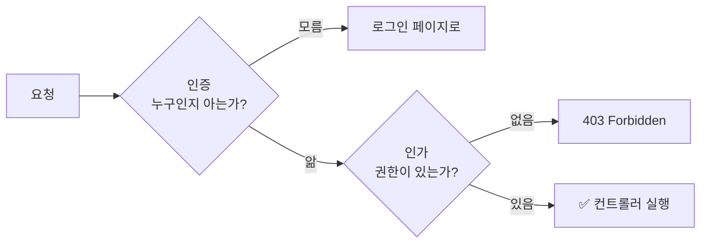

**항상 인증이 먼저**다. 누군지 알아야 권한을 따질 수 있다.

### 실습 기능 한눈에 보기

| 기능 | 내용 |
|---|---|
| 회원가입 | 비밀번호를 **BCrypt로 암호화**해서 저장, 권한(USER/ADMIN) 선택 |
| 로그인 / 로그아웃 | Security 필터가 처리 (**컨트롤러 없음**) |
| 권한별 접근 | URL 단위(`SecurityConfig`) + 메서드 단위(`@PreAuthorize`) |
| 로그인 유지 | Remember Me (24시간) |
| 계정 잠금 | 비밀번호 **5회 실패 시 잠금** |
| 로그인 로그 | 성공/실패, 시간, IP를 DB에 기록 → 관리자 페이지에서 조회 |
| 동시 접속 제한 | 한 계정당 세션 1개, 현재 활성 사용자 수 집계 |

---

## 2. 프로젝트 설정

### 의존성

```groovy
// Spring에서 제공하는 인증/인가 기능을 사용하기 위한 의존성
implementation 'org.springframework.boot:spring-boot-starter-security'

// Thymeleaf에서 sec: 문법(로그인 여부, 권한별 화면 처리)을 쓰기 위한 확장 의존성
implementation 'org.thymeleaf.extras:thymeleaf-extras-springsecurity6'

testImplementation 'org.springframework.security:spring-security-test'
```

> 💡 `spring-boot-starter-security`를 추가하는 **순간** 모든 URL이 잠긴다. 아무 설정도 안 하면 Spring이 기본 로그인 화면을 띄우고, 아이디 `user`와 콘솔에 출력된 랜덤 비밀번호(`Using generated security password: ...`)로만 들어갈 수 있다. 그래서 `SecurityConfig`로 **우리 규칙을 직접 정의**해야 한다.

### 테이블

```sql
CREATE TABLE TBL_USER (
    USER_NO           INT AUTO_INCREMENT,
    USER_ID           VARCHAR(30)  NOT NULL,           -- UNIQUE
    USER_NAME         VARCHAR(30),
    PASSWORD          VARCHAR(100) NOT NULL,           -- BCrypt 해시(60자)를 담을 수 있는 길이
    USER_ROLE         VARCHAR(50)  NOT NULL,           -- "USER", "ADMIN", "USER,ADMIN"
    LOGIN_FAIL_COUNT  INT          NOT NULL DEFAULT 0,
    IS_ACCOUNT_LOCKED BOOLEAN      NOT NULL DEFAULT FALSE,
    ...
);

CREATE TABLE TBL_LOGIN_LOG (
    ID          BIGINT AUTO_INCREMENT,
    USER_ID     VARCHAR(30) NOT NULL,
    LOGIN_TIME  DATETIME    NOT NULL,
    SUCCESS     BOOLEAN     NOT NULL,
    IP_ADDRESS  VARCHAR(45),           -- IPv6 최대 길이까지 고려
    ...
);
```

### 전체 흐름 지도

`SecurityConfig` 상단 주석에 정리된 흐름이다. 각 클래스 주석의 `[회원가입 ①]`, `[로그인 ③]` 번호를 따라가면 코드를 읽기 쉽다.

| 흐름 | 단계 |
|---|---|
| **회원가입** | ① GET `/user/signup` 화면 → ② POST `/user/signup` 입력값 받기 → ③ `MemberService.regist()` 비밀번호 암호화 후 `User.create()` → ④ `UserRepository.save()` |
| **로그인** | ① GET `/auth/login` 화면 → ② POST `/auth/login`을 **Security 필터가 가로챔** → ③ `AuthService.loadUserByUsername()` 회원 조회 → ④ `AuthDetails` 반환 → ⑤ Security가 잠금 여부·비밀번호 검사 → ⑥-1 성공 핸들러 / ⑥-2 실패 핸들러 |
| **로그인 이후 요청** | 요청 → 세션(`JSESSIONID`)으로 사용자 확인 → URL 권한 검사 → (`@PreAuthorize` 메서드 권한 검사) → 컨트롤러 |
| **로그아웃** | POST `/auth/logout` → 세션 무효화 + 쿠키 삭제 → `/`로 이동 (이것도 Security가 처리) |

---

## 3. Spring Security의 구조 — 필터 체인

<div style="margin:1.5em 0;overflow-x:auto"><svg viewBox="0 0 720 284" width="100%" role="img" aria-label="요청이 Security 필터 체인을 순서대로 통과한 뒤 DispatcherServlet과 컨트롤러에 도착한다" xmlns="http://www.w3.org/2000/svg" style="max-width:720px;font-family:'Pretendard','Noto Sans KR','Noto Sans CJK KR','Apple SD Gothic Neo','Malgun Gothic',sans-serif"><defs><marker id="sec-a1" viewBox="0 0 10 10" refX="9" refY="5" markerWidth="7" markerHeight="7" orient="auto"><path d="M0,0 L10,5 L0,10 z" fill="#3a3530"/></marker></defs><rect width="720" height="284" rx="12" fill="#fbf8f1"/><rect x="12" y="122" width="92" height="56" rx="8" fill="#e2eaf5" stroke="#3d6a9e"/><text x="58" y="146" text-anchor="middle" font-size="12.5" font-weight="700" fill="#2b2724">브라우저</text><text x="58" y="164" text-anchor="middle" font-size="10.5" fill="#6b625a">HTTP 요청</text><line x1="104" y1="150" x2="130" y2="150" stroke="#3a3530" stroke-width="1.5" marker-end="url(#sec-a1)"/><rect x="120" y="14" width="588" height="258" rx="12" fill="#efebe4" stroke="#8a8178" stroke-dasharray="5 4"/><text x="640" y="34" text-anchor="middle" font-size="11.5" font-weight="700" fill="#6b625a">Tomcat</text><rect x="133" y="30" width="430" height="232" rx="10" fill="#e3f1ee" stroke="#2f7f73" stroke-width="1.5"/><text x="348" y="51" text-anchor="middle" font-size="12.5" font-weight="700" fill="#2f7f73">SecurityFilterChain · 주요 필터만, 위에서부터 순서대로</text><rect x="141" y="105" width="414" height="22" rx="4" fill="#fbecd6"/><rect x="141" y="237" width="414" height="22" rx="4" fill="#fbecd6"/><g font-family="'D2Coding','JetBrains Mono',Consolas,monospace" font-size="11" fill="#2b2724"><text x="150" y="76">SecurityContextHolderFilter</text><text x="150" y="98">LogoutFilter</text><text x="150" y="120" font-weight="700" fill="#c47f22">UsernamePasswordAuthenticationFilter</text><text x="150" y="142">ConcurrentSessionFilter</text><text x="150" y="164">RequestCacheAwareFilter</text><text x="150" y="186">RememberMeAuthenticationFilter</text><text x="150" y="208">AnonymousAuthenticationFilter</text><text x="150" y="230">ExceptionTranslationFilter</text><text x="150" y="252" font-weight="700" fill="#c47f22">AuthorizationFilter</text></g><g font-size="10.5" fill="#6b625a"><text x="410" y="76">세션에서 인증 정보 꺼내기</text><text x="410" y="98">POST /auth/logout 처리</text><text x="410" y="120" font-weight="700" fill="#c47f22">POST /auth/login 처리</text><text x="410" y="142">만료된 세션 처리</text><text x="410" y="164">저장해 둔 요청 복원</text><text x="410" y="186">remember-me 쿠키 로그인</text><text x="410" y="208">비로그인이면 "익명" 지정</text><text x="410" y="230">인증·인가 예외를 응답으로</text><text x="410" y="252" font-weight="700" fill="#c47f22">URL 권한 최종 검사</text></g><line x1="563" y1="150" x2="587" y2="150" stroke="#3a3530" stroke-width="1.5" marker-end="url(#sec-a1)"/><rect x="590" y="122" width="108" height="44" rx="8" fill="#fff" stroke="#3d6a9e"/><text x="644" y="149" text-anchor="middle" font-size="11.5" font-weight="700" fill="#2b2724">Dispatcher</text><line x1="644" y1="166" x2="644" y2="190" stroke="#3a3530" stroke-width="1.5" marker-end="url(#sec-a1)"/><rect x="590" y="193" width="108" height="44" rx="8" fill="#2f7f73"/><text x="644" y="220" text-anchor="middle" font-size="12" font-weight="700" fill="#fff">Controller</text><text x="644" y="250" text-anchor="middle" font-size="10.5" fill="#6b625a">모두 통과해야</text><text x="644" y="264" text-anchor="middle" font-size="10.5" fill="#6b625a">도착</text></svg></div>

- Spring Security는 **서블릿 필터**로 동작한다. 즉 Spring MVC의 `DispatcherServlet`보다 **앞단**에서 실행된다. ([Spring MVC] 05편의 "Filter vs Interceptor"에서 Filter 위치)
- `SecurityConfig`에서 `formLogin`, `logout`, `rememberMe` 등을 설정할 때마다 그 기능을 담당하는 **필터가 체인에 추가**된다. (CSRF를 켜면 `LogoutFilter` 앞에 `CsrfFilter`도 들어간다)
- 그래서 **POST `/auth/login`을 처리하는 컨트롤러가 없다.** `UsernamePasswordAuthenticationFilter`가 요청을 가로채서 처리하고, 컨트롤러까지 가지 않는다.

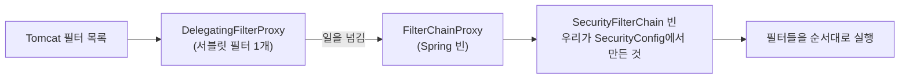

> 💡 정확히는 Tomcat에는 `DelegatingFilterProxy`라는 필터 하나만 등록되고, 이 필터가 Spring 빈인 `FilterChainProxy`에게 일을 넘긴다. `FilterChainProxy`가 우리가 만든 `SecurityFilterChain` 빈 안의 필터들을 순서대로 실행한다. "서블릿 세계"와 "Spring 빈 세계"를 연결하는 다리 역할이다.

---

## 4. SecurityConfig — 보안 규칙 모음 ⭐

```java
@Configuration
@EnableWebSecurity
// TODO [메서드 권한] @EnableMethodSecurity
public class SecurityConfig {
    ...
    @Bean
    public SecurityFilterChain configure(HttpSecurity http,
                                         AuthFailHandler authFailHandler,       // 로그인 실패 시 동작
                                         AuthSuccessHandler authSuccessHandler, // 로그인 성공 시 동작
                                         SessionRegistry sessionRegistry) throws Exception {
        http.authorizeHttpRequests(...)   // 1. 요청별 접근 권한
            .formLogin(...)               // 2. 로그인
            .rememberMe(...)              // 3. 로그인 유지
            .logout(...)                  // 4. 로그아웃
            .sessionManagement(...)       // 5. 세션
            .csrf(csrf -> csrf.disable()); // 6. CSRF (학습용으로 비활성화)

        return http.build();
    }
}
```

`@Component`로 등록된 핸들러들은 `@Bean` 메서드의 **매개변수로 선언만 하면** Spring이 주입해준다.

| 설정 | 다루는 곳 |
|---|---|
| `authorizeHttpRequests` | 10장 인가 |
| `formLogin` | 6장 로그인 |
| `rememberMe` / `logout` | 11장 |
| `sessionManagement` | 12장 동시 접속 |
| `csrf` | 13장 |

### PasswordEncoder — BCrypt

```java
@Bean
public PasswordEncoder passwordEncoder() {
    return new BCryptPasswordEncoder();
}
```

**BCrypt를 쓰는 이유**

| 특징 | 설명 |
|---|---|
| 보안성 | 해시할 때마다 **무작위 솔트(salt)** 를 섞는다 |
| 비용 조절 | 매개변수(strength)로 계산 시간을 늘려 **무차별 대입 공격**을 어렵게 한다 |
| 호환성 | 결과가 문자열이라 DB에 저장하기 쉽다 |
| 신뢰성 | 오랫동안 검증되어 널리 쓰이는 알고리즘 |

**해시 결과를 직접 보면**

```java
encoder.encode("pass0123");   // $2a$10$Ezq0L1n6...(총 60자)
encoder.encode("pass0123");   // $2a$10$7bXk9Pq2...  ← 같은 비밀번호인데 결과가 다르다!
```

```
$2a$10$ Ezq0L1n6tQXJ0gNxXg5bJe  oQ9T1M8wV4jK9h2...
 │   │  └──── 솔트 (22자) ────┘  └── 해시값 ──┘
 │   └ 비용(cost) 10 = 2^10번 반복
 └ 알고리즘 버전
```

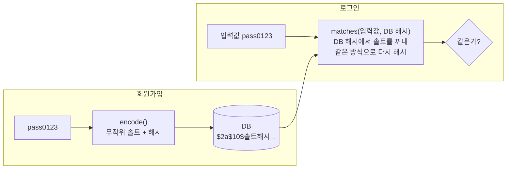

- 솔트가 매번 달라서 **같은 비밀번호도 다른 해시**가 된다. DB가 유출돼도 "같은 비밀번호 쓰는 사람"을 알 수 없고, 미리 계산해둔 해시표(레인보우 테이블) 공격도 막힌다.
- 해시는 **되돌릴 수 없다(단방향).** 그래서 로그인할 때 DB 값을 복호화하는 게 아니라, `encoder.matches(입력한 비밀번호, DB의 해시)`로 **솔트를 꺼내 같은 방식으로 다시 해시해서 비교**한다. 이 비교는 Security가 알아서 해준다.
- 이런 이유로 "비밀번호 찾기"는 원래 비밀번호를 알려줄 수 없고 **재설정**만 가능하다.

---

## 5. 회원가입 — 비밀번호는 절대 그대로 저장하지 않는다

```java
@Transactional
public Integer regist(SignupDTO signupDTO) {

    // 중복 아이디 체크 -> 중복이면 null 반환
    if (userRepository.existsByUserId(signupDTO.getUserId())) {
        return null;
    }

    try {
        User user = User.create(
                signupDTO.getUserId(),
                signupDTO.getUserName(),
                encoder.encode(signupDTO.getUserPass()),   // BCrypt 적용
                signupDTO.getRole()
        );
        User savedUser = userRepository.save(user);
        return savedUser.getUserCode();                    // 1 이상 : 성공
    } catch (Exception e) {
        e.printStackTrace();
        return 0;                                          // 0 : 서버 오류
    }
}
```

```java
// 신규 회원 생성용 정적 팩토리 메서드 : 실패 횟수 0, 잠금 해제 상태로 시작
public static User create(String userId, String userName, String encodedPassword, String userRole) {
    return new User(null, userId, userName, encodedPassword, userRole, 0, false);
}
```

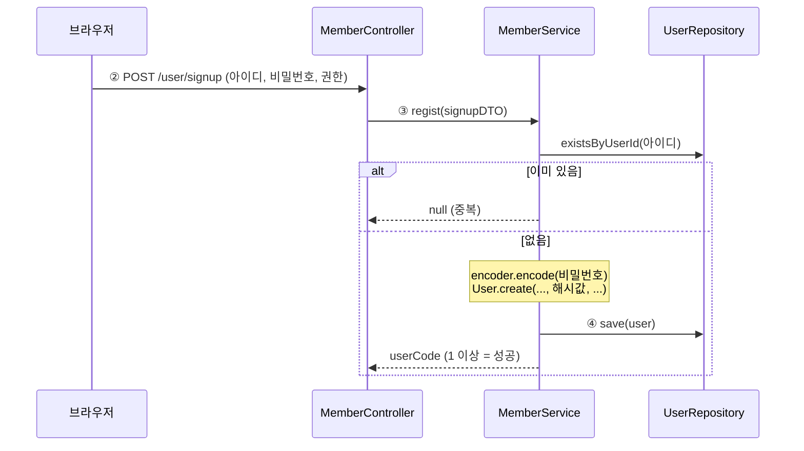

- 매개변수 이름을 `encodedPassword`로 지어서 **"암호화된 값만 받는다"는 약속**을 이름으로 드러냈다.
- [JPA] 04편 미니 프로젝트와 같은 패턴: 전체 필드 생성자는 `private`, 생성은 `User.create()`로만.

> ⚠️ 이번 실습은 테스트를 위해 회원가입 화면에서 **권한(ADMIN)을 직접 고를 수 있다.** 실제 서비스라면 누구나 관리자로 가입할 수 있는 심각한 보안 구멍이다. 가입은 항상 `USER`로 고정하고, 관리자 권한은 관리자가 별도로 부여해야 한다.

---

## 6. 로그인 흐름 — 우리가 만드는 것과 Security가 하는 것 ⭐

<div style="margin:1.5em 0;overflow-x:auto"><svg viewBox="0 0 720 470" width="100%" role="img" aria-label="로그인 처리 흐름: 필터, AuthService, AuthDetails, 잠금 검사, 비밀번호 검사, 성공과 실패 핸들러" xmlns="http://www.w3.org/2000/svg" style="max-width:720px;font-family:'Pretendard','Noto Sans KR','Noto Sans CJK KR','Apple SD Gothic Neo','Malgun Gothic',sans-serif"><defs><marker id="sec-a2" viewBox="0 0 10 10" refX="9" refY="5" markerWidth="7" markerHeight="7" orient="auto"><path d="M0,0 L10,5 L0,10 z" fill="#3a3530"/></marker><marker id="sec-a3" viewBox="0 0 10 10" refX="9" refY="5" markerWidth="7" markerHeight="7" orient="auto"><path d="M0,0 L10,5 L0,10 z" fill="#b5523b"/></marker></defs><rect width="720" height="470" rx="12" fill="#fbf8f1"/><g font-size="12" text-anchor="middle"><rect x="25" y="15" width="410" height="36" rx="8" fill="#e2eaf5" stroke="#3d6a9e"/><text x="230" y="38" fill="#2b2724">① GET /auth/login → AuthController → login.html</text><rect x="25" y="68" width="410" height="36" rx="8" fill="#fbecd6" stroke="#c47f22" stroke-width="1.5"/><text x="230" y="91" fill="#2b2724" font-weight="700">② POST /auth/login (user, pass) → Security 필터가 가로챔</text><rect x="25" y="121" width="410" height="36" rx="8" fill="#efebe4" stroke="#8a8178"/><text x="230" y="144" fill="#2b2724">AuthenticationManager → DaoAuthenticationProvider</text><rect x="25" y="174" width="410" height="36" rx="8" fill="#e3f1ee" stroke="#2f7f73" stroke-width="1.5"/><text x="230" y="197" fill="#2b2724" font-weight="700">③ AuthService.loadUserByUsername(아이디)  — 우리가 구현</text><rect x="25" y="227" width="410" height="36" rx="8" fill="#e3f1ee" stroke="#2f7f73" stroke-width="1.5"/><text x="230" y="250" fill="#2b2724" font-weight="700">④ new AuthDetails(LoginUserDTO) 반환  — 우리가 구현</text><rect x="25" y="280" width="410" height="36" rx="8" fill="#fff" stroke="#8a8178"/><text x="230" y="303" fill="#2b2724">⑤-a isAccountNonLocked() 잠금 검사  — Security</text><rect x="25" y="333" width="410" height="36" rx="8" fill="#fff" stroke="#8a8178"/><text x="230" y="356" fill="#2b2724">⑤-b passwordEncoder.matches(입력값, DB 해시)  — Security</text><rect x="25" y="386" width="410" height="68" rx="10" fill="#2f7f73"/><text x="230" y="410" fill="#fff" font-weight="700">⑥-1 인증 성공 → 세션에 SecurityContext 저장</text><text x="230" y="430" fill="#fff">AuthSuccessHandler : 실패 횟수 초기화 · 성공 로그</text><text x="230" y="446" fill="#d6ebe6" font-size="11">→ redirect "/"</text></g><g stroke="#3a3530" stroke-width="1.5" marker-end="url(#sec-a2)"><line x1="230" y1="51" x2="230" y2="65"/><line x1="230" y1="104" x2="230" y2="118"/><line x1="230" y1="157" x2="230" y2="171"/><line x1="230" y1="210" x2="230" y2="224"/><line x1="230" y1="263" x2="230" y2="277"/><line x1="230" y1="316" x2="230" y2="330"/><line x1="230" y1="369" x2="230" y2="383"/></g><rect x="470" y="170" width="225" height="44" rx="8" fill="#f8e1dc" stroke="#b5523b"/><text x="582" y="188" text-anchor="middle" font-size="11.5" font-weight="700" fill="#b5523b">아이디 없음</text><text x="582" y="205" text-anchor="middle" font-size="10.5" fill="#2b2724">UsernameNotFound → BadCredentials</text><rect x="470" y="276" width="225" height="44" rx="8" fill="#f8e1dc" stroke="#b5523b"/><text x="582" y="294" text-anchor="middle" font-size="11.5" font-weight="700" fill="#b5523b">계정 잠김</text><text x="582" y="311" text-anchor="middle" font-size="10.5" fill="#2b2724">LockedException</text><rect x="470" y="329" width="225" height="44" rx="8" fill="#f8e1dc" stroke="#b5523b"/><text x="582" y="347" text-anchor="middle" font-size="11.5" font-weight="700" fill="#b5523b">비밀번호 불일치</text><text x="582" y="364" text-anchor="middle" font-size="10.5" fill="#2b2724">BadCredentialsException</text><g stroke="#b5523b" stroke-width="1.5" stroke-dasharray="5 3" marker-end="url(#sec-a3)"><line x1="435" y1="192" x2="467" y2="192"/><line x1="435" y1="298" x2="467" y2="298"/><line x1="435" y1="351" x2="467" y2="351"/></g><path d="M695,192 L708,192 L708,420 L697,420 M695,298 L708,298 M695,351 L708,351" fill="none" stroke="#b5523b" stroke-width="1.2"/><line x1="708" y1="420" x2="697" y2="420" stroke="#b5523b" stroke-width="1.2" marker-end="url(#sec-a3)"/><rect x="470" y="386" width="225" height="68" rx="10" fill="#b5523b"/><text x="582" y="410" text-anchor="middle" font-size="12" font-weight="700" fill="#fff">⑥-2 AuthFailHandler</text><text x="582" y="429" text-anchor="middle" font-size="11" fill="#fff">실패 횟수 +1 (5회 잠금) · 실패 로그</text><text x="582" y="445" text-anchor="middle" font-size="11" fill="#f8e1dc">→ /auth/fail?message=...</text><text x="582" y="135" text-anchor="middle" font-size="11" fill="#6b625a">실패하면 어디서든</text><text x="582" y="151" text-anchor="middle" font-size="11" fill="#6b625a">실패 핸들러로</text></svg></div>

**핵심**: 우리가 구현하는 것은 **③ 회원 조회**와 **④ Security가 이해하는 형태로 감싸기**뿐이다. 비밀번호 비교, 잠금 확인, 세션 저장은 **Security가 직접** 한다.

### 로그인 화면과 formLogin 설정

```html
<!-- POST /auth/login 은 컨트롤러가 아닌 Security 필터가 처리한다. -->
<form th:action="@{/auth/login}" method="post">
    <input type="text" name="user">       <!-- usernameParameter("user") 와 일치 -->
    <input type="password" name="pass">   <!-- passwordParameter("pass") 와 일치 -->
    <input type="checkbox" name="remember-me"> 이 컴퓨터에서 로그인 유지하기
    <button type="submit">로그인</button>
</form>
```

```java
.formLogin(login -> {
    login.loginPage("/auth/login");           // 로그인 페이지 GET 경로 (컨트롤러에 핸들러가 있어야 함)
    login.usernameParameter("user");          // 아이디 input 의 name
    login.passwordParameter("pass");          // 비밀번호 input 의 name
    login.successHandler(authSuccessHandler); // ⑥-1 성공 시 실행
    login.failureHandler(authFailHandler);    // ⑥-2 실패 시 실행
})
```

- 기본 파라미터 이름은 `username`, `password`다. 화면의 `name`이 다르면 반드시 맞춰줘야 한다. 이름이 틀리면 아이디가 항상 빈 값으로 넘어가서 로그인이 계속 실패한다. ([Spring MVC] 02편의 "name 속성 맞추기"와 같은 문제)
- `loginPage()`는 **GET 화면 경로**이자, 기본적으로 **POST 처리 경로**도 같은 URL이 된다. (다르게 하려면 `loginProcessingUrl()`)

```java
@Controller
@RequestMapping("/auth")
public class AuthController {

    // ① 로그인 화면만 보여준다. POST /auth/login 처리 메서드는 없다!
    @GetMapping("/login")
    public String login() {
        return "auth/login";
    }
}
```

### ③ UserDetailsService — 회원 조회

```java
@Service
@RequiredArgsConstructor
public class AuthService implements UserDetailsService {

    private final MemberService memberService;

    // SecurityFilter 가 직접 실행하는 메서드. username = 로그인 form 에 입력한 아이디
    @Override
    public UserDetails loadUserByUsername(String username) throws UsernameNotFoundException {

        LoginUserDTO loginUser = memberService.findByUsername(username);

        if (Objects.isNull(loginUser)) {
            throw new UsernameNotFoundException("회원정보가 존재하지 않습니다!");
        }

        // return 되는 객체가 곧 Session 에 저장되는 객체
        return new AuthDetails(loginUser);
    }
}
```

```java
// MemberService : 없으면 null (AuthService 에서 예외로 바꾼다)
public LoginUserDTO findByUsername(String username) {
    return userRepository.findByUserId(username)
                         .map(LoginUserDTO::from)    // 메서드 참조 : user -> LoginUserDTO.from(user)
                         .orElse(null);
}
```

- `UserDetailsService`는 Security가 "**이 아이디의 회원 정보를 가져와줘**"라고 부르는 인터페이스다. 메서드는 `loadUserByUsername` 하나뿐이다.
- 여기서는 **조회만** 한다. 비밀번호를 받지도, 비교하지도 않는다.
- 이 인터페이스를 구현한 빈이 **하나**만 있으면 Spring Security가 자동으로 찾아서 로그인과 Remember Me에 사용한다.

### ④ UserDetails — Security가 이해하는 사용자 ⭐

```java
@Getter @Setter @NoArgsConstructor @AllArgsConstructor
public class AuthDetails implements UserDetails {

    private LoginUserDTO loginUserDTO;   // 우리가 만든 회원 정보를 감싼다

    // 권한 목록 : hasAnyAuthority("ADMIN") 같은 검사에 사용
    @Override
    public Collection<? extends GrantedAuthority> getAuthorities() {
        Collection<GrantedAuthority> authorities = new ArrayList<>();
        loginUserDTO.getRole().forEach(role -> authorities.add(() -> role));
        return authorities;
    }

    @Override
    public String getPassword() { return loginUserDTO.getPassword(); }   // 비교할 DB 비밀번호(해시)

    @Override
    public String getUsername() { return loginUserDTO.getUserId(); }

    @Override
    public boolean isAccountNonLocked() {
        return !loginUserDTO.isAccountLocked();     // 잠긴 계정이면 false
    }

    @Override public boolean isAccountNonExpired()     { return true; }
    @Override public boolean isCredentialsNonExpired() { return true; }
    @Override public boolean isEnabled()               { return true; }
}
```

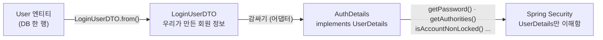

**`UserDetails`가 필요한 이유**: Security는 우리가 만든 `User`나 `LoginUserDTO` 클래스를 모른다. 그래서 "비밀번호는 `getPassword()`로, 권한은 `getAuthorities()`로 줘"라는 **약속(인터페이스)** 을 정해두고, 우리가 그 약속대로 감싸서 넘겨준다. **어댑터** 역할이다.

| 메서드 | Security가 언제 쓰나 |
|---|---|
| `getPassword()` | ⑤-b 입력한 비밀번호와 비교 |
| `getAuthorities()` | URL 권한 검사, `@PreAuthorize`, 화면의 `sec:authorize` |
| `isAccountNonLocked()` | ⑤-a 잠긴 계정인지 (`false`면 `LockedException`) |
| `isAccountNonExpired()` | 계정 만료 여부 |
| `isCredentialsNonExpired()` | 비밀번호 만료 여부 (예: 90일마다 변경 정책) |
| `isEnabled()` | 계정 활성화 여부 (탈퇴, 정지 등) |

아래 4개 중 하나라도 `false`면 로그인할 수 없다. 이번 실습은 **잠금**만 실제 값으로 판단한다.

**권한 문자열 → `GrantedAuthority` 변환**

```java
// LoginUserDTO : "USER,ADMIN" -> ["USER", "ADMIN"]
public List<String> getRole() {
    if (this.userRole != null && this.userRole.length() > 0) {
        return Arrays.asList(this.userRole.split(","));
    }
    return new ArrayList<>();
}
```

- 반환 타입이 `Collection`인 이유는 **한 사용자가 여러 권한**을 가질 수 있기 때문이다.
- `GrantedAuthority`는 메서드가 `getAuthority()` 하나뿐인 **함수형 인터페이스**라서 `() -> role` 람다로 만들 수 있다. 같은 일을 하는 기본 구현 클래스 `new SimpleGrantedAuthority(role)`도 있다.

### ⑤ Security의 검사 순서

`DaoAuthenticationProvider` 내부에서 실제로 일어나는 순서다.

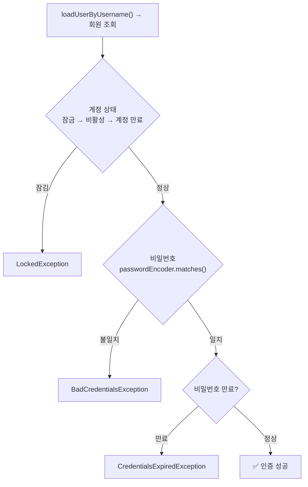

**계정 상태를 비밀번호보다 먼저** 본다. 그래서 잠긴 계정은 비밀번호가 맞든 틀리든 `LockedException`이 난다.

---

## 7. 성공 핸들러와 실패 핸들러

### ⑥-1 AuthSuccessHandler

```java
@Component
@RequiredArgsConstructor
public class AuthSuccessHandler extends SimpleUrlAuthenticationSuccessHandler {

    private final MemberService memberService;
    private final LoginLogRepository loginLogRepository;

    @Override
    public void onAuthenticationSuccess(HttpServletRequest request, HttpServletResponse response,
                                        Authentication authentication) throws IOException, ServletException {

        String username = authentication.getName();   // 인증된 사용자 아이디

        memberService.resetLoginFailCount(username);   // 1. 실패 횟수 초기화

        loginLogRepository.save(                        // 2. 성공 로그 (IP : 접속한 컴퓨터 주소)
                LoginLog.create(username, true, request.getRemoteAddr()));

        super.onAuthenticationSuccess(request, response, authentication);   // 3. 페이지 이동
    }
}
```

- 호출 시점에는 **이미 인증이 끝나고** 세션에 로그인 정보가 저장된 상태다.
- 인터페이스(`AuthenticationSuccessHandler`)를 직접 구현하지 않고, 이미 구현된 클래스를 **상속**해서 필요한 기능만 덧붙인 뒤 기본 동작(페이지 이동)은 `super`에 맡긴다.

> ⚠️ **"로그인 전에 가려던 페이지로 돌아가기"는 이 부모 클래스로는 안 된다.** 로그인하지 않은 상태로 `/admin/logs`에 접근하면 Security는 그 요청을 기억해두고 로그인 페이지로 보낸다. 그런데 `SimpleUrlAuthenticationSuccessHandler`는 기억해둔 요청을 보지 않고 **항상 기본 경로(`/`)로** 보낸다. 원래 가려던 페이지로 돌아가게 하려면 **`SavedRequestAwareAuthenticationSuccessHandler`** 를 상속해야 한다. (`formLogin`의 기본 성공 핸들러가 바로 이 클래스다.)

> 💡 로컬에서 실행하면 IP가 `0:0:0:0:0:0:0:1`로 찍힌다. IPv6의 `localhost`(`::1`)라서 정상이다. 앞단에 프록시나 로드밸런서가 있으면 `getRemoteAddr()`는 프록시의 주소가 되므로, `X-Forwarded-For` 헤더를 함께 확인해야 진짜 사용자 IP를 알 수 있다.

### ⑥-2 AuthFailHandler

```java
@Component
@RequiredArgsConstructor
public class AuthFailHandler extends SimpleUrlAuthenticationFailureHandler {

    private final MemberService memberService;
    private final LoginLogRepository loginLogRepository;

    @Override
    public void onAuthenticationFailure(HttpServletRequest request, HttpServletResponse response,
                                        AuthenticationException exception) throws IOException, ServletException {

        String errorMessage;
        // 실패했으므로 인증 객체가 없다 -> form 에 입력한 값을 request 에서 꺼낸다
        String username = request.getParameter("user");

        // 1. 실패 원인(예외 타입)별 메시지
        if (exception instanceof BadCredentialsException) {
            errorMessage = "아이디가 존재하지 않거나 비밀번호가 일치하지 않습니다.";
            if (username != null && !username.isEmpty()) {
                memberService.incrementLoginFailCount(username);   // 실패 횟수 증가
                errorMessage += " (실패 횟수: 누적)";
            }
        } else if (exception instanceof LockedException) {
            errorMessage = "계정이 잠겨있습니다. 관리자에게 문의하세요.";
        } else if (exception instanceof InternalAuthenticationServiceException) {
            errorMessage = "서버에서 오류가 발생되었습니다.";
        } else if (exception instanceof UsernameNotFoundException) {
            errorMessage = "존재하지 않는 아이디입니다.";
        } else if (exception instanceof AuthenticationCredentialsNotFoundException) {
            errorMessage = "인증 요청이 거부되었습니다.";
        } else {
            errorMessage = "알 수 없는 오류로 로그인 요청을 처리할 수 없습니다.";
        }

        // 2. 실패 로그 저장
        loginLogRepository.save(LoginLog.create(username, false, request.getRemoteAddr()));

        // 3. 실패 안내 페이지로 이동 (URL 에 한글을 그대로 넣을 수 없어 인코딩)
        errorMessage = URLEncoder.encode(errorMessage, "UTF-8");
        setDefaultFailureUrl("/auth/fail?message=" + errorMessage);
        super.onAuthenticationFailure(request, response, exception);
    }
}
```

| 예외 | 발생 상황 |
|---|---|
| `BadCredentialsException` | 비밀번호 불일치 (+ 아이디가 없는 경우도, 아래 참고) |
| `LockedException` | `isAccountNonLocked()`가 `false` |
| `InternalAuthenticationServiceException` | 회원 조회 중 서버 오류 (예: DB 연결 실패) |
| `UsernameNotFoundException` | `AuthService`에서 던진 예외 |
| `AuthenticationCredentialsNotFoundException` | 인증 정보 없이 보안 리소스 접근 |

> 💡 **`UsernameNotFoundException` 분기는 실제로는 실행되지 않는다.** `AuthService`가 `UsernameNotFoundException`을 던져도, Security는 기본 설정에서 이를 **`BadCredentialsException`으로 바꿔서** 실패 핸들러에 넘긴다. "존재하지 않는 아이디입니다"와 "비밀번호가 틀렸습니다"를 구분해서 알려주면, 공격자가 **어떤 아이디가 가입되어 있는지 알아낼 수 있기** 때문이다. (계정 열거 공격) 그래서 첫 번째 분기의 메시지처럼 "아이디가 존재하지 않거나 비밀번호가 일치하지 않습니다"로 **뭉뚱그리는 것이 보안상 올바른 방식**이다.

### ⚠️ 싱글톤 빈에서 `setDefaultFailureUrl()`을 매번 바꾸는 것은 위험하다

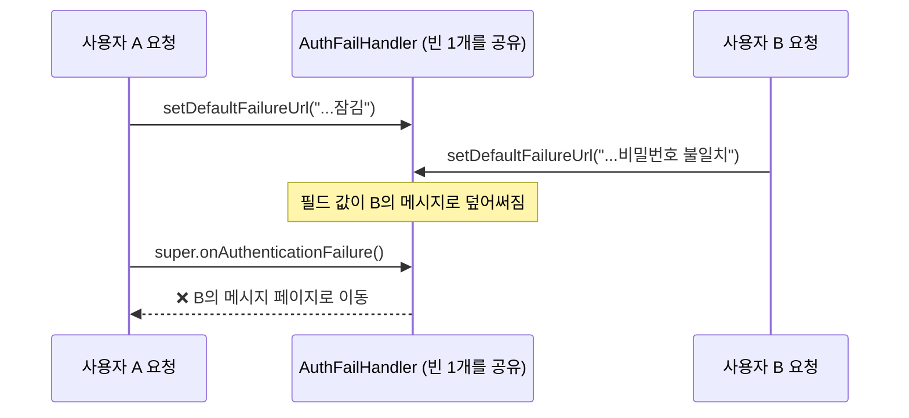

`AuthFailHandler`는 애플리케이션에 **하나뿐인 빈**이고, 모든 사용자의 실패 요청이 이 객체 하나를 함께 쓴다. 실패할 때마다 객체의 필드(실패 URL)를 바꾸면, 두 사람이 **동시에** 실패했을 때 A의 요청이 B의 메시지로 이동하는 일이 생길 수 있다. (경쟁 상태) 학습 환경에서는 거의 드러나지 않지만, 필드를 바꾸지 않고 **이번 요청에만 쓰이는 값으로 바로 redirect** 하는 방식이 안전하다.

```java
// 3. 필드를 바꾸지 않고, 이번 요청의 URL로 바로 이동
errorMessage = URLEncoder.encode(errorMessage, StandardCharsets.UTF_8);
getRedirectStrategy().sendRedirect(request, response, "/auth/fail?message=" + errorMessage);
```

Spring 빈은 기본이 싱글톤이므로 **필드에 요청별 상태를 저장하지 않는다**는 원칙을 기억하자.

---

## 8. 계정 잠금 — 5회 실패 시 잠금

<div style="margin:1.5em 0;overflow-x:auto"><svg viewBox="0 0 720 210" width="100%" role="img" aria-label="비밀번호를 5번 틀리면 계정이 잠기고, 그 전에 로그인에 성공하면 실패 횟수가 0으로 초기화된다" xmlns="http://www.w3.org/2000/svg" style="max-width:720px;font-family:'Pretendard','Noto Sans KR','Noto Sans CJK KR','Apple SD Gothic Neo','Malgun Gothic',sans-serif"><defs><marker id="sec-a4" viewBox="0 0 10 10" refX="9" refY="5" markerWidth="7" markerHeight="7" orient="auto"><path d="M0,0 L10,5 L0,10 z" fill="#3a3530"/></marker></defs><rect width="720" height="210" rx="12" fill="#fbf8f1"/><text x="260" y="32" text-anchor="middle" font-size="12.5" font-weight="700" fill="#2b2724">비밀번호를 틀릴 때마다 LOGIN_FAIL_COUNT + 1</text><g text-anchor="middle" font-size="16" font-weight="700"><circle cx="80" cy="85" r="24" fill="#fbecd6" stroke="#c47f22" stroke-width="1.5"/><text x="80" y="91" fill="#c47f22">1</text><circle cx="170" cy="85" r="24" fill="#fbecd6" stroke="#c47f22" stroke-width="1.5"/><text x="170" y="91" fill="#c47f22">2</text><circle cx="260" cy="85" r="24" fill="#fbecd6" stroke="#c47f22" stroke-width="1.5"/><text x="260" y="91" fill="#c47f22">3</text><circle cx="350" cy="85" r="24" fill="#fbecd6" stroke="#c47f22" stroke-width="1.5"/><text x="350" y="91" fill="#c47f22">4</text><circle cx="440" cy="85" r="24" fill="#b5523b"/><text x="440" y="91" fill="#fff">5</text></g><g stroke="#3a3530" stroke-width="1.3" marker-end="url(#sec-a4)"><line x1="104" y1="85" x2="143" y2="85"/><line x1="194" y1="85" x2="233" y2="85"/><line x1="284" y1="85" x2="323" y2="85"/><line x1="374" y1="85" x2="413" y2="85"/><line x1="464" y1="85" x2="512" y2="85"/></g><rect x="515" y="55" width="190" height="60" rx="10" fill="#b5523b"/><text x="610" y="80" text-anchor="middle" font-size="14" font-weight="700" fill="#fff">계정 잠금</text><text x="610" y="100" text-anchor="middle" font-size="11" font-family="'D2Coding','JetBrains Mono',Consolas,monospace" fill="#f8e1dc">IS_ACCOUNT_LOCKED = true</text><text x="610" y="138" text-anchor="middle" font-size="11" fill="#b5523b">이후에는 맞는 비밀번호도</text><text x="610" y="154" text-anchor="middle" font-size="11" fill="#b5523b" font-weight="700">LockedException</text><line x1="350" y1="109" x2="350" y2="145" stroke="#2f7f73" stroke-width="1.5" stroke-dasharray="4 3" marker-end="url(#sec-a4)"/><rect x="60" y="148" width="400" height="44" rx="10" fill="#e3f1ee" stroke="#2f7f73" stroke-width="1.5"/><text x="260" y="167" text-anchor="middle" font-size="12" font-weight="700" fill="#2f7f73">잠기기 전에 로그인 성공</text><text x="260" y="184" text-anchor="middle" font-size="11" fill="#2b2724">AuthSuccessHandler → resetLoginFailCount() → 0으로 초기화</text></svg></div>

```java
// User 엔티티의 도메인 메서드
public void increaseLoginFailCount() {
    this.loginFailCount++;
    if (this.loginFailCount >= 5) {
        this.isAccountLocked = true;
    }
}

public void resetLoginFailCount() {
    this.loginFailCount = 0;
}
```

```java
// MemberService
@Transactional
public void incrementLoginFailCount(String username) {
    userRepository.findByUserId(username)
                  .ifPresent(User::increaseLoginFailCount);   // 회원이 있을 때만 (없는 아이디는 무시)
}
```

- 값 변경은 **엔티티의 도메인 메서드**가, UPDATE는 **변경 감지**가 처리한다. `save()`를 부르지 않는다. ([JPA] 02·04편과 같은 원리)
- 잠금 판단 규칙(5회)이 `User` 안에 있어서, 횟수 정책이 바뀌어도 `User` 한 곳만 고치면 된다.
- 잠긴 계정은 ⑤-a에서 먼저 막히기 때문에, 그 뒤로는 실패 횟수도 더 늘지 않는다.

> 💡 지금은 한 번 잠기면 **풀 방법이 없다.** 실무에서는 관리자 잠금 해제 기능, 일정 시간 후 자동 해제, 본인 인증 후 해제 같은 정책을 함께 만든다.

---

## 9. 세션 — 로그인 상태는 어디에 저장될까?

<div style="margin:1.5em 0;overflow-x:auto"><svg viewBox="0 0 720 265" width="100%" role="img" aria-label="브라우저는 JSESSIONID 쿠키만 갖고 서버 세션에 SecurityContext와 Authentication이 저장된다" xmlns="http://www.w3.org/2000/svg" style="max-width:720px;font-family:'Pretendard','Noto Sans KR','Noto Sans CJK KR','Apple SD Gothic Neo','Malgun Gothic',sans-serif"><defs><marker id="sec-a5" viewBox="0 0 10 10" refX="9" refY="5" markerWidth="7" markerHeight="7" orient="auto"><path d="M0,0 L10,5 L0,10 z" fill="#3a3530"/></marker></defs><rect width="720" height="265" rx="12" fill="#fbf8f1"/><rect x="18" y="45" width="175" height="175" rx="12" fill="#e2eaf5" stroke="#3d6a9e" stroke-width="1.5"/><text x="105" y="70" text-anchor="middle" font-size="13" font-weight="700" fill="#3d6a9e">브라우저</text><text x="105" y="94" text-anchor="middle" font-size="11" fill="#6b625a">쿠키 저장소</text><rect x="32" y="104" width="147" height="34" rx="6" fill="#fff" stroke="#3d6a9e"/><text x="105" y="126" text-anchor="middle" font-size="11" font-family="'D2Coding','JetBrains Mono',Consolas,monospace" fill="#2b2724">JSESSIONID=A1B2</text><rect x="32" y="148" width="147" height="34" rx="6" fill="#fff" stroke="#8a8178" stroke-dasharray="4 3"/><text x="105" y="170" text-anchor="middle" font-size="11" font-family="'D2Coding','JetBrains Mono',Consolas,monospace" fill="#6b625a">remember-me=...</text><text x="105" y="204" text-anchor="middle" font-size="10.5" fill="#6b625a">(로그인 유지 체크 시)</text><line x1="193" y1="105" x2="322" y2="105" stroke="#3a3530" stroke-width="1.5" marker-end="url(#sec-a5)"/><text x="257" y="84" text-anchor="middle" font-size="11" fill="#2b2724">매 요청마다</text><text x="257" y="98" text-anchor="middle" font-size="10.5" font-family="'D2Coding','JetBrains Mono',Consolas,monospace" fill="#3d6a9e">Cookie: JSESSIONID</text><line x1="325" y1="170" x2="196" y2="170" stroke="#3a3530" stroke-width="1.5" marker-end="url(#sec-a5)"/><text x="257" y="189" text-anchor="middle" font-size="11" fill="#2b2724">로그인 성공 시</text><text x="257" y="203" text-anchor="middle" font-size="10.5" font-family="'D2Coding','JetBrains Mono',Consolas,monospace" fill="#2f7f73">Set-Cookie: JSESSIONID</text><rect x="325" y="20" width="380" height="228" rx="12" fill="#efebe4" stroke="#8a8178"/><text x="515" y="42" text-anchor="middle" font-size="13" font-weight="700" fill="#2b2724">서버 세션 저장소 (Tomcat 메모리)</text><rect x="342" y="54" width="346" height="180" rx="10" fill="#fff" stroke="#2f7f73" stroke-width="1.5"/><text x="356" y="74" font-size="11.5" font-weight="700" fill="#2f7f73">세션 A1B2</text><rect x="356" y="84" width="318" height="140" rx="8" fill="#e3f1ee" stroke="#2f7f73"/><text x="368" y="102" font-size="10.5" font-family="'D2Coding','JetBrains Mono',Consolas,monospace" fill="#6b625a">SPRING_SECURITY_CONTEXT</text><rect x="370" y="110" width="290" height="104" rx="6" fill="#fff" stroke="#2f7f73"/><text x="382" y="128" font-size="11" font-weight="700" font-family="'D2Coding','JetBrains Mono',Consolas,monospace" fill="#2b2724">SecurityContext</text><path d="M386,134 L386,142 L394,142" fill="none" stroke="#2b2724"/><text x="398" y="146" font-size="11" font-family="'D2Coding','JetBrains Mono',Consolas,monospace" fill="#2b2724">Authentication</text><text x="398" y="166" font-size="10.5" font-family="'D2Coding','JetBrains Mono',Consolas,monospace" fill="#c47f22">principal   : AuthDetails</text><text x="398" y="184" font-size="10.5" font-family="'D2Coding','JetBrains Mono',Consolas,monospace" fill="#c47f22">authorities : [ADMIN]</text><text x="398" y="202" font-size="10.5" font-family="'D2Coding','JetBrains Mono',Consolas,monospace" fill="#c47f22">authenticated : true</text></svg></div>

1. 로그인에 성공하면 Security가 `Authentication` 객체(안에 `AuthDetails`와 권한 목록)를 `SecurityContext`에 담아 **서버 세션**에 저장한다.
2. 브라우저에는 그 세션을 찾을 수 있는 **번호표(`JSESSIONID` 쿠키)** 만 준다.
3. 다음 요청부터 브라우저가 쿠키를 자동으로 보내면, `SecurityContextHolderFilter`가 세션에서 인증 정보를 꺼내 "이 요청은 admin이 보낸 것"이라고 판단한다.

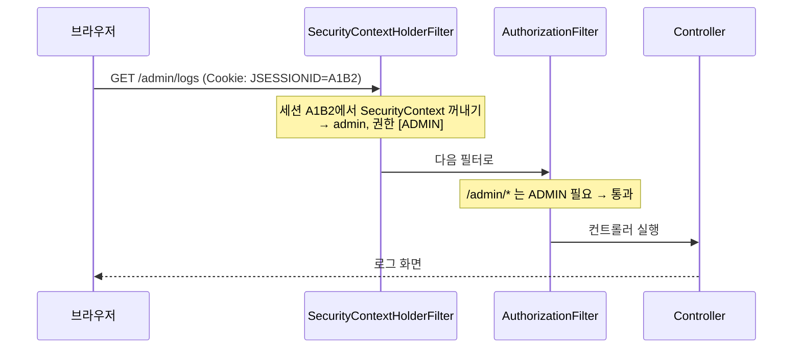

> 💡 **세션 고정(Session Fixation) 공격 방어**: 공격자가 미리 알고 있는 세션 ID를 피해자에게 심어두고, 피해자가 그 세션으로 로그인하면 공격자도 같은 세션을 쓰게 되는 공격이 있다. Spring Security는 **로그인에 성공하는 순간 세션 ID를 새로 바꿔서** 이를 막는다. (기본 동작) 로그인 전후로 F12 → Application → Cookies에서 `JSESSIONID` 값이 바뀌는 것을 확인할 수 있다.

### 컨트롤러와 화면에서 로그인 사용자 꺼내기

```java
// UserController 의 주석 예시
@PostMapping("/posts")
public String createPost(@AuthenticationPrincipal AuthDetails authDetails, PostRequest request) {
    postService.create(request.getTitle(), request.getContent(), authDetails.getUsername());
    return "redirect:/posts";
}
```

**작성자를 화면에서 받지 않고 서버의 로그인 정보로 정하는 이유**: 화면의 hidden input으로 회원 번호를 넘기면, 사용자가 개발자 도구로 값을 바꿔서 **다른 사람 이름으로 글을 쓸 수 있다.** 서버가 세션에 저장된 로그인 사용자를 기준으로 작성자를 정하면, 클라이언트가 조작할 수 없다.

> 💡 서버가 알고 있는 정보(누가 로그인했는지)를 **클라이언트에게서 다시 받지 않는다.** 보안의 기본 원칙이다.

**Thymeleaf에서** (`xmlns:sec="http://www.thymeleaf.org/extras/spring-security"`)

```html
<div sec:authorize="isAuthenticated()">현재 로그인 사용자: <span sec:authentication="name"></span></div>
<div sec:authorize="isAnonymous()">현재 로그인 상태가 아닙니다.</div>
<div sec:authorize="hasAnyAuthority('ADMIN')">ADMIN 권한으로 로그인 중</div>

<!-- 커스텀 사용자 객체에 접근 -->
<span th:text="${#authentication.principal.loginUserDTO.userId}"></span>
```

[Spring MVC] 07편 Thymeleaf에서 미리 봤던 `sec:authorize`가 이제 실제로 동작한다.

> ⚠️ `sec:authorize`는 화면에서 **보여줄지 말지만** 결정한다. 버튼을 숨겨도 사용자가 URL을 직접 입력하면 요청은 들어온다. 실제 보호는 반드시 **서버의 권한 설정**이 해야 한다. ([JPA] 04편의 "프론트 검증 + 백엔드 검증"과 같은 원리)

---

## 10. 인가 — URL 권한과 메서드 권한 ⭐

### URL 단위 : authorizeHttpRequests

```java
http.authorizeHttpRequests(auth -> {
    auth.requestMatchers("/auth/login", "/user/signup", "/auth/fail", "/").permitAll(); // 누구나
    auth.requestMatchers("/admin/*").hasAnyAuthority("ADMIN");                         // ADMIN 만
    auth.requestMatchers("/user/*").hasAnyAuthority("USER", "ADMIN");                  // USER, ADMIN
    auth.anyRequest().authenticated();                                                 // 나머지는 로그인만
})
```

<div style="margin:1.5em 0;overflow-x:auto"><svg viewBox="0 0 720 300" width="100%" role="img" aria-label="요청 URL을 규칙 순서대로 비교해 통과, 로그인 페이지 이동, 403 중 하나로 결정한다" xmlns="http://www.w3.org/2000/svg" style="max-width:720px;font-family:'Pretendard','Noto Sans KR','Noto Sans CJK KR','Apple SD Gothic Neo','Malgun Gothic',sans-serif"><defs><marker id="sec-a6" viewBox="0 0 10 10" refX="9" refY="5" markerWidth="7" markerHeight="7" orient="auto"><path d="M0,0 L10,5 L0,10 z" fill="#3a3530"/></marker></defs><rect width="720" height="300" rx="12" fill="#fbf8f1"/><text x="230" y="34" text-anchor="middle" font-size="12.5" font-weight="700" fill="#2b2724">위에서부터 비교 → 처음 일치한 규칙 하나만 적용</text><rect x="20" y="50" width="420" height="26" rx="4" fill="#3a3530"/><text x="35" y="68" font-size="11.5" font-weight="700" fill="#fff">요청 경로</text><text x="330" y="68" font-size="11.5" font-weight="700" fill="#fff">규칙</text><rect x="20" y="76" width="420" height="168" fill="#fff" stroke="#3a3530"/><g font-size="11" font-family="'D2Coding','JetBrains Mono',Consolas,monospace" fill="#2b2724"><text x="28" y="101">1  /, /auth/login, /user/signup, ...</text><text x="28" y="143">2  /admin/*</text><text x="28" y="185">3  /user/*</text><text x="28" y="227">4  anyRequest()</text></g><g font-size="11.5" font-weight="700"><text x="330" y="101" fill="#2f7f73">permitAll</text><text x="330" y="143" fill="#b5523b">ADMIN</text><text x="330" y="185" fill="#3d6a9e">USER, ADMIN</text><text x="330" y="227" fill="#c47f22">authenticated</text></g><g stroke="#e6dfd4"><line x1="20" y1="118" x2="440" y2="118"/><line x1="20" y1="160" x2="440" y2="160"/><line x1="20" y1="202" x2="440" y2="202"/><line x1="320" y1="76" x2="320" y2="244"/></g><text x="230" y="270" text-anchor="middle" font-size="11.5" fill="#b5523b" font-weight="700">anyRequest() 는 반드시 마지막 (뒤에 오는 규칙은 영원히 적용되지 않음)</text><g stroke="#3a3530" stroke-width="1.4" marker-end="url(#sec-a6)"><line x1="440" y1="150" x2="487" y2="82"/><line x1="440" y1="160" x2="487" y2="160"/><line x1="440" y1="170" x2="487" y2="238"/></g><rect x="490" y="54" width="215" height="56" rx="10" fill="#2f7f73"/><text x="597" y="78" text-anchor="middle" font-size="12.5" font-weight="700" fill="#fff">권한 충분</text><text x="597" y="97" text-anchor="middle" font-size="11" fill="#e3f1ee">→ 컨트롤러 실행</text><rect x="490" y="132" width="215" height="56" rx="10" fill="#c47f22"/><text x="597" y="156" text-anchor="middle" font-size="12.5" font-weight="700" fill="#fff">로그인 안 함</text><text x="597" y="175" text-anchor="middle" font-size="11" fill="#fff">→ /auth/login 으로 redirect</text><rect x="490" y="210" width="215" height="56" rx="10" fill="#b5523b"/><text x="597" y="234" text-anchor="middle" font-size="12.5" font-weight="700" fill="#fff">로그인 O · 권한 X</text><text x="597" y="253" text-anchor="middle" font-size="11" fill="#fff">→ 403 Forbidden</text></svg></div>

| 메서드 | 의미 |
|---|---|
| `permitAll()` | 누구나 (로그인 안 해도) |
| `authenticated()` | 로그인만 했으면 누구나 |
| `hasAuthority("ADMIN")` / `hasAnyAuthority("USER", "ADMIN")` | 해당 권한 문자열을 가진 사용자 |
| `hasRole("ADMIN")` / `hasAnyRole(...)` | 권한 문자열이 **`ROLE_ADMIN`** 인 사용자 |
| `denyAll()` | 아무도 못 들어감 |
| `fullyAuthenticated()` | Remember Me가 아닌 **직접 로그인**한 사용자만 |

**`hasAuthority` vs `hasRole`**

`hasRole("ADMIN")`은 내부적으로 **`ROLE_` 접두사를 붙여서** `ROLE_ADMIN`을 찾는다. 이번 실습은 DB에 `ADMIN`처럼 접두사 없이 저장했기 때문에 `hasAnyAuthority`를 쓴 것이다. 만약 `hasRole("ADMIN")`으로 바꾸면 권한이 있어도 403이 난다. 둘 중 하나로 **일관되게** 맞추는 것이 중요하다.

| DB에 저장된 값 | `hasAuthority("ADMIN")` | `hasRole("ADMIN")` |
|---|:---:|:---:|
| `ADMIN` | ✅ | ❌ (`ROLE_ADMIN`을 찾음) |
| `ROLE_ADMIN` | ❌ | ✅ |

**`/*`와 `/**`의 차이**

| 패턴 | `/admin/logs` | `/admin/logs/2026` |
|---|---|---|
| `/admin/*` | ⭕ 일치 | ❌ 불일치 → 4번 `anyRequest()`로 넘어가 **로그인만 하면 통과!** |
| `/admin/**` | ⭕ 일치 | ⭕ 일치 |

지금은 `/admin` 아래 경로가 한 단계뿐이라 문제가 없지만, 하위 경로가 생기면 `/*`로는 **관리자 페이지가 일반 사용자에게 열리는** 보안 구멍이 된다. 보호할 영역은 `/**`로 지정하는 습관을 들이자.

**처리 결과**

- **로그인 안 함** → `ExceptionTranslationFilter`가 로그인 페이지로 redirect (가려던 요청은 기억해둠)
- **로그인 O, 권한 X** → **403 Forbidden**
- 권한 검사를 통과하지 못하면 **컨트롤러 메서드는 실행조차 되지 않는다.**

### 정적 리소스 제외

```java
@Bean
public WebSecurityCustomizer webSecurityCustomizer() {
    return web -> web.ignoring().requestMatchers(PathRequest.toStaticResources().atCommonLocations());
}
```

`/css/**`, `/js/**`, `/images/**` 같은 정적 파일은 Security 검사 자체를 건너뛴다.

> 💡 실행하면 콘솔에 "ignoring은 권장하지 않으니 permitAll을 쓰라"는 경고가 찍힌다. `ignoring()`은 해당 요청에 대해 **필터 체인 전체를 끄기 때문에** 보안 헤더 같은 기본 보호도 빠진다. 최신 권장 방식은 `authorizeHttpRequests` 안에서 `requestMatchers(PathRequest.toStaticResources().atCommonLocations()).permitAll()`로 허용하는 것이다.

### 메서드 단위 : `@PreAuthorize`

```java
@GetMapping("/method/admin")
// TODO @PreAuthorize 로 ADMIN 만 호출 가능하도록 막아보자.
@ResponseBody
public String methodAdmin() {
    return "ADMIN 권한 확인 완료! (@PreAuthorize 통과)";
}
```

- `/method/*`는 `SecurityConfig`에 규칙이 없어서 `anyRequest().authenticated()`, 즉 **로그인만 하면 통과**한다.
- 여기에 `@PreAuthorize`를 붙이면, 메서드 실행 **직전에** 권한을 한 번 더 검사한다.
- **`SecurityConfig`에 `@EnableMethodSecurity`가 있어야** 동작한다. 없으면 어노테이션을 붙여도 그냥 무시된다.
- 내부적으로는 **AOP 프록시**로 동작한다. ([Spring] 03편 AOP의 `@Before`와 같은 원리) 그래서 같은 클래스 안에서 `this.메서드()`로 호출하면 검사가 적용되지 않는다는 점도 `@Transactional`과 똑같다.

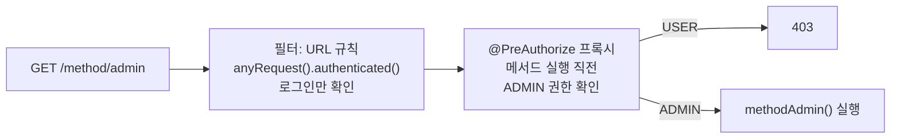

`@PreAuthorize` 안에는 URL 규칙과 같은 이름의 **표현식**을 문자열로 쓴다.

| 표현식 | 의미 |
|---|---|
| `"hasAuthority('X')"` | X 권한 |
| `"hasAnyAuthority('X', 'Y')"` | X 또는 Y 권한 |
| `"isAuthenticated()"` | 로그인한 사용자 |
| `"#userId == authentication.name"` | 메서드 매개변수와 로그인 사용자 비교 (본인 것만 수정 등) |

**URL 방식 vs 메서드 방식**

| | URL 방식 (`SecurityConfig`) | 메서드 방식 (`@PreAuthorize`) |
|---|---|---|
| 관리 위치 | 한 곳에 모아서 | 각 메서드 위에 |
| 잘 맞는 경우 | 경로 단위로 권한이 깔끔하게 나뉠 때 | 같은 컨트롤러 안에서도 메서드마다 권한이 다를 때 |
| 검사 시점 | 필터 (컨트롤러 도착 전) | 메서드 실행 직전 |

확인 방법: USER로 로그인 후 `/method/admin` 요청 → **403**, ADMIN으로 로그인 후 요청 → 문자열 출력.

---

## 11. 로그인 유지와 로그아웃

### Remember Me

```java
.rememberMe(rememberMe -> {
    rememberMe.rememberMeParameter("remember-me"); // 체크박스 name 과 일치
    rememberMe.tokenValiditySeconds(86400);        // 유효 기간 24시간 (초 단위)
    rememberMe.key("remember-me-secret-key");      // 토큰 생성에 쓰는 Key
})
```

- 세션 쿠키(`JSESSIONID`)는 보통 **브라우저를 닫으면 사라진다.** 로그인 유지를 체크하면 별도의 `remember-me` 쿠키가 24시간짜리로 저장된다.
- 세션이 없어도 이 쿠키가 있으면 `RememberMeAuthenticationFilter`가 **자동으로 다시 로그인**시킨다.

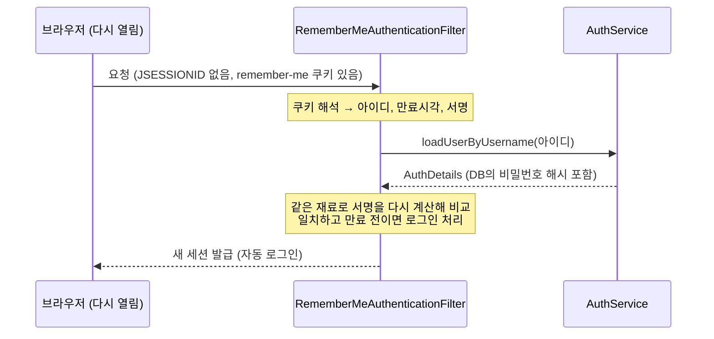

**remember-me 쿠키 안에는 무엇이 있을까?**

```
base64( 아이디 : 만료시각 : 알고리즘 : 서명 )
                              서명 = 해시(아이디 + 만료시각 + 비밀번호 + key)
```

- 비밀번호 자체가 아니라 **서명(해시)** 이 들어간다. `key`를 모르는 공격자는 서명을 위조할 수 없다. 그래서 실제 서비스에서는 `key`를 코드에 쓰지 말고 **환경 변수**로 관리한다.
- 서명에 비밀번호가 포함되어 있어서, 사용자가 **비밀번호를 바꾸면 기존 쿠키는 자동으로 무효**가 된다.
- 다만 쿠키를 탈취당하면 만료 전까지 그대로 쓰일 수 있다. 그래서 결제·비밀번호 변경 같은 민감한 기능은 `fullyAuthenticated()`로 **직접 로그인한 사용자만** 허용하는 경우가 많다. 토큰을 DB에 저장해두고 강제로 폐기할 수 있는 방식(`PersistentTokenRepository`)도 있다.

### 로그아웃

```java
.logout(logout -> {
    logout.logoutUrl("/auth/logout");      // 로그아웃 처리 URL
    logout.deleteCookies("JSESSIONID");    // 세션 쿠키 삭제
    logout.deleteCookies("remember-me");   // Remember Me 쿠키 삭제
    logout.invalidateHttpSession(true);    // 세션 소멸
    logout.logoutSuccessUrl("/");          // 로그아웃 후 이동
})
```

```html
<form th:action="@{/auth/logout}" th:method="post">
    <button type="submit">로그아웃</button>
</form>
```

로그인처럼 로그아웃도 **컨트롤러 없이** `LogoutFilter`가 처리한다.

> 💡 **로그아웃은 왜 링크(GET)가 아니라 form(POST)일까?** GET 로그아웃이 허용되면, 다른 사이트가 `` 한 줄만 심어둬도 방문자가 강제로 로그아웃된다. 상태를 바꾸는 요청은 POST로 하는 것이 원칙이고, CSRF 보호가 켜져 있으면 Security는 로그아웃을 **POST로만** 받는다.

---

## 12. 동시 접속 제한과 활성 사용자 수

### 설정

```java
@Bean
public HttpSessionEventPublisher httpSessionEventPublisher() {
    return new HttpSessionEventPublisher();   // 세션 생성/소멸 이벤트를 Spring 에 알려줌
}

@Bean
public SessionRegistry sessionRegistry() {
    return new SessionRegistryImpl();         // 현재 활성 세션 목록 관리
}
```

```java
.sessionManagement(session -> {
    session.maximumSessions(1).sessionRegistry(sessionRegistry); // 한 계정당 동시 접속 세션 1개
    session.invalidSessionUrl("/");                              // 유효하지 않은 세션으로 요청 시 이동
})
```

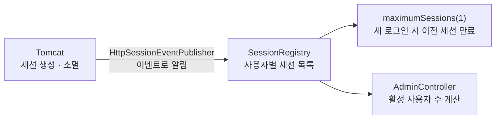

- 톰캣이 세션을 만들고 없앨 때 → `HttpSessionEventPublisher`가 이벤트로 알림 → `SessionRegistry`가 목록을 정확하게 유지한다.
- **`maximumSessions(1)`의 기본 동작**: 같은 계정으로 **새로 로그인하면 이전 세션이 만료**된다. (PC에서 로그인 중에 휴대폰으로 로그인하면 PC가 로그아웃됨) 반대로 "새 로그인을 막고 싶다"면 `maxSessionsPreventsLogin(true)`를 추가한다.
- 만료된 세션으로 요청하면 기본적으로 "This session has been expired..."라는 안내 문구가 나온다. 페이지로 보내고 싶다면 `expiredUrl("경로")`를 지정한다. `invalidSessionUrl()`은 이와 별개로, 서버 재시작 등으로 **세션 ID 자체가 없는** 요청일 때 쓰인다.

### 활성 사용자 수 계산 (AdminController)

```java
int activeUserCount = 0;

for (Object principal : sessionRegistry.getAllPrincipals()) {
    // false : 만료된 세션은 제외
    List<SessionInformation> sessions = sessionRegistry.getAllSessions(principal, false);

    if (!sessions.isEmpty()) {   // 살아있는 세션이 하나라도 있으면 활성 사용자
        activeUserCount++;
    }
}
```

`getAllPrincipals().size()`만 쓰면 이미 로그아웃했거나 만료된 사용자가 포함될 수 있어서, 사용자별로 **살아있는 세션이 있는지 확인**한 뒤 센다.

### ⚠️ 남은 TODO : `AuthDetails`의 `equals()` / `hashCode()`

<div style="margin:1.5em 0;overflow-x:auto"><svg viewBox="0 0 720 245" width="100%" role="img" aria-label="equals와 hashCode가 없으면 같은 사용자가 다른 키로 저장되어 동시 접속 제한이 동작하지 않는다" xmlns="http://www.w3.org/2000/svg" style="max-width:720px;font-family:'Pretendard','Noto Sans KR','Noto Sans CJK KR','Apple SD Gothic Neo','Malgun Gothic',sans-serif"><rect width="720" height="245" rx="12" fill="#fbf8f1"/><text x="360" y="28" text-anchor="middle" font-size="12.5" font-weight="700" fill="#2b2724">SessionRegistry 내부 : Map&lt;principal(AuthDetails), 세션 목록&gt;</text><text x="360" y="46" text-anchor="middle" font-size="11" fill="#6b625a">admin 이 PC와 휴대폰에서 각각 로그인한 경우</text><rect x="20" y="60" width="330" height="168" rx="12" fill="#f8e1dc" stroke="#b5523b" stroke-width="1.5"/><text x="185" y="84" text-anchor="middle" font-size="12.5" font-weight="700" fill="#b5523b">equals / hashCode 없음 (주소값 비교)</text><rect x="38" y="96" width="294" height="30" rx="6" fill="#fff" stroke="#b5523b"/><text x="50" y="116" font-size="11" font-family="'D2Coding','JetBrains Mono',Consolas,monospace" fill="#2b2724">AuthDetails@1a2b → [session PC]</text><rect x="38" y="132" width="294" height="30" rx="6" fill="#fff" stroke="#b5523b"/><text x="50" y="152" font-size="11" font-family="'D2Coding','JetBrains Mono',Consolas,monospace" fill="#2b2724">AuthDetails@3c4d → [session Phone]</text><text x="185" y="186" text-anchor="middle" font-size="11.5" fill="#2b2724">로그인할 때마다 새 객체 → 다른 사용자로 인식</text><text x="185" y="208" text-anchor="middle" font-size="12" font-weight="700" fill="#b5523b">세션 1개 제한 실패 · 활성 사용자 2명</text><rect x="370" y="60" width="330" height="168" rx="12" fill="#e3f1ee" stroke="#2f7f73" stroke-width="1.5"/><text x="535" y="84" text-anchor="middle" font-size="12.5" font-weight="700" fill="#2f7f73">userId 기준 equals / hashCode</text><rect x="388" y="110" width="294" height="40" rx="6" fill="#fff" stroke="#2f7f73"/><text x="400" y="135" font-size="11" font-family="'D2Coding','JetBrains Mono',Consolas,monospace" fill="#2b2724">"admin" → [session PC, session Phone]</text><text x="535" y="186" text-anchor="middle" font-size="11.5" fill="#2b2724">같은 아이디 = 같은 사용자</text><text x="535" y="208" text-anchor="middle" font-size="12" font-weight="700" fill="#2f7f73">이전 세션 만료 · 활성 사용자 1명</text></svg></div>

- `SessionRegistry`는 내부적으로 **로그인한 사용자 객체(`AuthDetails`)를 Map의 key**로 써서 세션을 관리한다.
- 같은 사람이라도 로그인할 때마다 `loadUserByUsername()`이 **새 `AuthDetails` 객체**를 만든다. `equals()`를 재정의하지 않으면 `Object`의 기본 동작(**주소값 비교**)을 쓰기 때문에, 두 객체를 **다른 사용자**로 판단한다.
- 그 결과 `maximumSessions(1)`이 동작하지 않고, 활성 사용자 수도 부풀려진다.
- 참고로 Spring Security가 기본 제공하는 `User` 클래스는 이미 **아이디 기준**으로 `equals()`/`hashCode()`가 구현되어 있다. 직접 만든 `UserDetails`라서 이 부분을 우리가 채워야 하는 것이다.

**구현할 때 기억할 개념** (직접 구현해보기)

- 무엇을 기준으로 "같은 사용자"라고 볼지 정한다 → 이번 실습은 **아이디(`getUsername()`)**
- `equals()`와 `hashCode()`는 **반드시 같은 기준으로 함께** 재정의한다. HashMap은 먼저 `hashCode()`로 칸을 찾고, 그 안에서 `equals()`로 비교하기 때문에 하나만 바꾸면 여전히 다른 key로 취급된다.
- 이미 import 되어 있는 `java.util.Objects` 클래스에 두 메서드 구현을 도와주는 정적 메서드가 있다.

---

## 13. CSRF — 이번 실습에서 끈 보호 기능

```java
.csrf(csrf -> csrf.disable());   // 학습용으로 비활성화. 프로덕션에서는 반드시 활성화!
```

<div style="margin:1.5em 0;overflow-x:auto"><svg viewBox="0 0 720 300" width="100%" role="img" aria-label="CSRF 공격 과정과 CSRF 토큰으로 막는 방법" xmlns="http://www.w3.org/2000/svg" style="max-width:720px;font-family:'Pretendard','Noto Sans KR','Noto Sans CJK KR','Apple SD Gothic Neo','Malgun Gothic',sans-serif"><defs><marker id="sec-a7" viewBox="0 0 10 10" refX="9" refY="5" markerWidth="7" markerHeight="7" orient="auto"><path d="M0,0 L10,5 L0,10 z" fill="#3a3530"/></marker><marker id="sec-a8" viewBox="0 0 10 10" refX="9" refY="5" markerWidth="7" markerHeight="7" orient="auto"><path d="M0,0 L10,5 L0,10 z" fill="#b5523b"/></marker></defs><rect width="720" height="300" rx="12" fill="#fbf8f1"/><rect x="15" y="95" width="140" height="92" rx="10" fill="#f8e1dc" stroke="#b5523b" stroke-width="1.5"/><text x="85" y="118" text-anchor="middle" font-size="13" font-weight="700" fill="#b5523b">악성 사이트</text><text x="85" y="140" text-anchor="middle" font-size="10" font-family="'D2Coding','JetBrains Mono',Consolas,monospace" fill="#2b2724">&lt;form action=</text><text x="85" y="154" text-anchor="middle" font-size="10" font-family="'D2Coding','JetBrains Mono',Consolas,monospace" fill="#2b2724">"bank/transfer"&gt;</text><text x="85" y="174" text-anchor="middle" font-size="10.5" fill="#6b625a">숨겨진 자동 전송</text><rect x="255" y="30" width="150" height="172" rx="10" fill="#e2eaf5" stroke="#3d6a9e" stroke-width="1.5"/><text x="330" y="56" text-anchor="middle" font-size="13" font-weight="700" fill="#3d6a9e">사용자 브라우저</text><rect x="268" y="70" width="124" height="32" rx="6" fill="#fff" stroke="#3d6a9e"/><text x="330" y="90" text-anchor="middle" font-size="10.5" fill="#2b2724">은행 세션 쿠키 보유</text><text x="330" y="190" text-anchor="middle" font-size="10.5" fill="#6b625a">쿠키는 자동으로 붙는다</text><rect x="560" y="30" width="145" height="172" rx="10" fill="#e3f1ee" stroke="#2f7f73" stroke-width="1.5"/><text x="632" y="56" text-anchor="middle" font-size="13" font-weight="700" fill="#2f7f73">은행 사이트</text><text x="632" y="120" text-anchor="middle" font-size="11" fill="#2b2724">쿠키가 유효하니</text><text x="632" y="137" text-anchor="middle" font-size="11" fill="#2b2724">본인 요청으로 판단</text><text x="632" y="164" text-anchor="middle" font-size="12" font-weight="700" fill="#b5523b">→ 송금 실행!</text><line x1="405" y1="80" x2="557" y2="80" stroke="#3a3530" stroke-width="1.5" marker-end="url(#sec-a7)"/><text x="481" y="70" text-anchor="middle" font-size="10.5" fill="#2b2724">① 로그인 (쿠키 발급)</text><line x1="255" y1="135" x2="158" y2="135" stroke="#3a3530" stroke-width="1.5" marker-end="url(#sec-a7)"/><text x="206" y="127" text-anchor="middle" font-size="10.5" fill="#2b2724">② 방문</text><line x1="405" y1="160" x2="557" y2="160" stroke="#b5523b" stroke-width="2" marker-end="url(#sec-a8)"/><text x="481" y="150" text-anchor="middle" font-size="10.5" font-weight="700" fill="#b5523b">③ 자동 송금 요청</text><text x="481" y="178" text-anchor="middle" font-size="10" fill="#b5523b">+ 쿠키 자동 첨부</text><rect x="15" y="222" width="690" height="62" rx="10" fill="#2f7f73"/><text x="360" y="246" text-anchor="middle" font-size="12.5" font-weight="700" fill="#fff">CSRF 토큰으로 방어</text><text x="360" y="268" text-anchor="middle" font-size="11.5" fill="#e3f1ee">서버가 폼마다 예측할 수 없는 토큰을 심어줌 → 악성 사이트는 토큰을 모름 → 토큰 없는 요청은 403 거부</text></svg></div>

**CSRF(Cross-Site Request Forgery, 사이트 간 요청 위조)**: 사용자가 로그인한 상태를 악용해, **사용자 모르게** 공격자가 원하는 요청을 보내게 만드는 공격이다. 브라우저는 요청을 보낼 때 **해당 사이트의 쿠키를 자동으로 첨부**하기 때문에, 서버 입장에서는 정상 요청과 구분할 수 없다.

**방어 원리**: Security는 폼을 만들 때마다 **예측할 수 없는 CSRF 토큰**을 함께 심고, POST·PUT·DELETE 요청에 그 토큰이 없거나 틀리면 거부한다. 악성 사이트는 우리 사이트의 화면을 읽을 수 없으니 토큰 값을 알 수 없다.

> 💡 **CSRF를 다시 켜면 무엇을 바꿔야 할까?** Thymeleaf에서 `th:action="@{...}"`으로 만든 form은 **CSRF 토큰 hidden input을 자동으로 넣어준다.** 이번 실습의 로그인·로그아웃·회원가입 폼이 모두 `th:action`을 쓰고 있어서, `csrf.disable()` 한 줄만 지워도 대부분 그대로 동작한다. 반대로 `action="..."`(th 없이)이나 JavaScript `fetch`로 POST를 보내는 경우에는 토큰을 직접 실어 보내야 한다.

**세션 방식 vs JWT 방식** (수업 주석 보충)

| | 세션 기반 (이번 실습) | JWT 토큰 기반 |
|---|---|---|
| 로그인 정보 저장 위치 | **서버** 세션 | **클라이언트**가 토큰 보관 |
| 클라이언트가 보내는 것 | 쿠키(`JSESSIONID`), 브라우저가 **자동 첨부** | `Authorization` 헤더, 코드가 **직접 첨부** |
| 서버 상태 | 있음 (Stateful) | 없음 (Stateless) |
| CSRF 보호 | **필수** (쿠키 자동 첨부 때문) | 보통 불필요 (자동 첨부가 아니라서) |
| 강제 로그아웃 | 쉬움 (세션 삭제) | 어려움 (만료 전까지 유효) |
| 서버 여러 대 | 세션 공유 필요 (Redis 등) | 그대로 확장 가능 |

---

## 14. 남은 TODO 정리

수업 시점 기준으로 비어 있는 부분이다. 직접 구현할 수 있도록 개념만 정리했다.

| TODO | 위치 | 확인 방법 / 힌트 |
|---|---|---|
| 메서드 보안 활성화 | `SecurityConfig` 클래스 | 10장 메서드 단위. 활성화 어노테이션이 없으면 `@PreAuthorize`가 무시됨 |
| `@PreAuthorize` 2개 | `IndexController` | 10장의 표현식 표 참고. USER로 `/method/admin` → 403이면 성공 |
| `equals()` / `hashCode()` | `AuthDetails` | 12장. 같은 계정으로 브라우저 2개에서 로그인 → 먼저 로그인한 쪽이 만료되면 성공 |

---

## 15. 한눈에 정리

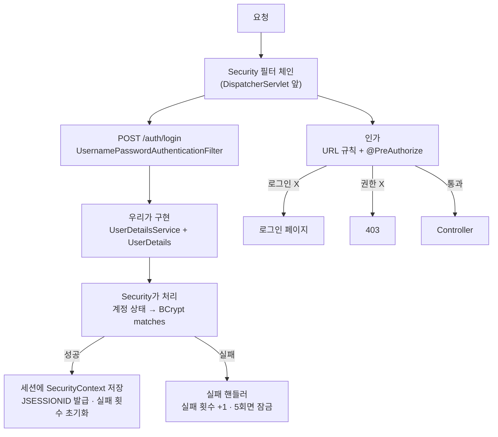

| 주제 | 핵심 |
|---|---|
| 인증 vs 인가 | 누구냐 vs 해도 되냐. 인증이 먼저 |
| 구조 | 컨트롤러 앞의 **필터 체인**. 로그인·로그아웃은 컨트롤러 없이 필터가 처리 |
| 비밀번호 | **BCrypt**. 솔트로 매번 다른 해시, 비교는 `matches()` |
| 우리가 구현 | `UserDetailsService`(조회) + `UserDetails`(감싸기) + 성공/실패 핸들러 |
| Security가 처리 | 계정 상태 검사 → 비밀번호 비교 → 세션 저장 |
| 실패 메시지 | 아이디 없음/비번 틀림은 **구분하지 않는다** (계정 열거 방지) |
| 싱글톤 핸들러 | 필드에 요청별 상태를 저장하지 않는다 |
| 세션 | 서버에 `SecurityContext`, 브라우저엔 `JSESSIONID`. 로그인 시 세션 ID 교체 |
| 인가 | URL(`authorizeHttpRequests`, 순서 중요, `/**` 주의) + 메서드(`@PreAuthorize`) |
| 권한 문자열 | `hasAuthority("ADMIN")` vs `hasRole("ADMIN")` = `ROLE_ADMIN` |
| Remember Me | 서명된 쿠키로 자동 로그인. 민감 기능은 `fullyAuthenticated()` |
| 동시 접속 | `maximumSessions(1)` + `SessionRegistry`. principal의 **equals/hashCode** 필수 |
| CSRF | 쿠키 자동 첨부를 악용. 세션 방식이면 **반드시 켠다** |
