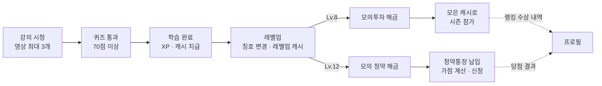
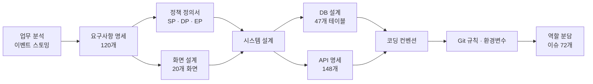
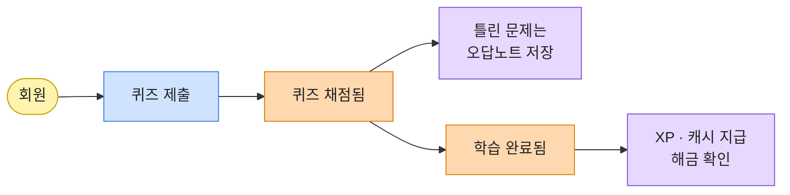
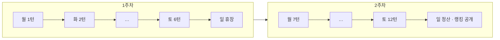
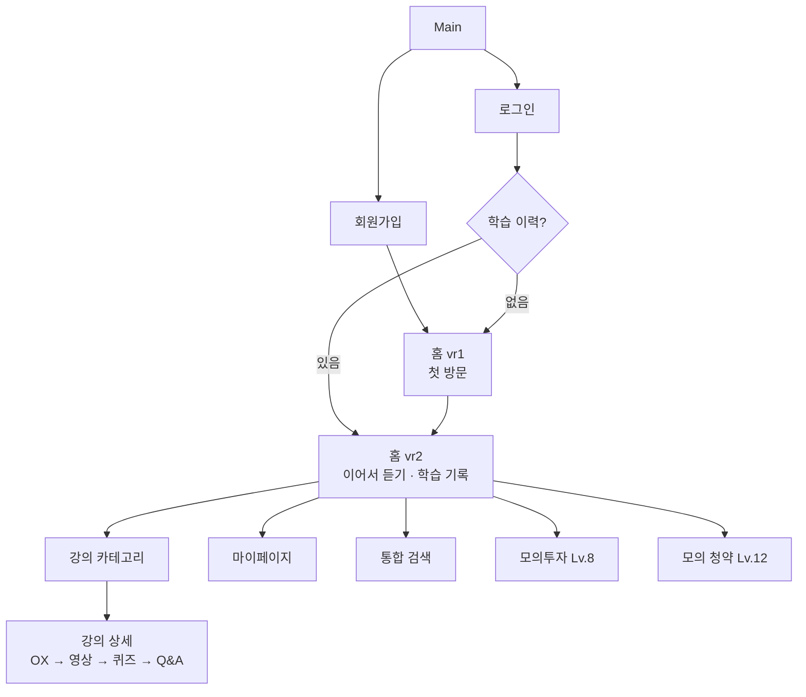
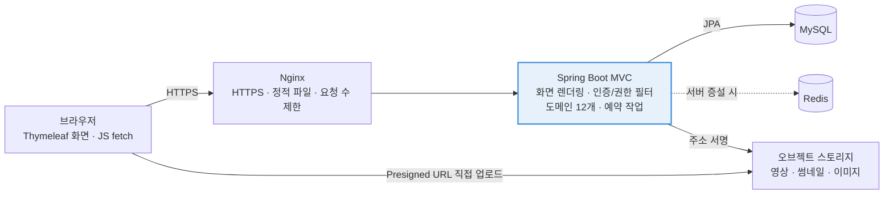
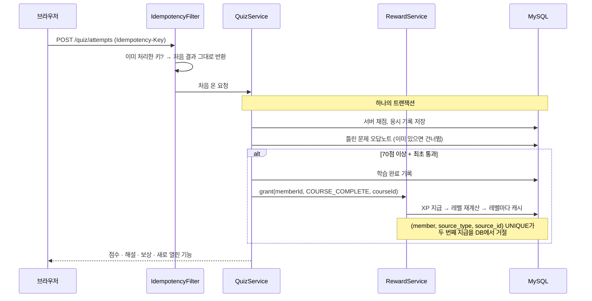
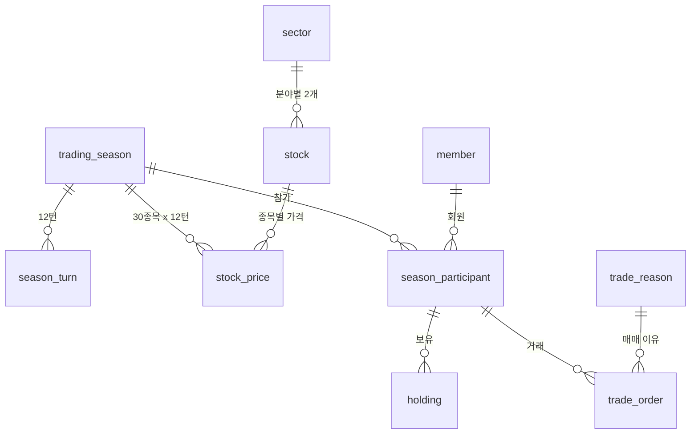
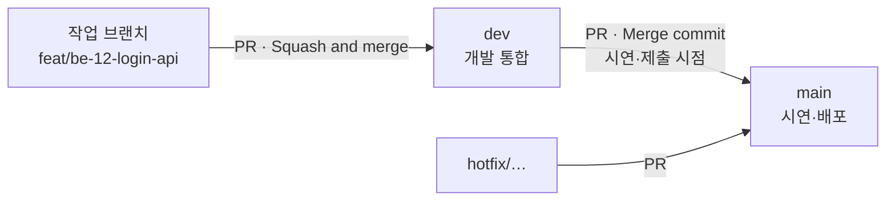
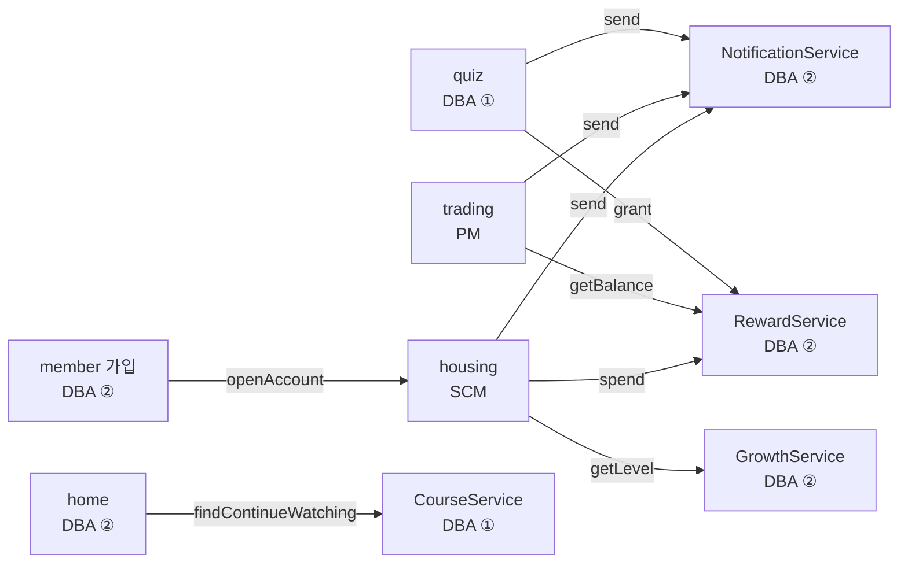

> **TL;DR**
> - **MoneyBeetle(머니비틀)** 은 2030 사회초년생이 내 집 마련에 필요한 금융 지식을 **영상 강의 + 퀴즈**로 배우고, 모은 가상 캐시로 **모의투자·모의 청약**을 연습하는 웹 학습 플랫폼(LMS)입니다.
> - 모듈 2에서 배운 구조 그대로 **Spring Boot MVC + Thymeleaf(서버 렌더링) + JPA + Spring Security(세션) + MySQL** 로 만듭니다.
> - 설계 단계에서 만든 문서는 11개입니다: 업무 분석 → 요구사항 명세(120개) → 정책 정의서 → 화면 설계(20개 화면) → 시스템 설계 → DB 설계(47개 테이블) → API 명세(148개) → 코딩 컨벤션 → Git 규칙 → 환경변수 → 역할 분담.
> - 설계의 중심 문장은 하나입니다. **"화면은 보여 주기만, 판정은 서버가. 돈(캐시)은 한 트랜잭션 안에서, 한 번만."**

---

## 1. 어떤 서비스인가

### 1-1. 문제

사회초년생이 "내 집 마련"을 준비하려면 알아야 할 것이 한꺼번에 몰려옵니다. 월급 관리, 예·적금, 주식과 ETF, 청약통장, 가점, 전·월세, 대출… 그런데 이 지식은 대개 **따로따로** 흩어져 있고, 실제 돈을 쓰기 전에 **연습해 볼 곳**이 없습니다.

그래서 문제를 이렇게 정했습니다.

> "자본과 부동산 지식을 **'내 집 마련'이라는 하나의 목표** 아래에서 순서대로 배우고, 실제 돈을 쓰기 전에 **가상 캐시로 안전하게 연습**하게 하자."

### 1-2. 핵심 아이디어: 배울수록 집이 커진다

이 서비스의 재미는 **성장 루프**에 있습니다. 공부하면 경험치(XP)와 캐시가 쌓이고, 레벨이 오르면 칭호가 "고시원 → 원룸 → 투룸 → 아파트 → 내 집"으로 바뀝니다. 그리고 일정 레벨이 되면 실습(트레이닝)이 열립니다.



캐시가 그냥 점수가 아니라 **모의투자의 투자 가능 금액**이자 **청약통장 납입금**이 된다는 점이 중요합니다. 공부를 많이 한 사람이 더 큰 돈으로 연습할 수 있게 됩니다.

### 1-3. 범위

| 넣은 것 | 뺀 것 |
| --- | --- |
| 영상 강의·테스트 퀴즈(OX)·퀴즈(4지선다), 오답노트·스크랩 | 실제 금융 거래, 실제 결제·계좌 연결 |
| 오늘의 경제 용어, 출석·경험치·레벨·캐시 | 실제 청약 신청 |
| 시즌제 모의투자(가상 종목 30개), 모의 청약(가상 단지) | 실시간 시세 등 외부 API 연동 |
| 강사 기능(강의 제작·검수 요청·문의 답변) | AI 기능(검색도 DB 키워드 검색) |
| 관리자 백오피스(검수·운영·감사 기록) | 코인, 적금·전월세 계산기 등 별도 실습 |

모든 투자·청약 화면에는 **"가상 실습이며 실제 금융 거래가 아니에요"** 를 표시합니다(NFR-12).

---

## 2. 설계 문서 체계

설계는 아래 11개 문서로 나눴습니다. 각 문서가 앞 문서를 근거로 삼도록, 표의 ID(USR-01, SP-24, DP-37 …)로 서로 연결했습니다.



| 문서 | 무엇을 정하나 |
| --- | --- |
| 업무 분석 | 사용자가 겪는 사건(Event)을 시간 순으로 늘어놓고 도메인을 찾는다 |
| 요구사항 명세서 | 기능 120개(9개 영역)와 비기능 15개, 우선순위 상·중·하 |
| 정책 정의서 | 숫자로 된 비즈니스 룰(SP), 데이터·보안 규칙(DP), 에러 처리와 문구(EP) |
| 화면 설계 | 정보 구조도(IA), 20개 화면, 인터랙션, 디자인 시스템, 반응형 |
| 시스템 설계 | 기술 스택, 서비스 구조도, 모듈 구성, 핵심 처리 흐름, 보안, 배포 |
| DB 설계 | ERD, 테이블 정의서, 데이터 이력(삭제) 정책 |
| API 명세서 | 화면 안 `fetch`가 부르는 JSON API 148개 |
| 코딩 컨벤션 | 계층, 네이밍, Entity·DTO·Policy 규칙 |
| Git 규칙 | 브랜치 전략, 커밋 메시지, PR 규칙 |
| 환경변수 | `.env` 키 목록과 비밀 값 관리 |
| 역할 분담 | 4명이 맡을 이슈·API·화면, 서로 부르는 메서드 약속 |

문서가 많아지면 **어느 문서가 이기는지**부터 정해야 합니다. 코딩 컨벤션 맨 앞에 이 규칙을 두었습니다.

| 무엇을 정하나 | 기준 | 충돌하면 |
| --- | --- | --- |
| 기능·규칙·데이터 (무엇을 만들지) | 요구사항·정책·DB·API·화면 문서 | **문서를 따른다.** 문서가 틀렸으면 코드를 맞추지 말고 문서를 먼저 고친다 |
| 코드를 쓰는 방식 (어떻게 만들지) | 학습한 구조 + 프로젝트 골격 | 코딩 컨벤션을 따른다 |

---

## 3. 업무 분석 — 크게 그리고, 과감하게 덜어내기

### 3-1. 이벤트 스토밍

처음에는 **이벤트 스토밍**으로 서비스 전체를 그렸습니다. 포스트잇 색으로 역할을 나눕니다.

| 색 | 의미 | 예시 |
| --- | --- | --- |
| 🟨 액터 | 행동하는 사람·시스템 | 회원, 관리자, 시스템 |
| 🟦 커맨드 | 요청하는 행동 | 퀴즈 제출 |
| 🟧 도메인 이벤트 | 이미 일어난 사실(과거형) | 학습 완료됨 |
| 🟪 정책 | 이벤트가 일어나면 자동으로 이어지는 규칙 | XP 지급, 해금 확인 |

예를 들어 퀴즈 하나만 봐도 이렇게 이어집니다.



이렇게 회원 가입부터 매일 학습, 강의·평가·성장, 모의투자 시즌, 모의 청약까지 약 35개의 사건을 늘어놓고 나니 **도메인**(회원, 학습, 평가, 성장, 실습, 운영)과 **애그리거트**(회원, 수강, 오답노트, 시즌, 포트폴리오, 청약 신청 …)가 자연스럽게 보였습니다.

### 3-2. 덜어낸 것

첫 그림은 욕심이 많았습니다. 홈에서 "맛보기 문제 → 학습 → 복습 문제"로 도는 **문제 루프**, 단원별 진도율, 오답 2번 연속 정답 시 "극복", 내 단어장, 오늘의 퀘스트, 뱃지, 적금 비교·전월세 비교 계산기, 코인 종목, 안정 투자 랭킹, 투자 습관 리포트…

요구사항 명세서로 넘어가면서 이것들을 **강의 단위**로 단순하게 정리했습니다.

| 처음 기획 | 최종 요구사항 |
| --- | --- |
| 홈 문제 루프(맛보기·복습), 문제 난이도 | 강의 안의 **테스트 퀴즈(OX 5문제)** + **퀴즈(4지선다 10±5문제)** |
| 단원 학습·단원 퀴즈·진도율, 오답 극복 | **강의 단위 학습 완료** (퀴즈 70점 이상) |
| 단어장, 퀘스트, 뱃지, 문제·용어 스크랩 | **강의 스크랩**만, 뱃지는 랭킹 보상에만 |
| 안정 투자 랭킹, 투자 습관 리포트 | **순자산·수익률 랭킹** + 관리자 시즌 통계 |
| 적금·전월세 계산기, 계약 체크리스트 | 실습이 아니라 **강의 내용**으로 이동 |
| 코인 종목, 청약 미래 점수, 자금 계획 | 제외 |

덜어내는 기준은 "모듈 2 기간 안에 **서버 쪽 규칙까지 제대로** 만들 수 있는가"였습니다. 기능이 많아 보이는 것보다, 캐시가 두 번 지급되지 않고 주문이 정확히 체결되는 쪽이 더 중요하다고 봤습니다.

---

## 4. 요구사항 — 120개를 9개 영역으로

### 4-1. 사용자와 권한

| 구분 | 할 수 있는 것 |
| --- | --- |
| 비회원 | 서비스 소개, 회원가입, 로그인 |
| 회원(학습자) | 강의·퀴즈, 오답노트·스크랩, 문의, 출석·캐시, 해금된 모의투자(Lv.8)·모의 청약(Lv.12) |
| 강사 | 강의·영상·요약글·퀴즈 등록, 검수 요청, 내 강의 문의 답변 |
| 관리자 | 강의 검수, 카테고리·경제 용어, 회원·강사, 문의 게시판, 모의투자·모의 청약 운영 |

### 4-2. 기능 영역

| 영역 | ID | 개수 | 대표 요구사항 |
| --- | --- | --- | --- |
| 회원·인증 | USR | 14 | 이메일 가입, 로그인, 권한 구분, 마이페이지, 탈퇴 |
| 홈·메뉴 | HOM | 6 | 오늘의 경제 용어 5개, 햄버거 메뉴 프로필, 연속 출석 |
| 강의 학습 | LRN | 9 | 카테고리 → 소주제 → 강의, 이어서 보기, 학습 완료, 문의 |
| 퀴즈 | QST | 6 | 테스트 퀴즈, 퀴즈, 서버 채점, 오답노트 |
| 성장·캐시 | GRW | 8 | 출석, 연속 출석 캐시, XP·레벨·칭호, 실습 해금 |
| 모의투자 | INV | 18 | 시즌·턴, 30개 종목, 턴 고정 가격, 매매 이유, 랭킹 |
| 모의 청약 | SUB | 11 | 청약 캘린더, 청약통장 납입, 가점 계산기, 신청, 발표 |
| 강사 | TCH | 9 | 강의 생성, 영상·요약글·퀴즈 등록, 검수 요청, 답글 |
| 관리자 | ADM | 39 | 강의 검수, 시즌·턴·가격·뉴스 운영, 정산, 당첨자 산정 |

우선순위는 **상 77개 / 중 33개 / 하 10개**입니다. 관리자 요구사항이 39개로 가장 많은데, 이 LMS의 핵심이 "강의 내용"보다 **관리자가 콘텐츠와 시장을 넣고 바꿀 수 있는 구조**에 있기 때문입니다(NFR-13).

### 4-3. 비기능 요구사항에서 중요한 것

- **NFR-02 권한별 접근 제한**: 주소를 직접 입력해도 서버가 권한을 확인한다.
- **NFR-05 매매 트랜잭션**: 캐시와 보유 수량은 함께 바뀌고, 하나라도 실패하면 둘 다 되돌린다.
- **NFR-06 이중 지급 방지**: 같은 활동으로 캐시·경험치가 두 번 지급되지 않는다.
- **NFR-07 시장 공정성**: 같은 시즌의 모든 참가자는 같은 종목, 같은 턴별 가격을 쓴다.
- **NFR-14 감사 기록**: 턴 진행, 정산, 캐시 수동 지급 같은 작업은 누가 언제 했는지 남긴다.

---

## 5. 정책 정의서 — 규칙을 숫자로

요구사항이 "무엇을"이라면 정책 정의서는 **"정확히 몇, 언제, 어떻게"** 입니다. 개발자가 코드에 `if`로 옮겨야 할 문장들입니다.

### 5-1. 성장과 캐시

| 번호 | 규칙 |
| --- | --- |
| SP-10~12 | 출석은 KST 하루 1회. **연속 5일째부터 매일** 캐시. 하루라도 빠지면 연속 일수 0 |
| SP-13 | 강의 학습 완료 캐시는 같은 강의 **최초 1회만** |
| SP-15 | 캐시는 0 미만이 될 수 없고, 적립·사용은 모두 기록 |
| SP-18 | 같은 날 출석·같은 강의 완료·같은 레벨로 **두 번 지급하지 않는다** |
| SP-23 | 한 번에 여러 레벨이 오르면 **레벨마다** 레벨업 캐시를 모두 지급 |
| SP-24 | 모의투자 Lv.8, 모의 청약 Lv.12. 화면은 블러, **서버도 막는다** |

### 5-2. 강의와 퀴즈

| 번호 | 규칙 |
| --- | --- |
| SP-30 | 강의 = 영상 1~3개 + 요약글 + 테스트 퀴즈 OX 5문제 + 퀴즈 4지선다 5~15문제 |
| SP-31 | 작성 중 → 검수 중 → 허가/반려. 허가된 강의만 노출, 허가 후 수정하면 **재검수** |
| SP-32 | 학습 기록이 있는 강의는 삭제하지 못하고 **비공개**로만 |
| SP-33 | 테스트 퀴즈는 점수·경험치·오답노트에 영향 없음 |
| SP-34 | 70점 이상 통과, 재응시 무제한, **보상은 최초 통과 때 한 번** |
| SP-35 | **서버에서만 채점**, 제출 전에는 정답이 화면으로 가지 않는다 |

### 5-3. 모의투자 시즌

모의투자는 "모두가 같은 시장에서 같은 속도로" 움직이는 시즌제입니다. 한 시즌은 **월요일에 시작하는 14일, 12턴**입니다.



| 번호 | 규칙 |
| --- | --- |
| SP-51·52 | Lv.8 이상, 시즌당 1회, 첫 턴이 끝나기 전까지 참가. 투자 가능 금액 = **모은 캐시 + 이월금**, 참가 후 불변 |
| SP-53 | 같은 턴 안의 거래는 모두 **그 턴의 고정 가격**으로 체결 |
| SP-54·55 | 매수는 현금 안에서 1주 이상 정수, 매도는 보유 수량 안에서(공매도 불가) |
| SP-57 | 매매 이유(예: "뉴스를 보고", "나눠 담으려고")를 골라야 주문 완료 |
| SP-58 | 휴장일, 정산 중, **이전 턴 가격으로 들어온 주문**은 거절 |
| SP-59 | 턴은 관리자 버튼으로만. 다음 턴 30개 종목 가격·뉴스가 모두 있어야 하고, **되돌릴 수 없다** |
| SP-61 | 순자산 = 현금 + 평가금액, 수익률 = (최종 순자산 − 투자 가능 금액) ÷ 투자 가능 금액 |
| SP-63 | 수익이 났을 때만 수익의 30%(초안)를 상한 안에서 다음 시즌으로 이월 |
| SP-65 | 시즌 상태는 준비 → 진행 중 → 휴장 → 정산 → 종료, **거꾸로 가지 않는다** |

"매매 이유 선택"은 이 서비스가 단순 게임이 아니라 **교육**이라는 점을 보여 주는 장치입니다. 시즌이 끝나면 관리자가 "뉴스를 보고 산 비율", "급락 턴에 판 사람 비율" 같은 통계를 볼 수 있습니다.

### 5-4. 모의 청약

| 번호 | 규칙 |
| --- | --- |
| SP-70 | 가입과 동시에 청약통장 개설, **하루 1회** 납입하면 납입회차 +1 |
| SP-71 | 가점은 학습용으로 단순화: 무주택 기간·부양가족 수·납입회차 |
| SP-73 | 신청 기간 안에서만, 같은 단지 1회, **신청 후 취소·수정 불가** |
| SP-74 | 경쟁률은 접수 마감 뒤에 공개 |
| SP-75 | 발표일 이후 관리자가 산정: 가점 높은 순 → 납입회차 많은 순 → 추첨 |

### 5-5. 데이터·보안·에러 정책

정책 정의서 2장(DP)과 3장(EP)은 코드 전체에 걸치는 규칙입니다.

- **DP-03 공개 범위**: 다른 사용자에게는 닉네임·프로필 이미지·칭호·레벨·수상 내역만 보인다.
- **DP-10·11**: 로그인 5회 연속 실패 시 10분 잠금, 30분 미활동 시 세션 만료.
- **DP-37 중복 제출**: 퀴즈 제출·매수·매도·청약통장 납입은 `Idempotency-Key`로 한 번만 처리한다. 같은 키에 **다른 내용**이 오면 409로 거절한다.
- **DP-40 트랜잭션**: 매수·매도, 보상 지급, 시즌 참가, 시즌 정산은 하나라도 실패하면 모두 되돌린다.
- **DP-42 시간**: 출석·턴·청약 일정은 모두 **서버 KST** 기준. 사용자 기기 시간은 믿지 않는다.
- **EP-01 오류 세 종류**: 입력 오류는 입력칸 아래, 규칙 위반은 토스트·모달, 시스템 오류는 공통 오류 페이지.
- **EP-03**: 처리 중 오류가 나면 모두 되돌리고 **"처리하지 못했어요. 내 정보는 바뀌지 않았어요"**.

에러 문구까지 정책서에 적어 둔 이유는, 같은 오류가 화면마다 다른 말투로 나오지 않게 하기 위해서입니다. 서버가 에러 코드와 함께 이 문구를 그대로 내려줍니다.

---

## 6. 화면 설계

### 6-1. 20개 화면

지금은 화면별 프로토타입(`.dc.html`)이 있고, 서비스에서는 각각 Thymeleaf 템플릿이 됩니다.

| 역할 | 화면 |
| --- | --- |
| 공통 | Main(서비스 소개) |
| 학습자 (11) | 로그인, 회원가입, 홈(첫 방문 vr1 / 기존 vr2), 강의 카테고리, 강의 상세, 마이페이지, 문의 게시판, 통합 검색, 모의투자, 모의 청약 |
| 강사 (4) | 로그인, 회원가입, 대시보드(Q&A 탭 포함), 강의 생성 |
| 관리자 (4) | 로그인, 대시보드(`?view=` 탭 13개), 모의투자 운영, 모의 청약 운영 |



홈을 두 가지로 나눈 것이 특징입니다. 처음 온 사람에게는 관심 주제(돈 굴리기 / 부동산)를 고르게 해서 **3번 클릭 안에 첫 강의를 시작**하게 하고(NFR-08), 기존 사용자에게는 **이어서 듣기**를 맨 위에 보여 줍니다.

### 6-2. 강의 상세의 학습 흐름

강의 상세 한 화면 안에서 학습이 순서대로 열립니다.

1. **OX 테스트 5문제** → `정답 확인`을 눌러야 영상이 열린다 (틀려도 불이익 없음)
2. **영상 시청** → 위치 저장, 끝까지 보면 시청 완료
3. 모든 영상을 보면 **퀴즈** 열림 → 70점 이상이면 학습 완료, 틀린 문제는 오답노트
4. **강의 Q&A** → 현재 강의 ID에 자동 연결, 작성자·강사·관리자만 볼 수 있음

### 6-3. 디자인 시스템과 반응형

밝고 친근한 교육 서비스 인상을 유지하기 위해 "어두운 핀테크 템플릿"은 쓰지 않기로 했습니다.

| 역할 | 색 |
| --- | --- |
| 페이지 배경 | `#F7FAF3` |
| 시그니처 라임 (주요 버튼·선택·진행률) | `#9FE870` |
| 딥 올리브 (제목·주요 CTA) | `#263B1A` |
| 골드 (보상·코인, 제한적으로) | `#F2C14E` |
| 상승 / 하락 | `#D93A44` / `#2F6FDB` |

서체는 Pretendard, 간격은 4px 기반(8·12·16·24·32px)입니다. 반응형은 **1200px 이상 / 768~1199 / 421~767 / 420 이하** 네 구간으로 나누고, 모바일에서는 카드를 1열로, 관리자 사이드바는 접이식 메뉴로, 표는 가로 스크롤로 바꿉니다. 터치 영역은 최소 44×44px, `prefers-reduced-motion`에서는 애니메이션을 줄입니다.

---

## 7. 시스템 설계

### 7-1. 기술 스택

| 영역 | 기술 | 상태 |
| --- | --- | --- |
| 화면 | Thymeleaf 서버 렌더링 + HTML·CSS·JS(`static/`) | 확정 |
| 서버 | Java 21, Spring Boot 3.5, Spring Web MVC, Spring Security, Spring Data JPA, Gradle | 확정 |
| DB | MySQL 8 (InnoDB, utf8mb4) | 확정 |
| 캐시 | 서버 메모리(Caffeine) → 서버 2대 이상이면 Redis | 가정 |
| 파일 | S3 호환 오브젝트 스토리지 (로컬은 폴더) | 가정 |
| 배포 | GitHub Actions → Docker → 클라우드 서버 + Nginx | 가정 |

React 같은 SPA를 쓰지 않은 이유는 단순합니다. 모듈 2에서 배운 **Spring Web MVC + Thymeleaf + 세션 로그인** 구조를 그대로 써서 끝까지 완성하는 것이 목표이기 때문입니다. 화면 안의 일부 동작(중복 확인, 알림 읽음, 퀴즈 제출 등)만 `/api/v1` JSON을 `fetch`로 부릅니다.

### 7-2. 서비스 구조도



강조한 Spring Boot 서버가 **판정을 내리는 유일한 곳**입니다. 큰 영상 파일만 예외로, 서버가 서명해 준 주소로 브라우저가 스토리지에 직접 올립니다.

### 7-3. 프로토타입에서 서버로 — 가장 먼저 지울 것

지금 프로토타입은 20개 화면이 각자 브라우저 `localStorage`(키 약 25개)에 데이터를 저장합니다. 문제는 이렇습니다.

- 같은 데이터를 화면마다 따로 들고 있어 **역할 간에 공유되지 않는다** (학습자가 쓴 문의를 강사가 못 봄)
- 레벨 해금·출석·가점·당첨을 **브라우저가 계산**한다
- 로그인하면 `mb-role`, `mb-admin-session`을 저장하고 그 값으로 화면을 연다 → **개발자 도구로 값을 바꾸면 관리자 화면이 열린다**

그래서 설계 원칙 1번이 **"화면은 보여 주기만, 판정은 서버가"** 입니다. 역할은 서버 세션으로, 출석·캐시는 `growth`로, 청약 데이터는 `housing`으로 옮기고, 브라우저에는 "오늘 하루 경제 용어 보지 않기" 같은 **화면 편의 설정만** 남깁니다.

### 7-4. 도메인 모듈

서버는 기능별 패키지로 나누고, 모든 도메인 안을 같은 모양(`controller` / `model/dao·dto·entity·service` / `exception`)으로 맞췄습니다.

| 패키지 | 맡는 일 |
| --- | --- |
| `auth`, `member` | 로그인·간편 로그인, 가입·강사 승인·마이페이지·탈퇴 |
| `course`, `quiz` | 강의 조회·이어보기·스크랩·검수, 채점·오답노트 |
| `growth` | **출석, 경험치, 레벨, 캐시 원장, 해금 판정** |
| `home`, `term`, `notification` | 홈 조립·검색, 오늘의 경제 용어, 알림 |
| `inquiry`, `operation` | 문의·Q&A, 서비스 설정·관리자 작업 기록·금칙어 |
| `trading`, `housing` | 모의투자, 모의 청약 |
| `global` | 공통 응답·예외, 레벨 해금·중복 요청 방지, 파일, KST 시계 |

핵심은 `growth`입니다. **캐시·경험치를 바꾸는 코드는 `RewardService` 한 곳에만** 두고, 퀴즈·모의투자·청약은 그 메서드를 불러서만 값을 바꿉니다. 다른 도메인의 Repository는 직접 쓰지 않고 그 도메인의 Service를 부릅니다.

### 7-5. 핵심 처리 흐름 — 퀴즈 제출 하나에 일어나는 일

실수하면 캐시가 어긋나는 흐름은 모두 **검증 → 한 트랜잭션 안에서 변경 → 기록** 순서를 따릅니다. 가장 대표적인 퀴즈 제출을 그려 보면 이렇습니다.



나머지 세 흐름도 같은 모양입니다.

- **다음 턴 진행**: 휴장일·가격·뉴스 빈칸을 서버가 다시 점검 → 현재 턴 +1, 진행 기록. 주문에는 항상 "어느 턴 가격으로 주문했는지"를 담아 보내서, 턴이 넘어가는 순간의 주문도 `STALE_TURN_PRICE`로 막는다.
- **청약 당첨 산정·발표**: 공고 상태(모집 예정·모집 중·마감)는 DB에 저장하지 않고 **서버 KST 시각과 일정으로 그때그때 계산**한다. 예약 작업이 안 돌아도 틀리지 않기 때문이다. 산정과 발표는 버튼을 나눠서, 확인 전에 결과가 새지 않게 한다.
- **청약통장 납입**: 하루 1회는 `(통장, 납입일)` UNIQUE로 DB가 막고, 캐시 차감 → 잔액 증가 → 회차 +1을 한 트랜잭션으로.

### 7-6. 인증·보안

인증은 모듈 2에서 배운 **Spring Security 세션 로그인**입니다. 서버가 화면과 API를 같은 주소에서 내보내므로 CORS가 필요 없고, 토큰을 브라우저 저장소에 두지 않으니 스크립트로 훔칠 수도 없습니다.

| 항목 | 방식 |
| --- | --- |
| 로그인 처리 | `POST` 로그인은 Controller가 아니라 **Security 필터**가 처리. 우리는 `AuthService`(회원 조회)와 성공·실패 핸들러만 만든다 |
| 세션 | 로그인 시 세션 ID 재발급(세션 고정 공격 방지), `HttpOnly`·`Secure`·`SameSite=Lax`, 30분 |
| 잠금 | `failed_login_count`, `locked_until` 컬럼. 잠금 검사는 비밀번호 검사보다 먼저 |
| 권한 | `/admin/**`는 ADMIN, `/instructor/**`는 승인된 INSTRUCTOR, 실습은 `@RequireLevel` |
| 본인 데이터 | 주소에 회원 ID를 받지 않고 **세션의 회원 ID로만** 조회 (`/members/me/...`) |
| CSRF | 학습 예제는 꺼 뒀지만 **켜 둔다**. 폼은 자동, `fetch`는 `X-CSRF-TOKEN` 헤더 |
| XSS | `th:text`만, `th:utext` 금지 |
| 정답 노출 | 퀴즈 문제 응답 DTO에 정답·해설 필드를 아예 두지 않는다 |

---

## 8. DB 설계 — 47개 테이블, 68개 관계

### 8-1. 도메인별 테이블

| 도메인 | 테이블 | 개수 |
| --- | --- | --- |
| 회원·인증 | member, instructor_profile, social_account, terms, member_terms_agreement, password_reset_token, attendance, notification | 8 |
| 성장·캐시 | level_policy, reward_rule, cash_history, exp_history | 4 |
| 강의·퀴즈 | category, course, course_review, lesson, quiz_question, quiz_choice, quiz_attempt, quiz_answer, wrong_answer_note, learning_progress, lesson_watch, scrap | 12 |
| 문의·경제 용어 | inquiry, inquiry_reply, economic_term, term_schedule | 4 |
| 모의투자 | trading_season, season_turn, sector, stock, stock_price, news, news_tag, trade_reason, season_participant, holding, trade_order, ranking_award | 12 |
| 모의 청약 | subscription_account, subscription_deposit, housing_complex, housing_application | 4 |
| 운영 | admin_log, system_setting, forbidden_word | 3 |

모의투자 쪽 관계만 떼어 보면 이렇습니다.



### 8-2. 설계 원칙

| 항목 | 규칙 |
| --- | --- |
| 이름 | 테이블은 소문자 **단수형** snake_case, PK는 `테이블명_id` BIGINT |
| 상태값 | ENUM 대신 **VARCHAR + 대문자 코드** (`ACTIVE`, `REVIEW`) — 값이 늘어도 ALTER 불필요 |
| 금액 | 캐시는 BIGINT 정수, 비율·수익률만 DECIMAL |
| 시간 | 모두 KST로 저장 |
| 바뀌는 값 | 해금 레벨, 통과 점수, 보상 금액은 `system_setting`, `reward_rule`, `level_policy`에 둔다 — 초안 값이 많아서, 코드에 박으면 바꿀 때마다 배포해야 한다 |

### 8-3. 원장과 UNIQUE — "두 번 지급"을 DB가 막는다

캐시는 `member.cash` 잔액만 바꾸지 않고, 모든 적립·사용을 `cash_history`에 한 줄씩 쌓습니다. **원장(장부)** 방식입니다. 잔액은 내역의 합과 일치해야 하고, 잘못된 값은 고치지 않고 반대 기록(관리자 회수)을 새로 쌓습니다.

그리고 중복 방지는 코드의 `if`에만 맡기지 않고 **복합 UNIQUE 제약**을 마지막 방어선으로 둡니다. 동시에 들어온 두 요청이 둘 다 `if`를 통과해도, 두 번째 INSERT는 DB가 거절합니다.

| 테이블 | UNIQUE | 막는 것 |
| --- | --- | --- |
| `cash_history` | member_id, source_type, source_id | 같은 활동으로 캐시 2번 |
| `exp_history` | member_id, source_type, source_id | 같은 강의로 경험치 2번 |
| `attendance` | member_id, attend_date | 하루 2번 출석 |
| `subscription_deposit` | subscription_account_id, paid_date | 하루 2번 납입 |
| `season_participant` | trading_season_id, member_id | 시즌 2번 참가 |
| `housing_application` | member_id, housing_complex_id | 같은 단지 중복 신청 |
| `stock_price` | trading_season_id, stock_id, turn_no | 같은 턴 가격 2개 |
| `wrong_answer_note` | member_id, quiz_question_id | 같은 오답 중복 저장 |

또 하나, **시점 값을 저장**합니다. 청약 신청 때의 가점·납입회차(`paid_count_snapshot`), 주문 때의 턴 번호·체결가를 함께 남겨서, 나중에 규칙이 바뀌어도 과거 결과가 흔들리지 않게 했습니다.

### 8-4. 삭제 정책

"지울 것인가, 표시만 할 것인가"를 테이블마다 정했습니다.

| 원칙 | 대상 |
| --- | --- |
| **Soft Delete** (`deleted_at`, `is_hidden`, `is_public`, `status`) | 회원(탈퇴), 강의, 문의, 청약 공고, 카테고리·종목(사용 이력 있으면 비활성) |
| **삭제 불가 (원장)** | cash_history, exp_history, trade_order, quiz_attempt, housing_application, admin_log |
| **조건부** | 지난 턴 가격은 수정 불가, 지난 턴 뉴스는 오타만(admin_log 기록) |
| **Hard Delete** | 본인 소유의 가벼운 데이터: 스크랩 해제, 오답 삭제, 만료 토큰, 90일 지난 알림 |

회원 탈퇴는 이렇게 처리합니다. 즉시 `status=WITHDRAWN`으로 로그인을 막고, **30일 뒤 배치**가 이메일·생년월일·성별·프로필 이미지를 NULL로 지우고 닉네임을 "탈퇴한 사용자#ID"로 바꿉니다. 학습·거래 기록 행은 통계용으로 남깁니다.

---

## 9. API 설계 — 148개

### 9-1. 화면 요청과 데이터 요청은 다르다

서버 렌더링이라 "API"의 위치를 먼저 분명히 했습니다.

| 구분 | 요청 | 응답 |
| --- | --- | --- |
| 화면 요청 | `GET /user/home` 등 | HTML (`ModelAndView`) |
| 데이터 요청 | `/api/v1/**` (화면 안 `fetch`) | JSON (`ApiResponse`) |
| 쓰기 후 화면 이동 | `POST` 폼 제출 | **302 redirect (PRG)** |
| 로그인·로그아웃 | Security 필터 | Controller 없음 |

### 9-2. 공통 규약

| 항목 | 내용 |
| --- | --- |
| Base URL | `/api/v1` |
| 이름 | URI는 소문자 복수형 kebab-case(`/wrong-notes`), JSON은 camelCase(`memberId`) |
| 권한 | `/api/v1/instructor/**`는 강사, `/api/v1/admin/**`는 관리자 |
| 해금 | 레벨이 모자라면 `403 LEVEL_LOCKED` |
| 페이지 | `page`(0부터), `size`(기본 20, 최대 100) → `items, page, size, totalElements, totalPages` |
| 중복 | 퀴즈 제출·주문·청약 납입은 `Idempotency-Key` 헤더 |

응답은 성공이든 실패든 같은 껍데기를 씁니다.

```json
{
  "success": false,
  "data": null,
  "error": { "code": "NOT_ENOUGH_CASH", "message": "현금이 부족해요", "fields": null }
}
```

`message`는 화면에 **그대로 보여 줄 수 있는 문구**이고, 기술 용어나 상세 원인은 넣지 않습니다(EP-05). 입력 오류는 `fields`에 입력칸별 안내를 담습니다.

### 9-3. 영역별 개수와 예시

| 영역 | 개수 | 예시 |
| --- | --- | --- |
| 회원·인증 | 18 | `GET /auth/check-nickname`, `GET /members/me` |
| 홈·성장 | 10 | `GET /home`, `GET /members/me/cash-histories` |
| 강의 학습·퀴즈·문의 | 24 | `PUT /courses/{id}/lessons/{id}/progress`, `POST /courses/{id}/quiz/attempts` |
| 모의투자 | 10 | `POST /trading/orders` |
| 모의 청약 | 9 | `POST /housing/account/deposits` |
| 강사 | 11 | `POST /instructor/courses/{id}/review-request` |
| 관리자 (일반·모의투자·모의 청약) | 66 | `POST /admin/trading/seasons/{id}/turns/next` |

매수 주문 하나를 보면 정책들이 API에 어떻게 녹아 있는지 보입니다.

```json
POST /api/v1/trading/orders
Header: Idempotency-Key: 9b2f...
{ "stockId": 1, "orderType": "BUY", "quantity": 6, "turnNo": 5, "reasonId": 1 }
```

- `turnNo`를 함께 보내서, 현재 턴과 다르면 `409 STALE_TURN_PRICE` (SP-58)
- `reasonId`가 없으면 `400 REASON_REQUIRED` (SP-57)
- 현금·보유 수량·거래 내역은 한 트랜잭션 (DP-40)
- 같은 키 재전송이면 처음 결과 그대로 (DP-37)

다음 턴 진행 API는 `{ "expectedCurrentTurn": 5 }`를 받습니다. 관리자 두 명이 동시에 버튼을 눌러도 턴이 두 칸 넘어가지 않도록 `TURN_CONFLICT`로 막기 위해서입니다.

---

## 10. 코딩 컨벤션 — 배운 구조 그대로

새로운 방식을 들이지 않고, 모듈 2에서 배운 구조(Java → JDBC → Servlet → Spring → MVC → JPA → Security)를 그대로 쓰기로 했습니다.

### 10-1. 계층의 역할

```
브라우저 → Controller → Service → Repository(dao) → DB
              │            └ Entity ↔ DTO 변환은 Service에서
              └ DTO만 다룸, try-catch 없음
```

| 계층 | 하는 일 | 하지 않는 일 |
| --- | --- | --- |
| Controller | `@Valid` 검증, Service 호출, View 또는 JSON | `try-catch`, 업무 판단, Entity 사용 |
| Service | 트랜잭션, 흐름, 변환, `BusinessException` | HTTP 처리 |
| Entity | 테이블 매핑, **현재 상태로 판단하는 규칙** | setter, 다른 도메인 Entity 참조 |
| DTO | 데이터 운반, **입력값만으로 판단하는 규칙** | DB 조회 |
| Policy | **DB 조회·다른 도메인**이 필요한 규칙 | HTTP 처리 |

### 10-2. 규칙은 "판단에 무엇이 필요한가"로 위치를 정한다

JPA 미니 프로젝트([JPA 04](./post.html?f=2026-11-04-jpa-04-mini-project.md))에서 배운 기준을 그대로 가져왔습니다.

| 종류 | 필요한 것 | 둘 곳 | 이 프로젝트의 예 |
| --- | --- | --- | --- |
| 입력 정책 | 입력값만 | DTO (`@Size`, `@NotBlank`) | 닉네임 2~12자, 문의 제목 50자 |
| 도메인 정책 | Entity의 현재 상태 | Entity 메서드 | 정지된 계정은 로그인 불가 |
| 비즈니스 정책 | DB 조회·다른 도메인 | `XxxPolicy` 클래스 | 닉네임 중복, 신청자 있는 공고 삭제 금지 |

Policy는 `validateXxx()`로 "된다/안 된다"만 판단하고, 안 되면 예외를 던지며, 통과하면 아무것도 돌려주지 않습니다. 그러면 Service에는 **"검사(Policy) → 생성(Entity) → 저장(Repository)"** 흐름만 남습니다.

### 10-3. 그 밖의 약속

- Entity는 `@Setter`·`@Data` 금지, 값 변경은 `suspend()`, `changeNickname()` 같은 **이름 있는 메서드**로만. 수정은 `save()` 없이 **변경 감지**로.
- 다른 도메인 Entity는 `@ManyToOne`으로 잇지 않고 **ID 값(`Long memberId`)으로 참조** — 도메인끼리 순환 의존을 막는다.
- 에러 코드는 도메인별 enum(`MemberErrorCode`)으로 나눠 **한 파일을 여럿이 고쳐 충돌하는 일**을 막는다.
- 바뀔 수 있는 숫자(해금 레벨, 통과 점수)는 코드에 쓰지 않고 설정 테이블에서 읽는다.
- 아직 구현되지 않은 다른 팀원의 기능은 **인터페이스 + Fake 구현**으로 먼저 개발한다.
- `AuthDetails`는 `equals`/`hashCode`를 오버라이드한다. 안 하면 `maximumSessions(1)`이 아무 효과가 없다([Spring Security 01](./post.html?f=2026-11-06-spring-security-01-session-login.md)에서 확인한 함정).

---

## 11. 협업 규칙 — Git과 환경변수

### 11-1. 브랜치 전략



| 항목 | 규칙 |
| --- | --- |
| 브랜치 이름 | `<타입>/<영역>-<이슈번호>-<설명>` (예: `fix/be-30-cash-negative`) |
| 커밋 메시지 | `<타입>(<영역>): <한글 요약> (#이슈)` — 예: `feat(be): 퀴즈 제출·채점 API 추가 (#34)` |
| PR | 한 PR = 한 이슈, 약 400줄 이하, **작성자 외 1명 승인**, 본인 PR은 본인이 병합하지 않음 |
| 병합 | 작업 → dev는 Squash, dev → main은 **Merge commit** (Squash하면 두 브랜치 이력이 어긋나 다음 병합 때 충돌) |
| 문서 | API·DB가 바뀌면 **같은 PR에서** 명세서도 수정 |

리뷰 코멘트에는 `[필수]` / `[제안]` / `[질문]` 말머리를 붙이고, 사람이 아니라 코드에 대해 말하기로 했습니다.

### 11-2. 환경변수

| 구분 | 키 |
| --- | --- |
| 필수 | `SPRING_PROFILES_ACTIVE`, `DB_URL`, `DB_USERNAME`, `DB_PASSWORD` |
| 기능 구현 시 | `MAIL_*`(비밀번호 재설정), `GOOGLE_*`·`KAKAO_*`(간편 로그인), `REMEMBER_ME_KEY`, `FILE_STORAGE_TYPE` |
| 배포 시 | `STORAGE_*`, `ADMIN_INITIAL_*`, `MYSQL_*`, `DEPLOY_*`(GitHub Secrets) |

규칙은 몇 가지뿐입니다. `.env`는 올리지 않고 `.env.example`(키 이름만)만 올린다. 비밀 값에는 `application.yaml` 기본값을 두지 않는다 — 설정을 빠뜨리면 **서버가 아예 뜨지 않아서** 실수를 바로 알 수 있다. 그리고 키가 한 번이라도 GitHub에 올라갔다면 **파일을 지우는 것보다 키를 폐기하는 것이 먼저**다. Git 이력에 남은 키는 지워도 유효하기 때문입니다.

환경에 따라 달라지지 않는 값(세션 30분, 업로드 2MB, `Asia/Seoul`, `ddl-auto: none`)은 환경변수가 아니라 `application.yaml`에 고정했습니다.

---

## 12. 역할 분담과 작업 순서

### 12-1. 네 명의 영역

GitHub 이슈 72개(#1~#72 중 열린 67개)를 작업량 점수로 계산해 나눴습니다. 점수 = 담당 API 수 + 난이도 가산(공통 기반 +8, 당첨 산정 +8, 보상 엔진 +5 …), 화면은 프로토타입 크기 기준입니다.

| 담당 | 맡는 영역 | 이슈 | API |
| --- | --- | --- | --- |
| SCM | **모의 청약** + 공통 응답·예외·Security + CI·배포 + 문서·Git 관리 | 11 | 16 |
| PM | **모의투자** + 통합 검색 + 마이페이지 틀 + 중복 요청 방지 + 일정 관리 | 17 | 39 |
| DBA ① | 강의·퀴즈·강사 + 문의 + 사용자·강사 관리 | 19 | 53 |
| DBA ② | 회원·인증 + 성장·알림·홈·경제 용어 + 관리자 틀 + 공통 레이아웃 | 19 | 40 |

처음 안에서는 한 사람에게 공통·회원·문의·관리자 운영이 몰려 이슈 27개였습니다. 다시 나누면서 **초반에 끝나는 공통 기반**만 남기고, 나머지를 다른 담당에게 옮겨 균형을 맞췄습니다.

### 12-2. 서로 부르는 메서드를 먼저 약속한다

도메인이 나뉘면 결국 서로를 불러야 합니다. 그래서 **1단계에서 메서드 이름과 파라미터만 먼저 올리기**로 했습니다(내용은 `TODO`).



공용 파일도 주인을 정했습니다. `global/**`과 `SecurityConfig`는 SCM, `create_table.sql`은 구역별 DBA, `fragments/layout`은 DBA ②. 마이페이지와 관리자 대시보드는 **틀(템플릿)과 탭(fragment)을 나눠서** 각자 자기 탭만 고칩니다.

### 12-3. 작업 단계

| 단계 | 내용 |
| --- | --- |
| 1. 기반 | 공통 응답·예외·서버 시작 클래스(#1), Security(#3), DB 스키마(#2), 공통 레이아웃, `RewardService` 메서드 공개(#9) |
| 2. 핵심 흐름 | 가입 → 로그인 → 홈 → 강의 → 퀴즈 통과 → 캐시·경험치 / 시즌 생성 → 가격 입력 → 참가 / 가입 → 청약통장 개설 → 납입 |
| 3. 기능 확장 | 주문, 뉴스, 턴, 가점·신청, 문의, 강사 강의 등록, 알림 |
| 4. 관리자·마무리 | 검수, 정산·랭킹, 당첨 산정·발표, 관리자 화면 |

1단계가 `dev`에 다 들어가야 2단계를 시작합니다. 특히 서버 시작 클래스(#1)와 연동 메서드 공개(#9)가 늦어지면 모두가 막히기 때문에 가장 먼저 처리합니다. 현재 골격은 `./gradlew compileJava`는 되지만 `bootRun`은 **서버 시작 클래스가 없어 실패**하는 상태라, #1이 첫 작업입니다.

---

## 13. 확정한 것과 아직 정하지 못한 것

설계 문서를 맞춰 보면서 문서끼리 어긋난 부분도 꽤 발견했습니다. 프로토타입, 요구사항, 정책서가 서로 다른 시점에 만들어졌기 때문입니다.

### 13-1. 최근 확정 (2026-11-06 기준)

| 항목 | 결정 |
| --- | --- |
| 화면 방식 | Thymeleaf 서버 렌더링 |
| 레벨 | 최대 Lv.20, 칭호 구간별 필요 XP가 다름 (첫 칭호는 **고시원**). 누적 Lv.8 = 1,250 XP, Lv.12 = 2,450 XP |
| 퀴즈 통과 | 70점 이상 |
| 시즌 참가 | **캐시를 차감하지 않음**, Lv.8부터 |
| 영상 등록 | 링크가 아니라 **파일 업로드** |
| 본인인증·간편 로그인 | 실제 연동 없이 **가상 방식** |
| 강사 권한 | 강사가 가입 신청 → 관리자 승인 (프로토타입 기준) |

### 13-2. 아직 열려 있는 것

| 항목 | 어긋난 부분 |
| --- | --- |
| 청약통장 납입액 | 정책서는 1회 1,000캐시, 프로토타입은 2만~50만(인정 25만) |
| 가점표 | 정책서는 84점 단일표, 프로토타입은 공고별 68점·85점 두 가지 |
| 당첨 결과 | 정책서는 당첨·낙첨, 프로토타입은 **예비 당첨**까지 — 지금은 임시안으로 구현 |
| 활동별 XP·캐시 금액 | 초안 값만 있고 확정 전 (#72) |
| 이월 상한 | 비율 30%(초안)만 있고 상한 미정 |
| 사이트 문의 게시판 | 강의 Q&A와 한 테이블(`course_id` NULL)로 둘지 나눌지 |
| 카테고리 이름 | "돈 굴리기"와 "자본 증액"이 화면마다 섞여 있음 |

다행히 이런 값들은 처음부터 **설정 테이블로 빼 두었기 때문에** 값이 바뀌어도 테이블 구조는 그대로 쓸 수 있습니다. "초안 값이 많다"는 사실 자체가 설계를 바꾼 셈입니다.

---

## 14. 마치며 — 배운 것이 설계가 되는 순간

설계를 하면서 가장 신기했던 점은, 모듈 2에서 하나씩 따로 배운 것들이 **한 서비스 안에서 각자 자리를 찾는다**는 것이었습니다.

| 배운 것 | 설계에서의 자리 |
| --- | --- |
| [Servlet 필터](./post.html?f=2026-10-23-servlet-05-filter.md) | Security 필터 체인, `IdempotencyFilter` |
| [forward / redirect](./post.html?f=2026-10-23-servlet-03-forward-redirect.md) | 쓰기 후 302 redirect(PRG)로 새로고침 중복 제출 방지 |
| [쿠키와 세션](./post.html?f=2026-10-23-servlet-04-cookie-session.md) | JWT 대신 세션 로그인, `HttpOnly` 쿠키 |
| [인터셉터](./post.html?f=2026-10-30-spring-mvc-05-interceptor.md) | `@RequireLevel` + `LevelCheckInterceptor`로 레벨 해금 |
| [예외 처리](./post.html?f=2026-10-30-spring-mvc-04-exception-handler.md) | `BusinessException` + `GlobalExceptionHandler`, 화면은 에러 페이지·API는 JSON |
| [영속성 컨텍스트](./post.html?f=2026-11-02-jpa-02-persistence-context.md) | `save()` 없는 변경 감지, 트랜잭션 안에서 조회 → 변경 |
| [JPA 미니 프로젝트](./post.html?f=2026-11-04-jpa-04-mini-project.md) | 입력·도메인·비즈니스 정책의 위치, Fake 구현으로 협업 |
| [Spring Security](./post.html?f=2026-11-06-spring-security-01-session-login.md) | 5회 실패 잠금, BCrypt, CSRF 켜기 |

모듈 1의 Washed 프로젝트에서는 "트랜잭션을 쓸 수 없는 환경"이라는 제약 때문에 SQL 한 문장과 DB 제약에 기댔습니다. 이번에는 반대로 **트랜잭션을 마음껏 쓸 수 있는 대신, 돈(캐시)이 걸린 흐름이 훨씬 많아졌습니다.** 그래서 이번 설계의 결론도 비슷한 곳에 도착했습니다.

> 판정은 서버 한 곳에서, 돈은 한 트랜잭션 안에서, 중복은 DB 제약으로 한 번 더.

이제 문서를 덮고 코드로 넘어갈 차례입니다. 첫 이슈는 서버 시작 클래스(#1)입니다. 다음 글은 구현하면서 설계와 달라진 부분을 기록해 보겠습니다. 🪲
