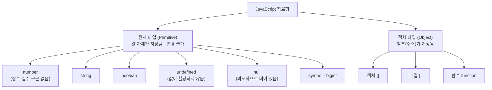
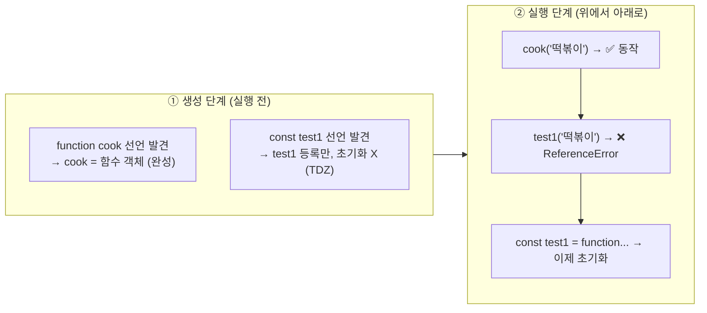
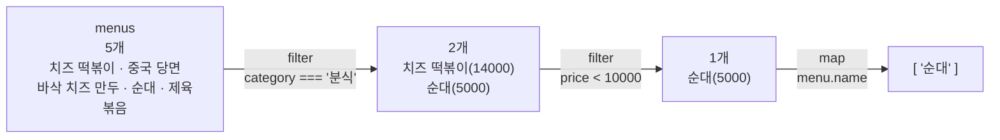
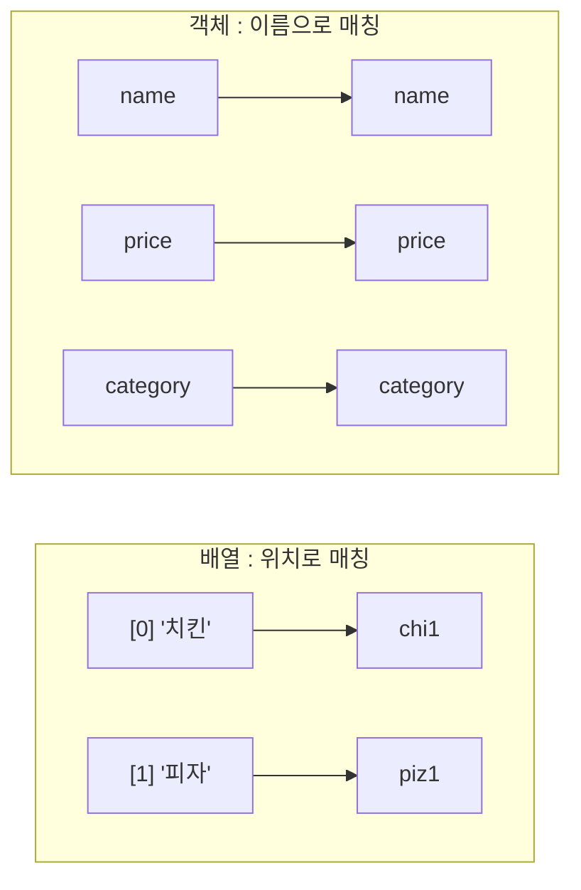
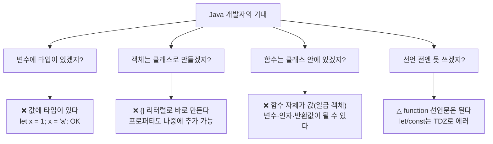

> **이번 글에서 다루는 것**
> 1. `var` · `let` · `const`와 **동적 타입**, `typeof`
> 2. **객체**: 프로퍼티(Key-Value)의 집합, 동적 추가·수정
> 3. **함수**: 선언문과 표현식, **호이스팅**, TDZ
> 4. **화살표 함수**와 `this`
> 5. **배열**과 **고차 함수** (`forEach` · `map` · `filter`)
> 6. **스프레드 문법**으로 복사하기: 참조 복사, 얕은 복사, 깊은 복사
> 7. **구조 분해 할당**
> 8. (미션) **Java와 JavaScript의 동작 원리 비교**
>
> Module 3에서는 프론트엔드를 다룬다. 그 첫 단계로 Java와 비교하며 JavaScript 문법을 익힌다. 예제는 모두 "원티드 식당"의 메뉴와 주문 데이터다.

**JavaScript 시리즈**: **01. JavaScript 기초**

```
javascript
├── 01_variable.js            ← var / let / const, 동적 타입, typeof
├── 02_object.js              ← 객체 리터럴, 프로퍼티 추가·수정
├── 03_function.js            ← 함수 선언문 vs 표현식, 호이스팅
├── 04_arrow-function.js      ← 화살표 함수
├── 05_array.js               ← 배열 리터럴
├── 06_higher-order-method.js ← forEach / map / filter
├── 07_spread-syntax.js       ← 스프레드 문법과 복사
└── 08_destructuring.js       ← 구조 분해 할당
```

---

## 1. 변수 — `var` · `let` · `const`와 동적 타입

Java는 변수를 선언할 때 **자료형**을 적고, JavaScript는 **변수 선언 키워드**를 적는다.

```java
// Java : 자료형 변수명 = 리터럴;
final String shop = "원티드 식당";
int test = 1;
```

```javascript
// JavaScript : 키워드 변수명 = 리터럴;
const shop = "원티드 식당";   // 재할당 불가 (Java의 final)
// shop = 1;                 // TypeError: Assignment to constant variable.

let test = 1;
test = "문자열";              // 숫자를 담던 변수에 문자열 재할당 OK
console.log(test);           // 문자열
```

### 세 키워드 비교

| | `var` | `let` | `const` |
|---|---|---|---|
| 재할당 | O | O | **X** |
| 재선언 (같은 이름 다시 선언) | O | X | X |
| 스코프 | **함수** 스코프 | **블록** `{}` 스코프 | **블록** `{}` 스코프 |
| 선언 전 접근 | `undefined` | ReferenceError (TDZ) | ReferenceError (TDZ) |
| 지금 써도 되나? | ❌ 쓰지 않는다 | 값이 바뀔 때만 | ✅ **기본값** |

> 💡 **실무 규칙: `const`를 기본으로, 재할당이 꼭 필요할 때만 `let`, `var`는 쓰지 않는다.**
> `var`는 블록을 무시하고 재선언도 허용해서 실수를 만들기 쉽다. ES6(2015)에서 `let`/`const`가 이 문제를 고치려고 등장했다.

```javascript
if (true) {
    var a = 1;
    let b = 2;
}
console.log(a);  // 1  ← var는 if 블록 밖으로 새어 나간다
console.log(b);  // ReferenceError: b is not defined
```

> ⚠️ **`const`는 "값을 바꿀 수 없다"가 아니라 "변수를 다시 할당할 수 없다"는 뜻이다.**
> Java의 `final` 참조 변수와 같다. `const`로 선언한 객체나 배열도 **내부 내용은 바꿀 수 있다**.
> ```javascript
> const cart = ['치킨'];
> cart.push('피자');      // OK: 배열 내용 변경
> cart = ['파스타'];      // TypeError: 변수 재할당
> ```

### 동적 타입 (Dynamic Typing)

JavaScript는 **변수에 값을 할당하는 시점**에 타입이 정해진다. 변수 자체에는 타입이 없고 **값에 타입이 있다**.

| | 장점 | 단점 |
|---|---|---|
| 동적 타입 | 자료형을 신경 쓰지 않고 빠르게 작성할 수 있다 | 값이 언제든 다른 타입으로 바뀔 수 있다. 실행해 보기 전에는 타입을 확신할 수 없고, 타입 오류가 **런타임**에야 드러난다 |

> 💡 이 단점 때문에 실무 프론트엔드에서는 JavaScript에 정적 타입을 얹은 **TypeScript**를 많이 쓴다. Java처럼 컴파일 시점에 타입 오류를 잡아준다.

### `typeof` 연산자

```javascript
let test1;
console.log(typeof test1);   // undefined
test1 = 1;             console.log(typeof test1);   // number
test1 = "java";        console.log(typeof test1);   // string
test1 = true;          console.log(typeof test1);   // boolean
test1 = null;          console.log(typeof test1);   // object   ← ⚠️
test1 = {};            console.log(typeof test1);   // object
test1 = [];            console.log(typeof test1);   // object   ← ⚠️
test1 = function() {}; console.log(typeof test1);   // function
```

출력 중 **두 군데**가 이상하다.

| 결과 | 이유 | 정확히 판별하려면 |
|---|---|---|
| `typeof null` → `"object"` | JavaScript 초기 구현의 **버그**. 호환성 때문에 고치지 못하고 남아 있다 | `value === null` |
| `typeof []` → `"object"` | 배열도 객체의 한 종류다 | `Array.isArray(value)` |
| `typeof function(){}` → `"function"` | 함수도 사실 객체지만, 호출할 수 있는 객체라 `typeof`가 따로 구분해 준다 | |

### JavaScript의 자료형 한눈에 보기



> 💡 **Java와 다른 점**: Java는 `int`, `long`, `double`처럼 숫자 타입이 여럿이지만 JavaScript는 **`number` 하나**(64비트 부동소수점)뿐이다. 그래서 `0.1 + 0.2`가 `0.30000000000000004`가 된다. 금액 계산은 원 단위 정수로 처리하는 습관을 들이자.

> 💡 **`undefined` vs `null`**: `undefined`는 "아직 값을 넣지 않음"(엔진이 넣는 기본값), `null`은 "비어 있음을 개발자가 의도적으로 표시". Java에는 `null`만 있다.

---

## 2. 객체 — 프로퍼티(Key-Value)의 집합

JavaScript에서 **중괄호 `{}`는 객체**다. 객체는 **프로퍼티(Key-Value 쌍)의 집합**이다.

```javascript
const store = {
    name : '원티드 식당',          // 프로퍼티 key : name, value : '원티드 식당'
    category : '분식',
    getInfo : function() {         // 값이 함수인 프로퍼티 = 메서드
        return `${this.name}은 ${this.category} 전문점 입니다!`
    }
};

console.log(store);            // { name: '원티드 식당', category: '분식', getInfo: [Function: getInfo] }
console.log(store.getInfo());  // 원티드 식당은 분식 전문점 입니다!
```

### Java 클래스와 비교

<div style="margin:1.5em 0;overflow-x:auto"><svg viewBox="0 0 720 270" width="100%" role="img" aria-label="Java는 클래스로 틀을 만든 뒤 new로 객체를 만들고, JavaScript는 객체 리터럴로 바로 객체를 만든다" xmlns="http://www.w3.org/2000/svg" style="max-width:720px;font-family:'Pretendard','Noto Sans KR','Noto Sans CJK KR','Apple SD Gothic Neo','Malgun Gothic',sans-serif"><defs><marker id="js1-a1" viewBox="0 0 10 10" refX="9" refY="5" markerWidth="7" markerHeight="7" orient="auto"><path d="M0,0 L10,5 L0,10 z" fill="#3a3530"/></marker></defs><rect width="720" height="270" rx="12" fill="#fbf8f1"/><text x="185" y="32" text-anchor="middle" font-size="15" font-weight="700" fill="#b5523b">Java : 설계도 → 객체</text><text x="535" y="32" text-anchor="middle" font-size="15" font-weight="700" fill="#2f7f73">JavaScript : 바로 객체</text><line x1="360" y1="18" x2="360" y2="255" stroke="#d8d0c4" stroke-dasharray="4 4"/><rect x="40" y="50" width="290" height="92" rx="8" fill="#f8e1dc" stroke="#b5523b"/><g font-family="'D2Coding','JetBrains Mono',Consolas,monospace" font-size="12" fill="#2b2724"><text x="55" y="72">class Store {</text><text x="70" y="90">String name;</text><text x="70" y="106">String category;</text><text x="70" y="122">String getInfo() {...}</text><text x="55" y="136">}</text></g><line x1="185" y1="142" x2="185" y2="172" stroke="#3a3530" stroke-width="1.5" marker-end="url(#js1-a1)"/><text x="195" y="162" font-size="11.5" font-family="'D2Coding','JetBrains Mono',Consolas,monospace" fill="#b5523b">new Store()</text><rect x="70" y="176" width="230" height="56" rx="8" fill="#fff" stroke="#b5523b"/><text x="185" y="200" text-anchor="middle" font-size="13" font-weight="700" fill="#2b2724">Store 인스턴스</text><text x="185" y="220" text-anchor="middle" font-size="11.5" fill="#6b625a">필드 추가 불가 (구조 고정)</text><rect x="390" y="50" width="290" height="110" rx="8" fill="#e3f1ee" stroke="#2f7f73" stroke-width="1.5"/><g font-family="'D2Coding','JetBrains Mono',Consolas,monospace" font-size="12" fill="#2b2724"><text x="405" y="72">const store = {</text><text x="420" y="90">name : '원티드 식당',</text><text x="420" y="106">category : '분식',</text><text x="420" y="122">getInfo : function() {...}</text><text x="405" y="140">};</text></g><rect x="390" y="176" width="290" height="56" rx="8" fill="#fff" stroke="#2f7f73"/><text x="535" y="200" text-anchor="middle" font-size="13" font-weight="700" fill="#2b2724">클래스 없이 리터럴로 즉시 생성</text><text x="535" y="220" text-anchor="middle" font-size="11.5" fill="#6b625a">프로퍼티 동적 추가·수정·삭제 가능</text></svg></div>

| Java | JavaScript 객체 |
|---|---|
| 클래스 `Store` | 객체 리터럴 `{ ... }` (클래스 없이 바로 생성) |
| 필드 `name`, `category` | 프로퍼티 `name`, `category` |
| 메서드 `getInfo()` | 값이 함수인 프로퍼티 `getInfo` |
| 필드 목록은 컴파일 시 고정 | 실행 중에 프로퍼티를 **추가·수정·삭제** 가능 |

- 프로퍼티 **key**는 암묵적으로 **문자열**로 취급된다 (`name`이라 써도 `'name'`).
- 프로퍼티 **value**에는 어떤 타입이든 들어갈 수 있다 (숫자, 문자열, 배열, 객체, 함수…).
- 메서드 안의 `this`는 **그 메서드를 호출한 객체**(`store.getInfo()`에서는 `store`)를 가리킨다.

### 프로퍼티 동적 추가 · 수정 · 삭제

```javascript
const order = { menuName : '치킨' };
console.log(order);          // { menuName: '치킨' }

order.sauce = "뿌링클 시즈닝"; // 없던 프로퍼티 → 추가
console.log(order);          // { menuName: '치킨', sauce: '뿌링클 시즈닝' }

order.sauce = "맛초킹 시즈닝"; // 있던 프로퍼티 → 수정
console.log(order);          // { menuName: '치킨', sauce: '맛초킹 시즈닝' }
```

`order`는 `const`인데도 프로퍼티를 바꿀 수 있다. 1장에서 본 것처럼 `const`는 **변수 재할당만** 막기 때문이다.

### 추가로 알아두면 좋은 것

```javascript
// 1) 대괄호 표기법 : key를 변수나 특수문자가 있는 문자열로 쓸 때
const key = 'menuName';
console.log(order[key]);          // 치킨
console.log(order['sauce']);      // 맛초킹 시즈닝

// 2) 삭제
delete order.sauce;

// 3) 없는 프로퍼티 접근 → 에러가 아니라 undefined
console.log(order.price);         // undefined

// 4) 메서드 축약 표현 (ES6) : ": function" 생략
const store2 = {
    name : '원티드 식당',
    getInfo() { return `${this.name}입니다`; }
};

// 5) 프로퍼티 축약 : key와 변수명이 같으면 한 번만
const name = '떡볶이', price = 4000;
const menu = { name, price };     // { name: '떡볶이', price: 4000 }
```

> 💡 **템플릿 리터럴** `` `...${표현식}...` ``: 백틱(`` ` ``)으로 감싼 문자열 안에 `${}`로 값을 끼워 넣는다. Java의 `"..." + name + "..."` 문자열 연결이나 `String.format()` 대신 쓴다. 여러 줄 문자열도 그대로 쓸 수 있다.

---

## 3. 함수 — 선언문, 표현식, 호이스팅

Java가 **클래스** 기반 객체지향 언어라면, JavaScript는 **함수**가 중심인 언어다. JavaScript에서 함수는 **일급 객체(First-class Object)** 다.

> **일급 객체** = 값처럼 다룰 수 있다.
> - 변수에 담을 수 있고 (`const f = function(){}`)
> - 다른 함수의 **인자로 넘길 수 있고** (→ 6장 고차 함수)
> - 함수의 **반환값**이 될 수 있다
>
> Java에서는 메서드를 변수에 담을 수 없어서 람다/함수형 인터페이스라는 우회로가 필요했다.

### 함수 선언문 vs 함수 표현식

```javascript
// ① 함수 선언문
function welcome(name) {
    return `${name}님, 반갑습니다~~!`
}

// ② 함수 표현식 : 함수를 "값"으로 만들어 변수에 담는다
const welcome2 = function(name) {          // 익명 함수 표현식
    return `${name}님, 반갑습니다~~!`
}

const welcome3 = function hello(name) {    // 기명 함수 표현식
    return `${name}님, 반갑습니다~~!`
}

console.log(welcome("조평훈"));   // 조평훈님, 반갑습니다~~!
console.log(welcome2("조평훈"));  // 조평훈님, 반갑습니다~~!
// console.log(hello("조평훈"));  // ReferenceError: hello is not defined
```

**기명 함수 표현식의 이름(`hello`)은 함수 몸체 안에서만 쓸 수 있다.** 바깥에서는 변수명 `welcome3`으로 호출해야 한다. 함수 안에서 자기 자신을 다시 부르는 **재귀**나, 에러가 났을 때 **스택 트레이스에 이름이 찍히게** 할 때 쓴다.

### 호이스팅 (Hoisting)

JavaScript 엔진은 코드를 한 줄씩 실행하기 **전에** 먼저 코드 전체를 훑으며 **선언을 등록**한다. 그래서 선언이 코드의 맨 위로 "끌어올려진(hoist)" 것처럼 동작한다.

```javascript
console.log(cook('떡볶이'));    // ✅ "떡볶이 조리 시작!"  ← 선언보다 먼저 호출해도 동작

function cook(menuName) {         // 함수 선언문 : 함수 전체가 호이스팅됨
    return `${menuName} 조리 시작!`
}

console.log(test1("떡볶이"));   // ❌ ReferenceError: Cannot access 'test1' before initialization

const test1 = function cook(menuName) {   // 함수 표현식 : 변수 test1만 등록, 값은 아직 없음
    return `${menuName} 조리 시작!`
}
```

> ⚠️ 수업 코드 마지막의 `console.log(test1("떡볶이"))`는 **에러가 나는 것이 정상**이다. 함수 표현식은 호이스팅되지 않는다는 것을 확인하는 예제다.



| 선언 방식 | 호이스팅될 때 등록되는 것 | 선언 전에 사용하면 |
|---|---|---|
| `function f() {}` 선언문 | 이름 **+ 함수 본체 전체** | ✅ 정상 호출 |
| `var f = function() {}` | 이름만, 값은 `undefined` | ❌ TypeError: f is not a function |
| `let` / `const f = function() {}` | 이름만, **초기화되지 않음** | ❌ ReferenceError (TDZ) |

> 💡 **TDZ (Temporal Dead Zone, 일시적 사각지대)**: `let`/`const` 변수는 호이스팅은 되지만, 선언문이 실행되기 전까지는 접근할 수 없는 구간에 있다. `var`처럼 조용히 `undefined`를 주는 대신 에러를 내서 실수를 빨리 발견하게 해준다.

> 💡 **실무 팁**: "선언 전에 호출해도 된다"는 것은 편리하지만 코드를 읽기 어렵게 만든다. 그래서 많은 팀이 **`const` + 함수 표현식(또는 화살표 함수)** 을 기본으로 쓰고 "먼저 정의하고 나중에 사용"하는 규칙을 지킨다.

---

## 4. 화살표 함수 — 짧은 함수 표현식과 `this`

ES6에서 추가된, 함수 표현식을 **짧게 쓰는 문법**이다. `function` 키워드 대신 `=>`를 쓴다.

```javascript
let message;

message = function() { return '주문 접수 OK!!👌' }   // 일반 함수 표현식
message = () => { return '주문 접수 OK!!👌' }        // ① function 생략
message = () => '주문 접수 OK!!👌'                   // ② 본문이 식 하나면 {}와 return 생략

message = (menuName, menuPrice) => `${menuName}의 가격 : ${menuPrice}`  // 매개변수 여러 개
message = menuName => `${menuName}!!`                                   // 매개변수 1개면 () 생략

console.log(message("신전떡볶이"));   // 신전떡볶이!!
```

### 생략 규칙 정리

| 상황 | 문법 | 예 |
|---|---|---|
| 매개변수 0개 | `()` 필수 | `() => 'OK'` |
| 매개변수 1개 | `()` 생략 가능 | `price => price * 0.9` |
| 매개변수 2개 이상 | `()` 필수 | `(a, b) => a + b` |
| 본문이 **식(expression) 하나** | `{}` · `return` 생략 가능 (결과가 자동 반환) | `x => x * 2` |
| 본문에 **문장이 여러 개** | `{}` · `return` 필수 | `x => { const y = x * 2; return y; }` |
| **객체**를 바로 반환 | `()`로 감싼다 | `name => ({ name })` |

> ⚠️ 수업 주석의 "코드가 많으면 생략할 수 없다"를 정확히 말하면 **"본문이 식 하나일 때만 생략할 수 있다"** 이다. 한 줄이어도 `if`문 같은 **문장**이면 `{}`가 필요하다.

> ⚠️ **객체를 반환할 때 함정**: `name => { name }`이라고 쓰면 `{}`를 **함수 본문 블록**으로 해석해서 `undefined`를 반환한다. `name => ({ name })`처럼 소괄호로 감싸야 한다.

### 고차 함수와 함께 쓰기

화살표 함수가 가장 빛나는 곳은 다른 함수에 **콜백**으로 넘길 때다.

```javascript
// 메뉴 가격 10% 할인!
const menuPriceList = [4000, 5000, 140000];

console.log(menuPriceList.map( function(price) { return price * 0.9 } ));  // [ 3600, 4500, 126000 ]
console.log(menuPriceList.map( price => price * 0.9 ));                    // [ 3600, 4500, 126000 ]
```

Java 8의 **람다 표현식**과 거의 같은 모양이다.

| Java 람다 | JavaScript 화살표 함수 |
|---|---|
| `price -> price * 0.9` | `price => price * 0.9` |
| `->` (하이픈) | `=>` (등호) |
| 함수형 인터페이스 타입이 필요 | 그냥 값(함수 객체) |

### 꼭 알아야 할 차이: 화살표 함수에는 자기 `this`가 없다

화살표 함수는 단순히 "짧은 function"이 아니다. **자신만의 `this`를 갖지 않고, 바깥 스코프의 `this`를 그대로 쓴다.** 그래서 **객체의 메서드를 화살표 함수로 만들면 안 된다.**

```javascript
const store = {
    name : '원티드 식당',
    getInfo : function() { return this.name },   // this = store
    getInfoArrow : () => this.name               // this = 바깥(store가 아님!)
};

console.log(store.getInfo());       // 원티드 식당
console.log(store.getInfoArrow());  // undefined
```

| | 일반 함수 `function` | 화살표 함수 `=>` |
|---|---|---|
| `this` | **호출한 객체**에 따라 결정 | **선언된 위치의 바깥** `this`를 사용 |
| 객체 메서드로 | ✅ 적합 | ❌ 부적합 |
| 콜백(`map`, `filter`, 이벤트 처리 안쪽 등)으로 | 가능 | ✅ 적합 (바깥 `this` 유지) |
| `new`로 생성자 호출 | 가능 | ❌ 불가 |

---

## 5. 배열 — 아무 타입이나 담는 가변 길이 배열

| | Java 배열 | JavaScript 배열 |
|---|---|---|
| 요소 타입 | **한 가지 타입만** (`int[]`, `String[]`) | **아무 타입이나 섞어서** |
| 길이 | 생성 시 고정 | 자유롭게 늘고 줄어듦 (Java의 `ArrayList`에 가까움) |
| 생성 | `new String[3]` / `{"a", "b"}` | 배열 리터럴 `[ ]` |

```javascript
// 배열 리터럴로 생성 : 문자열, 숫자, 객체, 함수가 한 배열에!
const menus = ['제육', '떡볶이', '순대', 1, {name : 'hi'}, function() {}];

for (let i = 0; i < menus.length; i++) {
    console.log(menus[i]);
}
// 제육 / 떡볶이 / 순대 / 1 / { name: 'hi' } / [Function (anonymous)]
```

> 💡 섞어 넣을 수 있다는 것이지 섞어 넣는 게 좋다는 뜻은 아니다. 실무에서는 **같은 모양의 데이터(예: 메뉴 객체들)** 를 담는 것이 일반적이다. 그래야 다음 장의 `map`/`filter`를 안전하게 쓸 수 있다.

### 자주 쓰는 배열 메서드

```javascript
const cart = ['치킨'];
cart.push('피자');          // 끝에 추가     → ['치킨', '피자']
cart.pop();                 // 끝에서 제거   → ['치킨']
cart.unshift('콜라');       // 앞에 추가     → ['콜라', '치킨']
cart.shift();               // 앞에서 제거   → ['치킨']
cart.includes('치킨');      // 포함 여부     → true
cart.indexOf('치킨');       // 위치         → 0 (없으면 -1)

for (const item of cart) {  // for...of : 인덱스 없이 값만 순회 (Java의 향상된 for문)
    console.log(item);
}
```

> ⚠️ `for...in`은 배열이 아니라 **객체의 key**를 순회할 때 쓴다. 배열의 값을 순회할 때는 `for...of`나 `forEach`를 쓰자.

---

## 6. 고차 함수 — `forEach` · `map` · `filter` ⭐

> **고차 함수**: 함수를 **인자로 받거나**, 함수를 **반환하는** 함수.
> 배열의 고차 함수는 **콜백 함수**를 인자로 받아 배열 요소를 하나씩 순회하며 처리한다.

예제 데이터:

```javascript
const menus = [
    { name : '치즈 떡볶이',   category : '분식',   price : 14000 },
    { name : '중국 당면',     category : '사이드', price : 3000 },
    { name : '바삭 치즈 만두', category : '사이드', price : 2000 },
    { name : '순대',         category : '분식',   price : 5000 },
    { name : '제육볶음',      category : '한식',   price : 10000 },
];
```

### 세 메서드 비교

| 메서드 | 콜백이 반환해야 하는 것 | 결과 | 원본 배열 |
|---|---|---|---|
| `forEach` | 없음 | **반환값 없음** (`undefined`) | 그대로 |
| `map` | **변환된 값** | 콜백 반환값으로 만든 **새 배열** (길이 같음) | 그대로 |
| `filter` | **true / false** | `true`인 요소만 모은 **새 배열** (길이 같거나 짧음) | 그대로 |

```javascript
// forEach : 각 요소마다 콜백 실행, 반환값 없음
menus.forEach( menu => console.log(menu) );

// map : 메뉴 객체 → 메뉴 이름으로 "변환"
const names = menus.map( menu => menu.name );
console.log(names);
// [ '치즈 떡볶이', '중국 당면', '바삭 치즈 만두', '순대', '제육볶음' ]

// filter : 조건에 맞는 것만 "골라내기"
const snacks = menus.filter( menu => menu.category === '분식' );
// [ {치즈 떡볶이...}, {순대...} ]
const cheap = menus.filter( menu => menu.price < 10000 );
// [ {중국 당면...}, {바삭 치즈 만두...}, {순대...} ]
```

### 메서드 체이닝: filter → filter → map

`map`과 `filter`는 **새 배열을 반환**하므로 결과에 바로 다음 메서드를 이어 붙일 수 있다.

```javascript
// 분식 중에서 가격이 1만원 미만인 메뉴의 이름 목록
const result = menus.filter(menu => menu.category === '분식')
                    .filter(menu => menu.price < 10000)
                    .map(menu => menu.name);
console.log(result);   // [ '순대' ]
```



이 코드는 Java의 **Stream API**와 사고방식이 똑같다.

```java
// Java Stream
List<String> result = menus.stream()
        .filter(menu -> menu.getCategory().equals("분식"))
        .filter(menu -> menu.getPrice() < 10000)
        .map(Menu::getName)
        .toList();
```

> 💡 **이 방식의 장점**: `for`문 + `if`문 + 빈 배열에 `push` 하는 코드를 "무엇을 할지"만 드러나게 바꿔준다(선언형). 그리고 **원본 배열을 건드리지 않는다**. 원본을 바꾸지 않는 습관은 React 같은 프레임워크에서 특히 중요하다.

### 추가로 알아두면 좋은 고차 함수

```javascript
// find : 조건에 맞는 "첫 번째 요소 하나" (없으면 undefined)
menus.find(menu => menu.name === '순대');           // { name: '순대', ... }

// some / every : 하나라도 / 모두 조건을 만족하는가
menus.some(menu => menu.price > 10000);             // true
menus.every(menu => menu.price > 1000);             // true

// reduce : 배열을 값 하나로 줄이기 (합계 등)
const total = menus.reduce((sum, menu) => sum + menu.price, 0);   // 34000

// sort : ⚠️ 원본을 바꾸고, 비교 함수가 없으면 "문자열" 기준으로 정렬한다
[10, 1, 2].sort();                                  // [ 1, 10, 2 ]  ← 의도와 다름
[10, 1, 2].sort((a, b) => a - b);                   // [ 1, 2, 10 ]
```

### `==` vs `===`

`filter`의 조건식에서 등장한 비교 연산자다.

| 연산자 | 이름 | 동작 | `1 ? '1'` |
|---|---|---|---|
| `==` | 동등 비교 | 타입이 다르면 **암묵적으로 타입을 변환**한 뒤 비교 | `true` |
| `===` | 일치 비교 | **타입과 값**이 모두 같아야 true | `false` |

```javascript
console.log(1 == '1');          // true   ← 문자열 '1'을 숫자 1로 바꿔서 비교
console.log(1 === '1');         // false
console.log(0 == '');           // true   ← 이런 예상 밖 결과가 생긴다
console.log(null == undefined); // true
```

> 💡 **항상 `===` / `!==`를 쓴다.** `==`의 형변환 규칙은 복잡해서 버그의 원인이 된다.
> 참고로 Java의 `==`는 객체의 **참조(주소)** 를 비교한다. JavaScript의 `===`도 객체끼리 비교할 때는 **참조**를 비교한다 (7장에서 확인).

---

## 7. 스프레드 문법 — 참조 복사, 얕은 복사, 깊은 복사 ⭐

`...`(점 세 개)는 배열이나 객체를 **펼쳐서(spread)** 개별 요소로 꺼낸다. 이것을 새 `[]`나 `{}` 안에 넣으면 **복사본**이 만들어진다.

```javascript
const cart = ['치킨', '피자'];
const cartRef = cart;          // 참조(주소) 복사 : 같은 배열을 가리킴
const cartCopy = [...cart];    // 얕은 복사 : 새 배열을 만들고 요소를 옮겨 담음

cartRef.push('파스타');
console.log(cart, cartRef);    // [ '치킨', '피자', '파스타' ] [ '치킨', '피자', '파스타' ]  ← 둘 다 바뀜

cartCopy.push('엽떡');
console.log(cart, cartCopy);   // [ '치킨', '피자', '파스타' ] [ '치킨', '피자', '엽떡' ]  ← 원본은 그대로
```

> ⚠️ **용어 바로잡기**: 수업 코드 주석에는 `cartRef = cart`를 "깊은 복사", `[...cart]`를 "얕은 복사"라고 적었는데, 일반적인 용어로는 다음과 같다.
> - `cartRef = cart` → **참조 복사** (복사가 아니라 같은 배열을 함께 가리키는 것. "참조 공유"라고도 한다)
> - `[...cart]` → **얕은 복사** (Shallow Copy)
> - **깊은 복사** (Deep Copy) → 안쪽에 중첩된 객체까지 전부 새로 만드는 복사 (`structuredClone()`)
>
> 주석이 지적한 문제("한 곳에서 수정하면 다른 곳의 값이 영문도 모른 채 바뀐다")는 정확히 **참조 복사**의 문제다.

<div style="margin:1.5em 0;overflow-x:auto"><svg viewBox="0 0 720 360" width="100%" role="img" aria-label="참조 복사, 얕은 복사, 깊은 복사의 메모리 구조 비교" xmlns="http://www.w3.org/2000/svg" style="max-width:720px;font-family:'Pretendard','Noto Sans KR','Noto Sans CJK KR','Apple SD Gothic Neo','Malgun Gothic',sans-serif"><defs><marker id="js1-a2" viewBox="0 0 10 10" refX="9" refY="5" markerWidth="7" markerHeight="7" orient="auto"><path d="M0,0 L10,5 L0,10 z" fill="#3a3530"/></marker><marker id="js1-a3" viewBox="0 0 10 10" refX="9" refY="5" markerWidth="7" markerHeight="7" orient="auto"><path d="M0,0 L10,5 L0,10 z" fill="#b5523b"/></marker></defs><rect width="720" height="360" rx="12" fill="#fbf8f1"/><g font-size="14" font-weight="700" text-anchor="middle"><text x="120" y="30" fill="#b5523b">① 참조 복사</text><text x="360" y="30" fill="#c47f22">② 얕은 복사</text><text x="600" y="30" fill="#2f7f73">③ 깊은 복사</text></g><g font-family="'D2Coding','JetBrains Mono',Consolas,monospace" font-size="11" text-anchor="middle" fill="#6b625a"><text x="120" y="48">b = a</text><text x="360" y="48">b = {...a}</text><text x="600" y="48">b = structuredClone(a)</text></g><line x1="240" y1="18" x2="240" y2="345" stroke="#d8d0c4" stroke-dasharray="4 4"/><line x1="480" y1="18" x2="480" y2="345" stroke="#d8d0c4" stroke-dasharray="4 4"/><g font-family="'D2Coding','JetBrains Mono',Consolas,monospace" font-size="13" font-weight="700" fill="#2b2724" text-anchor="middle"><rect x="35" y="66" width="50" height="30" rx="6" fill="#e2eaf5" stroke="#3d6a9e"/><text x="60" y="86">a</text><rect x="155" y="66" width="50" height="30" rx="6" fill="#e2eaf5" stroke="#3d6a9e"/><text x="180" y="86">b</text><rect x="275" y="66" width="50" height="30" rx="6" fill="#e2eaf5" stroke="#3d6a9e"/><text x="300" y="86">a</text><rect x="395" y="66" width="50" height="30" rx="6" fill="#e2eaf5" stroke="#3d6a9e"/><text x="420" y="86">b</text><rect x="515" y="66" width="50" height="30" rx="6" fill="#e2eaf5" stroke="#3d6a9e"/><text x="540" y="86">a</text><rect x="635" y="66" width="50" height="30" rx="6" fill="#e2eaf5" stroke="#3d6a9e"/><text x="660" y="86">b</text></g><line x1="60" y1="96" x2="105" y2="136" stroke="#3a3530" stroke-width="1.5" marker-end="url(#js1-a2)"/><line x1="180" y1="96" x2="135" y2="136" stroke="#3a3530" stroke-width="1.5" marker-end="url(#js1-a2)"/><rect x="50" y="140" width="140" height="56" rx="8" fill="#fff" stroke="#b5523b" stroke-width="1.5"/><text x="120" y="164" text-anchor="middle" font-size="12" fill="#2b2724">menuName : '뿌링클'</text><text x="120" y="184" text-anchor="middle" font-size="12" fill="#2b2724">option : ●</text><line x1="150" y1="196" x2="150" y2="236" stroke="#3a3530" stroke-width="1.5" marker-end="url(#js1-a2)"/><rect x="75" y="240" width="140" height="36" rx="8" fill="#fff" stroke="#8a8178"/><text x="145" y="263" text-anchor="middle" font-size="12" fill="#2b2724">{ sauce : '치즈' }</text><text x="120" y="304" text-anchor="middle" font-size="12" font-weight="700" fill="#b5523b">객체 1개를 함께 가리킴</text><text x="120" y="322" text-anchor="middle" font-size="11.5" fill="#2b2724">b를 고치면 a도 바뀜</text><text x="120" y="338" text-anchor="middle" font-size="11.5" fill="#6b625a">a === b → true</text><line x1="300" y1="96" x2="300" y2="136" stroke="#3a3530" stroke-width="1.5" marker-end="url(#js1-a2)"/><line x1="420" y1="96" x2="420" y2="136" stroke="#3a3530" stroke-width="1.5" marker-end="url(#js1-a2)"/><rect x="250" y="140" width="100" height="56" rx="8" fill="#fff" stroke="#3a3530"/><text x="300" y="162" text-anchor="middle" font-size="11" fill="#2b2724">menuName</text><text x="300" y="184" text-anchor="middle" font-size="11" fill="#2b2724">option : ●</text><rect x="370" y="140" width="100" height="56" rx="8" fill="#fff" stroke="#3a3530"/><text x="420" y="162" text-anchor="middle" font-size="11" fill="#2b2724">menuName</text><text x="420" y="184" text-anchor="middle" font-size="11" fill="#2b2724">option : ●</text><line x1="325" y1="196" x2="352" y2="236" stroke="#b5523b" stroke-width="1.5" marker-end="url(#js1-a3)"/><line x1="420" y1="196" x2="372" y2="236" stroke="#b5523b" stroke-width="1.5" marker-end="url(#js1-a3)"/><rect x="295" y="240" width="130" height="36" rx="8" fill="#fbecd6" stroke="#c47f22"/><text x="360" y="263" text-anchor="middle" font-size="12" fill="#2b2724">{ sauce : '치즈' }</text><text x="360" y="304" text-anchor="middle" font-size="12" font-weight="700" fill="#c47f22">바깥만 새로, 안쪽은 공유</text><text x="360" y="322" text-anchor="middle" font-size="11.5" fill="#2b2724">b.option.sauce 수정 → a도 바뀜</text><text x="360" y="338" text-anchor="middle" font-size="11.5" fill="#6b625a">a === b → false</text><line x1="540" y1="96" x2="540" y2="136" stroke="#3a3530" stroke-width="1.5" marker-end="url(#js1-a2)"/><line x1="660" y1="96" x2="660" y2="136" stroke="#3a3530" stroke-width="1.5" marker-end="url(#js1-a2)"/><rect x="490" y="140" width="100" height="56" rx="8" fill="#fff" stroke="#2f7f73"/><text x="540" y="162" text-anchor="middle" font-size="11" fill="#2b2724">menuName</text><text x="540" y="184" text-anchor="middle" font-size="11" fill="#2b2724">option : ●</text><rect x="610" y="140" width="100" height="56" rx="8" fill="#fff" stroke="#2f7f73"/><text x="660" y="162" text-anchor="middle" font-size="11" fill="#2b2724">menuName</text><text x="660" y="184" text-anchor="middle" font-size="11" fill="#2b2724">option : ●</text><line x1="540" y1="196" x2="540" y2="236" stroke="#3a3530" stroke-width="1.5" marker-end="url(#js1-a2)"/><line x1="660" y1="196" x2="660" y2="236" stroke="#3a3530" stroke-width="1.5" marker-end="url(#js1-a2)"/><rect x="492" y="240" width="96" height="36" rx="8" fill="#e3f1ee" stroke="#2f7f73"/><text x="540" y="263" text-anchor="middle" font-size="11" fill="#2b2724">{ sauce }</text><rect x="612" y="240" width="96" height="36" rx="8" fill="#e3f1ee" stroke="#2f7f73"/><text x="660" y="263" text-anchor="middle" font-size="11" fill="#2b2724">{ sauce }</text><text x="600" y="304" text-anchor="middle" font-size="12" font-weight="700" fill="#2f7f73">안쪽까지 전부 새로</text><text x="600" y="322" text-anchor="middle" font-size="11.5" fill="#2b2724">서로 완전히 독립</text><text x="600" y="338" text-anchor="middle" font-size="11.5" fill="#6b625a">a === b → false</text></svg></div>

### 객체도 똑같다

```javascript
const order = {
    menuName : '뿌링클',
    qty : 2
};

const orderRef = order;          // 참조 복사
const orderCopy = { ...order };  // 얕은 복사 : 새 객체 {}에 프로퍼티를 펼쳐 담음

console.log(order === orderRef);   // true  : 같은 객체
console.log(order === orderCopy);  // false : 내용은 같지만 다른 객체
```

`===`로 객체를 비교하면 **내용이 아니라 참조(주소)** 를 비교한다. Java에서 객체를 `==`로 비교하는 것과 같다.

### 얕은 복사의 한계 (꼭 알아둘 것)

스프레드는 **한 단계만** 복사한다. 프로퍼티 값이 또 객체라면, 그 안쪽 객체는 **주소만 복사**되어 원본과 공유된다.

```javascript
const order = { menuName : '뿌링클', option : { sauce : '치즈' } };
const copy = { ...order };

copy.menuName = '맛초킹';       // 1단계 값 → 복사본만 바뀜
copy.option.sauce = '갈릭';     // 2단계 객체 → 원본과 공유 중!

console.log(order.menuName);      // 뿌링클  ✅
console.log(order.option.sauce);  // 갈릭    ⚠️ 원본까지 바뀜

// 깊은 복사가 필요하면
const deep = structuredClone(order);
deep.option.sauce = '마늘';
console.log(order.option.sauce);  // 갈릭 (영향 없음)
```

| 방법 | 종류 | 비고 |
|---|---|---|
| `b = a` | 참조 복사 | 같은 객체를 공유 |
| `[...a]`, `{...a}`, `Object.assign({}, a)` | 얕은 복사 | 1단계만 새로 만듦 |
| `structuredClone(a)` | 깊은 복사 | 최신 브라우저·Node 17+ 내장. 함수가 들어 있으면 복사 불가 |
| `JSON.parse(JSON.stringify(a))` | 깊은 복사 (옛 방식) | 함수·`undefined`·`Date` 등은 손실됨 |

### 스프레드로 합치기 · 덮어쓰기

복사 외에도 자주 쓰는 패턴이다.

```javascript
// 배열 합치기
const korean = ['제육', '김치찌개'];
const snack = ['떡볶이', '순대'];
const all = [...korean, ...snack, '라면'];   // [ '제육', '김치찌개', '떡볶이', '순대', '라면' ]

// 객체 합치기 + 일부 값만 바꾸기 (뒤에 오는 값이 이긴다)
const menu = { name : '순대', price : 5000 };
const updated = { ...menu, price : 5500 };   // { name: '순대', price: 5500 }, menu는 그대로
```

> 💡 `{ ...menu, price : 5500 }`처럼 **원본은 두고 바뀐 부분만 반영한 새 객체를 만드는 패턴**은 React의 상태(state) 업데이트에서 매일 쓰게 된다.

---

## 8. 구조 분해 할당 — 배열과 객체에서 값 꺼내기

배열이나 객체에서 값을 꺼내 **여러 변수에 한 번에** 담는 문법이다.

### 배열 구조 분해: 순서(인덱스) 기준

```javascript
const menuArr = ['치킨', '피자'];

// 기존 방식
const chi = menuArr[0];
const piz = menuArr[1];

// 구조 분해 할당
const [chi1, piz1] = menuArr;
console.log(chi1);  // 치킨
console.log(piz1);  // 피자
```

### 객체 구조 분해: 이름(key) 기준

```javascript
const menu = {
    name : '치즈알밥',
    price : 7500,
    category : '퓨전한식'
};

// 기존 방식
// const name = menu.name;
// const price = menu.price;
// const category = menu.category;

// 구조 분해 할당 : 프로퍼티 key와 변수명이 같아야 한다
const { name, price, category } = menu;
console.log(name, price, category);   // 치즈알밥 7500 퓨전한식
```



| | 배열 구조 분해 | 객체 구조 분해 |
|---|---|---|
| 괄호 | `[ ]` | `{ }` |
| 매칭 기준 | **순서** | **key 이름** |
| 변수명 | 자유 | key와 같아야 함 (다르게 쓰려면 `key : 새이름`) |

### 나머지(rest)와 함께 쓰기

```javascript
const { ...rest } = menu;        // menu의 모든 프로퍼티를 담은 새 객체 (얕은 복사)
console.log(rest);               // { name: '치즈알밥', price: 7500, category: '퓨전한식' }

const { name: menuName, ...others } = menu;   // name만 따로 빼고 나머지는 others로
console.log(menuName);   // 치즈알밥
console.log(others);     // { price: 7500, category: '퓨전한식' }
```

> 💡 **`...`의 두 얼굴**: 같은 `...`이지만 위치에 따라 이름이 다르다.
> - 값을 **펼치는** 쪽 (`[...arr]`, `{...obj}`, `f(...args)`) → **스프레드(spread) 문법**
> - 남은 값을 **모으는** 쪽 (`const {...rest} = obj`, `function f(...args)`) → **나머지(rest) 문법**

### 추가로 알아두면 좋은 것

```javascript
// 1) 변수명 바꾸기 : key : 새변수명
const { name: menuName2, price: menuPrice } = menu;

// 2) 기본값 : 값이 undefined일 때 사용
const { spicy = '보통' } = menu;   // menu에 spicy가 없으므로 '보통'

// 3) 필요 없는 배열 요소 건너뛰기
const [, second] = ['치킨', '피자', '파스타'];   // second = '피자'

// 4) 두 변수 값 바꾸기 (임시 변수 없이)
let a = 1, b = 2;
[a, b] = [b, a];   // a = 2, b = 1

// 5) 함수 매개변수에서 바로 꺼내기 ← 가장 많이 쓰는 형태
const printMenu = ({ name, price }) => `${name} : ${price}원`;
console.log(printMenu(menu));   // 치즈알밥 : 7500원

// 고차 함수와 조합
menus.map(({ name }) => name);
```

> 💡 5번 형태는 React 컴포넌트에서 `function MenuCard({ name, price }) { ... }`처럼 props를 받을 때 그대로 쓰인다.

---

## 9. 오늘의 미션 — Java와 JavaScript의 동작 원리 비교

> **오늘의 미션**: Java 언어의 동작 원리와 JavaScript 언어의 동작 원리를 비교하고, 서로에게 이해시킬 수 있는 자료를 구성하기

### 실행 과정 비교

<div style="margin:1.5em 0;overflow-x:auto"><svg viewBox="0 0 720 330" width="100%" role="img" aria-label="Java는 javac로 바이트코드를 만든 뒤 JVM이 실행하고, JavaScript는 소스 코드를 엔진이 바로 파싱해 실행한다" xmlns="http://www.w3.org/2000/svg" style="max-width:720px;font-family:'Pretendard','Noto Sans KR','Noto Sans CJK KR','Apple SD Gothic Neo','Malgun Gothic',sans-serif"><defs><marker id="js1-a4" viewBox="0 0 10 10" refX="9" refY="5" markerWidth="7" markerHeight="7" orient="auto"><path d="M0,0 L10,5 L0,10 z" fill="#3a3530"/></marker></defs><rect width="720" height="330" rx="12" fill="#fbf8f1"/><text x="24" y="34" font-size="15" font-weight="700" fill="#b5523b">Java</text><rect x="20" y="50" width="120" height="58" rx="8" fill="#fff" stroke="#8a8178"/><text x="80" y="75" text-anchor="middle" font-size="12.5" font-weight="700" fill="#2b2724">소스 코드</text><text x="80" y="94" text-anchor="middle" font-size="11" font-family="'D2Coding','JetBrains Mono',Consolas,monospace" fill="#6b625a">Store.java</text><line x1="140" y1="79" x2="172" y2="79" stroke="#3a3530" stroke-width="1.5" marker-end="url(#js1-a4)"/><rect x="175" y="50" width="130" height="58" rx="8" fill="#f8e1dc" stroke="#b5523b" stroke-width="1.5"/><text x="240" y="75" text-anchor="middle" font-size="12.5" font-weight="700" fill="#b5523b">컴파일 (javac)</text><text x="240" y="94" text-anchor="middle" font-size="11" fill="#2b2724">타입 검사 · 문법 오류</text><line x1="305" y1="79" x2="337" y2="79" stroke="#3a3530" stroke-width="1.5" marker-end="url(#js1-a4)"/><rect x="340" y="50" width="120" height="58" rx="8" fill="#fff" stroke="#8a8178"/><text x="400" y="75" text-anchor="middle" font-size="12.5" font-weight="700" fill="#2b2724">바이트코드</text><text x="400" y="94" text-anchor="middle" font-size="11" font-family="'D2Coding','JetBrains Mono',Consolas,monospace" fill="#6b625a">Store.class</text><line x1="460" y1="79" x2="492" y2="79" stroke="#3a3530" stroke-width="1.5" marker-end="url(#js1-a4)"/><rect x="495" y="50" width="205" height="58" rx="8" fill="#e2eaf5" stroke="#3d6a9e" stroke-width="1.5"/><text x="597" y="75" text-anchor="middle" font-size="12.5" font-weight="700" fill="#3d6a9e">JVM에서 실행</text><text x="597" y="94" text-anchor="middle" font-size="11" fill="#2b2724">인터프리터 + JIT 컴파일러</text><text x="240" y="130" text-anchor="middle" font-size="11.5" fill="#b5523b">↑ 타입 오류는 여기서 미리 걸러짐</text><line x1="20" y1="152" x2="700" y2="152" stroke="#d8d0c4" stroke-dasharray="4 4"/><text x="24" y="184" font-size="15" font-weight="700" fill="#2f7f73">JavaScript</text><rect x="20" y="200" width="120" height="58" rx="8" fill="#fff" stroke="#8a8178"/><text x="80" y="225" text-anchor="middle" font-size="12.5" font-weight="700" fill="#2b2724">소스 코드</text><text x="80" y="244" text-anchor="middle" font-size="11" font-family="'D2Coding','JetBrains Mono',Consolas,monospace" fill="#6b625a">store.js</text><line x1="140" y1="229" x2="172" y2="229" stroke="#3a3530" stroke-width="1.5" marker-end="url(#js1-a4)"/><rect x="175" y="200" width="525" height="100" rx="10" fill="#e3f1ee" stroke="#2f7f73" stroke-width="1.5"/><text x="437" y="220" text-anchor="middle" font-size="12.5" font-weight="700" fill="#2f7f73">JS 엔진 (브라우저: V8 · SpiderMonkey / 서버: Node.js의 V8)</text><rect x="190" y="232" width="150" height="52" rx="8" fill="#fff" stroke="#2f7f73"/><text x="265" y="254" text-anchor="middle" font-size="12" font-weight="700" fill="#2b2724">파싱 · 선언 등록</text><text x="265" y="272" text-anchor="middle" font-size="11" fill="#6b625a">← 호이스팅이 여기서</text><line x1="340" y1="258" x2="362" y2="258" stroke="#3a3530" stroke-width="1.5" marker-end="url(#js1-a4)"/><rect x="365" y="232" width="150" height="52" rx="8" fill="#fff" stroke="#2f7f73"/><text x="440" y="254" text-anchor="middle" font-size="12" font-weight="700" fill="#2b2724">인터프리터 실행</text><text x="440" y="272" text-anchor="middle" font-size="11" fill="#6b625a">위에서 아래로</text><line x1="515" y1="258" x2="537" y2="258" stroke="#3a3530" stroke-width="1.5" marker-end="url(#js1-a4)"/><rect x="540" y="232" width="145" height="52" rx="8" fill="#fff" stroke="#2f7f73"/><text x="612" y="254" text-anchor="middle" font-size="12" font-weight="700" fill="#2b2724">JIT 최적화</text><text x="612" y="272" text-anchor="middle" font-size="11" fill="#6b625a">자주 쓰는 코드만</text><text x="437" y="320" text-anchor="middle" font-size="11.5" fill="#2f7f73">별도 컴파일 단계 없음 → 타입 오류는 해당 줄이 실행될 때 발견</text></svg></div>

### 한눈에 비교

| 구분 | Java | JavaScript |
|---|---|---|
| 실행 방식 | 소스 → **javac 컴파일** → 바이트코드 → **JVM** 실행 | 소스를 **JS 엔진**이 바로 파싱·실행 (내부적으로 JIT 최적화) |
| 실행 환경 | JVM이 설치된 곳 | **브라우저**, Node.js |
| 타입 | **정적 타입**: 변수에 타입, 컴파일 때 검사 | **동적 타입**: 값에 타입, 실행할 때 결정 |
| 오류 발견 시점 | 대부분 **컴파일 시** | 대부분 **실행 시** (그 줄에 도달해야 앎) |
| 객체지향 방식 | **클래스** 기반 (클래스 → `new` → 인스턴스) | **프로토타입** 기반 (객체가 다른 객체를 직접 상속). `class` 문법은 ES6에 추가된 겉모양 |
| 객체 구조 | 클래스에 정의된 필드로 고정 | 실행 중 프로퍼티 추가·삭제 자유 |
| 함수 | 반드시 클래스 안의 **메서드** | **일급 객체** (변수에 담고, 인자로 넘기고, 반환) |
| 선언 전 사용 | 메서드는 위치 무관 (컴파일러가 클래스 전체를 앎) | **호이스팅** 규칙에 따라 다름 (3장) |
| 스레드 | **멀티 스레드** | **싱글 스레드** + 이벤트 루프로 비동기 처리 |
| 비교 연산 | `==` (원시값은 값, 객체는 참조) / `equals()` | `===` 권장 (객체는 참조 비교) |

### Java 개발자가 JavaScript를 처음 볼 때 헷갈리는 포인트



> 💡 **반대로 JavaScript 개발자가 Java를 볼 때**는 "왜 매번 타입을 써야 하지?", "왜 객체 하나 만들려고 클래스 파일을 만들어야 하지?"가 낯설다. 답은 **"컴파일러가 미리 오류를 잡아주고, 큰 프로젝트에서 구조가 흔들리지 않게 하기 위해서"** 다. JavaScript 진영도 같은 필요 때문에 TypeScript를 쓴다.

---

## 10. 한눈에 정리

| 주제 | 핵심 |
|---|---|
| 변수 | `const` 기본, 재할당이 필요하면 `let`, `var`는 쓰지 않는다 |
| 동적 타입 | 타입은 변수가 아니라 값에 있다. `typeof null`과 `typeof []`는 `"object"` |
| 객체 | `{}` = 프로퍼티(Key-Value)의 집합. 실행 중 추가·수정·삭제 가능 |
| 함수 | 일급 객체. 선언문은 통째로 호이스팅, `let`/`const` 표현식은 **TDZ**로 ReferenceError |
| 화살표 함수 | 식 하나면 `{}`·`return` 생략. **자기 `this`가 없어** 객체 메서드로 쓰지 않는다 |
| 배열 | 아무 타입이나 담기는 가변 길이 배열 (Java의 `ArrayList`에 가까움) |
| 고차 함수 | `forEach`(순회) · `map`(변환) · `filter`(선별). 체이닝 가능, 원본 유지 (Java Stream과 같은 사고방식) |
| 비교 | `==`는 형변환 후 비교, **항상 `===`** |
| 스프레드 | `=`는 **참조 복사**, `[...]`/`{...}`는 **얕은 복사**, 깊은 복사는 `structuredClone()` |
| 구조 분해 | 배열은 **순서**, 객체는 **key 이름**으로 꺼낸다. `...rest`로 나머지 모으기 |
| Java vs JS | 컴파일 + 정적 타입 + 클래스 vs 엔진이 바로 실행 + 동적 타입 + 프로토타입·일급 함수 |

- **핵심 키워드** : `const`/`let`, 동적 타입, `typeof`, 객체 리터럴, 템플릿 리터럴, 일급 객체, 호이스팅, TDZ, 화살표 함수, `this`, 고차 함수, `map`/`filter`, `===`, 스프레드, 얕은 복사, `structuredClone`, 구조 분해 할당
